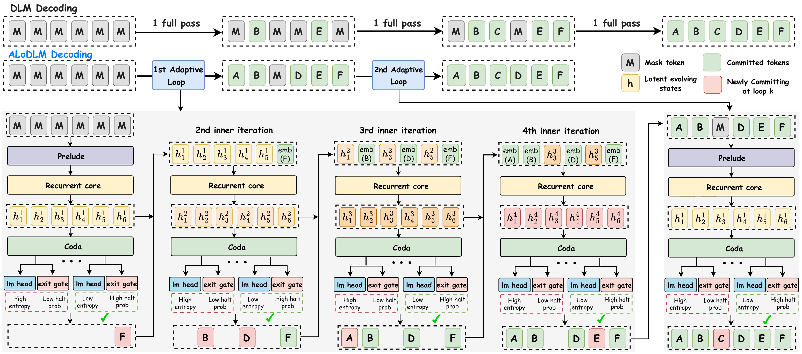
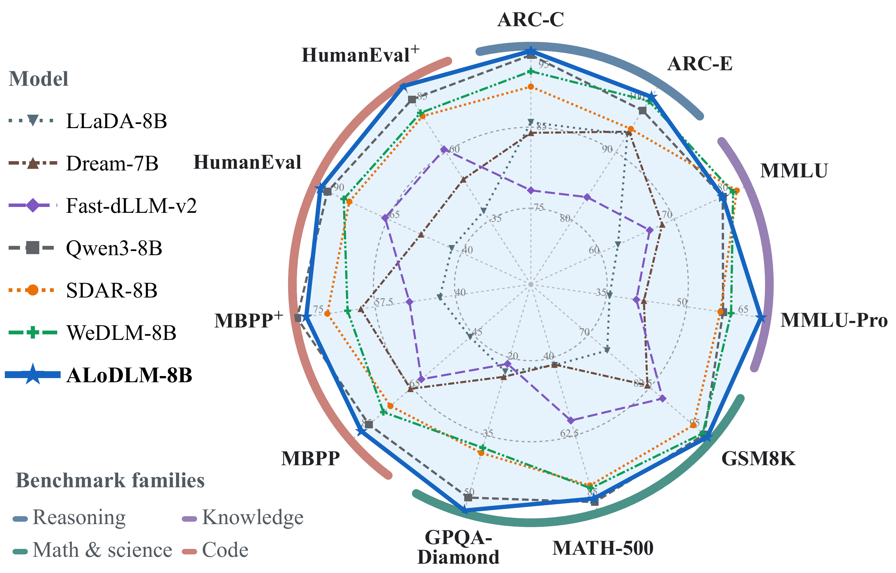
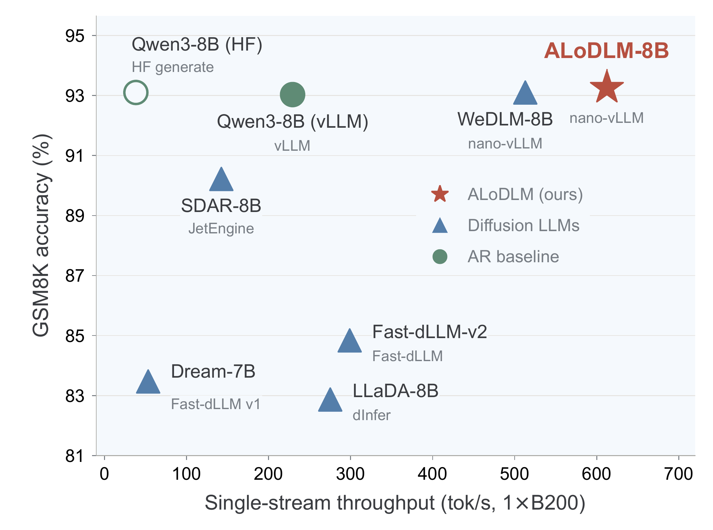
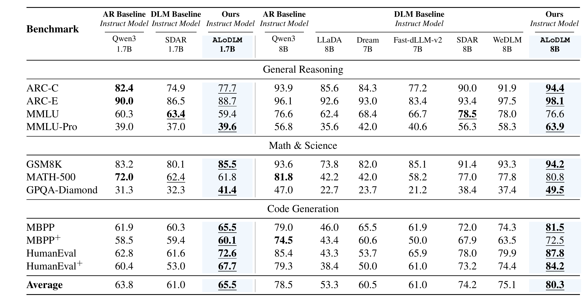

# ALoDLM: Adaptively Looped Diffusion Language Models

**Paper:** [ALoDLM: Adaptively Looped Diffusion Language Models](https://huggingface.co/papers/2610.04198) · **Project page:** [https://alo-dlm.github.io/](https://alo-dlm.github.io/)

ALoDLM is a family of diffusion language models developed at Amazon, available as **ALoDLM-1.7B** and **ALoDLM-8B** and initialized from the corresponding Qwen3 backbones. The models generate text and code by repeatedly applying shared transformer layers, preserving unresolved tokens' latent states, and adaptively allocating computation across token positions.

Training data includes mathematical problems and worked solutions, programming tasks and code solutions, and instruction-formatted text.

**Models:** [ALoDLM-1.7B](https://huggingface.co/amazon/ALoDLM-1.7B) · [ALoDLM-8B](https://huggingface.co/amazon/ALoDLM-8B)  
**Code:** [amazon-science/ALoDLM](https://github.com/amazon-science/ALoDLM)  
**License:** [Creative Commons Attribution-NonCommercial 4.0 International](LICENSE)

## Research overview

**ALoDLM: Adaptively Looped Diffusion Language Models** studies how to allocate computation while generating multiple tokens in parallel. In masked diffusion, some unknown positions can be resolved from the available context, while others benefit from further refinement. A fixed-depth denoiser applies the same computational depth to every position. Our research explores whether preserving and refining latent states within each denoising step can improve this allocation.

ALoDLM adds adaptive recurrence to shared transformer layers. Tokens that commit early provide resolved context for the remaining positions. Unresolved tokens retain their hidden states and refine them through additional recurrent passes. Predictive confidence controls token commitment, while a learned halting policy determines when to end the recurrent loop.

The work develops three components:

- **Persistent latent refinement:** reuse shared layers to refine unresolved representations across recurrent passes.
- **Learned computation allocation:** treat token-wise computation schedules as latent variables and derive a conditional negative evidence lower bound for jointly learning token prediction and computation allocation.
- **Inference-time control:** use the gate threshold `q` and entropy threshold `τ` to explore the trade-off between recurrent refinement and parallel token commitment.



*Decoding overview from the paper.* Committed tokens provide discrete context while unresolved tokens retain latent states for further refinement. The expanded schematic shows the recurrent core and its readouts; prefix and suffix transformer blocks are optional components of the architecture.

### Research performance



*Benchmark profile from the paper's 8B comparison.* Each spoke represents one benchmark; farther outward indicates a higher score. Compare models along each spoke, since the axes use different score ranges. The table in [Evaluation](#evaluation) reports both model sizes.



*Inference efficiency from the paper's 8B experiments.* The plot compares GSM8K accuracy with single-stream generation throughput on one NVIDIA B200 GPU, using the optimized inference engine named for each model. The throughput measurements use parallel commitment, a separate operating mode from the quality comparison below. They do not report 1.7B throughput or establish the speed of the portable decoder.

## Intended use

The models support noncommercial research on diffusion language modeling, adaptive computation, mathematical reasoning, and code generation, including the effects of changing inference-time computation.

Downstream use requires evaluation for the intended application. The reported benchmarks do not establish readiness for autonomous operation or decisions with significant consequences.

## Evaluation

The following table reproduces **all model columns and scores from Table 1** in *ALoDLM: Adaptively Looped Diffusion Language Models*. All scores are percentages.

The paper follows the OpenCompass evaluation protocol adopted by SDAR, using each model's native chat template, greedy token selection, and a 4,096-token generation limit. Both ALoDLM models use a 16-token window, with mean cumulative halting threshold **`q = 0.4` for 1.7B** and **`q = 0.5` for 8B**. Each recurrent pass commits one token, with entropy-based selection disabled (`τ` is inactive); successive recurrent passes can commit multiple tokens within a denoising step.

Qwen3 models are autoregressive (AR) baselines; SDAR, LLaDA, Dream, Fast-dLLM-v2, and WeDLM are diffusion language model (DLM) baselines. As in the paper, **bold** marks the best overall score within each size group, and <u>underlining</u> marks the best non-AR score. ALoDLM columns are shaded in blue in the rendered table.



<details>
<summary>View the full results as text</summary>

| Benchmark | Qwen3-1.7B | SDAR-1.7B | **ALoDLM-1.7B** | Qwen3-8B | LLaDA-8B | Dream-7B | Fast-dLLM-v2-7B | SDAR-8B | WeDLM-8B | **ALoDLM-8B** |
|---|---:|---:|---:|---:|---:|---:|---:|---:|---:|---:|
| ARC-Challenge | **82.4** | 74.9 | <u>77.7</u> | 93.9 | 85.6 | 84.3 | 77.2 | 90.0 | 91.9 | **<u>94.4</u>** |
| ARC-Easy | **90.0** | 86.5 | <u>88.7</u> | 96.1 | 92.6 | 93.0 | 83.4 | 93.4 | 97.5 | **<u>98.1</u>** |
| MMLU | 60.3 | **<u>63.4</u>** | 59.4 | 76.6 | 62.4 | 68.4 | 66.7 | **<u>78.5</u>** | 78.0 | 76.6 |
| MMLU-Pro | 39.0 | 37.0 | **<u>39.6</u>** | 56.8 | 35.6 | 42.0 | 40.6 | 56.3 | 58.3 | **<u>63.9</u>** |
| GSM8K | 83.2 | 80.1 | **<u>85.5</u>** | 93.6 | 73.8 | 82.0 | 85.1 | 91.4 | 93.3 | **<u>94.2</u>** |
| MATH-500 | **72.0** | <u>62.4</u> | 61.8 | **81.8** | 42.2 | 42.0 | 58.2 | 77.0 | 77.8 | <u>80.8</u> |
| GPQA-Diamond | 31.3 | 32.3 | **<u>41.4</u>** | 47.0 | 22.7 | 23.7 | 21.2 | 38.4 | 37.4 | **<u>49.5</u>** |
| MBPP, sanitized | 61.9 | 60.3 | **<u>65.5</u>** | 79.0 | 46.0 | 65.5 | 61.9 | 72.0 | 74.3 | **<u>81.5</u>** |
| MBPP+ | 58.5 | 59.4 | **<u>60.1</u>** | **74.5** | 43.4 | 60.6 | 50.0 | 67.9 | 63.5 | <u>72.5</u> |
| HumanEval | 62.8 | 61.6 | **<u>72.6</u>** | 85.4 | 43.3 | 53.7 | 65.9 | 78.0 | 79.9 | **<u>87.8</u>** |
| HumanEval+ | 60.4 | 53.0 | **<u>67.7</u>** | 79.3 | 38.4 | 50.0 | 61.0 | 73.2 | 74.4 | **<u>84.2</u>** |
| **Average** | 63.8 | 61.0 | **<u>65.5</u>** | 78.5 | 53.3 | 60.5 | 61.0 | 74.2 | 75.1 | **<u>80.3</u>** |

</details>

Non-code benchmarks report accuracy or exact match; coding benchmarks report execution-based pass@1. The average is the unweighted mean of the eleven benchmark scores.

## Getting started

Use Python 3.12 and clone the accompanying ALoDLM code. Choose either inference environment below; training is not required to try the released weights:

```bash
git clone https://github.com/amazon-science/ALoDLM.git
cd ALoDLM
```

### Optimized inference

Install the bundled ALoDLM-aware nano-vLLM engine in a dedicated Linux CUDA environment on an NVIDIA GPU supporting BF16:

```bash
python3.12 -m venv .venv-inference
source .venv-inference/bin/activate
python -m pip install --upgrade pip
python -m pip install ./optimized

alodlm-generate-optimized \
  --model amazon/ALoDLM-8B \
  --mode entropy \
  --q 0.5 \
  --tau 0.4 \
  --max-new-tokens 512 \
  --prompt "Write a Python function that returns the greatest common divisor of two positive integers."
```

Set `--model amazon/ALoDLM-1.7B` to use the smaller model, or supply a local model directory. The command downloads the model files when needed, reads their recurrence configuration, and runs entropy-based parallel commitment with adaptive CUDA graphs. The engine and cache repair are included in the code repository. See its [inference guide](https://github.com/amazon-science/ALoDLM/blob/main/docs/inference.md) for runtime settings.

### Portable inference

The portable PyTorch decoder uses Python 3.10 or later, PyTorch 2.8.0, and Transformers 4.56.1. Install it in a separate environment:

```bash
python3.12 -m venv .venv
source .venv/bin/activate
python -m pip install --upgrade pip
python -m pip install .
```

Generate with the portable decoder on a CUDA GPU supporting BF16. Use `amazon/ALoDLM-1.7B` for the smaller model or a local model directory for offline use. The command downloads the required inference files when needed:

```bash
alodlm-generate \
  --model amazon/ALoDLM-8B \
  --device cuda \
  --precision bf16 \
  --mode entropy \
  --q 0.5 \
  --tau 0.4 \
  --position-penalty 0.02 \
  --window-size 16 \
  --max-new-tokens 512 \
  --prompt "Write a Python function that returns the greatest common divisor of two positive integers."
```

Entropy mode enables parallel token commitment and is also used when `--mode` is omitted. `q` controls the gate-based stopping threshold and `τ` controls entropy-based commitment. The command applies the checkpoint's chat template with thinking disabled by default; add `--thinking` to enable the template's thinking mode.

The local checkpoint directory must contain the backbone configuration and weights, tokenizer files, `exit_gate.pt`, and `alodlm_config.json`. The supplied recurrence configuration selects the portable SDPA backend. Loading only the Qwen3 backbone with a standard Transformers generation pipeline omits ALoDLM's recurrent decoding and learned exit gate.

### Setup notes

The GPU must have enough memory for the weights, KV cache, and runtime workspace. The optimized 8B path has been checked on an A100 with 40 GB of GPU memory. Use the smaller model or reduce the context and output budget when memory is limited. For portable CPU inference, select `--device cpu --precision fp32`; generation will be slower and requires sufficient system RAM.

Public model downloads require no login. If a repository is private or gated, run `hf auth login` using an account with access. See the [inference troubleshooting guide](https://github.com/amazon-science/ALoDLM/blob/main/docs/inference.md#download-and-access-troubleshooting) for missing files, access errors, and GPU setup.

## Limitations and risks

- The models can produce incorrect reasoning, fabricated facts, biased or offensive text, and code with functional or security defects. Review generated content and test generated code before use.
- Inference speed varies by domain, prompt, and dataset. Even with identical hardware and inference hyperparameters, adaptive recurrent refinement and parallel token commitment can produce different throughput and latency across inputs. Reported speeds and speedups should not be expected to hold for every workload.
- Evaluation primarily covers English reasoning and programming tasks. Performance across other languages, domains, and demographic groups has not been established by the reported results.
- Long-context performance beyond the evaluated settings has not been established.
- Changing the gate threshold, commitment rule, or token budget can change accuracy and computation. Additional passes do not guarantee a better answer.
- The reported capability benchmarks do not constitute a comprehensive safety, privacy, fairness, or robustness evaluation. The models may retain limitations of their base models and training data.

## Responsible AI Considerations

At Amazon, we are committed to developing AI responsibly and take a people-centric approach that prioritizes education, science, and our customers, to integrate responsible AI across the end-to-end AI lifecycle. We believe the use of AI must respect the rule of law and human rights, and we encourage the safe and responsible development of AI. When downloaded or used in accordance with [AWS Responsible AI Policy](https://aws.amazon.com/ai/responsible-ai/policy/), developers should work with their internal model team to ensure this model meets requirements for the relevant industry and use case and addresses unforeseen product misuse.
Please report model quality, risk, security vulnerabilities or Amazon AI Concerns [here](https://pages.awscloud.com/global-ln-gc-400-ai-service-cards-contact-us-registration.html).

## License and attribution

The released model weights are licensed under [CC BY-NC 4.0](LICENSE). Use and redistribution must comply with the license, including its attribution and noncommercial requirements.

ALoDLM-1.7B is derived from [Qwen3-1.7B](https://huggingface.co/Qwen/Qwen3-1.7B), and ALoDLM-8B is derived from [Qwen3-8B](https://huggingface.co/Qwen/Qwen3-8B). Both base models were developed by the Qwen team and released under Apache 2.0. The [upstream Apache 2.0 license](licenses/Qwen-Apache-2.0.txt) and [attribution notice](NOTICE) accompany each model. Retain applicable upstream license and attribution notices when redistributing the models.