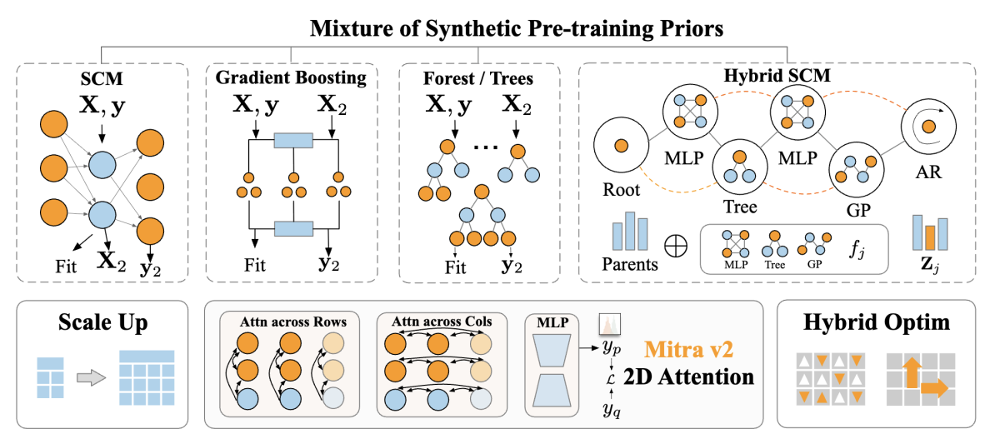
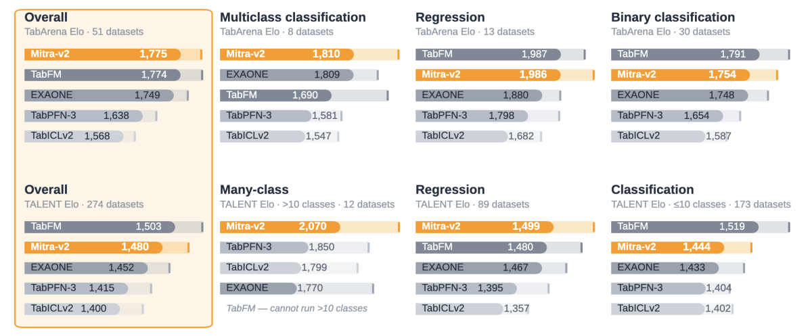

> [!tldr]
> Mitra-v2在基本不加深网络的前提下扩展合成表格分布：更长的行上下文、更多列、混合SCM先验，并给回归加1000-bin分布头。核心判断：它既有纯ICL能力，也有带8折、50步全参适配的公开高分recipe；不能把后者宣传成无需训练的零样本结果。

> [!warning] 日期与资料深度
> Amazon官方2026-11-10博客明确“今天介绍第二代并发布分类/回归版本与代码”，以该公开发布声明日收录。报告编号2609表明9月已有方法材料，不能把11月博客冒充方法首次出现；实际权重最早开放日尚未核实。已读分类/回归两卡、完整微调recipe、官方博客与两张图。完整技术报告只留链接未读，未运行训练/预测，资料充分度显著低于完整报告精读。

## 定位、发布与模型边界

> [!tldr]
> 分类、回归与微调代码组成一个表格专项family，不各拆新正代。Amazon官方链接核验了autogluon发布账号，后续巡检补查该账号。

| 项目 | 分类 | 回归 |
|---|---|---|
|结构|12层2DTransformer，跨行/列注意力|相同骨干|
|参数|75.7M|76.7M|
|输出|原生10类head；更多类层次分解|1000-bin分布head；点预测为分布均值|
|数据|纯合成表，非客户真实表预训练|纯合成表|
|许可|Apache2.0|Apache2.0|

10倍行数、约3倍列数是相对前代的预训练范围扩展，不是推理时任意无限表格。此前SCM/树生成器之外，Hybrid SCM在单一因果图中混合神经网络、树、Gaussian Process、时间自回归关系；这是生成机制的先验设计，不证明现实业务变量具有已识别因果关系。新优化器被描述为hybrid，完整公式未从未读报告补造。

## 适配recipe、数据隔离与推理

> [!tldr]
> 默认高分管线是每表适配并bagging。fit存数据，predict才在子进程中执行bagged fine-tune，调用两次预测接口可能重新训练；预算需覆盖真实执行路径。

| 公开冻结配置 | 数值 / 行为 |
|---|---|
|全参FT|50步；lr1e-5、warmup10、weight decay0.3|
|bagging|8折子模型，预测均值；最佳验证checkpoint|
|小型二分类例外|训练行数≤16384时lr3e-6|
|宽表>256列|分类默认dtype-gated top-K选择；回归默认truncated SVD到256，不是两者都SVD|
|FT支持集cap|分类16384；回归20480|
|预测支持集cap|二类16384；多类/回归32768|
|二分类采样|class-balanced，非统一随机|
|评测控制|task time_limit3600；每bag child FT250s；超时保留已完成children，需要显式开启环境开关|

默认heldout-in-support：每child在训练fold上适配，用自己的heldout fold验证；预测测试集时把原外层训练表（含该child heldout）作ICL支持。这里用的是训练/验证标签，不是测试标签。另一个默认关闭开关可把外部验证集加进测试预测support；验证预测本身仍train-only。比较训练数据边界时须固定这些开关，不能只写“8折”。

回归每child在其训练fold目标范围归一化后定义1000bin，直方图均匀bin内质量的等权混合支持mean、CDF、quantile、log_prob、CRPS。不同children边界不同；给出预测区间不自动保证域外覆盖率或校准。stock AutoGluon v1回归head不兼容本1000-bin，需配套包，不能套旧接口推定同指标。

源码README把速度优化与recipe分开：大query chunk减少重复编码，支持集超cap时仍每chunk重采样。十个相关表90split，50胜40负，几何误差比1.0001，不是逐任务bit-identical。可选support cache默认关闭；超cap时会固定一次support抽样，改变随机过程，不能把其约5倍预测加速当所有任务总加速。

## 实验、时间协议与研究启发

> [!tldr]
> 公开Elo、完整原图和可追溯recipe支持有价值的比较，但“1小时预算”与最大墙钟1.4小时并非同一陈述，缺完整报告/逐任务复测时保留这个差异。

| 官方披露 | 结果与边界 |
|---|---|
|TabArena|51数据集；主张single-model field领先；不是所有AutoML系统总榜无条件第一|
|对v1可原生比较|33数据集中的32项改善，不代表全部51项都有对照|
|TabArena默认配置Elo|总体1774.6，分类1756.3，回归1985.6；不同榜口径不可平均|
|TALENT|约300数据集，强调>10类；未从图或摘要编造完整逐表分数|
|ScoringBench|官方称FT版本第一；无完整数表/置信区间，不造CRPS数值|
|已发布38分类artifact计时|H100每评估单位均值0.3h、最大1.4h（APSFailure）|

博客称所有51任务完成1h协议；recipe把3600s任务预算、250s/child与保留children开关列得更具体，但同时披露最大墙钟1.4h。它们可能统计范围不同，公开片段不足以确定原因，因此不能改写成严格端到端60分钟内完成所有任务。原文/recipe与该缺口一起保留。

> [!warning] 官方图中的非领先项
> TabArena图中Mitra-v2整体1775与TabFM1774接近，但回归1986低于TabFM1987，二分类1754低于TabFM1791；TALENT274数据集整体1480低于TabFM1503，≤10类分类1444低于1519。多分类/回归的部分优势不能概括为全任务领先；图中取整与模型卡小数口径分开保留。

> [!insight]
> 对Agent训练，扩大可验证合成任务分布比只加深网络更值得做受控实验。固定骨干、FT预算、验证策略与bag数量，分别消融生成先验、行列范围、支持集选择及优化器；把训练与预测实际执行时间、超时策略和失败折数记入每成功成本。把真实业务表留作独立评测，不能用同一表逐任务调参后再宣称零样本泛化。

- [11/10 Amazon官方发布博客](https://www.amazon.science/blog/mitra-v2-scaling-synthetic-pretraining-for-tabular-foundation-models)
- [分类卡](https://huggingface.co/autogluon/mitra-classifier-2) · [回归卡](https://huggingface.co/autogluon/mitra-regressor-2)
- [完整FT recipe与评测artifact入口](https://huggingface.co/autogluon/mitra-finetune)
- [技术报告链接，未读](https://arxiv.org/abs/2609.04540)

> 📊 相关可视化: [[mitra_v2_poster_zh.html|中文Poster]]
