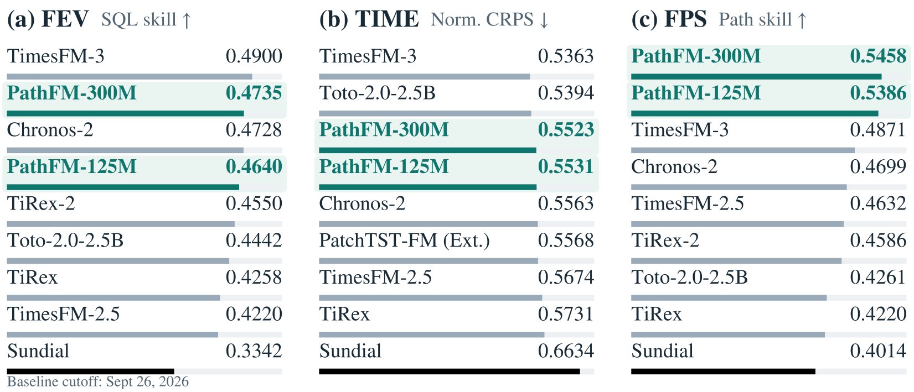
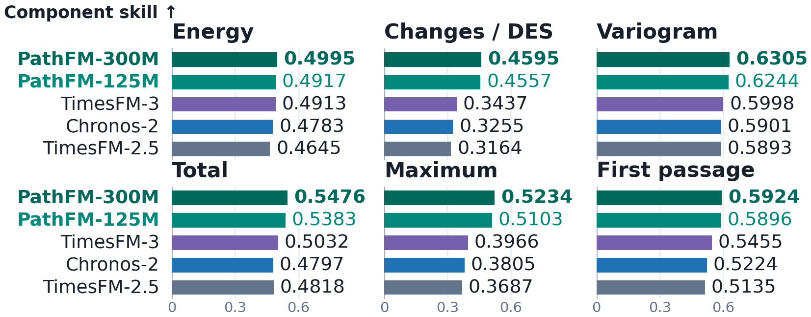
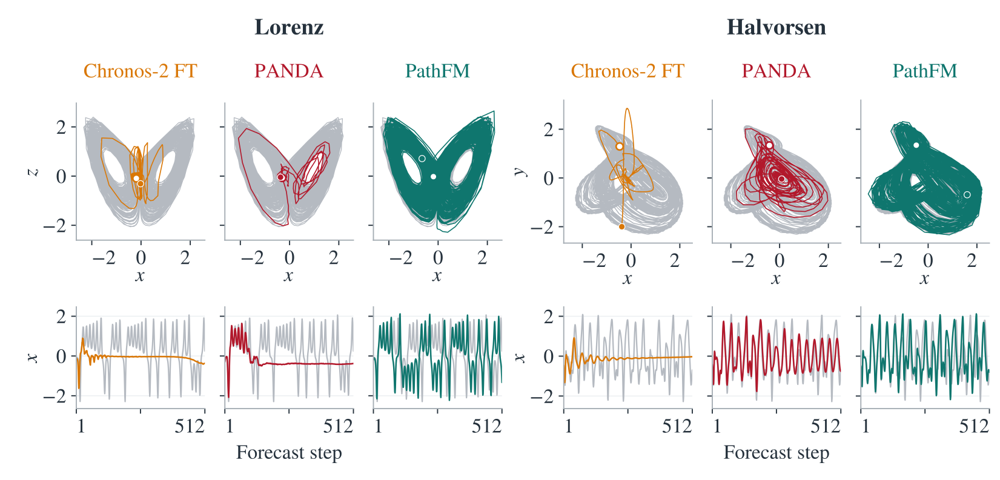

> [!tldr]
> PathFM的关键是直接采样联合未来轨迹，让峰值、总量与首次越阈时间在同一条路径上可计算；它用缓存历史、PDD蒸馏和fair CRPS将通用预测缩到一步。混沌专项仍默认10步Euler，不能把“所有模型一步”当作家族统一属性。

> [!warning] 时间与阅读范围
> 四个官方HF提交分别明确Release PathFM，均在2026-10-30 23:56北京时间，合并为一个family；不按11/11巡检或lastModified记新发布。论文v1标10/15，属于方法论文时间，与公开checkpoint区分。本轮已读四卡、论文HTML正文方法/实验及附录B/C/F关键协议、官方README；未下载PDF/权重、未独立执行。完整逐实现对应、全部附录与数据去污染仍待核，不声称所有实验已复现。

## 预测对象、家族与公开版本

> [!tldr]
> 通用125M/300M、Chaotic75M/125M合一预测专项。边际分位数无法唯一确定时间/通道依赖，联合路径才支持累积量和事件统计。

| 型号 | 层/FFN宽 | 共有结构 | 原生输出与采样 |
|---|---|---|---|
|125M通用|12/3072|宽768、12heads、patch16|480步，一步并行解码|
|300M通用|30/3072|宽768、12heads、patch16|480步，一步并行解码|
|Chaotic75M|11/768|宽768、12heads、patch16|256步/block，10步Euler|
|Chaotic125M|12/3072|宽768、12heads、patch16|256步/block，10步Euler|

论文给flow125.1M、带PDD头126.3M，大模型带头296.3M；保留125M/300M仓库名作为家族标签，不以近似命名改写精确口径。HF卡写context512，而GitHub和论文通用训练上限8192；512可作为示例/混沌上下文，但不能未经代码核验删除HF原始差异。许可为CC BY-NC4.0，不能称允许任意商业用途。

同样的每时刻边际分位数可以配独立或共同秩，从而得到完全不同的峰值、总量与事件时间分布。PathFM以每条完整采样路径计算下游函数，再统计结果；这不保证现实分布完全校准，增加样本也不能消除模型偏差。

## Flow训练、PDD与校准

> [!tldr]
> 教师在学生访问状态给局部速度监督，既不需要完整教师rollout，也不等于只在真实样本上做蒸馏。独立训练采样和推理分层采样用途不同。

历史均值/尺度归一化后做asinh，噪声标准差0.75。flow matching沿噪声到未来的直线学习速度，mask排除缺失值、已知未来协变量与padding。T5式主干分时序和通道attention，输入patch16；先用无flow输入的entry层处理历史、register与未来占位符，再注入flow状态。后续历史只看历史、未来看两者，使历史计算可在不同路径与flow步复用。四个训练draw共享历史，论文称约1.5倍成本换4倍监督，不当端到端推理提速。

PDD把[0,1]切20段，仿射interval heads共享backbone特征；20段合成1次、两个10段块为2次。学生提出中间状态，冻结教师给该状态速度，状态与教师target停止梯度；不沿教师完整ODE路径逐步追踪。校准阶段保留PDD，并通过一次可微采样对8条iid路径的fair CRPS反传，两个loss系数均1。fair版本修正小样本经验CRPS偏爱过窄分布的问题；它针对边际评分，路径依赖仍需FPS单独验收。

| 通用训练阶段 | 更新数 | 峰值LR | warmup | EMA |
|---|---:|---:|---:|---:|
|Flow matching|2000000|5e-5|2000|0.9999|
|WSD末段衰减|100000|5e-5→0|无|0.9999|
|PDD|100000|3e-5|500|0.999|
|PDD+fair CRPS|100000|1e-5|无|0.999|

共2.3M更新；AdamW(0.9,0.99)、clip1，每更新1024 channel rows；flow/WSD wd0.01。83M行真实/合成时序、训练context≤8192、horizon≤480。Transformers从头初始化但保留可训练Chronos2输入embedding，不能称所有参数完全随机从零。校准126M线性衰减，300M恒定；PDD新建优化器，校准接续优化器与EMA。

## 完整结果、采样预算与研究判断

> [!tldr]
> 路径分数领先不等于边际分数或延迟全面领先；通用一步与混沌十步、32路径与16路径必须区分。

| 通用checkpoint |FEV↑|FPS↑|TIME MASE↓|TIME CRPS↓|GIFT MASE↓|GIFT CRPS↓|
|---|---:|---:|---:|---:|---:|---:|
|125M|0.4640|0.5386|0.6560|0.5531|0.7073|0.4878|
|300M|0.4735|0.5458|0.6538|0.5523|0.7008|0.4818|

FPS在94个有效FEV任务上，32路径，综合Energy、差分Energy、Variogram与总量/最大值/首次越阈CRPS。边际模型取independent与comonotone两种补全中聚合更好者，仍不是所有可能copula的最优。图中TimesFM3 FEV0.4900与TIME0.5363优于PathFM300M0.4735/0.5523；PathFM300M FPS0.5458更高。原图基线截止9/26，不能称覆盖11月所有模型。

论文累计消融R2→R3启用history-only时FEV0.4468降0.4356、FPS0.4960升0.5008；不是每组件全面提升。R7→R8同权重分层采样FPS0.5248→0.5329，配对95%task-bootstrap增益区间[0.0042,0.0131]。不可用累计消融直接归因单一模块的独立贡献。固定权重将iid样本32增至1024，80%边际覆盖率增加约4pp，说明有限样本本身影响校准估计。

L4端到端延迟：context2048、horizon288、32paths，7block共35次测量中位数、warmup后CUDA同步。单history一步51.6ms、两步96.4ms；16history一步215.2ms（平均每history13.5ms不是单请求时延）。Chronos2路径22.5ms、TiRex2为27.6ms更快；不能称全模型最快。

| 模型 |sMAPE64↓|128↓|256↓|state W1↓|spectral H²↓|CD err↓|
|---|---:|---:|---:|---:|---:|---:|
|PANDA|19.0921|24.4189|31.9446|0.5885|0.1946|0.5366|
|Chaotic75M|16.9402|22.1646|28.2200|0.2633|0.0626|0.2856|
|Chaotic125M|16.4464|21.5160|27.4294|0.2507|0.0608|0.2734|

短期sMAPE按480 source groups均权；长程4096步、135系统、两个起点512/4096，每起点16条独立续跑；W1等先组内算术平均再系统平均。论文短期点预测用16分层样本中位数反馈，长程是每路径独立反馈，不能把两者当同一rollout协议。混沌训练2M FM+100K衰减、384channel rows、lr1e-4、EMA0.999、噪声0.86；非通用PDD+CRPS四阶段直接照搬。HF原图写Halvorsen，GitHub图说明写Rössler，需按各原图核对，本文不替来源改名。

> [!insight]
> 可以把预测轨迹作为决策环境的候选未来，但预测模型只负责分布，不直接证明策略收益。先固定信息截点、样本数、flow步数、上下文和动作成本，再评估峰值/累积约束与实际后悔值。训练reward若只优化边际CRPS，会漏掉跨时依赖错误；路径分数、罕见事件误差和分布漂移应独立验证。

- [四张官方卡](https://huggingface.co/autogluon/pathfm-125m)；同目录300M/Chaotic合并
- [官方代码与README](https://github.com/autogluon/PathFM)
- [论文HTML](https://arxiv.org/html/2610.22358v1)，PDF不下载
- [[pathfm_poster_zh.html|中文Poster]]
