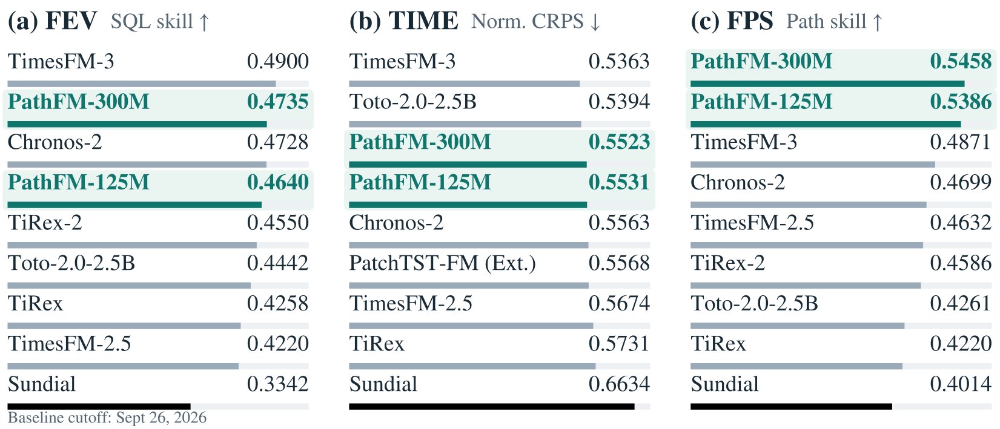
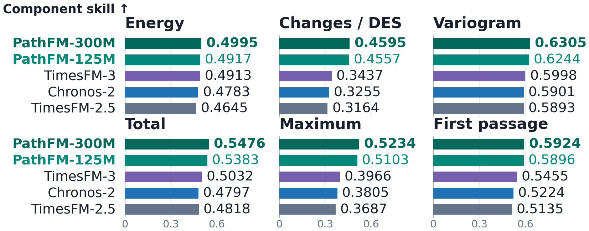

# PathFM-300M

PathFM makes trajectory forecasting fast and practical.
It generates multivariate futures in one step with competitive marginal accuracy and leading trajectory quality.
Get sample paths, quantiles, and other higher-order statistics through one model.

Our model also demonstrates strong performance in short- and long-horizon chaotic systems.
Chaotic models: [75M](https://huggingface.co/autogluon/pathfm-chaotic-75m) and [125M](https://huggingface.co/autogluon/pathfm-chaotic-125m).

## Model Details

- **Layers:** 30 transformer layers.
- **Hidden Dimension:** 768.
- **Attention Heads:** 12 (64 dimensions per head).
- **Feed-forward Dimension:** 3,072.
- **Patch Length:** 16 time steps.
- **Context Length:** 512 observed steps.
- **Forecast Horizon:** up to 480 steps with one model call.
- **Default Sampler:** one-step parallel decoding.

## Performance

| Model | FEV skill ↑ | FPS skill ↑ | TIME MASE ↓ | TIME CRPS ↓ | GIFT MASE ↓ | GIFT CRPS ↓ |
|---|---:|---:|---:|---:|---:|---:|
| [PathFM-125M](https://huggingface.co/autogluon/pathfm-125m) | 0.4640 | 0.5386 | 0.6560 | 0.5531 | 0.7073 | 0.4878 |
| [PathFM-300M](https://huggingface.co/autogluon/pathfm-300m) | 0.4735 | 0.5458 | 0.6538 | 0.5523 | 0.7008 | 0.4818 |

FPS combines six complementary component skills to evaluate complete forecast trajectories on general corpus, capturing temporal dependencies rather than only the marginal distribution at each forecast step.

## Code

For installation, inference examples, and benchmark evaluation, see [autogluon/PathFM](https://github.com/autogluon/PathFM).
