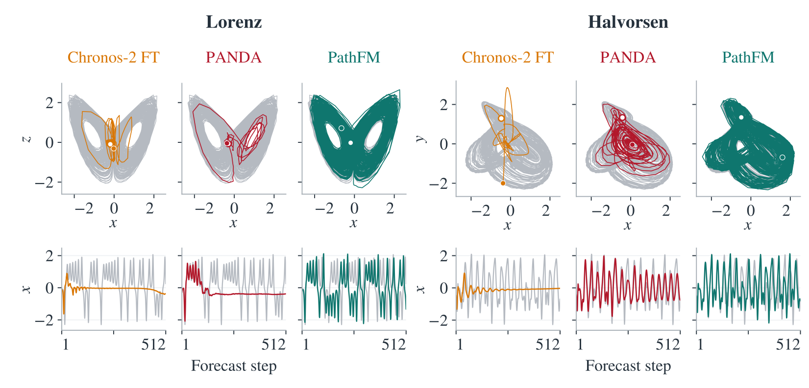

# PathFM-Chaotic-125M

Explore the possible futures of a chaotic system with ensembles of evolving trajectories.
PathFM-Chaotic produces trajectories that better match the long-run distributions than other models, while maintaining competitive short-horizon accuracy.

For general time-series forecasting, see [PathFM-125M](https://huggingface.co/autogluon/pathfm-125m) and [PathFM-300M](https://huggingface.co/autogluon/pathfm-300m).

## Model Details

- **Layers:** 12 transformer layers.
- **Hidden Dimension:** 768.
- **Attention Heads:** 12 (64 dimensions per head).
- **Feed-forward Dimension:** 3,072.
- **Patch Length:** 16 time steps.
- **Context Length:** 512 observed steps.
- **Forecast Horizon:** 256 steps per block.
- **Sampler:** 10-step Euler.

## Performance

*Figure: PathFM-Chaotic-125M with 10-step Euler sampling.*

| Model | sMAPE@64 ↓ | sMAPE@128 ↓ | sMAPE@256 ↓ | State-space W1 ↓ | Spectral H² ↓ | CD err. ↓ |
|---|---:|---:|---:|---:|---:|---:|
| [PANDA](https://huggingface.co/GilpinLab/panda-72M) | 19.0921 | 24.4189 | 31.9446 | 0.5885 | 0.1946 | 0.5366 |
| **[PathFM-Chaotic-75M](https://huggingface.co/autogluon/pathfm-chaotic-75m)** | **16.9402** | **22.1646** | **28.2200** | **0.2633** | **0.0626** | **0.2856** |
| **[PathFM-Chaotic-125M](https://huggingface.co/autogluon/pathfm-chaotic-125m)** | **16.4464** | **21.5160** | **27.4294** | **0.2507** | **0.0608** | **0.2734** |

Short-horizon accuracy is mean sMAPE across 480 source groups in PANDA's evaluation dataset.
State-space W1 (sliced Wasserstein-1), spectral H², and CD err. (absolute correlation-dimension error) use 4,096-step continuations.
For each metric, we take the arithmetic mean over all path–origin realizations within each system, then the arithmetic mean across 135 DYSTS systems, following the final paper.
PathFM uses 16 sampled paths at each of two forecast origins (512 and 4,096).

## Code

For installation, inference examples, and benchmark evaluation, see [autogluon/PathFM](https://github.com/autogluon/PathFM).
