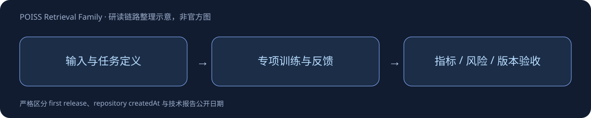

# POISS Retrieval Family

> [!tldr]
> BGE-M3地理位置检索与reranker，共用一个专项family；精确首发日待核实。 语义和地理坐标共同决定相关性，bi-encoder独立编码query/地点，ANN召回后可用cross-encoder精排。InfoNCE加hard negatives，使名称相似但位置或质量不合适的候选得到区分。

## 一页速览

| 项目 | 当前证据 |
|---|---|
| 日期 | 2026-09 （确切首发待核实） |
| 归属 | amazon · 专项支线 |
| 关键事实1 | Overture 72M+ POIs |
| 关键事实2 | 测试42018 queries |
| 关键事实3 | 全库 R@100 83.2% |

## 把坐标作为检索语义的一部分

以四位小数经纬度写入query与地点模板，7种欧美语言、72M+Overture地点。Bi-encoder离线编码地点，CLS末层表示L2归一化并做ANN检索；不能把query模板改成随意自然语言后假定相同表现。

| 全库42018 query测试 | R@10 | R@100 | R@1K |
|---|---:|---:|---:|
| BM25 | 17.8 | 29.9 | 42.8 |
| BGE-M3 zero-shot | 15.2 | 26.4 | 40.0 |
| 领域微调 | 45.2 | 83.2 | 95.6 |

Search/Detail的R@100为89.1/88.0，Recommend/Things-to-do为77.3/74.0，开放意图更难。高召回只是候选覆盖，不是最终推荐质量。

## 训练与复现

254089train、13374validation，Overture2026-03-18语料；InfoNCE、可学习temperature初始.01，每query挖100hard negatives、每步采4，AdamW2e-5、16×8GPU、最多20epochs，按validationMRR早停，选择epoch19、MRR.8828。

query截断128、POI160；末尾空格要去掉。Retriever没有rating/review/quality输入，质量分由companion cross-encoder消费，不可声称retriever直接学习了点评质量。checkpoint转换位级相同，但BF16/flash attention使指标约1e-3误差，临近rank20的交换能改变nDCG。

> [!warning] 日期与阅读范围
> 已读Retriever card；Reranker全文仍待独立精读。9月18日createdAt不能证明正式首发，当前9月待核实，不计入精确日期30日表。

## 对 Agent Training 的判断

> [!insight]
> 地理检索应固定坐标精度、模板、语料版本与召回候选池。高召回不代表最终推荐满足用户偏好，模型没有消费评分的部分不能声称学习了地点质量。

以上是基于已读材料的研究判断，未在本机复现模型推理或训练结果。

## 官方来源与导航

- [S1] [HF Model Card · Retriever](https://huggingface.co/amazon/poiss-bge-m3-retriever)
- [S2] [HF Model Card · Reranker](https://huggingface.co/amazon/poiss-bge-m3-reranker)

- [[src/retrieval_manifest.json|原始抓取记录]]
- [[poiss_retrieval_family_poster_zh.html|中文Poster]]
- [[Topics/13_base_model/Base Model MOC|基模主题索引]]

> 📊 相关可视化: [[poiss_retrieval_family_poster_zh.html|中文研究Poster]]
