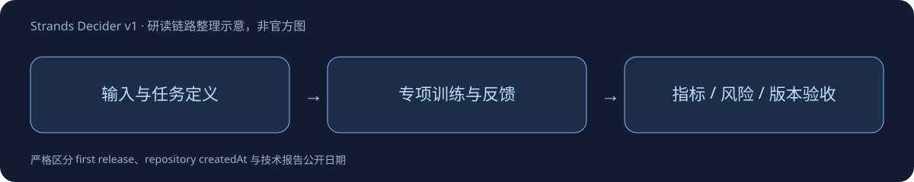

# Strands Decider v1

> [!tldr]
> 五种尺寸/基座合并family，用校准概率承担路由、工具选择和规则判断，不是通用生成模型。 LoRA adapter加typed-question readout，支持choice、noul、score。teacher在与gold一致时提供概率分布，保留v19行为作KL anchor，三个seed权重平均后再按primitive做温度校准。

## 一页速览

| 项目 | 当前证据 |
|---|---|
| 日期 | 2026-10-09  |
| 归属 | amazon · 专项支线 |
| 关键事实1 | 246678条训练记录 |
| 关键事实2 | v19 anchor KL权重0.3 |
| 关键事实3 | 三随机种子权重soup |

## 不是小 LLM 聊天接口

本checkpoint是Qwen3.5-2B-Base的LoRA与读出head；同family还有Gemma4多个尺寸。模型选选项、回答yes/no或给离散等级，返回校准confidence。它适合路由、工具选择、参数检查、规则应用，不生成任意长文本。

## 数据与监督闭环

246678条数据中，short80449、multi-step12909、generated3815、adequacy6166、code24533、gap-fill96638、rule application22168。移除有商业使用限制的数据，新增代码与规则应用。Gemma4-31B teacher概率只在回答与gold相符时用于训练；规则文本和案件由模型写，gold由代码计算，Claude仅作独立过滤，文本不进入数据。

三seed权重soup、v19 KL anchor权重0.3，再按primitive做单温度校准。基座revision在原训练主机未固定，由provenance推断，因此不能宣称完全固定了训练输入版本。训练配置公开，但数据builder尚未进入main，原始数据不能从main完整重建。

## Confidence 的失效值得单独记录

视觉塔未进行图像训练；NaturalBench和POPE评测仅用有限子集。缺图时仍会高confidence作答，POPE平均0.834且ECE0.334，官方明确不能用confidence检测缺图。长多步文档、陌生rubric与yes/no任务亦较弱。必须先验证输入存在，再在真实流量上测校准与升级阈值。

9月的hobson-v19/v21不按v1新名重复登记，当前首次release由card changelog明确10月9日。正文没有官方技术配图，本文用标注为“整理示意”的图解释决策链；不是伪造的官方架构图。

## 对 Agent Training 的判断

> [!insight]
> 单一短任务校准温度不能保证复杂或缺失输入场景的可靠confidence。先测Brier/ECE与selective risk，再把置信度用于路由；缺图时必须由输入检查器报错而非依赖模型信心。

以上是基于已读材料的研究判断，未在本机复现模型推理或训练结果。

## 官方来源与导航

- [S1] [HF Model Card](https://huggingface.co/amazon/strands-decider-2B-qwen3.5-v1-2610)
- [S2] [官方代码](https://github.com/strands-labs/strands-decider)

- [[src/retrieval_manifest.json|原始抓取记录]]
- [[strands_decider_v1_poster_zh.html|中文Poster]]
- [[Topics/13_base_model/Base Model MOC|基模主题索引]]

> 📊 相关可视化: [[strands_decider_v1_poster_zh.html|中文研究Poster]]
