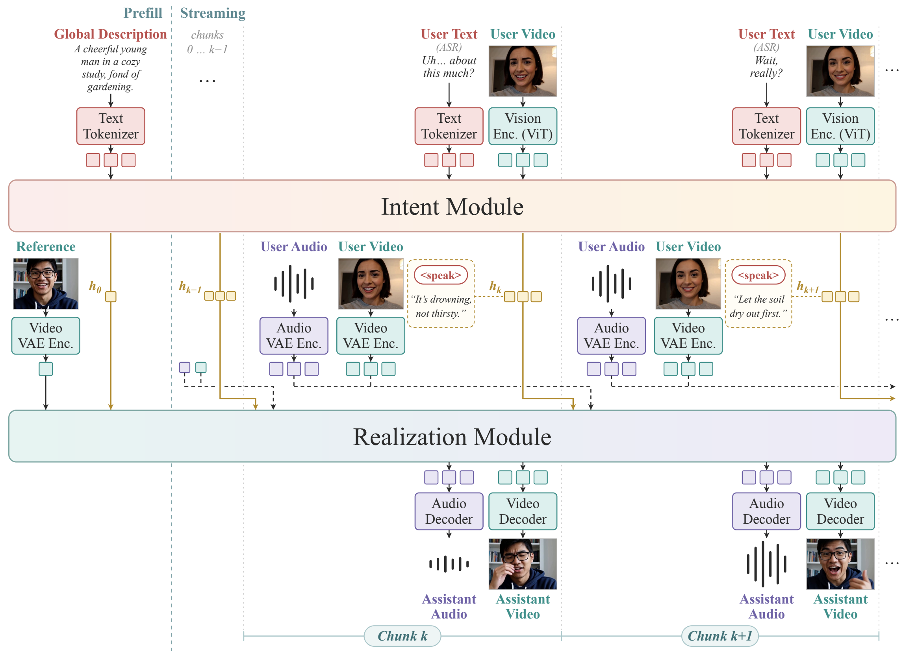

> [!tldr]
> Duo把“是否开口、说什么”交给Intent，把“怎样用同步音视频表现”交给Realization，并在生成历史上训练以减少推理分布偏移。它是蚂蚁的双工交互专项，不是Ling新的通用正代；1.0、蒸馏、FP8与1.2合并一个family。

> [!warning] 资料与验收边界
> 官方GitHub News明确2026/11/13发布四套权重和代码；这是公告日，不是HF createdAt，未给时区或精确首次可用时间。论文、项目页与四卡已归档；本文读README、方法及评估关键段，未精读全文、运行模型或复现分数。官方图已保存；浏览器使用被Work设置禁用，视觉验收待补。论文设计与已发布v1实现存在范围差异，不能把v2“coming soon”写成已开放能力。

## 发布、变体与开放范围

> [!tldr]
> 完整bundle与Realization覆盖包不同；FP8并不意味着离线参考路径已做原生FP8计算。模型与源码许可分开。

| 变体 | 包与依赖 | 默认采样 |
|---|---|---|
| Duo-1.0-causal-base | 完整Realization、Intent、adapter、音视频codec、ASR与强制对齐器 | Euler 50步，flow shift 1.0 |
| Duo-1.0-distill | Realization DCP覆盖包，需要1.0 causal-base | Euler 4步，flow shift 5.0 |
| Duo-1.0-distill-quant | ModelOpt FP8逐channel缩放覆盖包，需要1.0 causal-base | Euler 4步，flow shift 5.0 |
| Duo-1.2-causal-base | 改进生成质量的完整bundle；没有独立公开增益数字 | Euler 50步，flow shift 1.0 |

1.2蒸馏、1.2量化和v2仍写Coming soon，不额外建节点。权重声明从MiniMax H3初始化并由Duo团队训练，适用MiniMax H3 Community License；代码主仓Apache2.0，第三方组件保留各自许可，不能把代码许可移用于模型。

main分支是研究用离线流程：先有完整用户录像，经ASR和强制对齐，Intent读用户视频/文本，Realization接Intent状态。独立vLLM-Omni与SGLang-Omni分支提供在线加速；README推荐前者。项目页的双向离线展示、因果实时展示、训练数据样例不是同一种实验。论文图允许Realization直接接用户音视频；README又将直接视觉交互条件化列为v2后续方向，因此本文不承诺发布v1已实现论文所有条件通路。

参考离线部署Linux/Python3.10+、FFmpeg/FFprobe、两张CUDA GPU，模型与speech分环境以避免qwen-asr的Transformers版本约束。论文实时调度采用八GPU服务器，与两卡离线入口不是同一吞吐配置。离线runtime会反量化FP8；优化FP8执行在专用serving分支，不能拿权重格式直接推断加速比。

## 因果接口与三阶段训练

> [!tldr]
> 因果性不只靠attention mask：输入编码、时间戳、生成历史提交都必须不含未来信息。DMD把语言规划和音视频历史的偏移一起处理。

Intent每个chunk预测`speak + 正文`或`wait`，同时输出hidden states给Realization；`wait`并不意味着正在播放的媒体中断。用户ASR token在对齐结束时刻后才能入context，assistant文本按语音起点分块，初始wait仅作context不算loss。17帧视觉组末尾重复第16帧，而不是拼入下一chunk第17帧；否则即使mask正确，视觉token也已泄漏未来。

Realization是H3初始化的因果联合音视频DiT，接Intent投影/refiner、参考外观和已完成的媒体历史。音频每声道每秒40个32维latent；17帧视频压成5个latent帧，每帧24维、空间16倍压缩，进入DiT前再作2×2合并成96维向量。3D-RoPE按共同播放时间对齐，而不是把不同采样率当相同步号。

| 阶段 | 目标与关键约束 | 不能推导的结论 |
|---|---|---|
| 1 Intent SFT | 因果chunk语言与参与决策；按action/content类别加权，防wait占优 | 不等于RL优化了用户满意度 |
| 2 Realization训练 | 冻结Intent，从记录的assistant文字提取状态，以记录媒体历史训练因果联合生成 | teacher-forced历史不等于真实rollout |
| 3 四步DMD | generator用预测Intent与自身生成媒体历史；冻结real score及可训练fake score比较同一次噪声扰动 | score双向评估完整窗口不代表流式generator能读未来 |

采样结束还有clean forward，提交干净媒体KV，而不是把最后一步有噪状态当历史。论文八卡安排Intent在0–3做TP4，DiT用0–7，VAE在4–7分块解码，与下一chunk的Intent重叠。稳态周期含生成、完整decode与下一Intent较慢者及切换开销，目标不超过17/24秒；它是调度目标，不能冒充本轮实测首包时延或单卡速度。

## 评估、反例与训练判断

> [!tldr]
> 93.3%是30个案例×六项二元检查的通过率；内容响应仅22/30。它不能代表93.3%的任意任务成功率，也不能证明长期物理世界模型可靠。

| 人评项 | 通过 | 范围 |
|---|---:|---|
| 语言遵循 | 30/30 | 正常速度、有声音回放 |
| 语音可懂度 | 30/30 | 同一30案例 |
| 视觉身份稳定 | 30/30 | 同一30案例 |
| 音视频情绪一致 | 29/30（96.7%） | 论文所报 |
| 唇音同步 | 27/30（90.0%） | 论文所报 |
| 内容响应 | 22/30（73.3%） | 最弱一项 |
| 全部检查 | 168/180（93.3%） | 不能当180独立场景 |

论文反例：用户在室内抱怨“刚解锁共享单车就下雨”，模型当作求建议而非抱怨，给出暂缓骑车的建议。画面、语言均流畅仍可能误解意图。幽默、反常表述和需要联合解读视频/语音的场景更难。Showcase部分是脚本条件化训练样例，不是全部独立测试；本文未取得逐例原始评分、评审一致性或跨版本随机对照，不补造置信区间或SOTA比较。

> [!insight]
> 对Agent Training更有价值的是“参与决策+实现历史”的联合分布对齐：把何时发言、何时等待作为显式监督，并对自生成历史训练。后续消融应固定同一输入时间线、可见帧与ASR截止点，分别更换预测Intent、真实媒体历史和自生成媒体历史；同时测响应正确性、打断行为、同步与端到端延迟。不能只比较四步与50步采样便把全部收益归为蒸馏，也不能把论文的因果chunk流程替换为用户金融任务所要求的Pi harness。

- [官方GitHub及11/13发布公告](https://github.com/inclusionAI/Duo)
- [官方项目页](https://duo-v1.github.io/)
- [技术报告HTML](https://arxiv.org/html/2611.15131v1)
- [官方模型卡](https://huggingface.co/inclusionAI/Duo-1.2-causal-base)
- [[duo_poster_zh.html|中文Poster]]
