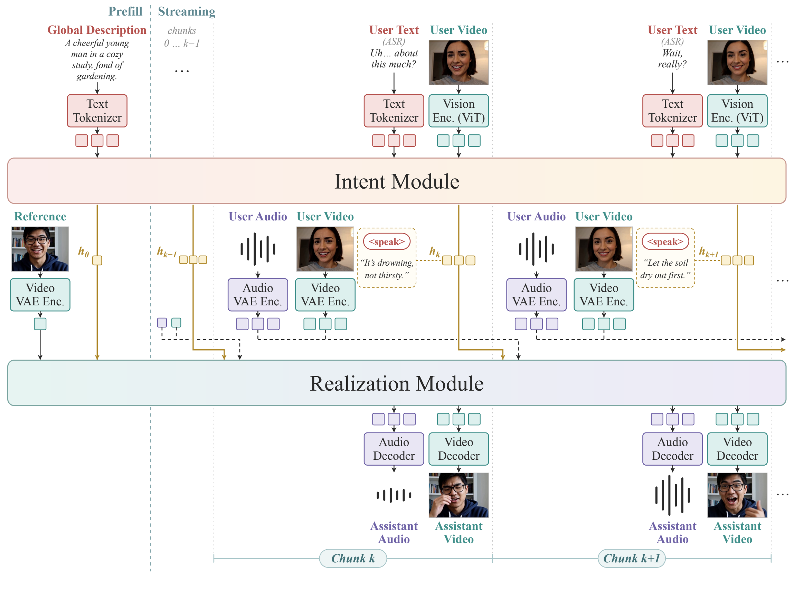
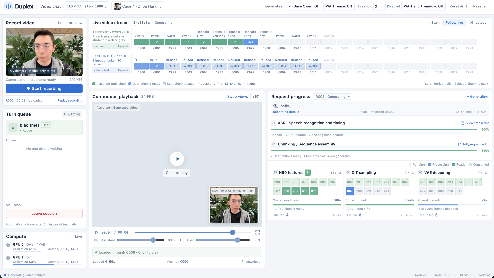

<div align="center">

  

# Duo: A Reciprocal World Model for Full-Duplex Interaction

[](https://duo-v1.github.io/)
[](https://arxiv.org/abs/2611.15131)
[](https://huggingface.co/collections/inclusionAI/duo-v1)
[](https://github.com/inclusionAI/Duo)
[](https://github.com/inclusionAI/Duo/blob/main/assets/Duo_Technical_Report.pdf)
[](https://www.apache.org/licenses/LICENSE-2.0)
[](https://www.python.org/downloads/)

[vLLM-Omni](https://github.com/inclusionAI/Duo/tree/inference/vllm-omni-duo) · [SGLang-Omni](https://github.com/inclusionAI/Duo/tree/inference/sglang-omni-duo)

</div>

**Duo v1** is a Reciprocal World Model that treats intelligence and physical reality as equally fundamental to a world. It continuously perceives audiovisual inputs while responding in real time, enabling spontaneous conversations and interruptions. This **preview release** currently supports basic audiovisual conversation, with an updated version coming soon. The `main` branch provides an offline pipeline for research, while the [`inference/vllm-omni-duo`](https://github.com/inclusionAI/Duo/tree/inference/vllm-omni-duo) and [`inference/sglang-omni-duo`](https://github.com/inclusionAI/Duo/tree/inference/sglang-omni-duo) branches provide accelerated online real-time streaming pipelines.

## 🔥 News

- `2026/11/13`: Publish the [Duo paper on arXiv](https://arxiv.org/abs/2611.15131), introducing the Reciprocal World Model and our first implementation for full-duplex audiovisual interaction.
- `2026/11/13`: Release the [vLLM-Omni](https://github.com/inclusionAI/Duo/tree/inference/vllm-omni-duo) (Recommended) and [SGLang-Omni](https://github.com/inclusionAI/Duo/tree/inference/sglang-omni-duo) streaming pipelines for accelerated, online full-duplex deployment.
- `2026/11/13`: Release **Duo v1** with [Duo-1.0 causal](https://huggingface.co/inclusionAI/Duo-1.0-causal-base), [distilled](https://huggingface.co/inclusionAI/Duo-1.0-distill), [quantized](https://huggingface.co/inclusionAI/Duo-1.0-distill-quant), and [Duo-1.2 causal](https://huggingface.co/inclusionAI/Duo-1.2-causal-base) model weights, plus [offline inference code](https://github.com/inclusionAI/Duo/tree/main) for research.

## ✨ Architecture



**Duo introduces three key technical designs:**

- Leveraging autoregressive modeling for continuous interaction reasoning and participation decisions, rather than restricting it to instruction understanding for diffusion models. 
- Constructing chunk-specific conditions and synchronizing tokens across Intent and Realization on a unified timeline. Module-specific attention masks enforce causal dependencies both within and across chunks, preventing access to future inputs.
- Mitigating distribution shift in both modules through dual rollout distillation, training on autoregressively generated Intent tokens and synthesized audiovisual histories from Realization.

Duo v1 is a preview release for researchers. In the offline pipeline below, user video and ASR text pass through Intent, which guides Realization via intent states. Duo v2 is coming soon and will enable visual interaction by conditioning Realization directly on user audio and video. 

```text
completed user recording
    │
    ├─ Qwen3-ASR + forced alignment ─ user video/text chunks
    │                                      │
    └──────────────────────────────────── Intent
                                           │ intent states
                                           ▼
                                      Realization
                                           │ assistant media latents
                                           ▼
                                  streaming media codecs
                                           │
                                           ▼
                                  browser playback and API
```

See [Architecture](docs/architecture.md) for the causal visibility and clean commitment contract.

## 📦 Model Releases

| Version | Causal base | Distilled | Quantized | Features / Notes |
| --- | --- | --- | --- | --- |
| v1.0 | [Duo-1.0-causal-base](https://huggingface.co/inclusionAI/Duo-1.0-causal-base) | [Duo-1.0-distill](https://huggingface.co/inclusionAI/Duo-1.0-distill) | [Duo-1.0-distill-quant](https://huggingface.co/inclusionAI/Duo-1.0-distill-quant) | Basic full-duplex realtime audio-visual conversation. |
| v1.2 | [Duo-1.2-causal-base](https://huggingface.co/inclusionAI/Duo-1.2-causal-base) | Coming soon | Coming soon | Quality improvements. |
| v2.0 | Coming soon | Coming soon | Coming soon | Visual interaction. |


## 🛠️ Requirements

- Linux and Python 3.10 or newer
- FFmpeg and FFprobe on `PATH`
- CUDA GPUs x2. the default offline configuration assigns one to Intent/codecs and one to Realization
- enough GPU memory for the selected released checkpoints
- The reference offline deployment uses separate model and speech environments because `qwen-asr` pins its own compatible Transformers version.

## 🚀 Installation

Clone the repository and create the model environment:

```bash
git clone https://github.com/inclusionAI/Duo.git
cd Duo
python -m venv .venv-model
source .venv-model/bin/activate
pip install --upgrade pip
# Install the PyTorch, TorchAudio, and TorchVision wheels matching your CUDA driver.
pip install -e '.[realization]'
deactivate
```

Create the speech environment:

```bash
python -m venv .venv-speech
source .venv-speech/bin/activate
pip install --upgrade pip
# Install the PyTorch wheel matching your CUDA driver.
pip install -e '.[speech]'
deactivate
```

The CUDA build tag matters in addition to the package version. Install PyTorch from the index matching the host driver before the editable install. Pip will keep a compatible already-installed build. Optional optimized attention kernels can be installed for the target GPU. `sdpa` is the portable default.

## 🤗 Download Checkpoints

Download the complete [Duo-1.2-causal-base](https://huggingface.co/inclusionAI/Duo-1.2-causal-base) bundle. It already contains every model needed by offline inference, including speech recognition and forced alignment:

```bash
hf download inclusionAI/Duo-1.2-causal-base --local-dir weights
```

To run the 1.0 distilled or quantized Realization, first download the 1.0 causal bundle and then overlay the selected Realization weights onto the same directory:

```bash
hf download inclusionAI/Duo-1.0-causal-base --local-dir weights
hf download inclusionAI/Duo-1.0-distill --local-dir weights
# Or: hf download inclusionAI/Duo-1.0-distill-quant --local-dir weights
```

To store the bundle elsewhere, change `--local-dir` and update the model paths in `configs/inference.json`. The complete directory layout is:

```text
weights/
├── realization/
│   ├── complete.json
│   ├── dcp/
│   │   ├── .metadata
│   │   └── *.distcp
│   └── backbone/                 # when referenced by complete.json
├── intent/                       # base Intent processor and model
├── intent_adapter/               # Intent tokenizer and adapter
│   └── protocol_manifest.json
├── codec/
│   ├── video_vae/model.safetensors
│   └── audio_vae/diffusion_pytorch_model.safetensors
└── speech/
    ├── recognizer/
    └── forced-aligner/
```

The runtime reads every weight locally and does not download models at startup. Keep `realization_family` set to `auto`; the manifest selects `student` for causal checkpoints and `realization` for distilled checkpoints. Release manifests also select the validated sampler defaults: 50 Euler steps with flow shift 1.0 for causal-base, and 4 Euler steps with flow shift 5.0 for distilled models. The quantized release is dequantized by the portable offline runtime; optimized FP8 execution is provided by the dedicated serving branches.

## 🎮 Run the Offline Demo

Copy and edit the example configuration:

```bash
cp configs/inference.example.json configs/inference.json
```

Set the three Python executables in `configs/inference.json`. A typical setup is:

```json
{
  "executables": {
    "realization_python": ".venv-model/bin/python",
    "intent_python": ".venv-model/bin/python",
    "speech_python": ".venv-speech/bin/python",
    "ffmpeg": "ffmpeg",
    "ffprobe": "ffprobe"
  }
}
```

Set the local model directories in the same file. Absolute paths are accepted:

```json
{
  "weights": {
    "realization": "/models/duo/realization",
    "realization_family": "auto",
    "intent": "/models/duo/intent",
    "intent_adapter": "/models/duo/intent_adapter",
    "intent_protocol": "/models/duo/intent_adapter/protocol_manifest.json",
    "codec": "/models/duo/codec",
    "speech_recognizer": "/models/speech/recognizer",
    "forced_aligner": "/models/speech/forced-aligner"
  }
}
```

Launch the demo with your configuration:

```bash
.venv-model/bin/python run_demo.py --config configs/inference.json --port 4173
```

Open <http://127.0.0.1:4173/video/index.html>, then record or upload an MP4/WebM video to generate and play Duo's audiovisual response. If you deploy behind a reverse proxy, set `DUO_PUBLIC_URL` to the public demo URL before launch. You can also explore the interface in [preview mode](docs/frontend.md#preview-mode) without loading model weights.



## ⚙️ Configuration

`configs/inference.example.json` controls executables, weight locations, GPU assignment, resolution, seed, sampler steps, and the Case catalog. Relative paths are resolved from the repository root. Runtime output is written to the configured runtime directory, which is ignored by Git.


## 🗂️ Repository Layout

```text
Duo/
├── configs/               # offline runtime and Case configuration
├── demo/                  # browser frontend
├── docs/                  # architecture and frontend integration notes
├── duo/
│   ├── data/              # inference sequence materialization
│   ├── inference_runtime/ # multi-GPU offline execution engine
│   ├── models/            # Intent, Realization, and codecs
│   ├── preprocessing/     # ASR, alignment, and user-video preparation
│   ├── runtime/           # distributed inference/checkpoint utilities
│   └── serving/           # HTTP API, sessions, media publication
├── tests/                 # CPU regression and release-safety tests
└── run_demo.py            # end-to-end offline launcher
```


## 🤗 Acknowledgements

We thank the [MiniMax H3](https://github.com/MiniMax-AI/MiniMax-H3) and [Qwen](https://github.com/QwenLM) teams for their models and research. We also thank the [Hugging Face](https://huggingface.co/), [vLLM](https://github.com/vllm-project/vllm) (especially [vLLM-Omni](https://github.com/vllm-project/vllm-omni)), and [SGLang](https://github.com/sgl-project/sglang) (especially [SGLang-Omni](https://github.com/sgl-project/sglang-omni)) communities.

## 📝 Citation

If you use Duo in your research, please cite:

```bibtex
@misc{cao2026duoreciprocalworldmodel,
  title         = {Duo: A Reciprocal World Model for Full-Duplex Interaction},
  author        = {Hengyuan Cao and Biao Gong and Guoshan Lu and Qiyuan Zhang and Lin Liu and Yiding Tian and Yilei Jiang and Yuxin Ma and Chengzhang Wu and Kun Chen and Yiqian Xie and Ting Liu and Xin Zheng and Xijun Gu and Tianren Ma and Jiancheng Pan and Chi Zhang and Xuzhe Zheng and Siyi Li and Zhenzhong Lan},
  year          = {2026},
  eprint        = {2611.15131},
  archivePrefix = {arXiv},
  primaryClass  = {cs.CV},
  url           = {https://arxiv.org/abs/2611.15131}
}
```


## 📄 License

This project is released under the [Apache 2.0 License](LICENSE). Third-party components retain their original notices and licenses beside their source.
