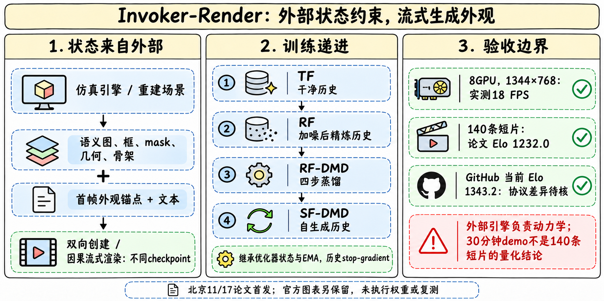
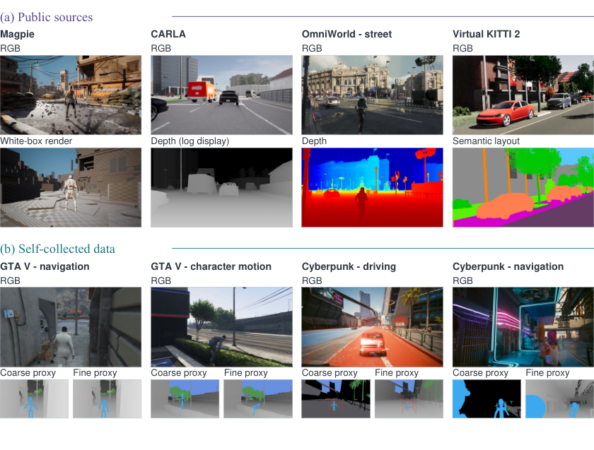
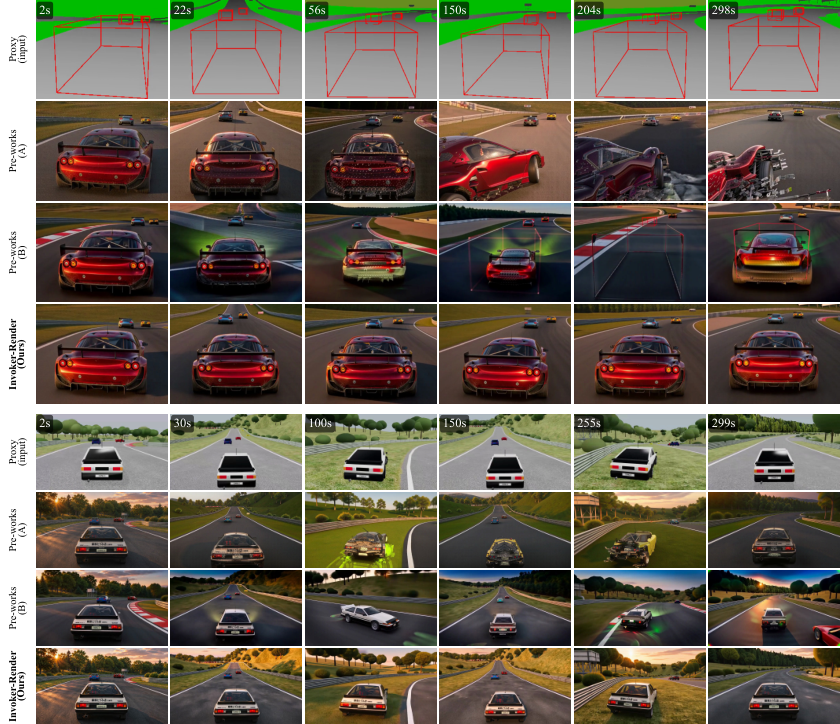

> [!tldr]
> Code World Model2.0把世界状态交给引擎，把外观交给视频模型。关键训练递进是从干净历史转到加噪精炼，再训练自生成历史下的四步因果渲染；它改善交互外观，不证明模型学会全部物理动力学。

> [!warning] 首发与数字冲突
> 报告v1 11/17 15:23:57Z→北京11/17 23:23:57；11/16仓库提交不证明公开。本文读v2主体方法、数据、基础设施与实验；v2 Overall Elo1232.0，当前GitHub README为1343.2，协议差异待核，分别保留不混表。未执行权重、完整代码审计或独立复测。

## 外部状态与多粒度代理

> [!tldr]
> 双向创建和因果流式使用不同checkpoint；控制量来自引擎或重建场景，生成视频不是状态真值。

条件包含首帧外观锚点、文本和五类proxy：语义图、稀疏3D框、mask、shaded geometry、框+骨架。粗代理固定根部布局但不约束肢体，细代理给更多结构；训练在同一窗口选择粒度，不据此宣称已验证任意中途LOD切换。

HF causal root约33.12B FP32（29分片、638张量，文件规模约132.5GB）；bidirectional_lora/teacher-live约2.3GB对应MiniMaxH3的双向分支，不得应用到因果root。VAE、Qwen条件组件、causaldecoder等另依赖。代码默认8GPU生产方案；本轮只归档小源码与配置，未取二进制。

## 数据、TF到SF的训练链

> [!tldr]
> 200小时为独立视频口径，重叠窗口/proxy变体不新增独立小时；最终自生成历史仍需固定外部状态与停止梯度边界。

150小时自采、50小时公共（OmniWorld15、Magpie15、CARLA15、其他5），游戏含GTA/Cyberpunk/Elden/Forza，配同步engine buffers或重建。训练窗口与代理变体重复不能算独立泛化样本。

1. TF：观察到的干净历史teacher forcing。
2. RF：给观察历史加噪后由模型精炼，精炼历史detached，以缓和纯干净历史与推理的差别。
3. RF-DMD：在data-anchored历史上四步DMD，冻结双向teacher、训练fake-score，另以teacher特征和可训练head做matched-noise relativistic GAN。
4. SF-DMD：用student自生成历史，继承RF-DMD的student、fake-score、discriminator、AdamW moments和student EMA，teacher保持冻结。局部重叠窗口mask使target只计一次，首帧anchor始终保留；rollout内部student权重不变，历史stop-gradient后统一更新。

Guidance-Free Training beta2、condition dropout10%。固定anchor+有界KV历史不是无限记忆；长时保持应与窗口边界、角色再现和相机回返分别验证。公开材料仍没有完整可复现优化器/训练算力账本。

## 基础设施与实测速率

> [!tldr]
> 24FPS条件时间轴与实测18FPS吞吐是两种数。1.82×属于固定8GPU流水线，不是任意设备的算法速度。

1344×768、8GPU steady-chunk：基线1.770s/9.9FPS；TAE encoder1.410s/12.4；复用1.180s/14.4；fuse H/C/D由六launch到四后1.165s/14.8；codec与CPU重叠后.930s/18.0FPS。首图与初始化延迟不能用steady-chunk推断。proxy帧数17N+5，最少39，输入首帧1344×768。

## 全部主结果与评测限制

> [!tldr]
> 140条6.58–20秒视频，由Gemini3.8Flash盲评。Elo来自该组相对排序，既非人评绝对质量，也非30分钟长片量化结果。

相同proxy/首帧，裁判看672×384、12FPS时间戳帧，随机顺序平衡，四轴独立给胜平负。Overall不是另三轴平均；Bradley–Terry Elo归一为均值1000，比较集合变化会改变分数。

| v2论文系统 | 步数 | Proxy | Quality | Motion | Overall |
|---|---:|---:|---:|---:|---:|
| StreamingCWM |4|653.0|626.7|835.3|692.4|
| StreamRender |2|935.7|1011.4|882.5|940.2|
| Solar |4|1174.9|1152.9|1118.1|1135.3|
| Invoker |4|1236.4|1209.0|1164.1|1232.0|

Invoker分别对CWM130/8/2、Stream116/4/20、Solar88/2/50（胜/平/负）。对Solar胜62.9%、负35.7%，不能只说“明显领先”而隐去失败。GitHub当前Overall为1343.2/1245.3/1051.9/359.6，与论文不一致，未取得统一原始票据，不能混用README Overall与论文分轴。

30分钟racing展示带reference-guided quality policy，默认服务不启用；论文长时图含298/299秒案例。两类演示都不等于140条短片已验证30分钟稳定。原始judge votes、CI、人评及跨引擎测试仍缺。

## 研究判断、可转化实验与来源

> [!tldr]
> 对Agent训练更有用的是把“状态可验证”与“视觉多样性”分开。生成外观只能作为观测，奖励应从外部引擎状态验证。

固定引擎状态、动作与proxy，分别测试视觉一致性和任务成功；对RF/SF、历史detach、优化器状态继承、anchor与代理粒度做同预算消融。保存真实engine log，不用模型生成画面自证因果。长期rollout测累积漂移、对象回返、遮挡、分布外动作和实际墙钟，保持短片评测为单独集合。

- [v2报告HTML](https://arxiv.org/html/2611.22925v2)
- [官方HF](https://huggingface.co/inclusionAI/invoker-render-1.0)
- [官方源码及当前榜](https://github.com/inclusionAI/CodeWorldModel)
- [官方项目页](https://www.inclusion-ai.org/CodeWorldModel/)

## 关联与交付

> [!tldr]
> 一手材料、研读判断和展示分别保存；图为机制示意，原表保留原量尺。

> 📊 相关可视化: [[invoker_render_poster_zh.html]]

[[WeVisForensics]]
