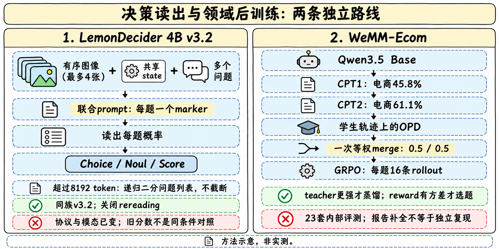

# LemonDecider 4B v3.2 — 联合问题读出与图像决策

> [!tldr]
> 我的判断：这是同一LemonDecider专项族的分发包/协议升级，不能按仓库lastModified再增一代。核心变化是从旧卡的独立问题文本读出，改成共享state加全部问题的联合prompt，并在每个marker输出概率；新增最多四图和Vision面板，评测条件也随之改变。

> [!warning] 发布证据与训练缺口
> 官方11/24提交明确“Full sync LemonDecider4B v3.2”，当前模型卡指定v3.2、joint-question-inline-readout-v1及公开评测结果路径；日期采用这次明确的版本分发事件，不是一般lastModified。未取得完整训练变更说明或新旧完整权重哈希对照，不据此宣称重新训练算法、训练量或权重改善。旧v3.1的1.20M+35467数据不能自动套给v3.2。

## 请求如何变成输出

> [!tldr]
> 输入共享不代表每个问题答案互相独立；要验证问题顺序、同批干扰与递归拆分造成的上下文变化。

Qwen3.5-4B骨干、4539918336参数、724tensor；255×2560读出头。图像按列表顺序在state文本之前，最多4张，每图65536–1638400像素。检查点context262144，但服务窗口8192；不能以checkpoint规格承诺26万token联合请求。长请求递归二分question列表，绝不截断；同一state因此在拆分中重复编码。

Choice给各候选概率；Noul给命题为真概率；Score为2–10有序级别给概率与从0开始的期望 \(E[k]=\sum_{k=0}^{K-1}k p_k\)。期望是等级读出，不是自然语言解释或生成式推理。联合协议rereading disabled，temperature0.835655，BF16/SDPA，与旧single-question read_twice路径区别显著。

## 本轮公开评测的边界

> [!tldr]
> Text64.25与Vision72.349是不同套件的Skill聚合，不宜横向相减；老63.78与新64.25也不是控制其他条件后的模型净提升。

| 面板 | 当前Skill | 请求 | 条件 |
|---|---:|---:|---|
|Text DI0.3|64.25|140178|43数据集展示；带†项不计index|
|Vision DI0.3|72.349|12210|11数据集；同joint/no-reread协议|
|旧v3.1 Text历史|63.78|140178|旧独立问题/文本卡记录，非同协议对照|

| Vision数据集 | Accuracy | Skill |
|---|---:|---:|
|CVBench|86.85|78.31|
|BLINK|73.57|59.08|
|RealWorldQA|80.65|68.37|
|CharXiv|81.95|75.94|
|InfographicVQA|96.31|95.08|
|Mind2Web|84.58|79.45|
|Winoground|91.75|83.50|
|KIE CORD+FUNSD|96.06|93.52|
|HatefulMemes|71.56|43.12|
|RBenchM|49.62|39.54|
|MMMUProVision|45.14|37.08|

Text原43行完整保存，不用列举强项代替总表。比如BFCL case exact96.40/Skill95.14，GSM8K64.94/58.01，HLE12.57/0，反映归一化Skill与原始准确率不同。Chess19.78/12.63、SimpleBench20/4（†不计总分）是保留的弱项。Mind2Web在这里是候选决策准确率，不代表浏览器长任务端到端84.58%。私人套件与单RTXPRO6000延迟资格仍maintainer-run，当前没有这项认证。

## 对接、证据与下一步

> [!tldr]
> 两条HTTP路由使用同一decision逻辑，业务应按问题ID取answers，避免靠列表位置猜测返回含义。

`POST /v1/systemone`对应DI text engine；`/v1/decisions`是image-capable JSON协议，Vision用decide --option protocol=decisions。不要拿普通chat/completions生成答案来替代该读出。服务器侧路径受image-root约束；本次未启动HTTP或执行示例，也没有改写官方评测结果仓库。

> [!insight]
> 把多轮Agent中重复的分类/路由问题联合编码可能减少重复state成本，但代价是问题互相影响。应固定同一权重，对独立/联合读出分别做问题排序置换、冲突问题、图像顺序、临界8192token与递归切分测试；评测概率校准、批内一致性和实际请求时延，不能用总分的0.47点差直接证明训练进步。

## 官方来源与关联资料

- [card-inclusionAI--LemonDecider.md](https://huggingface.co/inclusionAI/LemonDecider/resolve/main/README.md)

> 📊 中文Poster：[[Topics/13_base_model/Ant_Ling/Variants/2610_LemonDecider/lemon32_poster_zh.html|中文Poster]]

## 官方原图与机制对照

