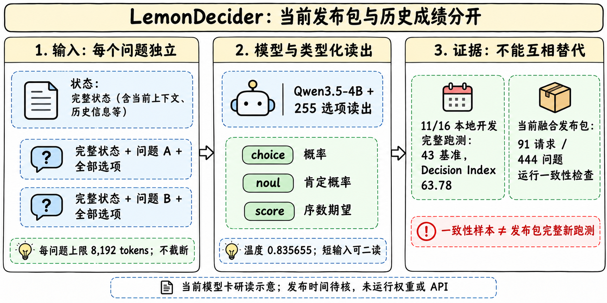
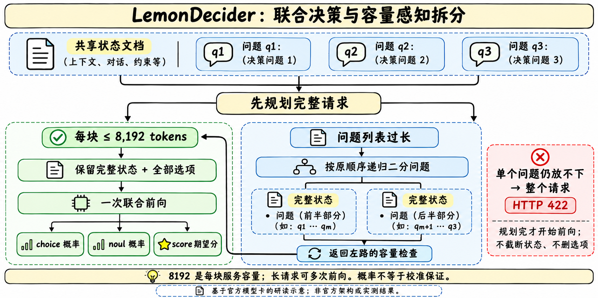

> [!tldr]
> 本轮当前包已经改为逐问题独立前向、完整重复state、短输入按配置二读，再从标记位置的255选项读出计算choice/noul/score。不能继续把11/11的联合多问题+递归分块当成当前契约。新卡补了两阶段训练和43基准完整开发成绩，但当前融合发布包只做了较小的一致性样本，不代表已完整重跑或验证训练增益。

> [!warning] 版本日期与证据归属
> 当前ID为lemondecider-4b-20261112-v3.1，config与README温度均0.835655，协议version1且read_twice=true、twice_max_tokens=3000。ID中的11/12、声明的11/16开发run都不是独立的公开发布日；本轮只更新同family文档快照，不增加日级首发/正代条目。已读当前README、config、model.py、decision_runtime、模型加载实现与QUICKSTART；保留旧卡/旧note历史。没有下载权重，未执行远程代码、verify或GPU推理；完整训练配方、原始逐题预测和温度拟合记录仍未获得。

## 当前发布包：独立问题、二读与完整容量

> [!tldr]
> “一次前向”现在以一个问题为单位。多问题请求会依次执行多次，不能从单个接口返回推断是一次联合决策。

|项|当前可核对契约|
|---|---|
|底座/结构|Qwen3.5-4B hybrid，周期full attention非因果，线性递归层保留；255选项读出|
|当前模型ID|lemondecider-4b-20261112-v3.1|
|输入/输出|text/structured JSON；choice概率、noul肯定概率、score的零起点序数期望|
|容量|每题渲染后最多8192tokens，最多255选项；请求1–256个命名问题|
|短输入|第一次render不含外层模板的token计数<=3000时二读；最后仍按实际encoded长度验8192|
|温度|logits转FP32，除0.835655再softmax；额外再调温会改变概率|
|格式|使用发布包renderer，不再自行套chat template；marker必须单token且最终恰好一个|
|运行|README称Python3.12、PyTorch2.9.0、Transformers5.17.0；本轮未装未测|

`DecisionModel.predict`持锁后循环question，每题单独prepare和forward；state与全部选项均保留。structured state可加索引注释；超长时退回不带可选索引的同一JSON内容，仍超长抛CapacityError，绝不是截断。旧包按问题列表二分与全部前置规划的叙述已过期；当前若后续问题超限，之前问题可能已经计算，但接口整体422而不返回部分answers，不能说“必定所有题前置校验后才开始计算”。

短输入二读复制的是同一任务文字，不是多次随机采样/投票；概率不是模型生成一串选项token的自回归概率。`noul`取肯定选项概率，`score`对0..K−1等级算期望，可为非整数。config仍含视觉张量/视频ID不构成公开图像API支持。锁内逐题运行也不等于已经验证高并发吞吐。

## 两阶段训练与当前包的可追溯边界

> [!tldr]
> 新README补了约1.20M通用决策数据和35467增量数据；没有公开足够run材料把它们与旧step1241、四checkpoint平均和新融合权重串成完整可复现实验。

阶段1建立choice/noul/score通用判断，覆盖服务动作、语言理解、知识推理、检索候选、偏好质量和概率/序数。增量原则是错误直接入候选，正确样本追加一问/一步或条件提高难度；共35467条。阶段2对难决策继续SFT，更新融合成自包含full weights并应用标量校准。它不是已核实的RL配方，也没有公开增量数据的独立来源/泄漏审计、LR/epoch/奖励或完整算力日志。

新卡声明两片权重SHA为a88cb411…与dd8090bb…，724序列化tensor，index为68427B/SHA cdc57ae8…；本轮仅核对文本清单，没有读取9GB权重来计算hash。温度0.835655与旧1.002675不同；缺当前校准样本/拟合分割与温度前后指标，不能因为名字叫calibrated就宣称分布外校准良好。原11/11冲突作为历史保留在最后一Tab，不混作当前事实。

当前源码要求local_files_only、从同目录加载runtime，readout shape与codes单token映射校验。HTTP默认localhost；设置key后所有端点验证bearer，非loopback必须有key，body上限8,000,000B，health不回传本机路径。`verify.py`是可读验证脚本，不是本轮已经执行或安全认证。

## 开发完整跑测、发布包一致性与全表

> [!tldr]
> 63.78属于作者声明的11/16本地开发run；91请求/444问题的一致性核验，只支持当前包在那个样本上与相同融合权重参考实现一致。

|当前卡声明|值/含义|
|---|---|
|Decision Index balanced skill / raw / breadth|63.78 /72.09 /62.87|
|selected / scoreable / excluded|140620 /140178 /442|
|ok / unsupported / errors|140099 /79 /0；unsupported仍在coverage|
|记录的request wall time median/mean/p95|102.6 /342.5 /1121.6 ms，in-process开发run|
|发布runtime一致性|91 requests /444 questions，覆盖43类和三输出类型，同融合权重参考实现|

它不是官方榜单接受、生产HTTP延迟认证或当前BF16融合包的完整新跑测。旧61.67与当前63.78差2.11点，但权重、协议、温度和样本口径均发生变化；不能归因于增量训练的受控收益。API-Bank旧0.8478与当前0.5158的反向变化也须保留，不能只选涨分项。

Headline scores use a 0–100 scale. Area and benchmark values below use 0–1.

| Area | Raw | Skill | Coverage | Benchmarks |
|---|---:|---:|---:|---:|
| Knowledge & Reasoning | 0.5797 | 0.4639 | 0.9992 | 11 |
| Language Understanding | 0.7866 | 0.7004 | 1.0000 | 9 |
| Retrieval & Classification | 0.7883 | 0.7314 | 0.9926 | 6 |
| Tools & Automation | 0.7516 | 0.7299 | 0.9926 | 5 |
| Arts & Human Taste | 0.7253 | 0.5701 | 0.9967 | 6 |

| # | Benchmark | Metric | Requests | Score | Skill | Cov. |
|---:|---|---|---:|---:|---:|---:|
| 1 | BFCL ★ | case exact accuracy | 1,694 | 0.9728 | 0.9633 | 1.0000 |
| 2 | ToolRet ★ | nDCG@10 | 685 | 0.6678 | 0.5894 | 0.9650 |
| 3 | API-Bank ★ | accuracy | 508 | 0.5158 | 0.5044 | 0.9961 |
| 4 | BANKING77 ★ | macro-F1 | 3,080 | 0.9313 | 0.9304 | 1.0000 |
| 5 | CLINC150+OOS ★ | macro-F1 | 5,500 | 0.9543 | 0.9540 | 1.0000 |
| 6 | RouterBench | selected quality (quality objective) | 10,000 | 0.7995 | 0.5299 | 1.0000 |
| 9 | Home appliance simulator ★ | case exact accuracy | 88 | 0.7500 | 0.7500 | 1.0000 |
| 10 | SGD/SGD-X | macro-F1 | 2,500 | 0.5553 | 0.2601 | 1.0000 |
| 11 | ContractNLI ★ | macro-F1 | 123 | 0.8618 | 0.8002 | 1.0000 |
| 12 | ANLI ★ | macro-F1 | 3,200 | 0.7586 | 0.6384 | 1.0000 |
| 20 | BPoMP ★ | accuracy | 5,000 | 0.9802 | 0.9600 | 1.0000 |
| 21 | Humicroedit ★ | accuracy | 2,628 | 0.6130 | 0.2260 | 1.0000 |
| 22 | POP909-CL ★ | accuracy | 2,000 | 0.7434 | 0.7181 | 0.9800 |
| 23 | cfcolor ★ | accuracy | 5,000 | 0.7230 | 0.4535 | 1.0000 |
| 24 | MMLU | accuracy | 14,033 | 0.8164 | 0.7552 | 1.0000 |
| 25 | GPQA Diamond ★ | accuracy | 196 | 0.5153 | 0.3537 | 1.0000 |
| 26 | ARC-Easy | accuracy | 2,376 | 0.9895 | 0.9860 | 1.0000 |
| 27 | ARC-Challenge | accuracy | 1,172 | 0.9556 | 0.9408 | 1.0000 |
| 28 | WinoGrande ★ | accuracy | 1,267 | 0.9092 | 0.8184 | 1.0000 |
| 29 | HellaSwag ★ | accuracy | 10,042 | 0.9556 | 0.9408 | 1.0000 |
| 30 | GSM8K ★ | accuracy | 2,638 | 0.6630 | 0.5963 | 1.0000 |
| 31 | ChessBench ★ | accuracy | 5,000 | 0.2048 | 0.1339 | 1.0000 |
| 32 | MuSR ★ | accuracy | 752 | 0.6436 | 0.4334 | 1.0000 |
| 33 | SATA-Bench ★ | case exact accuracy | 1,650 | 0.3327 | 0.3238 | 1.0000 |
| 34 | SimpleBench | accuracy | 10 | 0.2000 | 0.0400 | 1.0000 |
| 36 | BRIGHT ★ | nDCG@10 | 220 | 0.4447 | 0.3512 | 0.9591 |
| 37 | Amazon ESCI ★ | macro-F1 | 5,000 | 0.6131 | 0.5147 | 1.0000 |
| 38 | ACOS ★ | per-review F1 | 1,565 | 0.4130 | 0.3942 | 1.0000 |
| 39 | FinEntity ★ | macro-F1 | 979 | 0.9323 | 0.9004 | 1.0000 |
| 40 | iSarcasmEval ★ | Sarcasm F1 (track A, English) | 4,600 | 0.6684 | 0.5734 | 1.0000 |
| 41 | VAST ★ | macro-F1 | 3,006 | 0.8025 | 0.7038 | 1.0000 |
| 42 | NLI4CT ★ | macro-F1 | 5,500 | 0.8221 | 0.6539 | 1.0000 |
| 43 | CRUXEval ★ | accuracy | 570 | 0.6825 | 0.4962 | 1.0000 |
| 44 | CLadder ★ | accuracy | 5,000 | 0.8076 | 0.6152 | 1.0000 |
| 45 | HLE ★ | accuracy | 501 | 0.1549 | 0.0000 | 0.9920 |
| 50 | Habermas Machine ★ | accuracy | 1,676 | 0.6187 | 0.4467 | 1.0000 |
| 56 | PhishNChips phishing decisions ★ | accuracy | 2,000 | 0.9275 | 0.8550 | 1.0000 |
| 57 | MMLU-Pro ★ | accuracy | 12,032 | 0.6541 | 0.6110 | 1.0000 |
| 58 | BBH fixed-option tasks ★ | accuracy | 5,507 | 0.7863 | 0.6902 | 1.0000 |
| 59 | RAGTruth response-level hallucination ★ | F1 on hallucinated class | 2,700 | 0.8373 | 0.6627 | 1.0000 |
| 61 | HoVer claim verification ★ | accuracy | 4,000 | 0.8875 | 0.7750 | 1.0000 |
| 62 | When2Call MCQ ★ | accuracy | 3,652 | 0.8806 | 0.8408 | 1.0000 |
| 64 | New Yorker caption matching ★ | accuracy | 528 | 0.6932 | 0.6165 | 1.0000 |

表中Score用各benchmark原生metric，Skill和Coverage来自指数聚合；iSarcasmEval当前是English track-A，不与旧混合子任务直接比。未附原始predictions、benchmark inputs和内部logs，因此无法自行复算63.78或核对完整错误账本。

## 对 Agent Training 的判断与资料地图

> [!insight]
> 错题优先、对题加条件是有价值的数据构造方向，但要用固定harness和独立测试来检验。这个包更直接的教训是：数据改进、模型更新、校准、renderer和服务协议必须一起版本化，再通过受控消融分别验证。不能把小样本runtime一致性当训练提分或泛化证据。

当前概率端点适合工具选择和结构化路由；应另外评估校准、拒识、超容量、state长度和多问题成本。比较旧联合与新独立路径时，固定完整state、同权重、温度及二读开关，保留失败分母。这里没有复现这些实验。

- [官方当前模型卡](https://huggingface.co/inclusionAI/LemonDecider)
- src/updates/2026-11-18保存当前卡/config/runtime/校验清单；旧原件与旧固定revision仍保留，不覆盖来源历史。
- [[Topics/13_base_model/Ant_Ling/Variants/2611_Sing_VL_S1/Sing-VL-S1]]、[[Topics/13_base_model/Ant_Ling/Variants/261111_ZoomGain/ZoomGain-Family]]
- 中文Poster：[[Topics/13_base_model/Ant_Ling/Variants/2610_LemonDecider/lemondecider_poster_zh.html]]

## 历史快照：11/11联合协议与step1241冲突

> [!warning] 以下为11/11已读资料与当时判断
> 本节完整保留旧协议、旧数字与版本冲突，供追溯；其中“当前”“本包”等均指11/11的旧快照，不能作为11/18的实际加载/服务契约。最新契约以本笔记前四个Tab为准。

### 定位、版本与证据冲突

> [!tldr]
> 先固定当前包和证据来源，再讨论训练及成绩。不得把旧README训练参数、当前manifest权重和不同版次分数合并为无冲突的实验。

| 证据 | 当前声明 | 能支持的判断 |
|---|---|---|
|README Model ID|lemondecider-4b-20261104-v3|文档公开名称，和当前config不一致|
|config/decision_config|lemondecider-4b-step1241，initialization_step1241|当前加载配置的模型身份|
|RELEASE_MANIFEST|step1241-pure-hf-package-20261111-v1|11/11同族包更新，不是新正代|
|README训练|1,199,692行SFT、4,690步、四检查点FP32平均|旧训练叙述，不能直接归属于当前pure checkpoint|
|manifest训练来源|B_mix_full，step930恢复，执行931–1241，LoRA32,464,896可训参数|当前包的作者声明，缺原始训练数据/日志独立核验|
|README评测版次|Decision Index public0.4|与manifest0.3冲突|
|manifest评测版次|full-0.3 / edition0.3|与README0.4冲突；两处均声明61.67|
|温度|1.0026751894886363，继承parent，step1241未refit|不能称当前权重已重新校准|

manifest给出两个权重的声明SHA与README一致；未下载大权重，所以这里只核对文本声明，不声称已计算真实权重哈希。README给index68,426B及另一SHA，manifest/API为68,427B及旧indexSHA，另列文件一致性缺口。manifest中的README文件SHA也可能对应此前README，不把清单本身当全文件审计完成。

许可声明README为LICENSE Apache2.0、LICENSE.code MIT，且Qwen3.5底座义务继续适用；没有由此推导训练/评测数据可任意再分发。原始卡、manifest、code/config和提交元数据均随src保存。

### 联合读取、服务容量与训练来源

> [!tldr]
> 短请求一次联合前向，长请求多块前向；规划阶段发现单题超限就整体拒绝。8192是每块服务容量，262144是底座位置配置，不能互换。

joint_readout.py在一份共享State后顺次放各问题、全部候选描述和单token的fim_suffix标记，在每个标记位置提取hidden。用户提供的特殊token转成全角形式，避免伪造标记。每个问题按有效选项数mask，再除温度做softmax；choice/noul/score均由候选概率派生，不生成答案token流。

Qwen3.5混合主干的周期full attention改为非因果，线性递归层保留原机制；不能说整个网络已变为全双向Transformer。forward禁止KV cache，要求SDPA与有效标记、左padding。当前协议是lemondecider-v1：代码中D3专用FP32 head分支不能套到这个配置；logits转float也不证明head GEMM权重为FP32。

serve_312k.py先tokenize规划完整问题列表，放不下就按原顺序二分。每块重复完整state，不删选项、不截断。规划全部成功才开始前向；单题仍超8192则整个请求HTTP422，避免返回前半段答案后才失败。返回原问题ID顺序；usage.input_tokens合计各块，因此重复状态也计入。长请求不是一次前向，也不承诺跨块交互等同完整联合推理。

服务显式拒绝images，即使权重包含视觉张量。默认localhost、可选bearer key、单锁忙返回529；这些是官方源码行为，本文没有启动服务。测试源码用FakeJoint验证短请求、递归拆分、保序、完整状态、超限先拒绝和图片拒绝；它们不是实际GPU数值测试，manifest也声明packaging后未做新GPU推理/训练/评测。

### 两套训练叙述分开保存

README旧叙述：1,199,692 decision/QA行，choice84.4%、noul15.2%、score0.4%；16卡FSDP full shard、1epoch/4690步、batch256、LR2e-6、warmup0.15、wd0.01、clip1，8192长度，option CE，text-only/vision frozen，四checkpoint平均；parent温度由1448 held-out样本拟合。去掉grouping元数据的逐题导出不等于原联合训练布局，指纹过滤也不等于绝对零重叠。

manifest当前来源：B_mix_full，seed20261104、world_size16，固定final step1241而非按DI挑best；从930恢复，执行931–1241，看到39,682 request groups/96,708 decisions；LoRA rank16/alpha32/dropout0.05，248模块、32,464,896可训参数，readout/vision frozen，合并导出full weights。没有公开足够信息将两者串成完整可复现继承链，正文不选择性抹去冲突。

option_loss.py的有效候选FP32 CE按每个decision算一个loss，支持硬/软target、严格校验概率质量和padding；温度仅后处理、不进入该CE。源码存在这个loss不等于已经核验step1241实际训练的完整调用与混合数据。

### 自评结果、缺口与研究判断

> [!tldr]
> 声明的public指数61.67、raw70.84、breadth60.28不应脱离0.3/0.4冲突和覆盖率。16个PPU worker的HTTP墙钟延迟，也不是单GPU准入或生产负载延迟。

| 原卡当前headline（未经独立复测） | 值 |
|---|---:|
|Decision Index public|61.67|
|Raw index|70.84|
|Breadth skill|60.28|
|HTTP p50 / mean / p95|49.9 /121.2 /286.9 ms|
|selected / scoreable / excluded|140620 /140178 /442|
|answered /unsupported|140148 /30|

声明评测日11/4，16个PPU-ZW810E worker，联合推理+问题二分，complete=true；unsupported仍在coverage。该结果是自评public suite，不是私有Full或已经接受的官方榜单提交。manifest只给原始证据文件SHA，未附results.jsonl、labels、logs与suite输入，不能据此复算或核验纳入指标的最终聚合。

下表完整保留当前卡的5领域和43个原生benchmark分数。星号代表原卡纳入public index，native score、chance-corrected skill、coverage不能混为一个accuracy；未支持/低skill项不得删去。

| Area | Raw | Skill | Coverage | Benchmarks |
|---|---:|---:|---:|---:|
| Knowledge & Reasoning | 0.5320 | 0.4063 | 0.9998 | 11 |
| Language Understanding | 0.7616 | 0.6674 | 1.0000 | 9 |
| Retrieval & Classification | 0.7680 | 0.6909 | 1.0000 | 6 |
| Tools & Automation | 0.8029 | 0.7817 | 0.9986 | 5 |
| Arts & Human Taste | 0.7345 | 0.5790 | 0.9979 | 6 |

#### Per-benchmark native scores (★ = included in the public index)

The **Score** column uses each benchmark's native headline metric. Skill and
coverage come from the official index report; area weighting and chance
correction can therefore make Skill differ from Score. iSarcasmEval uses its
English track-A headline, matching the suite's selected summary. All values
are generated from this model run, not from the earlier v3 card.

| # | Benchmark | Metric | Requests | Score | Skill | Cov. |
|---:|---|---|---:|---:|---:|---:|
| 1 | BFCL ★ | case exact accuracy | 1,694 | 0.9528 | 0.9362 | 1.0000 |
| 2 | ToolRet ★ | nDCG@10 | 685 | 0.6354 | 0.5768 | 0.9971 |
| 3 | API-Bank ★ | accuracy | 508 | 0.8478 | 0.8415 | 0.9961 |
| 4 | BANKING77 ★ | macro-F1 | 3,080 | 0.9317 | 0.9308 | 1.0000 |
| 5 | CLINC150+OOS ★ | macro-F1 | 5,500 | 0.9423 | 0.9420 | 1.0000 |
| 6 | RouterBench | selected quality (quality objective) | 10,000 | 0.7936 | 0.5161 | 1.0000 |
| 9 | Home appliance simulator ★ | case exact accuracy | 88 | 0.6477 | 0.6477 | 1.0000 |
| 10 | SGD/SGD-X | macro-F1 | 2,500 | 0.4253 | 0.0438 | 1.0000 |
| 11 | ContractNLI ★ | macro-F1 | 123 | 0.8684 | 0.8097 | 1.0000 |
| 12 | ANLI ★ | macro-F1 | 3,200 | 0.7203 | 0.5810 | 1.0000 |
| 20 | BPoMP ★ | accuracy | 5,000 | 0.9858 | 0.9715 | 1.0000 |
| 21 | Humicroedit ★ | accuracy | 2,628 | 0.6320 | 0.2641 | 1.0000 |
| 22 | POP909-CL ★ | accuracy | 2,000 | 0.8339 | 0.8197 | 0.9875 |
| 23 | cfcolor ★ | accuracy | 5,000 | 0.7446 | 0.4336 | 1.0000 |
| 24 | MMLU | accuracy | 14,033 | 0.7940 | 0.7253 | 1.0000 |
| 25 | GPQA Diamond ★ | accuracy | 196 | 0.4643 | 0.2857 | 1.0000 |
| 26 | ARC-Easy | accuracy | 2,376 | 0.9882 | 0.9843 | 1.0000 |
| 27 | ARC-Challenge | accuracy | 1,172 | 0.9548 | 0.9397 | 1.0000 |
| 28 | WinoGrande ★ | accuracy | 1,267 | 0.8942 | 0.7884 | 1.0000 |
| 29 | HellaSwag ★ | accuracy | 10,042 | 0.9511 | 0.9348 | 1.0000 |
| 30 | GSM8K ★ | accuracy | 2,638 | 0.6391 | 0.5680 | 1.0000 |
| 31 | ChessBench ★ | accuracy | 5,000 | 0.1220 | 0.0437 | 1.0000 |
| 32 | MuSR ★ | accuracy | 752 | 0.6037 | 0.3700 | 1.0000 |
| 33 | SATA-Bench ★ | case exact accuracy | 1,650 | 0.2636 | 0.2538 | 1.0000 |
| 34 | SimpleBench | accuracy | 10 | 0.1000 | 0.0000 | 1.0000 |
| 36 | BRIGHT ★ | nDCG@10 | 220 | 0.4485 | 0.3762 | 1.0000 |
| 37 | Amazon ESCI ★ | macro-F1 | 5,000 | 0.6007 | 0.4991 | 1.0000 |
| 38 | ACOS ★ | per-review F1 | 1,565 | 0.3341 | 0.3128 | 1.0000 |
| 39 | FinEntity ★ | macro-F1 | 979 | 0.9331 | 0.9016 | 1.0000 |
| 40 | iSarcasmEval ★ | see separate subtask tracks | 4,600 | 0.6076 | 0.4952 | 1.0000 |
| 41 | VAST ★ | macro-F1 | 3,006 | 0.7683 | 0.6524 | 1.0000 |
| 42 | NLI4CT ★ | macro-F1 | 5,500 | 0.8051 | 0.6208 | 1.0000 |
| 43 | CRUXEval ★ | accuracy | 570 | 0.6333 | 0.4182 | 1.0000 |
| 44 | CLadder ★ | accuracy | 5,000 | 0.7960 | 0.5920 | 1.0000 |
| 45 | HLE ★ | accuracy | 501 | 0.1140 | 0.0000 | 0.9980 |
| 50 | Habermas Machine ★ | accuracy | 1,676 | 0.6092 | 0.4328 | 1.0000 |
| 56 | PhishNChips phishing decisions ★ | accuracy | 2,000 | 0.7890 | 0.5780 | 1.0000 |
| 57 | MMLU-Pro ★ | accuracy | 12,032 | 0.5910 | 0.5400 | 1.0000 |
| 58 | BBH fixed-option tasks ★ | accuracy | 5,507 | 0.7086 | 0.5776 | 1.0000 |
| 59 | RAGTruth response-level hallucination ★ | F1 on hallucinated class | 2,700 | 0.8371 | 0.6622 | 1.0000 |
| 61 | HoVer claim verification ★ | accuracy | 4,000 | 0.8922 | 0.7844 | 1.0000 |
| 62 | When2Call MCQ ★ | accuracy | 3,652 | 0.8976 | 0.8635 | 1.0000 |
| 64 | New Yorker caption matching ★ | accuracy | 528 | 0.6420 | 0.5525 | 1.0000 |

> [!insight]
> 对Agent Training，这种端点适合路由、工具选择与结构化判断，但概率不是安全或校准保证。优先把当前immutable revision、实际harness版次、原始结果、温度拟合与overflow策略对齐，再验证迁移收益。要分别测完整联合、问题分块与逐题独立三种协议；不能用一次前向宣传代替真实多块成本，也不应把容量失败从覆盖率分母移除。

### 原件与关联

- [官方模型卡](https://huggingface.co/inclusionAI/LemonDecider)
- [固定当前版本](https://huggingface.co/inclusionAI/LemonDecider/tree/05ec18fa0994b7369cb25ac76c19ed0865c776fd)
- [同族step1241包替换提交](https://huggingface.co/inclusionAI/LemonDecider/commit/ef27e061ea67b7df6109b189aaf6b1231fc9bfd9)
- [[Topics/13_base_model/Ant_Ling/Variants/2611_Sing_VL_S1/Sing-VL-S1]]、[[Topics/13_base_model/Ant_Ling/Variants/261111_ZoomGain/ZoomGain-Family]]
- 中文Poster：[[Topics/13_base_model/Ant_Ling/Variants/2610_LemonDecider/lemondecider_poster_zh.html]]

> [!update] 2026-11-25研读补充
> [[Topics/13_base_model/Ant_Ling/Variants/2610_LemonDecider/LemonDecider-4B-v3.2|LemonDecider 4B · v3.2]]：本次来源和旧结论的差异请以这份新增笔记为准；旧记录按历史保留。
