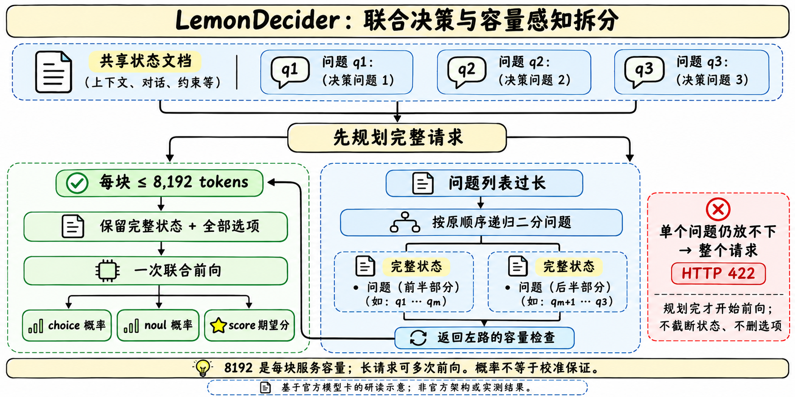

> [!tldr]
> LemonDecider将共享状态与多个命名问题放入一条序列，在各问题标记处读取候选概率；超容量时按问题列表递归二分，每块保留完整状态和选项。它是文本决策专项，不是通用生成模型；服务正确性依赖联合协议与容量规划，而不只是加载一份4B权重。

> [!warning] 当前资料互相矛盾，不能拼成一个已复现结果
> 固定HF revision `05ec18fa0994b7369cb25ac76c19ed0865c776fd`。11/11提交明确替换为step1241 pure package，manifest/config也标step1241、LoRA合并、temperature未重新拟合；README却保留旧SFT四检查点平均和其他Model ID。README称Decision Index0.4，manifest称full-0.3。61.67仅是两者声明的自评数，原始run/逐题结果未包含，不能认定哪个版次实际跑过。首发日缺独立声明，10月只是归档线索；11/11是可证的同族资料包更新日，11/4是声明的评测日期，不当首发日。没有下载权重或运行其远程代码。

## 定位、版本与证据冲突

> [!tldr]
> 先固定当前包和证据来源，再讨论训练及成绩。不得把旧README训练参数、当前manifest权重和不同版次分数合并为无冲突的实验。

| 证据 | 当前声明 | 能支持的判断 |
|---|---|---|
|README Model ID|lemondecider-4b-20261104-v3|文档公开名称，和当前config不一致|
|config/decision_config|lemondecider-4b-step1241，initialization_step1241|当前加载配置的模型身份|
|RELEASE_MANIFEST|step1241-pure-hf-package-20261111-v1|11/11同族包更新，不是新正代|
|README训练|1,199,692行SFT、4,690步、四检查点FP32平均|旧训练叙述，不能直接归属于当前pure checkpoint|
|manifest训练来源|B_mix_full，step930恢复，执行931–1241，LoRA32,464,896可训参数|当前包的作者声明，缺原始训练数据/日志独立核验|
|README评测版次|Decision Index public0.4|与manifest0.3冲突|
|manifest评测版次|full-0.3 / edition0.3|与README0.4冲突；两处均声明61.67|
|温度|1.0026751894886363，继承parent，step1241未refit|不能称当前权重已重新校准|

manifest给出两个权重的声明SHA与README一致；未下载大权重，所以这里只核对文本声明，不声称已计算真实权重哈希。README给index68,426B及另一SHA，manifest/API为68,427B及旧indexSHA，另列文件一致性缺口。manifest中的README文件SHA也可能对应此前README，不把清单本身当全文件审计完成。

许可声明README为LICENSE Apache2.0、LICENSE.code MIT，且Qwen3.5底座义务继续适用；没有由此推导训练/评测数据可任意再分发。原始卡、manifest、code/config和提交元数据均随src保存。

## 联合读取、服务容量与训练来源

> [!tldr]
> 短请求一次联合前向，长请求多块前向；规划阶段发现单题超限就整体拒绝。8192是每块服务容量，262144是底座位置配置，不能互换。

joint_readout.py在一份共享State后顺次放各问题、全部候选描述和单token的fim_suffix标记，在每个标记位置提取hidden。用户提供的特殊token转成全角形式，避免伪造标记。每个问题按有效选项数mask，再除温度做softmax；choice/noul/score均由候选概率派生，不生成答案token流。

Qwen3.5混合主干的周期full attention改为非因果，线性递归层保留原机制；不能说整个网络已变为全双向Transformer。forward禁止KV cache，要求SDPA与有效标记、左padding。当前协议是lemondecider-v1：代码中D3专用FP32 head分支不能套到这个配置；logits转float也不证明head GEMM权重为FP32。

serve_312k.py先tokenize规划完整问题列表，放不下就按原顺序二分。每块重复完整state，不删选项、不截断。规划全部成功才开始前向；单题仍超8192则整个请求HTTP422，避免返回前半段答案后才失败。返回原问题ID顺序；usage.input_tokens合计各块，因此重复状态也计入。长请求不是一次前向，也不承诺跨块交互等同完整联合推理。

服务显式拒绝images，即使权重包含视觉张量。默认localhost、可选bearer key、单锁忙返回529；这些是官方源码行为，本文没有启动服务。测试源码用FakeJoint验证短请求、递归拆分、保序、完整状态、超限先拒绝和图片拒绝；它们不是实际GPU数值测试，manifest也声明packaging后未做新GPU推理/训练/评测。

### 两套训练叙述分开保存

README旧叙述：1,199,692 decision/QA行，choice84.4%、noul15.2%、score0.4%；16卡FSDP full shard、1epoch/4690步、batch256、LR2e-6、warmup0.15、wd0.01、clip1，8192长度，option CE，text-only/vision frozen，四checkpoint平均；parent温度由1448 held-out样本拟合。去掉grouping元数据的逐题导出不等于原联合训练布局，指纹过滤也不等于绝对零重叠。

manifest当前来源：B_mix_full，seed20261104、world_size16，固定final step1241而非按DI挑best；从930恢复，执行931–1241，看到39,682 request groups/96,708 decisions；LoRA rank16/alpha32/dropout0.05，248模块、32,464,896可训参数，readout/vision frozen，合并导出full weights。没有公开足够信息将两者串成完整可复现继承链，正文不选择性抹去冲突。

option_loss.py的有效候选FP32 CE按每个decision算一个loss，支持硬/软target、严格校验概率质量和padding；温度仅后处理、不进入该CE。源码存在这个loss不等于已经核验step1241实际训练的完整调用与混合数据。

## 自评结果、缺口与研究判断

> [!tldr]
> 声明的public指数61.67、raw70.84、breadth60.28不应脱离0.3/0.4冲突和覆盖率。16个PPU worker的HTTP墙钟延迟，也不是单GPU准入或生产负载延迟。

| 原卡当前headline（未经独立复测） | 值 |
|---|---:|
|Decision Index public|61.67|
|Raw index|70.84|
|Breadth skill|60.28|
|HTTP p50 / mean / p95|49.9 /121.2 /286.9 ms|
|selected / scoreable / excluded|140620 /140178 /442|
|answered /unsupported|140148 /30|

声明评测日11/4，16个PPU-ZW810E worker，联合推理+问题二分，complete=true；unsupported仍在coverage。该结果是自评public suite，不是私有Full或已经接受的官方榜单提交。manifest只给原始证据文件SHA，未附results.jsonl、labels、logs与suite输入，不能据此复算或核验纳入指标的最终聚合。

下表完整保留当前卡的5领域和43个原生benchmark分数。星号代表原卡纳入public index，native score、chance-corrected skill、coverage不能混为一个accuracy；未支持/低skill项不得删去。

| Area | Raw | Skill | Coverage | Benchmarks |
|---|---:|---:|---:|---:|
| Knowledge & Reasoning | 0.5320 | 0.4063 | 0.9998 | 11 |
| Language Understanding | 0.7616 | 0.6674 | 1.0000 | 9 |
| Retrieval & Classification | 0.7680 | 0.6909 | 1.0000 | 6 |
| Tools & Automation | 0.8029 | 0.7817 | 0.9986 | 5 |
| Arts & Human Taste | 0.7345 | 0.5790 | 0.9979 | 6 |

#### Per-benchmark native scores (★ = included in the public index)

The **Score** column uses each benchmark's native headline metric. Skill and
coverage come from the official index report; area weighting and chance
correction can therefore make Skill differ from Score. iSarcasmEval uses its
English track-A headline, matching the suite's selected summary. All values
are generated from this model run, not from the earlier v3 card.

| # | Benchmark | Metric | Requests | Score | Skill | Cov. |
|---:|---|---|---:|---:|---:|---:|
| 1 | BFCL ★ | case exact accuracy | 1,694 | 0.9528 | 0.9362 | 1.0000 |
| 2 | ToolRet ★ | nDCG@10 | 685 | 0.6354 | 0.5768 | 0.9971 |
| 3 | API-Bank ★ | accuracy | 508 | 0.8478 | 0.8415 | 0.9961 |
| 4 | BANKING77 ★ | macro-F1 | 3,080 | 0.9317 | 0.9308 | 1.0000 |
| 5 | CLINC150+OOS ★ | macro-F1 | 5,500 | 0.9423 | 0.9420 | 1.0000 |
| 6 | RouterBench | selected quality (quality objective) | 10,000 | 0.7936 | 0.5161 | 1.0000 |
| 9 | Home appliance simulator ★ | case exact accuracy | 88 | 0.6477 | 0.6477 | 1.0000 |
| 10 | SGD/SGD-X | macro-F1 | 2,500 | 0.4253 | 0.0438 | 1.0000 |
| 11 | ContractNLI ★ | macro-F1 | 123 | 0.8684 | 0.8097 | 1.0000 |
| 12 | ANLI ★ | macro-F1 | 3,200 | 0.7203 | 0.5810 | 1.0000 |
| 20 | BPoMP ★ | accuracy | 5,000 | 0.9858 | 0.9715 | 1.0000 |
| 21 | Humicroedit ★ | accuracy | 2,628 | 0.6320 | 0.2641 | 1.0000 |
| 22 | POP909-CL ★ | accuracy | 2,000 | 0.8339 | 0.8197 | 0.9875 |
| 23 | cfcolor ★ | accuracy | 5,000 | 0.7446 | 0.4336 | 1.0000 |
| 24 | MMLU | accuracy | 14,033 | 0.7940 | 0.7253 | 1.0000 |
| 25 | GPQA Diamond ★ | accuracy | 196 | 0.4643 | 0.2857 | 1.0000 |
| 26 | ARC-Easy | accuracy | 2,376 | 0.9882 | 0.9843 | 1.0000 |
| 27 | ARC-Challenge | accuracy | 1,172 | 0.9548 | 0.9397 | 1.0000 |
| 28 | WinoGrande ★ | accuracy | 1,267 | 0.8942 | 0.7884 | 1.0000 |
| 29 | HellaSwag ★ | accuracy | 10,042 | 0.9511 | 0.9348 | 1.0000 |
| 30 | GSM8K ★ | accuracy | 2,638 | 0.6391 | 0.5680 | 1.0000 |
| 31 | ChessBench ★ | accuracy | 5,000 | 0.1220 | 0.0437 | 1.0000 |
| 32 | MuSR ★ | accuracy | 752 | 0.6037 | 0.3700 | 1.0000 |
| 33 | SATA-Bench ★ | case exact accuracy | 1,650 | 0.2636 | 0.2538 | 1.0000 |
| 34 | SimpleBench | accuracy | 10 | 0.1000 | 0.0000 | 1.0000 |
| 36 | BRIGHT ★ | nDCG@10 | 220 | 0.4485 | 0.3762 | 1.0000 |
| 37 | Amazon ESCI ★ | macro-F1 | 5,000 | 0.6007 | 0.4991 | 1.0000 |
| 38 | ACOS ★ | per-review F1 | 1,565 | 0.3341 | 0.3128 | 1.0000 |
| 39 | FinEntity ★ | macro-F1 | 979 | 0.9331 | 0.9016 | 1.0000 |
| 40 | iSarcasmEval ★ | see separate subtask tracks | 4,600 | 0.6076 | 0.4952 | 1.0000 |
| 41 | VAST ★ | macro-F1 | 3,006 | 0.7683 | 0.6524 | 1.0000 |
| 42 | NLI4CT ★ | macro-F1 | 5,500 | 0.8051 | 0.6208 | 1.0000 |
| 43 | CRUXEval ★ | accuracy | 570 | 0.6333 | 0.4182 | 1.0000 |
| 44 | CLadder ★ | accuracy | 5,000 | 0.7960 | 0.5920 | 1.0000 |
| 45 | HLE ★ | accuracy | 501 | 0.1140 | 0.0000 | 0.9980 |
| 50 | Habermas Machine ★ | accuracy | 1,676 | 0.6092 | 0.4328 | 1.0000 |
| 56 | PhishNChips phishing decisions ★ | accuracy | 2,000 | 0.7890 | 0.5780 | 1.0000 |
| 57 | MMLU-Pro ★ | accuracy | 12,032 | 0.5910 | 0.5400 | 1.0000 |
| 58 | BBH fixed-option tasks ★ | accuracy | 5,507 | 0.7086 | 0.5776 | 1.0000 |
| 59 | RAGTruth response-level hallucination ★ | F1 on hallucinated class | 2,700 | 0.8371 | 0.6622 | 1.0000 |
| 61 | HoVer claim verification ★ | accuracy | 4,000 | 0.8922 | 0.7844 | 1.0000 |
| 62 | When2Call MCQ ★ | accuracy | 3,652 | 0.8976 | 0.8635 | 1.0000 |
| 64 | New Yorker caption matching ★ | accuracy | 528 | 0.6420 | 0.5525 | 1.0000 |

> [!insight]
> 对Agent Training，这种端点适合路由、工具选择与结构化判断，但概率不是安全或校准保证。优先把当前immutable revision、实际harness版次、原始结果、温度拟合与overflow策略对齐，再验证迁移收益。要分别测完整联合、问题分块与逐题独立三种协议；不能用一次前向宣传代替真实多块成本，也不应把容量失败从覆盖率分母移除。

### 原件与关联

- [官方模型卡](https://huggingface.co/inclusionAI/LemonDecider)
- [固定当前版本](https://huggingface.co/inclusionAI/LemonDecider/tree/05ec18fa0994b7369cb25ac76c19ed0865c776fd)
- [同族step1241包替换提交](https://huggingface.co/inclusionAI/LemonDecider/commit/ef27e061ea67b7df6109b189aaf6b1231fc9bfd9)
- [[Topics/13_base_model/Ant_Ling/Variants/2611_Sing_VL_S1/Sing-VL-S1]]、[[Topics/13_base_model/Ant_Ling/Variants/261111_ZoomGain/ZoomGain-Family]]
- 中文Poster：[[Topics/13_base_model/Ant_Ling/Variants/2610_LemonDecider/lemondecider_poster_zh.html]]
