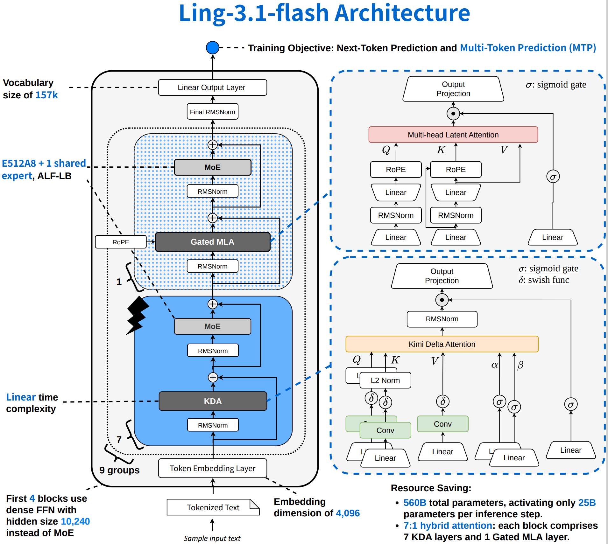
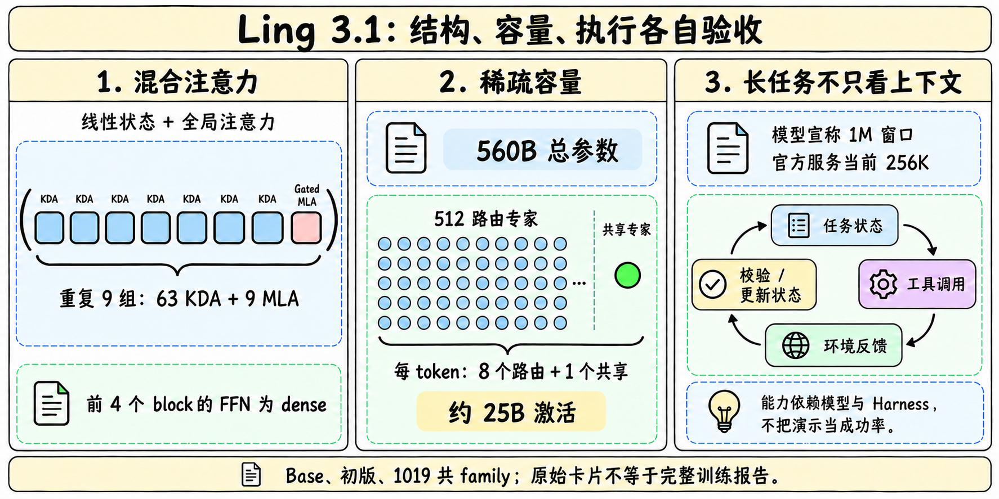
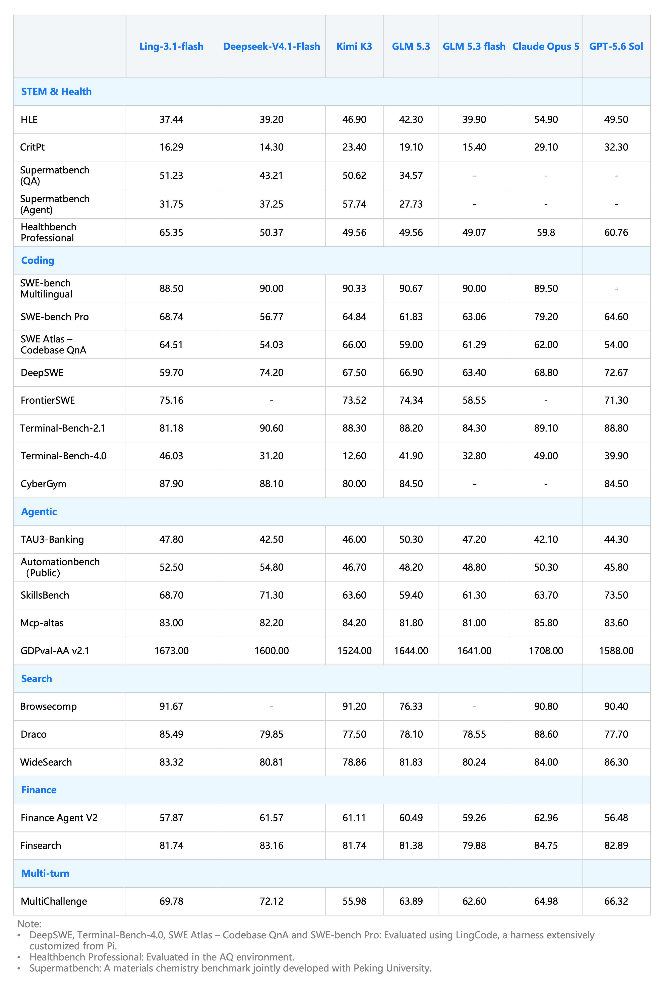

# Ling 3.1 family

> [!tldr] 我的判断
> Ling-3.1-flash是蚂蚁自研的文本混合推理正代：把63层KDA与9层Gated MLA混合，配合560B总参数、每token约25B激活的MoE，面向长周期工程与工具任务。真正需要分开验收的是网络结构、后训练版本和执行Harness；长上下文、稀疏激活与榜单高分分别回答不同问题。初版、1019和Base共用family入口，不拆成三个正代。

> [!warning] 原始训练资料不足，达不到完整技术报告精读标准
> 已阅读初版、1019、Base三份完整HF卡、蚂蚁官网和官方模型说明，保存三张官方原图与手绘研读图。当前材料缺完整预训练数据/阶段、后训练配比、RL奖励与消融，也缺统一硬件/执行器的独立复现。卡中的Training-content Summary是PDF训练内容披露，**不是Tech Report**；按要求仅保留链接，不抓PDF，也没有声称读过全文。本笔记达不到GLM/Kimi完整报告级机制归因深度，未知部分不会拿通用MoE常识补成事实。

## 日期：公告、开源仓库与渠道上架分开

蚂蚁官网What's New明确列 **2026-09-30 Ling-3.1-flash: A Model Upgrade for Real-World Tasks**，据此把family首发设为9/30。官网模型说明的粗粒度演进表写2026.10，本文保留这一差异，不让月份概述覆盖已明确的公告日期。HF仓库创建/修改时间不是首发证据。

2026-10-29阿里云Model Studio记录`antdigital/Ling-3.1-flash`直供上架，这是渠道可用性，不是千问正代，也不是Ling当天首次发布。蚂蚁官方FAQ同样说明Ling与Qwen没有直接产品族关系。

`1019`原卡确认进一步后训练和新的成绩，但没有在正文明确首次公开日。**名称1019、仓库创建日10/27都不直接当首发日**；其权重/能力作为family内部版本记录，精确更新日期仍待核，不伪造一条10/19发布事件。

## 结构：注意力效率与专家容量是两根独立旋钮

| 规格 | 官方原卡 | 不能推导成 |
|---|---|---|
| 总 / 激活参数 | 560B / 25B每token | 只需存25B权重或单卡可装下 |
| 注意力 | 63 KDA + 9 Gated MLA，7:1 | 所有层都线性复杂度 |
| 专家 | 512 routed，激活8个；另有1 shared | 8个独立Agent或人工选技能 |
| FFN | 前4个block使用dense，intermediate10240 | 72层全部相同MoE结构 |
| hidden / heads | 4096 / 64 | 参数规模直接决定任务成功 |
| 专家intermediate / vocab | 1280 / 157184 | 语言覆盖、质量或token成本保证 |
| 上下文 | 模型宣称1M；官方服务当前256K | 任意API均能收1M且质量无损 |

KDA更新压缩状态，Gated MLA保留部分全局注意力路径；这是对长序列算量、状态容量和检索的折中，不是消除长上下文丢失问题。MoE减少每token激活计算，仍有专家权重存储、路由、跨设备通信、KV/循环状态和工具执行成本。官方图中的MTP训练目标也不等于部署时免费减少所有任务延迟。

## 三份checkpoint怎样读

初版是混合thinking / non-thinking的后训练文本模型，官方建议thinking开启、temperature1.0、top_p0.95、top_k20。1019保留同一架构并进一步后训练；资料没有披露足以还原该后训练的reward和数据配比，不能称为已证明某种RL算法贡献。

Base是供继续预训练、领域适配和后训练研究的基础checkpoint。原卡说明采用FP8训练，发布的是经过Warmup-Stable and Merge（WSM）合并的BF16基础权重。**训练精度FP8与发布精度BF16不同**；“Base评测不错”也不构成可直接对话、安全对齐或production-ready保证。

初版、1019、Base在同一family中比较，日期和用途分别记录。Base不是对话模型的便宜替代，1019也不能只靠URL换名字加载：其SGLang Quickstart当前仍指`inclusionAI/Ling-3.1-flash`。测试新版时必须显式改成`...-1019`并固定revision，否则会把初版结果误记给新版。

## 初版结果：Harness与任务条件进入解释

完整官方表保留在下图。所列均为厂商自报或转引的快照，未本地复测。

| 初版指标 | 官方值 | 阅读限制 |
|---|---:|---|
| Terminal-Bench 4.0 | 46.03 | LingCode执行器；不能与2.1的81.18混用 |
| SWE-bench Pro | 68.74 | 同样用高度定制Pi衍生的LingCode |
| DeepSWE | 59.70 | 与DeepSeek-V4.1-Flash 74.20相比并非全胜 |
| FrontierSWE | 75.16 | 不能据此推到所有软件工程任务 |
| SkillsBench | 68.70 | 低于图中GPT-5.6 Sol 73.50 |
| BrowseComp | 91.67 | 多轮工具/搜索成本仍需计入 |
| HealthBench Professional | 65.35 | 官方说明在AA环境，不是临床验收 |
| Supermatbench QA / Agent | 51.23 / 31.75 | 知识问答与工具执行差距要保留 |

LingCode基于开源Pi改造，支持长时任务、数百轮工具与反复上下文压缩。原卡说考虑未来开源，不能称其完整执行环境已可复现。DeepSWE、Terminal-Bench4.0、SWE Atlas Codebase QnA和SWE-bench Pro明确用了LingCode，因此这些分数衡量模型与执行器系统，不宜全部归因参数或注意力比例。

GDPVal-AA v2.1表中的1673，与1019文字中的AA-Briefcase从约1400到1524 Elo并非同一名称/快照；Automationbench Public52.50也不直接等于1019所述AutomationBench-AA旧值62。本文保持各自标签，不挑较大数字统一成“模型总分”。

## 1019：同族后训练提升，日期与归因仍有边界

| 原卡对照 | 初版/旧快照 → 1019 | 解释 |
|---|---|---|
| AA-Briefcase | 约1400 → 1524 Elo | Elo差不是正确率百分点 |
| AutomationBench-AA | 62% → 68% | +6个百分点，约9.7%相对提升；不是Public52.50那行 |
| CritPt | 18% → 26% | +8个百分点；初版完整图另列16.29，快照不同 |
| SciCode | 54% → 57% | +3个百分点，缺误差条与独立重复 |
| AA Intelligence Index v4.3.2 | 41 → 44 | 版本化组合指数，不直接减另一版指数 |

仅有这些变化，仍不能识别奖励、数据量、任务覆盖、Harness变化各自的贡献；这正是完整报告与消融缺口。模型规模不变，提升不能解释为参数变大。

## Base：正面结果也保留反例

Base卡列47项、8领域、不同0–5 shot设置，完整表另由模型卡渲染页承载。几个有解释力的对照是：LongBench51.90高于DeepSeek-V4-Pro-Base17.70；但RULER128K88.64低于95.06、256K86.64低于94.37。长上下文并非所有测法都占优。

代码HumanEval-Plus79.88低于MiMo-V2.5-Pro-Base82.93，BigCodeBench53.60低于66.75；不能用少数数学优势覆盖代码执行短板。Base的47项也不与后训练初版表直接混排，因为prompt、shot数、任务协议和训练阶段均不同。

## 推理配置：当前服务窗口不替代离线模型上限

官方模型页说1M上限、官方服务当前256K；阿里云上架页宣称上限1M。不同入口需实际核对请求/模型ID和服务约束，不替某一入口承诺另一入口的容量。

SGLang原卡列8×H200（TP8+EP8）或4×GB300（TP4+EP4），NEXTN为投机解码；可选Hopper kernel约10% batch1 decode提升只是指定优化条件，不能移成所有并发/长任务收益。vLLM需要对应模型与ling3工具/推理parser；temperature、thinking、工具schema、上下文压缩策略都要固定。本轮未运行Docker/安装命令、模型代码或权重。

> [!insight] 对Agent训练：把状态压缩后的错误算进奖励
> 更大的窗口和更长工具链增加可处理历史，也增加无效重复、丢失约束与恢复成本。实验应固定执行器、任务分布、工具预算和上下文压缩方式，分别测首次成功、恢复成功、token/调用/时间成本。对比Base到后训练、初版到1019时，若Harness同时变化，应先分离系统收益与权重收益。

## 一手资料与导航

- [🤗 初版Model Card](https://huggingface.co/inclusionAI/Ling-3.1-flash)、[1019原卡](https://huggingface.co/inclusionAI/Ling-3.1-flash-1019)、[Base原卡](https://huggingface.co/inclusionAI/Ling-3.1-flash-base)；三份完整MD已保存。
- [官方模型页](https://developer.ant-ling.com/en/docs/models/ling)、[蚂蚁官网9/30公告索引](https://www.ant-ling.com/en)。模型页仍称Tiny未来开源而HF已有Tiny卡，官网各入口存在时效差异。
- [训练内容披露PDF](https://huggingface.co/inclusionAI/AI-Transparency/resolve/main/Ling-3.1_TDS-Summary.pdf)：仅保留链接，不冒充Tech Report。
- [DeepSeek V4.1 Flash对照入口](https://linjh1118.github.io/thinking/base-model-atlas/model.html?id=deepseek-deepseek-v4-1-flash)：比较时固定执行器与预算。

> 📊 相关可视化：[[ling31_poster_zh.html|中文Poster]]
