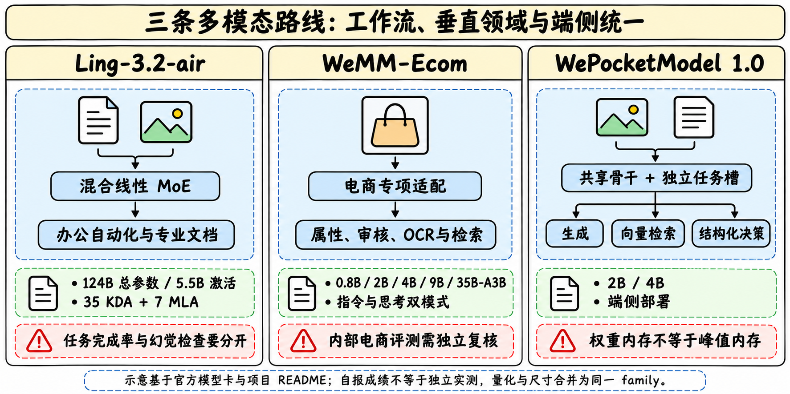

# Ling-3.2-Air — 合并进Ling 3.2的开放多模态型号

> [!tldr]
> 我的判断：Air的发布补齐了124B/5.5B开放权重路线，应与11/05的3.2 Flash共family，而不是新增一条正代。其专业工作流提升很大，但法律任务经材料幻觉检查后的all-pass仅0.8%，比criterion pass87.7%更能提醒严格任务终态的差异。

> [!warning] 资料不足
> 已读HF原卡、配置、发布事件与静态页面。卡的两张官方图链接指向intranetproxy.alipay.com，本机正常访问失败，未绕过权限；正文图示仅为据卡制作的手绘机制图，不假冒官方架构/完整成绩原图。缺独立3.2-Air技术报告、训练token/配比/教师/RL、逐题评测与误差条。

## 型号、日期与架构

> [!tldr]
> HF publish=2026-11-23T15:28:47.723Z，对应北京11/23 23:28；创建和上传早于公开，不据此提前日期。

Air卡称与Ling-3.0-flash-VL同原生多模态架构，124B/5.5B激活，35KDA+7GatedMLA（5:1），42语言层、2dense开头层、512路由专家+1共享、top8、hidden2560、32heads、专家宽768、dense6144、词表157184。HF张量元数据约127.921B包含更广组件，不等于主模型简称改变。配置max_position262144、rope_scaling=null；开源讨论有1M YaRN提案，提案不是已合并配置或实测证据。Flash的560B/25B与1M不能套给Air。

文本、图片、视频输入形态在卡中给例子；video_url只是请求输入契约，不证明完整视频任务质量。MIT卡许可与推理依赖条款分别保留。

## 评测：逐项保留不同成功定义

> [!tldr]
> 下列为原卡正文可核查数值，完整图不可达；分母、判分与模型条件不齐，不据倍数变化推断普遍能力跃迁。

| 指标 | 卡中前代 | Air | 注意 |
|---|---:|---:|---|
|AutomationBench-AA|15.7%|61%|工作流任务，非通用准确率|
|GDP.pdf all-pass|8.4%|16%|必须全部要求通过|
|AA-Briefcase v1.1 Elo|987|1340|+353；Elo非百分比|
|Terminal-Bench4.0|0%|27%|终端环境成功率|
|AA Intelligence Indexv5.0.1|未列|23|第三方汇总版本需固定|
|Harvey LAB-AA criterion|未列|87.7%|逐条标准通过|
|Harvey all-pass before hallucination|未列|8.3%|全要求同时满足|
|Harvey all-pass after hallucination|未列|0.8%|加入材料幻觉检查|

卡用“predecessor”并链接3.0-flash-VL，但没有完整原始图可核对所有列条件。0.8%不能被87.7%替代；反过来也不能把0.8%当所有法律请求准确率。缺样本数、置信区间、工具预算和完整harness日志。

## 推理与Agent训练启发

> [!tldr]
> 开发镜像、parser、chat template和模型revision共同定义运行行为；没有执行本卡示例，不宣称硬件可复现。

推荐SGLang开发镜像dev-Ling-3.0-flash-VL，NEXTN/MTP、context262144、TP4；4×141GB级或Blackwell四卡，80GB卡改TP8。vLLM自定义分支支持ling3 reasoning/tool parser与MTP3speculative tokens。sampling建议temperature1/top_p0.95/top_k20、thinking=true。开发tag并非冻结digest，版本更新可能改变解析。

研究可把criterion pass、all-pass、引用核验、最终状态分开作为训练信号，固定token/工具/时间预算比较前代与Air。尤其检查法律任务的材料归因：答案格式完整但引用不存在，必须判失败。模型生成tool_call不等于应用已执行或验证工具。卡未给教师和RL配方，不借用LingSante-Flash训练路线补写。

## 来源与关联

> [!tldr]
> 当前Air证据来自HF；原有Flash文章保留独立规格与日期。

- [HF Model Card](https://huggingface.co/inclusionAI/Ling-3.2-air)、[官方公开活动](https://huggingface.co/organizations/inclusionAI/activity/all)、[Collection](https://huggingface.co/collections/inclusionAI/ling-32-6b03e6c3bca5bfeb21905e5b)。
- [[Ling-3.2-Flash]]、[[LingSante-3.1]]、[[Kimi-K3]]。

> 📊 相关可视化: [[ling32_air_poster_zh.html]]
