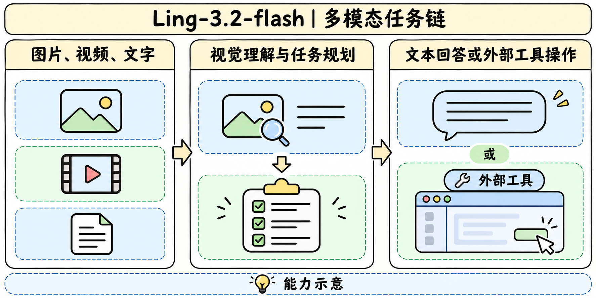

# Ling-3.2-flash

## 发布与规格

> [!tldr]
> 11 月 5 日，蚂蚁灵波上线 Ling 3.2 主干。公开规格延续 560B 总参数、25B 激活与 1M 上下文，主要变化是图片、文本和视频进入同一个面向任务的模型接口。

| 型号 | 总参数 / 激活 | 上下文 | 官方定位 |
|---|---:|---:|---|
| Ling-3.0-flash-VL | 124B / 5.5B | 256K | 视觉理解、多模态混合推理 |
| Ling-3.1-flash | 560B / 25B | 1M | 文本混合推理、长任务和工具调用 |
| Ling-3.2-flash | 560B / 25B | 1M | 原生视觉输入、视觉长程 Agent、空间理解 |

官方首页上线公告和开发者模型页一致。公告所链接的公众号正文触发环境验证，官方 HF 未见 3.2 原卡或权重。

## 能力与结构证据

> [!tldr]
> 这一代将视觉信息接入推理与行动。公开规模相同，权重继承、视觉编码和路由细节仍待披露。

开发者页将视觉语言融合放在架构层面，支持图像、文本和视频输入。分析长视频时，1M 表示上下文上限。视频帧率、视觉 token 占比、分辨率限制与多轮工具输出都会影响可用预算。3.1 原卡的 63 KDA + 9 Gated MLA 是上一代公开规格，3.2 层级配置仍待披露。

官方把复杂视觉理解、长程多模态 Agent、3D 关系与交互、医学图文列为重点。空间推理可用同一对象在不同视角下的关系追踪来判断。外部操作演示需要分别核对模型给出的动作、工具执行结果和任务终态。

## 评测与资料缺口

> [!warning] 资料深度
> 发布目录与规格已核对。架构报告、训练语料、后训练配方、权重和可比较的逐项评测尚缺，当前材料不足以达到 GLM-5.3-Flash / Kimi-K3 的报告级审计深度。

比较 3.1 与 3.2 时，可固定工具集合和预算，分别度量视觉证据定位、引用证据、动作正确、工具失败恢复和最终产物。长视频任务按采样预算分组，可分离高输入预算和推理增益。医学图文这里只记录官方能力范围，仍需对应任务的独立验证。

## 一手资料

> [!tldr]
> 日期取蚂蚁首页发布条目，规格取开发者模型页。

- [蚂蚁官方发布目录](https://www.ant-ling.com/en)
- [官方 Ling 模型页](https://developer.ant-ling.com/en/docs/models/ling)
- [官方发布文章](https://mp.weixin.qq.com/s/-eHoHAYQXgPP-EUpkgoCcA)
- [[ling32_poster_zh.html|中文 Poster]]
