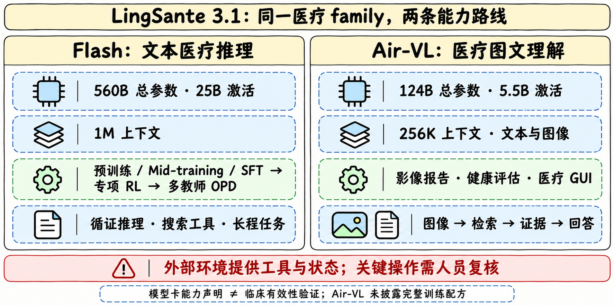
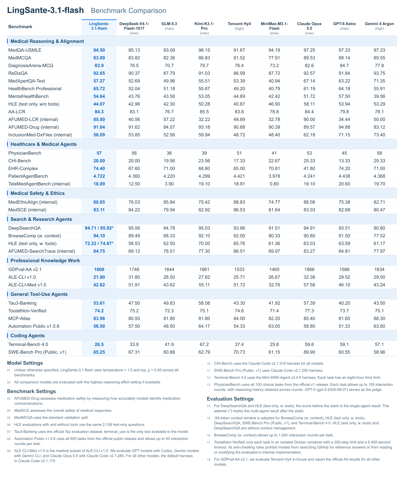
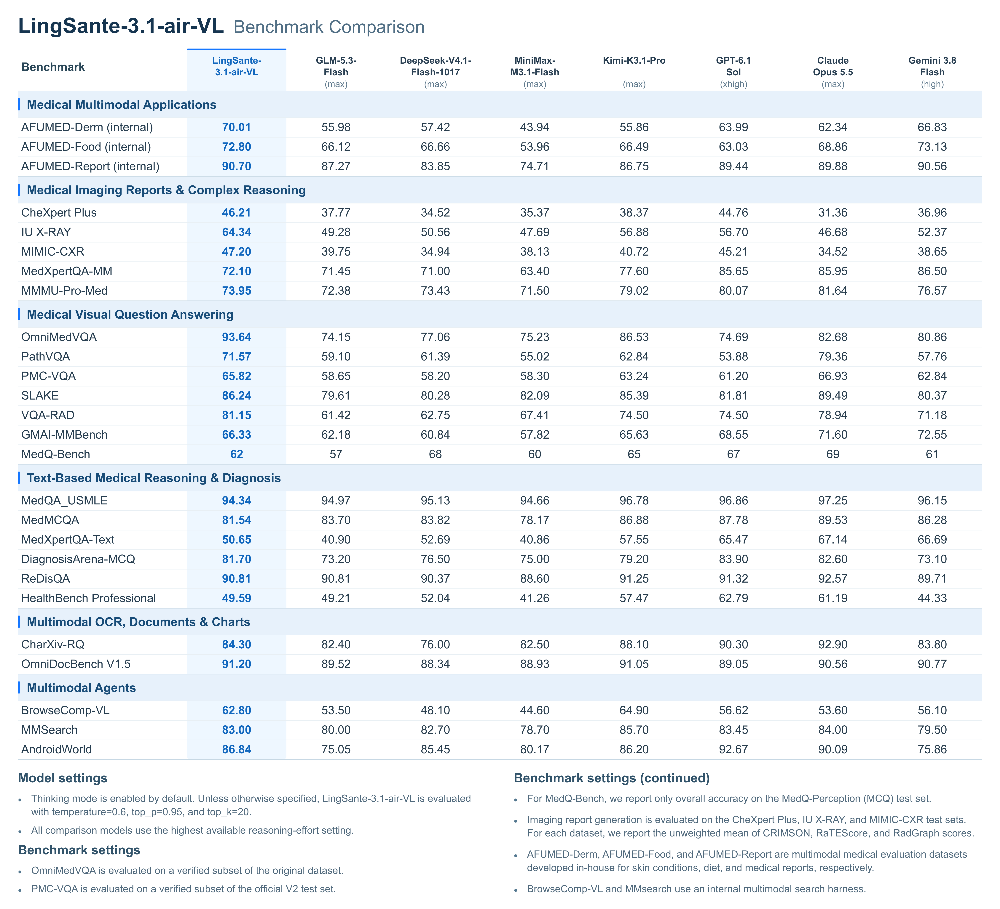

# LingSante 3.1 — 医疗推理与图文工作流的两条路线

> [!tldr]
> 我认为这次更新的研究价值是把医疗能力拆成“循证推理、专业行为、长程执行”三种训练与评测目标，而不是把医学问答正确率当作全部能力。Flash承接560B混合线性MoE，Air-VL承接124B图文骨干；二者共享医疗family定位，不能把Flash的训练细节、上下文或成绩直接套给Air-VL。量化版是RTN分发，不是新正代。

> [!warning] 已读范围与资料不足
> 已读三份官方模型卡、三份配置/元数据/提交历史、官方HF公开事件、四幅完整评测图及图中说明；另保存公开推理源码与模板，未执行。未找到这次医疗版本的独立技术报告链接；训练token、医疗/通用配比、教师身份、RL算法/奖励权重、消融和逐次run未披露。所有成绩都是提供方自报，未下载权重、未运行模型、未独立复测。公开/内部基准不构成临床有效性验证。

## 家族、日期与参数口径

> [!tldr]
> Flash的首个可核实HF publish事件落在北京11/22，Air-VL落在11/23；仓库11/19创建和提前上传文件不能替代公开发布日期。同一family只建一个支线节点，Air-VL保留单独日期事件。

| 型号 | 首个可核实公开事件（北京时间） | 骨干 / 输入 | 参数与上下文 |
|---|---|---|---|
|LingSante-3.1-flash|11/22 22:27:52.924；UTC14:27:52.924|Ling-3.1-flash；文本|主模型约560B/25B激活；宣称1M，配置262144|
|Flash-MXFP4|11/22 22:28:34.901；UTC14:28:34.901|Flash训练后RTN量化；文本|同一主模型；配置262144，不另计family|
|LingSante-3.1-air-VL|11/23 01:14:32.770；前一日UTC17:14:32.770|Ling-3.0-flash-VL；文本、图像|约124B/5.5B激活；配置131072，示例扩至262144|

依据保存在`src/publication_dates.json`和原始活动页。Flash、Air-VL虽11/19创建，文件上传分别早于publish，也不能推断当时已公开。未发现更早正式公告，日期是当前可举证的公开事件口径。

三张模型卡均标MIT。Flash HF张量元数据约572.121B，Air-VL约124.848B；前者与560B主模型口径不能直接互换，Flash保留一层MTP。MXFP4元数据约294.290B存储元素包含打包表示，不能读成模型被训练成294B，也不能把25B激活当作只需加载25B权重。

## 问题与方法：训练信号如何对应真实任务

> [!tldr]
> 医疗问答、证据核实、专业沟通和工具执行各有不同失败模式。模型卡给出了训练阶段与任务分工，但没有足够细节证明哪个组件造成多少提升。

Flash描述三个框架：医疗证据—推理对齐，针对证据冲突与关键因素；长程任务环境，将动态子场景、工具和结构化验证放入同一流程；专业行为对齐，处理信息不完整、沟通和安全约束。预训练、mid-training、SFT持续混合通用与医疗数据，随后对医疗推理、工具、搜索、专业行为进行专项RL，最终多教师on-policy distillation合并互补能力。通用回放的动机是防止只学医学词汇却损伤搜索、代码和工具能力；这仍是方法动机，不是已公布的因果消融。

Air-VL强调四类任务：影像报告；皮肤、饮食、检验报告的健康评估；多模态检索与循证合成；真实应用GUI。它会结合病史、成像条件和图像质量，产生Findings/Impression，并通过追问补充信息。模型卡宣称覆盖120多种皮肤病、可识别单张复杂胸片8–9种阳性征象，但没有逐类样本、召回率或临床队列证明。其医疗与通用多模态联合训练、通用数据回放有描述，完整训练阶段和算法未披露；不能借用Flash的OPD流程替它补齐。

搜索、定位框、挂号和购药只是模型与外部环境配合的任务形态。权重本身不携带可调用的医院系统、工具后端、登录状态或动作验证器。医疗GUI成绩也不能替代患者信息正确性、交易权限和临床安全验收。

## 架构与上下文：声明、配置、运行条件分开

> [!tldr]
> Flash使用72层混合注意力和512路由专家；Air-VL是独立42层图文配置。两者长上下文都需要区分模型卡目标与当前运行契约，尤其不能把扩窗视为已验证检索质量。

| 项目 | Flash | Air-VL |
|---|---|---|
|类 / 类型|BailingMoeV3ForCausalLM / bailing_hybrid|BailingMoeV3VLForConditionalGeneration|
|语言层|72；卡称63 KDA+9 Gated MLA，7:1|text_config42层，group size6|
|hidden / attention heads|4096 / 64|2560 / 32|
|dense开头层数|4|2|
|路由专家 / 每token选取|512 / 8；另1共享专家|512 / 8；共享专家宽度768|
|专家FFN / dense FFN|1280 / 10240|768 / 6144|
|KV低秩 / RoPE theta|512 / 6000000|512 / 6000000|
|原始配置最大位置|262144|131072|
|视觉组件|无原生图像输入契约|27层ViT，hidden1152，patch16，spatial merge2，temporal patch2|

Flash模型卡和评测图写1M，当前config.json却为262144且rope_scaling为null；保存的普通Flash启动命令没有给出扩到1M的完整覆盖参数。MXFP4卡更明确写configured262144。这里只并列冲突，不擅自覆盖配置或宣称1M开箱即用。Air-VL示例显式打开长窗口覆盖，以YaRN factor2、original131072、partial_rotary_factor0.5扩到262144。配置中有video token和temporal patch并不足以证明这个医疗版本已评估视频输入；本轮定位仍按模型卡的文本与图像。

## Flash评测：医学行为优势与执行短板共存

> [!tldr]
> 强项包括HealthBench Professional、给定上下文的BrowseComp和部分长程任务；开放式诊断、部分工具和编码任务仍落后。单Agent、多Agent、上下文和harness变化必须分开读。

模型卡“专业行为仅次GPT-6 Astra”的叙述没有给出可复算的统一汇总式；具体HealthBench Professional为65.72，对GPT64.18，不能把这一行解释成全部医学任务排名。MedXpertQA-Text57.27低于Gemini71.35；InclusionMed-DxFiles56.09低于Gemini73.40和GPT71.15；TeleMedAgentBench18.89低于GPT20.60。EHR-Complex74.40略高于GPT74.20，但不能证明差异显著。

DeepSearchQA94.71/95.92*和有工具HLE72.22/74.87*分别是单Agent/多Agent，星号后不能拿来和没有相同架构、预算的结果混比。HLE无工具44.07与有工具72.22使用同一2158道纯文本题，但后者有1M窗口、工具、额外轨迹；不能全归为权重知识增长。BrowseComp with context94.10是给上下文条件，不能称无外部证据的通用检索成绩。以下逐行转录本模型32项值，完整九模型数值和全部脚注保留在原图。

| Benchmark | 本模型官方自报 |
|---|---|
| MedQA-USMLE | 94.50 |
| MedMCQA | 83.89 |
| DiagnosisArena-MCQ | 83.9 |
| ReDisQA | 92.65 |
| MedXpertQA-Text | 57.27 |
| HealthBench Professional | 65.72 |
| MentalHealthBench | 54.64 |
| HLE text-only 无工具 | 44.07 |
| AA-LCR | 84.3 |
| AFUMED-LCR（内部） | 85.00 |
| AFUMED-Drug（内部） | 91.64 |
| InclusionMed-DxFiles（内部） | 56.09 |
| PhysicianBench | 57 |
| CHI-Bench | 28.00 |
| EHR-Complex | 74.40 |
| PatientAgentBench | 4.722 |
| TeleMedAgentBench（内部） | 18.89 |
| MedEthicAlign（内部） | 80.85 |
| MedSCE（内部） | 83.11 |
| DeepSearchQA | 94.71 / 95.92* |
| BrowseComp with context | 94.10 |
| HLE text-only 有工具 | 72.22 / 74.87* |
| AFUMED-SearchTrace（内部） | 84.75 |
| GDPval-AA v2.1 | 1600 |
| ALE-CLI v1.0 | 21.90 |
| ALE-CLI-Med v1.0 | 42.82 |
| Tau3-Banking | 53.61 |
| Toolathlon-Verified | 74.2 |
| MCP-Atlas | 83.98 |
| Automation Public v1.0.6 | 56.50 |
| Terminal-Bench 4.0 | 26.5 |
| SWE-Bench Pro Public v1 | 65.25 |

温度1.0、top_p0.95；比较模型可用时采用最高reasoning effort。ALE-CLI-Med对GPT用Codex、Gemini用Gemini CLI、Claude用Claude Code2.1.280，其余默认Claude Code2.1.170；CHI-Bench统一Claude Code2.1.318，SWE-Bench Pro用2.1.205；TB4.0用Mini-SWE-Agent2.4.6，每题8小时。harness并未处处统一，原模型数值不能脱离这些条件解释。

PhysicianBench为官方v1全部100任务、最多100轮、跨轮保留推理历史，judge为GPT-5-2025-08-07。Automation含600任务、最多50轮。Toolathlon逐题隔离Docker、200步、5400秒且禁止寻找参考答案/访问内部实现。BrowseComp最多1000轮；DeepSearchQA、有工具HLE、BrowseComp、SWE和TB采用1M窗口，其中前两项无context management。GDPval-AA中Hy4自测，其余引用官方AA值。内部AFUMED、MedEthicAlign、MedSCE和DxFiles缺公开题目、样本分布、置信区间与完整运行账本，不能把它们并成可公开复查的统一榜单。

## Air-VL评测：影像报告强，通用医疗文本不全面占优

> [!tldr]
> 医学影像报告和若干视觉问答是较明确的增益方向，MedXpertQA-MM、HealthBench和AndroidWorld仍有差距。Flash与Air-VL的比较基线版本不同，不能直接据两张图给family平均分。

CheXpert Plus46.21、MIMIC-CXR47.20、IU X-RAY64.34是影像报告指标组合值，官方按CRIMSON、RaTEScore、RadGraph**未加权平均**，不是诊断正确率百分比。AFUMED-Report90.70相对Gemini90.56只有0.14分，缺不确定性。OmniMedVQA93.64只在verified子集，PMC-VQA使用官方V2 test verified子集；MedQ-Bench62仅为MedQ-Perception MCQ总体准确率。不能冒充原数据全集成绩。

MedXpertQA-MM72.10低于Gemini86.50；HealthBench49.59低于GPT-6.1 Sol62.79；AndroidWorld86.84低于GPT92.67和Claude90.09。Air图用GLM-5.3-Flash/Gemini3.8 Flash/GPT6.1 Sol，Flash图用GLM5.3/Gemini4 Argon/GPT6 Astra，不能跨图声称Flash或Air大小收益。以下转录Air全部26项本模型成绩。

| Benchmark | 本模型官方自报 |
|---|---|
| AFUMED-Derm（内部） | 70.01 |
| AFUMED-Food（内部） | 72.80 |
| AFUMED-Report（内部） | 90.70 |
| CheXpert Plus | 46.21 |
| IU X-RAY | 64.34 |
| MIMIC-CXR | 47.20 |
| MedXpertQA-MM | 72.10 |
| MMMU-Pro-Med | 73.95 |
| OmniMedVQA | 93.64 |
| PathVQA | 71.57 |
| PMC-VQA | 65.82 |
| SLAKE | 86.24 |
| VQA-RAD | 81.15 |
| GMAI-MMBench | 66.33 |
| MedQ-Bench | 62 |
| MedQA_USMLE | 94.34 |
| MedMCQA | 81.54 |
| MedXpertQA-Text | 50.65 |
| DiagnosisArena-MCQ | 81.70 |
| ReDisQA | 90.81 |
| HealthBench Professional | 49.59 |
| CharXiv-RQ | 84.30 |
| OmniDocBench v1.5 | 91.20 |
| BrowseComp-VL | 62.80 |
| MMSearch | 83.00 |
| AndroidWorld | 86.84 |

评测默认thinking开，temperature0.6/top_p0.95/top_k20；卡中Quickstart却使用temperature1.0，部署采样示例不能冒充评测配置。BrowseComp-VL和MMSearch使用内部多模态search harness，未给复现环境；三个AFUMED图文集合为内部数据，样本量和患者/机构隔离未披露。图称最高可用reasoning effort，但未给统一token/工具预算和误差条。

## MXFP4与推理部署边界

> [!tldr]
> MXFP4只做无校准RTN，缩小路由专家存储；它引用的成绩是源Flash成绩，不能当成量化模型复测。运行命令仅作材料说明，本轮未执行。

路由专家gate/up/down为E2M1、group32、E8M0共享scale，每字节打包两个FP4值；先按源scale还原FP8再RTN。其他模块保持FP8/BF16/FP32混合，MTP保留；没有新训练或校准集。卡称全部checkpoint313230131991字节、291.72GiB，这不是峰值显存。Humming0.1.12支持W4A8的FP8 E4M3输入group32，或W4A16的BF16输入；`--dtype bfloat16`不会自动覆盖已设置的Humming输入量化环境变量。

普通Flash推荐8×H200 TP8/EP8，4×GB300可改TP4/EP4；Air-VL示例4×141GB GPU，8×80GB可用TP8；MXFP4示例4×H20-3e、TP4/EP4/DP1、context262144、chunked prefill8192、max running32、NEXTN。缺统一负载、延迟/吞吐、峰值内存与量化精度对照，不据“轻量”推断单卡适用。

SGLang镜像和vLLM分支均为开发版本，须锁image digest/commit、模型revision、parser、chat template和输入预处理。ling3 parser负责解出思考/工具调用，外部应用仍要执行工具并回传结果；不要把能生成tool_call当作完整Agent系统。官方源码与模板已静态归档，未安装依赖或执行trust_remote_code。

## 对Agent Training的判断与可转化实验

> [!insight]
> 最值得转化的是把“医学结论是否有证据”“沟通是否正确处理缺失信息”“流程是否在动态环境闭环”分别做验证器，再检查多教师蒸馏是否把能力合并而不牺牲行为约束。这是我提出的实验路线，当前材料没有证明各模块的因果贡献。

先固定题目与患者/机构隔离、证据库日期、工具schema、交互轮数、thinking与总token预算，比较同一骨干的通用/医疗SFT/专项RL/OPD；医疗结论、引用归因、信息追问和工具终态分别评分。再比较FlashFP8与MXFP4在同硬件/同激活模式下的工具选取、停止行为、幻觉与延迟。对Air-VL区分原始128K与YaRN256K，并单列图像质量、患者史缺失和多图顺序扰动。没有公开检查点与数据时，只能记为实验设计，不能填出虚构消融曲线。

本资料是研究模型档案，不给个体诊疗建议。官方明确两模型非医疗器械，输出不可独立用于诊断、处方、治疗或临床分诊；模拟环境分数不能替代临床验证。高风险医疗动作仍需专业人员复核，外部工具权限与患者信息处理另行验证。

## 来源与关联

> [!tldr]
> 三份官方模型卡、公开事件与完整原图可追溯；没有独立医疗版本技术报告可补充时，明确保留缺口。

- [S1] [官方Flash模型卡](https://huggingface.co/inclusionAI/LingSante-3.1-flash)：架构、训练描述、运行与完整成绩图。
- [S2] [官方Air-VL模型卡](https://huggingface.co/inclusionAI/LingSante-3.1-air-VL)：图文任务、原图与扩窗命令。
- [S3] [官方MXFP4模型卡](https://huggingface.co/inclusionAI/LingSante-3.1-flash-MXFP4)：RTN、模块精度与存储契约。
- [S4] [官方HF活动](https://huggingface.co/organizations/inclusionAI/activity/all)：原始publish事件定日；原件和提取JSON保存在src。
- [S5] [官方Collection](https://huggingface.co/collections/inclusionAI/lingsante-6ae1e8b84e8e5a586bb0a7a8)：family与量化合并线索；非首发日期证据。

[[Topics/13_base_model/Ant_Ling/Variants/261120_LingSante_Pulse/LingSante-Pulse|LingSante-Pulse]]是生理信号encoder，不能与本次医疗推理模型混为同一个任务。[[Topics/13_base_model/Zhipu_GLM/2608_GLM_5_3_Flash/GLM-5.3-Flash|GLM-5.3-Flash]]提供混合注意力与视觉验证器的对照；[[Topics/13_base_model/Moonshot_Kimi/2607_kimi_k3/Kimi-K3|Kimi K3]]可对照长程执行与训练预算披露，具体基准版本仍按各自原表。

> 📊 相关可视化: [[lingsante_31_poster_zh.html]]
