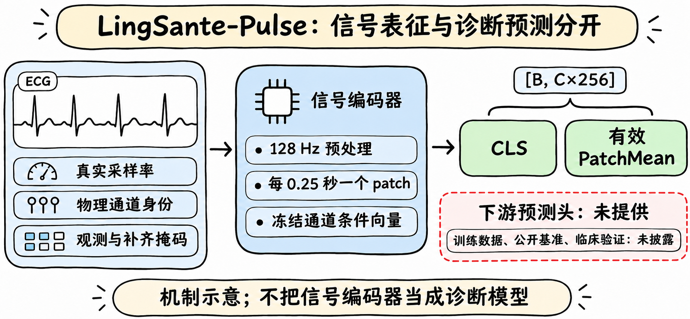

> [!tldr]
> LingSante-Pulse是16.7M参数的生理信号编码器，返回CLS和有效patch均值表征，没有任务预测头。它是独立专项支线，不是Ling医学聊天模型的新正代，也不能按诊断模型记性能。

> [!warning] 材料不足
> 官方HF publish=2026-11-20T09:16:41.620Z，即北京11/20 17:16:41；以首次公开发布事件收录，不用早先仓库创建/提交时间。已读完整README、配置、通道字典、许可与文件清单，未发现卡内报告/代码仓库链接。卡要求独立推理包但没有给其来源与版本；本轮不猜包安装地址、不安装、不下载权重。训练数据、架构层数/损失、公开基准、跨设备泛化与临床验证均未披露，当前只适合建立可追溯的接口档案。

## 输入、预处理与输出

> [!tldr]
> 采样率和物理通道身份属于输入语义，不能只把数组reshape后送入模型。

输入可为[T]、[C,T]、[B,C,T]或对齐的通道字典。调用必须给真实采样率和通道描述；代码包处理固定128Hz预处理、观测样本与存储补齐掩码。不能把原始1280点在任意采样率下都解释为10秒，也不应把padding当真实生理信号。

| 输出 | 形状/含义 |
|---|---|
|CLS|[B,C×256]，各通道拼接|
|PatchMean|[B,C×256]，仅observed-valid patch聚合，独立于CLS|
|return_tokens=True|0.25秒间隔的有序patch特征与validity masks|
|下游预测头|未提供，不能直接输出疾病/睡眠分期结论|

官方随机数组示例为B2、C1、1280点、128Hz、ECG导联II，预期两份[2,256]输出。它是接口演示，随机噪声没有临床含义；没有实际跑过，就不能写“已验证结果”。多通道向量按输入顺序拼接，交换顺序会改变特征位置，需冻结通道顺序。

## 通道条件与文件契约

> [!tldr]
> 固定通道向量来自指定BGE模型；仓库没有随附BGE权重或tokenizer，这也不证明模型能理解任意自由文本通道名。

channels.json列有EEG、EOG、EMG、ECG导联、PPG、呼吸气流/胸腹用力、SpO2等物理描述。字典出现某类通道只证明身份词汇存在，不等于该类信号的训练覆盖充分或性能已验证。完整字典保存在src，不在正文虚构各模态指标。

通道向量由BAAI/bge-small-en-v1.5固定revision生成，CLS pooling+L2 normalization；仓库只分发结果向量。不能把其256维编码器输出与BGE向量维度直接等同，也不能推断模型会在每次推理实时调用BGE。

| 文件 | 已核实用途 |
|---|---|
|model.safetensors|约16,708,352参数，HF元数据F32；本轮不下载|
|config.json|format_version1与三个资产SHA256，未公开网络结构|
|channels.npz|固定通道条件向量；本轮不下载二进制|
|channels.json|可读物理身份描述|
|README / LICENSE|接口与MIT许可|

revision可固定模型版本，local_files_only可限制本地缓存加载；这些参数不能替代校验独立推理代码包版本。配置内SHA是自动完整性检查的输入，不是对训练质量、适用人群或数据无污染的证明。

## 当前能判断什么、还缺什么

> [!tldr]
> 目前可以复述输入输出契约，不能给出效果排名、训练机制或临床适用结论。

没有公开样本数、人群/设备分布、数据使用授权、预训练目标、切分与患者隔离、任务头、分类AUROC/F1、回归误差、置信区间、推理速度和内存账本。不以“基础模型”称谓补造Transformer层数或自监督损失，不沿用Ling医学语言模型成绩。

如果后续提供推理包与任务数据，先冻结采样率转换、滤波、单位、缺失段/补齐规则和通道映射，再按患者/设备/机构隔离评测；分别验证CLS、PatchMean、token pooling及不同下游头，并比较跨设备/导联缺失退化。上述为研究验收设计，本轮没有临床测试，也没有证明泛化或安全性。

> [!insight] 对当前研究的启发
> 工具使用Agent可以把它当候选特征提取工具，但需要独立解析/信号质控工具和可追踪的下游判定。仅返回向量的工具不应被包装成“已诊断”；训练数据应记录工具实际输入、掩码和模型revision，让验证器检查接口语义而非奖励流畅的医学解释。

## 官方来源与交付

> [!tldr]
> 唯一可核实发布入口为官方HF；未发现的报告和推理包来源继续列缺口。

- [官方模型卡](https://huggingface.co/inclusionAI/LingSante-Pulse-1.0)
- [官方发布活动](https://huggingface.co/organizations/inclusionAI/activity/all)
- [配置](https://huggingface.co/inclusionAI/LingSante-Pulse-1.0/blob/main/config.json) · [通道字典](https://huggingface.co/inclusionAI/LingSante-Pulse-1.0/blob/main/channels.json)
- [BGE通道向量来源revision](https://huggingface.co/BAAI/bge-small-en-v1.5/tree/5c38ec7c405ec4b44b94cc5a9bb96e735b38267a)

[[SingProbe-Family]]

> 📊 相关可视化: [[lingsante_pulse_poster_zh.html]]
