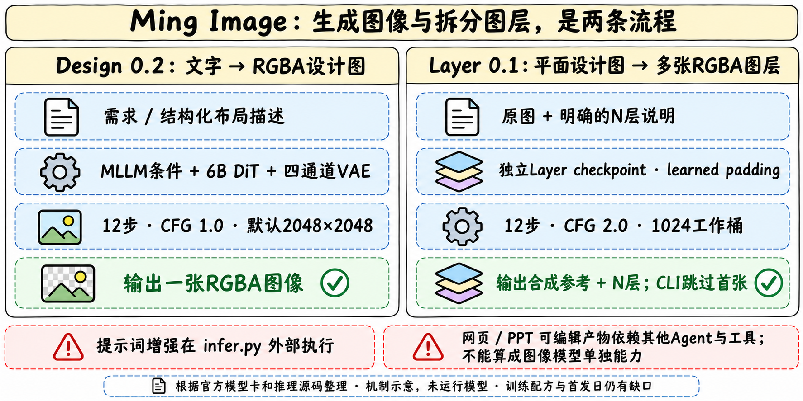
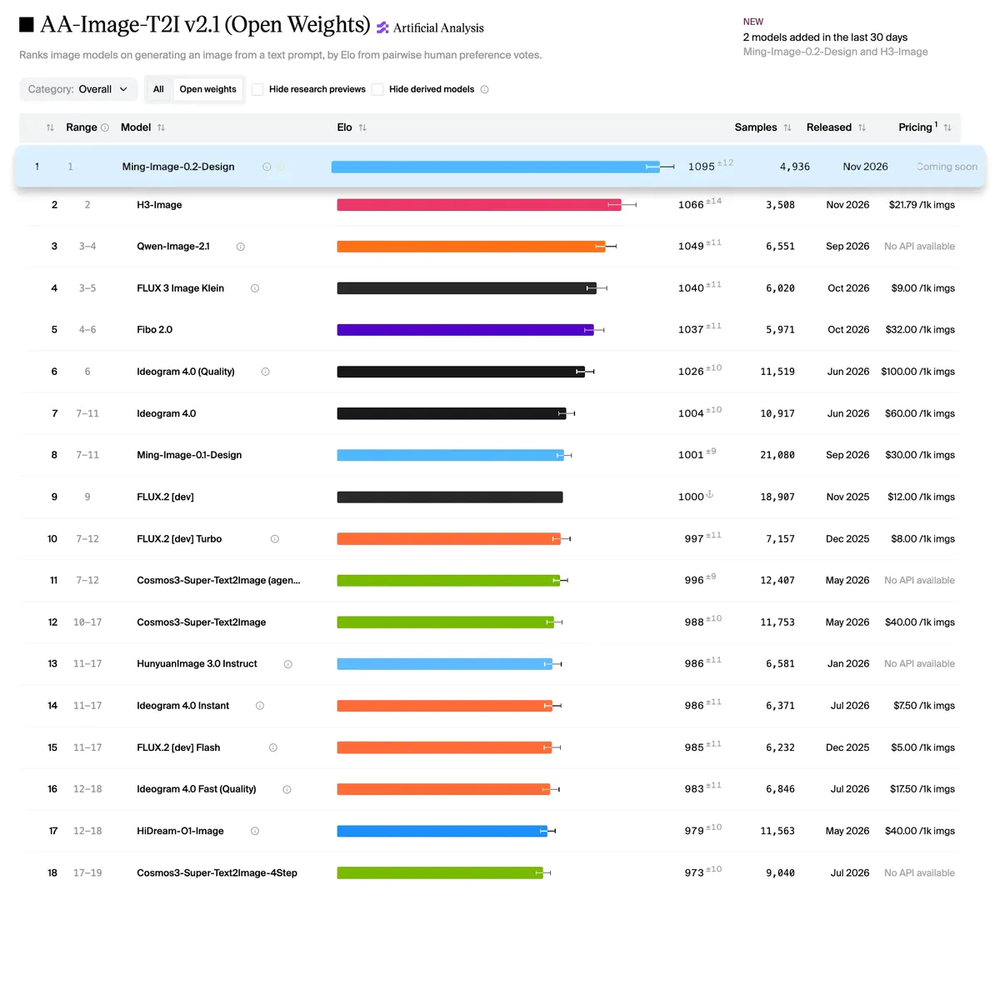
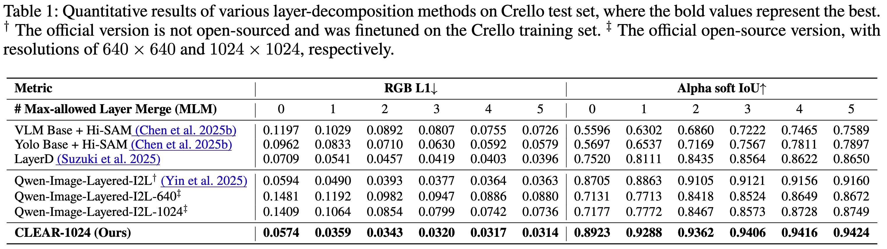

# Ming Image — 把可生成、可分层与可编辑工作流分开

> [!tldr] 我的判断
> 这条支线的价值在于把设计图与透明图层作为可组合资产交给 Agent，而不是证明图像模型自己会写网页或生成可编辑 PPT。Design 0.2 的 6B 指 DiT，不是整个 MLLM、connector、VAE 管线总参数。公开推理契约足够建立能力边界，尚不足以解释训练收益或复现官方榜单。

> [!warning] 日期、开放与训练缺口
> 当前官方仓库列出 Design 0.2、Design 0.1 与独立 Layer 0.1，统一 family 收录，不能拆成三个通用正代。0.1 的官方榜单图记录2026年9月；0.2 的图只记录2026年11月，模型卡把榜单标为11/25并称11/23有初步结果。HF创建9/17、11/25，权重上传与README提交均只作材料线索，**不当首次公开日**。本轮没有证实首次私有转公开时刻，故family日期仅9月，0.2升级仅11月，进入“发布日期待核实”，不伪造每日发布事件。官方公众号返回环境验证页，X入口403；未绕过验证。未下载权重、未运行推理或训练；没有取得完整训练报告、数据清单、配方或受控0.1→0.2实验。

## 模型族、开放与材料时间

> [!tldr] 同族合并不等于任务可互换
> 0.1/0.2 Design共用推理代码；Layer仍指向独立0.1权重。0.2卡片里的角色部件分层描述没有对应0.2-Layer checkpoint，不能把该升级能力默认为当前Design参数可直接调用。

| 项目 | 官方材料 | 边界 |
| --- | --- | --- |
| Design 0.2 | 新版视觉设计生成，DiT 6B，当前可下载 | 构图、光照和文字改进为官方定性声明；没有逐项受控消融 |
| Design 0.1 | 旧版设计生成，DiT 6B | 9月UI/UX细分类第一不等于当时总榜第一 |
| Layer 0.1 | 独立分层模型，DiT 6B | 返回RGBA层，与Design的单图生成不同 |
| 新分层升级 | 卡片称细到角色部件 | 当前公开列表仍只有0.1-Layer；0.2-Layer不列为已开放权重 |
| 许可 | 当前三卡/代码MIT | 以官方许可原件为准，不把第三方素材权利一并推定 |
| 版本固定 | GitHub d5615110e3ae7d27f270eafe5556d669b2069971；HF 0.2为3538f4c311cf8f5256d631ddb7f47793f741aa2e | `main`会变；本轮归档这些版本下的源码、配置和官方原图 |

HF 0.2权重包上传记录2026-11-25 12:52:53 UTC，首个可见模型卡13:18:10 UTC；GitHub展示0.2的提交为11/25 17:14:39 UTC（北京11/26 01:14:39）。它们说明对应内容何时进入历史，不能排除仓库此前私有。AA图的月份支持月份归档，不支持把具体上传日直接定为公开首发。

## 架构：6B以外还有哪些模块

> [!tldr] 看模块接口，不用产品名推断总规模
> 文本/参考图先经MLLM条件化，connector/MLP衔接至扩散模型，再由四通道VAE解码。配置是静态事实，不能把配置中的最大长度直接当实际可用文本预算。

| 模块 | 已归档配置 | 解释 |
| --- | --- | --- |
| MLLM语言骨干 | BailingMoeV2，20层、hidden2048、16 query/4 KV heads；256路由专家、top8与1共享；vocab157184 | 该子模块并非6B DiT；max_position_embeddings32768不是本轮实测服务上下文 |
| 视觉侧 | Qwen2.5 ViT类，32层、hidden1280、patch14、merge2 | preprocessor min/max_pixels均451584；参考图预处理尺度和最终2K输出不同 |
| Connector | Qwen2型，28层、hidden1536、12 heads/2 KV heads | config dtype float32与整体BF16设置分别记录，不把静态字段当最终所有张量精度 |
| MLP/条件 | VLM direct条件与learnable token条件；选hidden层5/12/20；cap维2560、DiT内部3840 | 不能从这些连接推断训练时各模块冻结/更新配方 |
| DiT | 官方6B；30层、hidden3840、30heads、2 refiner层、输入16 latent通道、patch2 | 这里的16通道是latent，与图像RGBA四通道不矛盾 |
| VAE | AutoencoderKLQwenImage，input_channels4，z_dim16，scale8.0064、shift0 | 参考编码要求latent分布mode(argmax)，不是随机sample |
| 调度器 | FlowMatchEulerDiscreteScheduler，配置train_timesteps1000、shift6 | generator源码随后强制dynamic_shifting=True，不能只抄配置中的false |

`diffusion/pipeline.py`按latent网格计算image_seq_len；达到4096时把max_image_seq_len设为当前长度、max_shift1.35，否则4096/1.15，再计算mu传set_timesteps，sigma_min=0。1000是调度参数，不是训练步数；12是推理采样步数，也不是12步训练。

## 两条推理契约与尺寸策略

> [!tldr] 加载失败比悄悄跑错checkpoint更可靠
> `inference_profile.py`要求padding与multi-frame字段配对，缺失、冲突和未知值直接报错，不靠目录名猜任务；新组件配置优先于旧root profile，两者不一致也报错。

| 契约 | Design generation/edit | Layer decomposition |
| --- | --- | --- |
| alignment_padding_mode | zero_masked | learned |
| multi_frame_output | false | true |
| VAE/参考编码 | 四通道、argmax | 四通道、argmax |
| 默认steps / CFG | 12 / 1.0 | 12 / 2.0 |
| 默认工作尺度 | 2048；支持1024/2048桶 | 1024；支持512/1024桶 |
| 输入与输出 | T2I不能有参考图，num_layers必须1；image-edit需参考图 | 必须参考图；根据明确N层说明生成N+1张，首张为合成参考 |
| 实际保存 | 单张RGBA PNG | CLI跳过第一张，保存独立layer_01等 |

`parse_num_layers`优先匹配“Decompose this image into N layers”，再读“Number of layers: N”，解析不到时退回5；不等同于模型自主发现正确层数。CLI会检查返回张数，Layer必须恰好N+1。任务schema能支持image-edit不代表已验证所有编辑质量或宣传中的新分层效果。

T2I的width/height必须同时给出，不能和resolution并用，宽高比限1:4–4:1；按面积平方根选择最近1024或2048内部桶（并列取较小值），再选内部aspect bucket，最后需要时Lanczos resize到请求尺寸。官方给2560×1440、2432×1824、1664×2496等例子；**请求尺寸不等于原生每像素都在该尺寸生成**。分层则按工作桶计算但保持输入图比例。

### 部署口径

官方已验证最低配置为一张80GiB CUDA GPU、BF16；这是指定实现的配置，不是实测最低显存或吞吐保证。默认MLLM eager，FlashAttention2可选，sdpa对LLM会在加载时报错，DiT内部仍用PyTorch SDPA，二者不能混为一谈。balanced映射为GPU0预留视觉/扩散固定模块并拆分MLLM，严格检查可见GPU数与声明匹配、layer设备和fixed module设备。

归档requirements精确固定torch2.4.0、transformers4.57.1、diffusers0.36.0、accelerate1.13.0，注释称9/16已验证；config还出现dev版本字符串。这不是本轮重建验证。源码有`validate-only`与smoke/contract tests入口，但我们没有执行可能触发HF下载的推理命令。应另建隔离环境、固定所有权重哈希后再测，不把“可读源码”写成“复现成功”。

## 提示词增强与Agent工作流

> [!tldr] 模型能产图，工具链负责资产成为可编辑产物
> PE在infer.py外部执行，官方推荐可选Ling-3.0-flash-VL或Qwen3.8-27B；卡片还展示搭配Ling-3.2-flash做网页。额外模型的调用预算与收益必须单独计算。

生成PE要求严格JSON：canvas_settings只含aspect_ratio/ambient_lighting/image_style，layers每层含description、coordinates、hierarchy_and_relation、color_specs；coordinates是一条归一化cx/cy/w/h字符串而非对象。用户要求渲染的字符串逐字保留，每段文字仅有一个owner，前后Z-order明确，布局完整枚举，避免隐藏“其余文字”。这是一种接口约束，不保证模型每次遵守。

分层PE先接收用户粗略层计划，严格保留层数与角色，Layer1最前，文字前置，承载文字的card/panel在后且独立，主物体独立，背景最后吸收其余支撑面；再生成CLI能解析的层说明。把一张图拆开不保证层重组等于原图、透明边缘正确或所有文字仍可编辑。

Ling UI Design、Image-to-Editable-PPT是另外的Agent工作流。RGBA图层仍是像素，不是原生SVG、HTML DOM或PowerPoint文本框；网页代码、版式修复与文字转原生元素需要其他Agent/工具完成。

## 评测：榜单快照与分层原表

> [!tldr] 日期、类别、置信区间和模型身份一起读
> 下图是厂商保存的AA快照，不是本轮直接调用独立评测平台或独立复测。它选中了Open weights；不能写成所有闭源模型也被超过。模型卡说11/23初步评估，截图注11/25，均不是模型首发日期。

| 官方快照行 | Elo及图示误差 | Samples | 读法 |
| --- | --- | --- | --- |
| Ming-Image-0.2-Design | 1095 ±12 | 4936 | 截图Open weights Overall第一，非全市场总榜第一 |
| H3-Image | 1066 ±14 | 3508 | 不能仅靠单次点估计承诺所有任务更优 |
| Qwen-Image-2.1 | 1049 ±11 | 6551 | 榜单人类偏好不等于文字精确率或可编辑性 |
| FLUX 3 Image Klein | 1040 ±11 | 6020 | 成本、延迟、硬件并非同条件 |
| Ming-Image-0.1-Design | 1001 ±9 | 21080 | 同快照较旧版高94点，不是受控训练消融 |

原图标题为Crello测试集，最后一行名称是**CLEAR-1024 (Ours)**，README将其作为0.1-Layer结果图展示。本轮未取得把CLEAR训练版与已开放checkpoint逐权重对齐的证据，因此下面保留原名，不能改名为0.2 Design的分层分数。MLM=允许的最大layer merge数0–5，合并越宽松，任务越容易；L1越小越好、alpha soft IoU越大越好。

| 方法（原图名称） | RGB L1：MLM0/1/2/3/4/5 | Alpha soft IoU：MLM0/1/2/3/4/5 |
| --- | --- | --- |
| VLM Base + Hi-SAM | .1197/.1029/.0892/.0807/.0755/.0726 | .5596/.6302/.6860/.7222/.7465/.7589 |
| Yolo Base + Hi-SAM | .0962/.0833/.0710/.0630/.0592/.0579 | .5697/.6537/.7169/.7567/.7811/.7897 |
| LayerD | .0709/.0541/.0457/.0419/.0403/.0396 | .7520/.8111/.8435/.8564/.8622/.8650 |
| Qwen-Image-Layered-I2L † | .0594/.0490/.0393/.0377/.0364/.0363 | .8705/.8863/.9105/.9121/.9156/.9160 |
| Qwen-Image-Layered-I2L-640 ‡ | .1481/.1192/.0982/.0947/.0886/.0880 | .7131/.7713/.8418/.8524/.8649/.8672 |
| Qwen-Image-Layered-I2L-1024 ‡ | .1409/.1064/.0854/.0799/.0742/.0736 | .7177/.7772/.8467/.8573/.8728/.8749 |
| CLEAR-1024 (Ours) | .0574/.0359/.0343/.0320/.0317/.0314 | .8923/.9288/.9362/.9406/.9416/.9424 |

†原图注明官方版未开源且用Crello训练集微调。‡为官方开源版本，分别640与1024分辨率。训练暴露、分辨率、提示增强与merge容许度都影响可比性；不能用这张表推出0.2每项任务领先。

## 训练缺口与可转化实验

> [!insight] 把视觉质量奖励与可编辑资产验证分开
> 对Agent Training，可把文字逐字匹配、bbox归属、Z-order、alpha边缘、层数与重组重建作独立验证信号；再由浏览器/PPT原生工具检验最终交付。保留同prompt/seed、模型版本、PE开关、总token、采样步、像素桶与硬件，做四组：纯Design、Design+PE、Design+Layer、完整Agent。这样才能区分图像模型进步与工作流收益。

尚缺预训练语料/规模/过滤、合成样本比例、SFT/RL或蒸馏配方、优化器/LR/步数/算力、奖励与裁判、0.1→0.2受控消融、榜单原始投票及去污染、0.2-Layer权重、首次公开日和独立复现。源码中的train_model命名、requires_grad接口、scheduler字段不证明官方训练实际按某方案执行。示例动画只说明可展示的案例，不证明普遍成功率。

### 第一手材料与关联

- [当前官方0.2模型卡](https://huggingface.co/inclusionAI/Ming-Image-0.2-Design)、[0.1 Design](https://huggingface.co/inclusionAI/Ming-Image-0.1-Design)、[0.1 Layer](https://huggingface.co/inclusionAI/Ming-Image-0.1-Design-Layer)。
- [官方源码固定版本](https://github.com/inclusionAI/Ming-Image/tree/d5615110e3ae7d27f270eafe5556d669b2069971)；原始README、推理代码、profile、padding、调度器、配置、测试及官方原图保存在src/。
- [旧版官方博客](https://mp.weixin.qq.com/s/VGdtxfM8kbHIQJw50VD_Sw)本轮为环境验证，未将验证页当正文；[官方X候选](https://x.com/AntLingAGI/status/2125916926048358827)访问403，公告内容与日期未用二手转述替代。
- 关联：[[NVIDIA_Nemotron/Variants/261124_Nemotron_Labs_Image/Nemotron-Labs-Image]]；[[NVIDIA_Nemotron/Variants/261124_Nemotron_Labs_VisionCode/Nemotron-Labs-VisionCode]]；[[Alibaba_Qwen/Variants/260920_Qwen_Image_2_1/Qwen-Image-2.1]]。

> 📊 中文 Poster：[[ming_image_poster_zh.html]]
