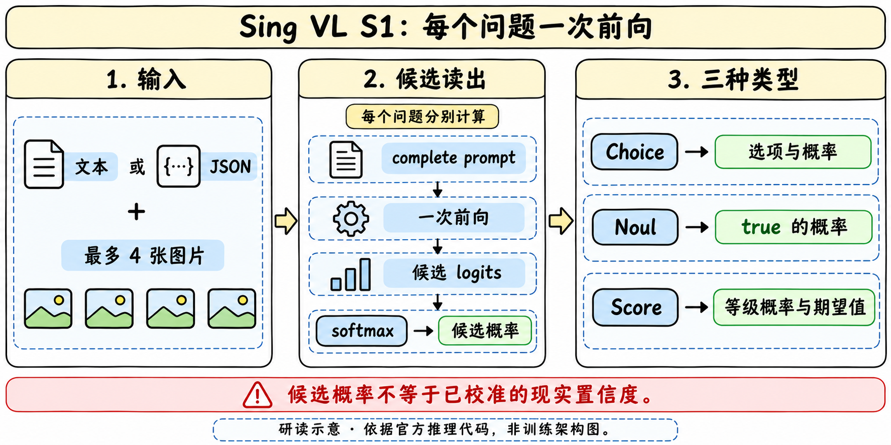

> [!tldr]
> Sing VL S1是在Qwen3.5上构建的多模态决策模型：对文本/JSON和至多四张图片中的每个命名问题分别做一次完整前向，再从候选token logits中读出Choice、Noul或Score。它省去的是自回归输出过程，不是输入处理成本，也不是一次前向回答任意多个问题。

> [!warning] 日期、许可与报告边界
> 官方HF仓库首个权重上传提交6b8f505在2026-11-11 12:02:22北京时间，README于13:38:33更新；createdAt不作发布日期。没有独立Release Date声明，先前渠道与首次public状态未证实，Atlas只以2026-11月份线索收录“首发日待核”，不编造日级首发。卡未给license字段，不能继承Qwen底座许可结论。已读原卡、配置、model/serve/benchmark源码，未下载权重、未运行；数据、训练loss与独立报告仍不足完整报告级精读。

## 定位、接口与公开结果

> [!tldr]
> 一个决策专项family；4B是仓库型号，不据文件体积精确推导参数量。候选集合决定概率空间，输出需要连同问题定义保存。

| 输出类型 | 输入约束与返回 |
|---|---|
| Choice |2–256个候选，返回候选概率和argmax标签|
| Noul |true/false命题，返回true的候选概率|
| Score |2–10个按低到高排序等级；返回零起始等级概率、legend与期望|
| 输入 |state文本或紧凑JSON，至多4张图片；一图对应一个`<image>`|
| 预算 |文本每问题≤65536 tokens；带图每问题≤10000 tokens|
| 公共图预算 |每图最多1638400 pixels；预处理含token网格对齐与BICUBIC缩放|
| 实现 |BF16、SDPA、无KV cache；官方依赖Torch2.10.0/Transformers5.13.1|

三等级概率0.1、0.3、0.6给Score=0×0.1+1×0.3+2×0.6=1.5；不是1–3等级，也不是某个候选文字的算术平均。JSON字段顺序、候选顺序、图像顺序和重写prompt都可能影响读出，不能只保留最终标签。

## 注意力、媒体与评测执行契约

> [!tldr]
> 源码声明前缀双向full attention，同时GDN保持causal；这些机制不可合写为“全网络双向”。一次前向仍要计算整段问题，多个问题循环运行。

配置为32个语言层、宽2560、FFN9216，每4层一层full attention，其余linear attention；视觉24层、宽1024、16heads、patch16、spatial merge2。加载器核对prefix_bidir、causal GDN、soft-choice-full-vocab-v2和last-valid-input-position。256个候选token须与tokenizer的单token双大写字母标签一致。

推理把完整state、instructions和候选描述拼成单轮prompt，在最后有效输入位置读出前N个候选token的logits，转float后只在这些候选上softmax。配置中训练侧标记full-vocabulary normalization，不等于运行时返回全词表概率；训练代码未公开，不能据metadata重建loss。源码将full-attention层设非causal，并用pre-hook拒绝带cache、padding或多行batch；linear GDN不随之变成双向。

图像特征在一次predict内先编码一次，各问题仍分别调用模型。`usage.input_tokens`累加每题完整输入，`output_tokens=0`只代表没有生成token，不能当作零成本。图像顺序匹配占位符；缺省自动前插，显式标记数量须等于图片数；保留控制token会被拒绝。Score等级按概率再归一化，Noul不另做概率校准。

FastAPI默认127.0.0.1、单worker与推理锁，body/file上限64MiB；服务端文件需落在指定image-root，禁止越界。这个示例是本机服务接口，不承诺生产吞吐或安全配置。benchmark固定Vision12210条与Text140178条、语料hash和模型索引hash；按ID检查分片完整、保存error/unsupported，不能删除不支持项后只报成功集合。代码可复查不等于本轮已真实跑测。

## 完整成绩、反例与训练启发

> [!tldr]
> Public Text69.76与Vision73.94是Skill协议的聚合，不是所有数据集准确率。Skill/Non-Skill与排除项需要并列保留，低分项不能被总榜遮住。

官方主卡给Text对照TypeSafe Jev1.14为60.70、StartLux67.8、Perplexity60.1；Vision为73.94，对照StartLux67.90/Perplexity72.5，Jev为空。inference/README则另列AutoTrust JEV-27B-VL72.78作为独立参考，不能填进Jev1.14的空白列。两个README的命名与对照范围不同，保留原件不拼接榜单。

### Public Vision (11 datasets)

| Dataset | Non-Skill (Accuracy) | Skill |
| --- | ---: | ---: |
| CV-Bench | 87.34 | 79.12 |
| BLINK | 72.11 | 56.83 |
| RealWorldQA | 82.17 | 70.87 |
| CharXiv | 86.65 | 82.21 |
| InfographicVQA | 96.31 | 95.08 |
| Mind2Web | 87.67 | 83.56 |
| Winoground | 93.12 | 86.25 |
| KIE (CORD+FUNSD) | 95.82 | 93.12 |
| Moderation (Hateful Memes) | 71.64 | 43.28 |
| R-Bench-M | 49.77 | 39.72 |
| MMMU-Pro vision | 50.17 | 42.85 |
| **Public Vision Index** | — | **73.94** |

### Public Text (43 datasets)

| Dataset | Original metric | Non-Skill | Skill |
| --- | --- | ---: | ---: |
| BFCL | Case exact accuracy | 96.81 | 95.70 |
| ToolRet | nDCG@10 | 67.96 | 63.00 |
| API-Bank | Accuracy | 84.45 | 84.15 |
| BANKING77 | Macro-F1 | 94.00 | 93.92 |
| CLINC150+OOS | Macro-F1 | 97.03 | 97.01 |
| RouterBench † | Selected quality | 79.83 | 52.71 |
| Home appliance simulator | Case exact accuracy | 100.00 | 100.00 |
| SGD/SGD-X † | Macro-F1 | 8.33 | 0.00 |
| ContractNLI | Macro-F1 | 84.05 | 76.94 |
| ANLI | Macro-F1 | 78.29 | 67.48 |
| BPoMP \* | Accuracy | 95.18 | 90.70 |
| Humicroedit | Accuracy | 67.16 | 34.32 |
| POP909-CL \* | Accuracy | 80.60 | 79.74 |
| cfcolor \* | Accuracy | 70.14 | 44.04 |
| MMLU † | Accuracy | 82.93 | 77.24 |
| GPQA Diamond | Accuracy | 53.06 | 37.41 |
| ARC-Easy † | Accuracy | 99.03 | 98.71 |
| ARC-Challenge † | Accuracy | 96.25 | 95.00 |
| WinoGrande | Accuracy | 89.82 | 79.64 |
| HellaSwag | Accuracy | 96.48 | 95.31 |
| GSM8K | Accuracy | 73.84 | 68.68 |
| ChessBench | Accuracy | 26.88 | 20.36 |
| MuSR | Accuracy | 65.82 | 45.66 |
| SATA-Bench | Case exact accuracy | 53.88 | 53.27 |
| SimpleBench † | Accuracy | 50.00 | 40.00 |
| BRIGHT | nDCG@10 | 47.51 | 40.62 |
| Amazon ESCI | Macro-F1 | 60.74 | 50.75 |
| ACOS | Per-review F1 | 64.56 | 63.43 |
| FinEntity | Macro-F1 | 95.19 | 92.93 |
| iSarcasmEval | Sarcasm F1 (A · English) | 64.98 | 54.95 |
| VAST | Macro-F1 | 79.69 | 69.53 |
| NLI4CT | Macro-F1 | 86.41 | 73.56 |
| CRUXEval | Accuracy | 78.07 | 65.21 |
| CLadder | Accuracy | 94.72 | 89.44 |
| HLE | Accuracy | 12.77 | 0.00 |
| Habermas Machine | Accuracy | 63.60 | 47.18 |
| PhishNChips | Accuracy | 85.55 | 71.10 |
| MMLU-Pro | Accuracy | 68.40 | 64.46 |
| BBH | Accuracy | 88.61 | 83.49 |
| RAGTruth | Hallucinated-class F1 | 83.49 | 65.77 |
| HoVer | Accuracy | 89.25 | 78.50 |
| When2Call MCQ | Accuracy | 90.61 | 87.48 |
| New Yorker caption matching | Accuracy | 80.49 | 75.61 |
| **Public Text Index** | **Weighted aggregate** | **77.26** | **69.76** |

† Decision Index reports these datasets separately and excludes them from the Text Index.

> [!warning] 概率与汇总边界
> Text Non-Skill聚合77.26与Skill69.76不同。†标记的RouterBench、SGD、MMLU、ARC和SimpleBench等按原卡排除规则处理；表内原样保留。Skill HLE0、SGD0与Moderation43.28是明确弱项。没有原始公开run产物、完整skill映射与校准曲线，不把候选softmax当作现实正确概率，也不声称重现分数。

> [!insight]
> 类型化输出适合作为固定输入与可验证选择上的训练接口，但输入证据、候选顺序与问题定义要随trace保存。对训练比较应分别测标签质量、候选概率的Brier/校准、拒答/unsupported覆盖率与总输入计算量；不能把格式稳定性当作任务理解，也不能把本模型单次前向协议套成通用工具Agent harness。

- [官方HF卡](https://huggingface.co/inclusionAI/SingVL_S1_4B)
- [本轮固定版本推理源码](https://huggingface.co/inclusionAI/SingVL_S1_4B/tree/93f15cd61c1cf417d9cb2631f6be2df13510829e/inference)
- [权重上传提交，仅用于版本时间线](https://huggingface.co/inclusionAI/SingVL_S1_4B/commit/6b8f50556d454a2f0720ad6682411d1b970d5ccf)
- [[sing_vl_s1_poster_zh.html|中文Poster]]
