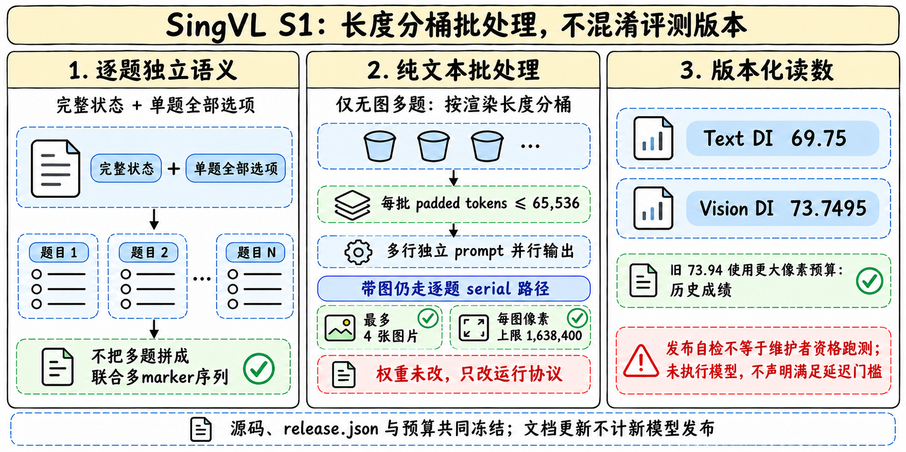

> [!tldr]
> 当前改动是纯文本多题按长度分桶、带图仍逐题的运行协议；权重未变。Text69.75与Vision73.7495必须附budget与revision，旧73.94使用更大像素预算，只作为历史结果。

## 当前执行与旧协议的差别

> [!tldr]
> 每题仍独立渲染完整state、instructions与全部候选；批处理只是多行独立prompt并行，不是把多题编码进联合序列。

源码`_predict`仅在batch_text=true、无image_features且题数>1时调用`_score_batched_text`；带图和单题走`_score_serial`。文本先全部encode再按长度排序，每批最大长度×题数不超过65536 padded tokens；各行右padding，full-attention屏蔽pad keys，causal GDN保留原位置。最后有效token取候选logits转FP32，逐题softmax；OOM只在CUDA且多行时递归二分重试，不静默删题。

最多4图片，每图1,638,400pixels；图像先编码一次，带图仍每题前向。每问题独立token上限/媒体预算继续生效，65536为批padded预算，不能拿来替代带图10000限制。usage累加完整每题输入、输出0不代表零计算。

## 版本与新旧成绩

> [!tldr]
> release.json、源码和权重revision分别记录；同checkpoint不保证不同预算成绩相同。

| 字段 | 当前值 |
|---|---|
| download revision |dd9fcbe2412068def01666b1d1a443e412f11214|
| evaluated weights |93f15cd61c1cf417d9cb2631f6be2df13510829e|
| 原结果revision |90ec7e159da6fa21d762f1f75876ea79049d0f4a|
| 当前batch结果 |709aaf417ebf1d00dd01fdb49e306573b801d488/releases/batch-65k|
| DI kit |f5a6e4fd85fed05e77878dfc4966d0568bfb45ec|
| engine |inference.engine:D3Engine，model参数为本地checkpoint|
| 当前Text |69.75，140178请求|
| 当前Vision |73.74949871316771，12210请求|
| 历史serial Text |69.76|
| 历史Vision73.94 |更大像素预算，非当前公共预算|

`weights_unchanged=true`是发布元数据声明，本轮没下载二进制独立对hash。原始逐题model revision b6672ce4fd31aab79aee3f0729fd8738f87361cf保留用于比较。结果不是本轮实测，也没有维护者private/latency qualification已完成的证据。

## 研究判断、缺口与来源

> [!tldr]
> 性能比较应固定权重、媒体预算与协议，并保留unsupported和OOM；吞吐优化不能省掉语义等价验证。

验证题顺序还原、padding屏蔽、候选数量不同、单题与多题、OOM拆分及图像路径。逐题候选logits误差、概率和最终类型值一起比；同输入预算比较Text/vision，再独立测吞吐与TTFT。没有独立运行，不报告达到延迟门槛或量化版本同分。

当前说明和源码来自[官方模型卡](https://huggingface.co/inclusionAI/SingVL_S1_4B)、[release.json](https://huggingface.co/inclusionAI/SingVL_S1_4B/blob/main/inference/release.json)、[model.py](https://huggingface.co/inclusionAI/SingVL_S1_4B/blob/main/inference/model.py)。旧family笔记的逐项历史表保留并显著标为历史协议，当前读数以本说明为准；family首日继续待核，不新增发布事件。

## 关联与交付

> [!tldr]
> 一手材料、研读判断和展示分别保存；图为机制示意，原表保留原量尺。

[[Sing-VL-S1]]

> 📊 相关可视化: [[singvl_batch_poster_zh.html]]
