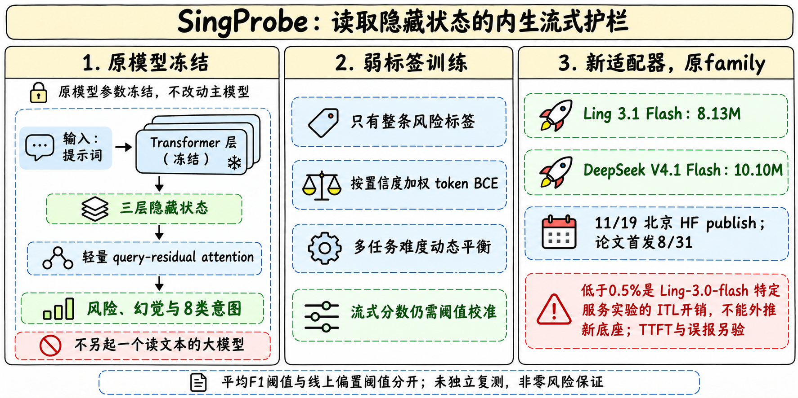
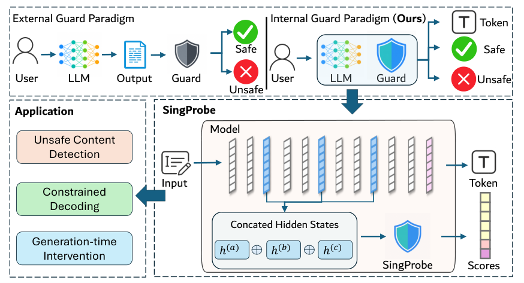

> [!tldr]
> SingProbe从冻结生成模型的中间层读取轻量护栏，避免每token另起一个大文本审核器。其难点不是“多一个分类头”，而是用序列弱标签获得局部信号、控制误报并避免把离线最大F1当线上阈值。

> [!warning] 历史补收与新适配器
> 报告首发8/31 12:42:11Z→北京8/31 20:42:11；本family为历史补收。Ling3.1Flash1019和DeepSeekV4.1Flash1017两适配器HF publish为11/19 19:37北京，合并阶段更新，不新增两家底座正代。主体方法/数据/评测/开销已读，未逐附录复现或运行权重。

## 内生探针与训练目标

> [!tldr]
> 拼接三个选定层的hidden states，通过query-residual attention得到意图、风险和幻觉分数；底座不参与探针训练。

统一输出八类意图+risk+hallucination。query risk为七个非安全类别多标签+safe互斥约束；动态EMA任务权重alpha=.9、floor1e-9按近期任务难度分配，不是简单固定平均。response/hallucination用粗序列标签监督token BCE，再按模型置信度加权；beta=clip(std(p)/tau,0,1)，早期近均匀避免错误尖峰被过度强化。权重按样本归一，不能让长文本天然多占loss。

弱标签并非每个token都是真实局部注释：危险回应也含正常前缀，训练对这类token的负惩罚做置信度调节。流式提前截断与全序列事后分类是不同任务，必须分别给AUC、误报和延迟。

## 两份新增探针与完整卡表

> [!tldr]
> 参数量与抽层由底座决定；两新适配器不自动继承旧Ling3.0的速度测量。

| 本轮适配器 | 参数 | 取层 | attention |
|---|---:|---|---|
| Ling3.1Flash1019 |8.13M|23/47/71|8heads、head64、BF16|
| DeepSeekV4.1Flash1017 |10.10M|12/25/39|同配置|

默认三层间隔选择，probe attention上限约2Ktokens。原报告讨论29个底座适配，主要实验围绕Ling3.0tiny/flash；不能将该数量写成本轮新发布29个。

| Base model | Probe parameters | Tapped layers (zero-based) | Outputs |
| --- | ---: | --- | --- |
| `Ling-3.1-flash-1019` | 8.13M | `[23, 47, 71]` | 8 query intents + response unsafety + hallucination |

| Task | Metric | Ling-3.1-flash-1019-singprobe | Reference baseline |
| --- | --- | ---: | --- |
| Query intent classification (6 benchmarks) | F1 | **0.8687** | YuFeng-XGuard-Reason-8B (0.8714) |
| Response safety classification (8 benchmarks) | F1 | **0.8707** | Qwen3Guard-Gen-8B-strict (0.8604) |
| Streaming safety (3 benchmarks) | Response AUC / token AUC | **0.9844 / 0.9411** | Qwen3Guard-Stream-8B-strict (0.9640 / 0.8893) |
| Hallucination detection (6 benchmarks) | AUC | **0.8041** | DRIFT (0.8000) |

| Deployment characteristic | Result |
| --- | --- |
| Benign-response false-positive rate | 0.008% averaged over 5 datasets at the evaluation's pre-calibration response threshold of 0.983085 |
| Calibrated release thresholds | 0.5 for response unsafety and 0.5 for hallucination |

| Base model | Probe parameters | Tapped layers (zero-based) | Outputs |
| --- | ---: | --- | --- |
| `DeepSeek-V4.1-Flash-1017` | 10.10M | `[12, 25, 39]` | 8 query intents + response unsafety + hallucination |

| Task | Metric | DeepSeek-V4.1-Flash-1017-singprobe | Reference baseline |
| --- | --- | ---: | --- |
| Query intent classification (6 benchmarks) | F1 | **0.8756** | YuFeng-XGuard-Reason-8B (0.8714) |
| Response safety classification (8 benchmarks) | F1 | **0.8668** | Qwen3Guard-Gen-8B-strict (0.8604) |
| Streaming safety (3 benchmarks) | Response AUC / token AUC | **0.9907 / 0.9522** | Qwen3Guard-Stream-8B-strict (0.9640 / 0.8893) |
| Hallucination detection (6 benchmarks) | AUC | **0.7951** | DRIFT (0.8000) |

| Deployment characteristic | Result |
| --- | --- |
| Benign-response false-positive rate | 0.009% averaged over 5 datasets at the evaluation's pre-calibration response threshold of 0.987179 |
| Calibrated release thresholds | 0.5 for response unsafety and 0.5 for hallucination |

Ling query F1 .8687低于对照.8714，而response .8707高于.8604；hallu .8041略高于DRIFT .8。DeepSeek query .8756、response .8668、stream response AUC .9907/token .9522，而hallu .7951低于.8。多任务不是每项都更好。

## 数据、离线聚合与线上阈值

> [!tldr]
> 卡的平均F1采用跨suite统一阈值最大化均值；发布偏置将特定校准阈值映射到.5。这不是未经校准的raw score=.5。

query F1在generated responses、response F1在benchmark responses，macro给benchmark等权，不能合成一个混合分母。Ling低误报点为预校准阈值.983085、FPR .008%；DeepSeek .987179、FPR .009%，均为五数据集平均，不能报告任意线上分布同样误报。

报告线上majority/leave-one-out用其他三个detector构造pseudo ground truth，不是人工真值；Ling3.0Flash accuracy.9641、F1.6452，Tiny .8089/.4726。类不平衡下accuracy很高仍可能F1低，线上F1也不能直接和离线自适应阈值比较。

训练材料/bench覆盖与逐token弱标签偏差会影响跨语言、长上下文和对抗改写泛化。本轮未审计全部原始数据，医疗子模型另为专项范围，未将其效果填入通用探针。

## 开销实验完整条件

> [!tldr]
> “低于0.5%”只对应Ling3.0Flash受控服务的ITL；prefill-enabled TTFT最高约2.25%，并非零开销。

| 并发 | Decode TTFT Δ% | Decode ITL Δ% | Prefill TTFT Δ% | Prefill ITL Δ% |
|---:|---:|---:|---:|---:|
|1|+.68±.22|+.18±.15|+.89±.29|+.18±.15|
|2|−1.45±4.17|+.33±.12|+2.25±4.86|+.33±.12|
|4|−1.91±5.97|+.30±.12|+1.85±7.77|+.38±.10|
|8|+.39±1.84|+.26±.09|+1.01±.53|+.21±.12|
|16|+.06±3.57|+.42±.09|+.86±1.15|+.39±.12|
|32|+1.14±.93|+.45±.18|+1.34±.37|+.47±.15|

输入8192、输出1024；并发1/2/4每轮24prompt、8为48、16/32为96，8个独立round。同round先算中位TTFT/ITL再配对基座，报告配对相对差的均值±标准差。TTFT负值可为噪声，不能称探针加速prefill；prefill-enabled的ITL .18–.47%、TTFT .86–2.25%。不能外推本轮两底座或不同服务框架。

## 对Agent训练的判断与来源

> [!tldr]
> 探针可作为监控候选信号，不能未经验证直接当可优化的真值reward。必须防止策略训练出绕过探针的隐状态。

固定底座、层位、token窗口、量化、服务版本和阈值，在独立干净/危险/幻觉集合上测PR曲线、早停位置与误伤；同时比较文本detector的质量和全成本。若用于RL，单独设不可见holdout与不同判定器，评估reward hacking与校准漂移。

公开GitHub和卡中SGLang分支/内部托管路径不完全一致，不能保证安装即可运行。没有本轮加载、服务兼容性和线上复测；原件保留实际链接而不执行其中命令。

- [报告HTML v2](https://arxiv.org/html/2608.30703v2)
- [Ling新适配器](https://huggingface.co/inclusionAI/Ling-3.1-flash-1019-singprobe)
- [DeepSeek新适配器](https://huggingface.co/inclusionAI/DeepSeek-V4.1-Flash-1017-singprobe)
- [官方项目源码](https://github.com/inclusionAI/SingProbe)

## 关联与交付

> [!tldr]
> 一手材料、研读判断和展示分别保存；图为机制示意，原表保留原量尺。

> 📊 相关可视化: [[singprobe_poster_zh.html]]

[[WeVisForensics]]
