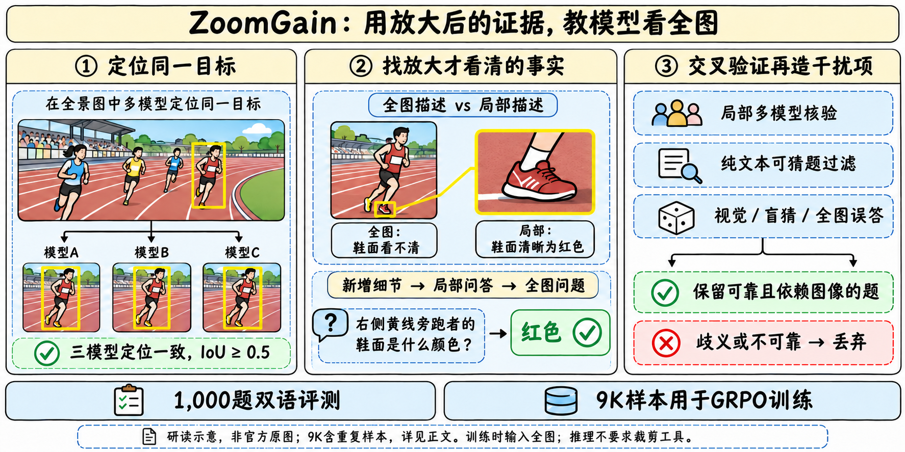
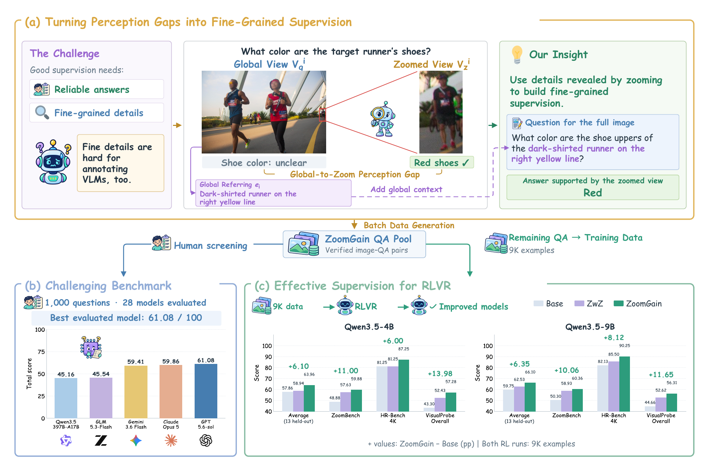
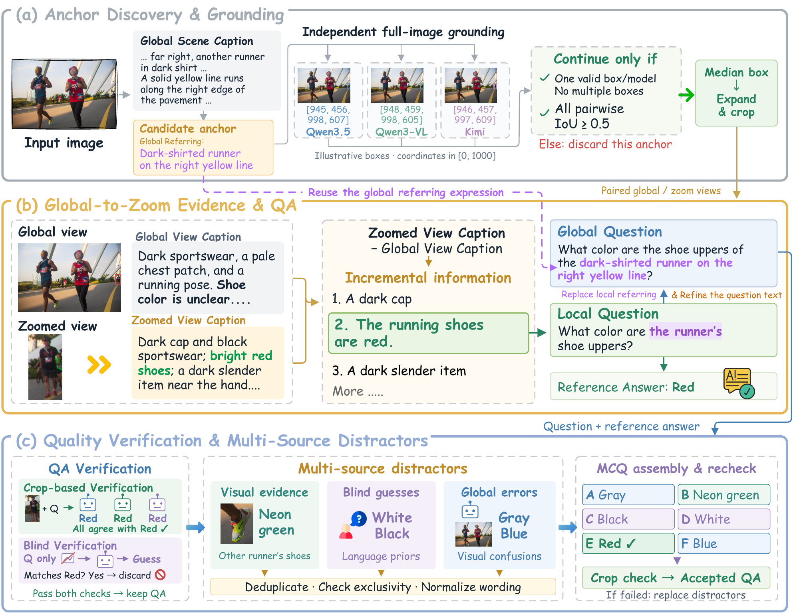
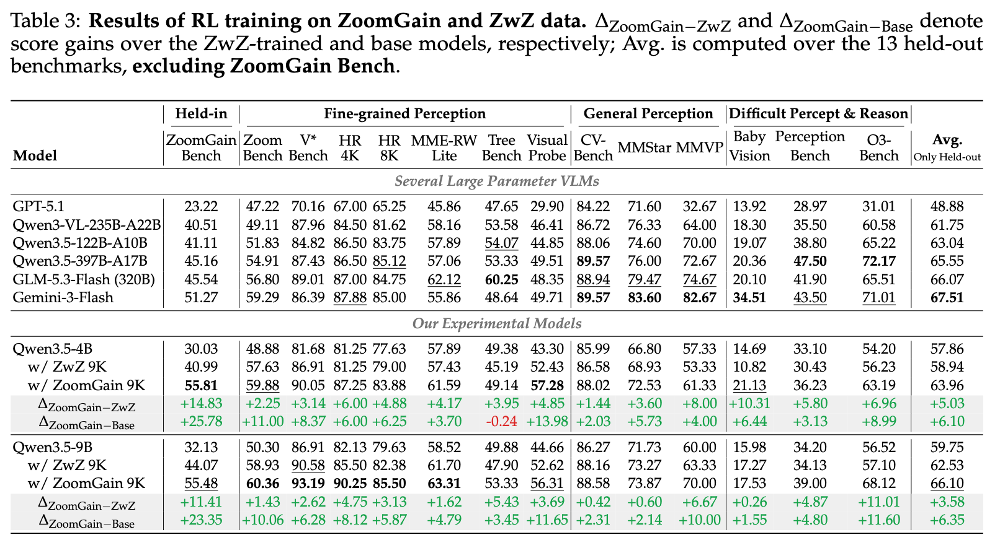

> [!tldr]
> ZoomGain的贡献是把“放大后能看见、全图时容易漏掉”的细节转成可验证的训练题，随后用9K记录对Qwen3.5-4B/9B做GRPO。它是数据方法和视觉专项权重，不是新增通用主干，也不要求模型推理时调用裁剪工具。

> [!warning] 首发、许可与复现边界
> 官方README明确2026-11-11发布checkpoint、数据和论文。arXiv v1页标11/10，HF权重上传也早于公告；分别记录论文/上传/公开公告，不用仓库创建或lastModified改写首发公告日。4B/9B及GGUF合一family。本文已读完整正文、A/B/F/G关键协议、README、训练入口/奖励与评分代码；没有逐条审计J全部生成prompt、EasyR1完整实现或原始run，未下载PDF、权重或数据包，未运行模型。代码Apache2.0不等于checkpoint/数据许可：HF卡未提供明确license元数据，权利范围仍待核。

## 问题、数据与家族定位

> [!tldr]
> 训练对象是全图上的细节定位与读取；放大图用于构造和核验标签。1,000个双语问题是2,000次语言任务，不是2,000个独立问题；9K训练记录也不是9K独立图像。

### 为什么需要这种数据

全图VLM经常能理解场景，却把小标志、鞋面颜色、局部数字猜成合理但错误的答案。若仍让同一个模型直接看全图出题并给答案，其感知错误会进入训练标签。ZoomGain先在局部放大图上恢复证据，再把问题改写成能在完整照片中唯一定位的表述；因此训练信号针对的是难以读取的细节，而不是一般场景描述。

| 发布对象 | 用途与合并规则 |
|---|---|
|ZoomGain-4B / 9B|Qwen3.5视觉语言底座的GRPO专项，合一family|
|4B / 9B GGUF|同族格式/量化分发，不另计正代或专项|
|ZoomGainBench|1,000问题、941图片；472属性、94计数、434OCR；中英各一版|
|ZoomGain RL Data|9,000训练记录、7,713源图片；数据方法与权重分开描述|

官方先从ZwZ随机取12K图片，生成23,610个QA。两个人工审核员只接受/拒绝，不编写或修订问答。训练比较中先排除1,000个benchmark条目，再按每张图片两边可用唯一问题数的较小值匹配，得到8,746对；两边各重复254对补齐9K。由此固定的是源图和记录数，并非证明两套输入像素完全一致：ZwZ保留原框线，ZoomGain用原图。按“条目排除”也不能自动推出训练与评测在图像级完全隔离。

### 28模型评测的口径

属性为4–6选项；计数整数exact match；OCR为ANLS≥0.7时保留分数，否则零分。各语言Overall按472/94/434题量加权，再给双语总体。论文Table2最高GPT-5.6-Sol61.08是该组历史模型和对应预算的结果，不是11月全部最新模型榜单。

Qwen/ZwZ/Vision-OPD温度0、输出2048、关闭native thinking；GLM4.6V/5.3Flash输出4096/8192；Kimi-K3启用thinking、8192；闭源四模型4096并保留供应商默认温度/思考。Agent组可多轮工具，32768总输出预算，11轮或5轮、4次或10次工具限制。不能把这些不同预算当作等计算比较。

|模型|EN属性|EN计数|EN OCR|EN总体|ZH属性|ZH计数|ZH OCR|ZH总体|双语总体|
|---|---|---|---|---|---|---|---|---|---|
|GPT-5.5 OpenAI ()|52.75|57.45|60.40|56.51|52.12|63.83|60.96|57.06|56.79|
|Gemini-3.6-Flash Google DeepMind (2026)|51.27|42.55|74.71|60.62|48.52|45.74|71.42|58.20|59.41|
|Claude-Opus-5 Anthropic (2026)|48.09|63.83|71.86|59.89|48.73|62.77|71.29|59.84|59.86|
|GPT-5.6-Sol OpenAI ()|56.57|62.77|67.93|62.08|54.03|63.83|65.84|60.07|61.08|
|DeepEyes-7B Zheng et al. (2026)|24.79|20.21|41.05|31.42|24.36|22.34|34.46|28.55|29.99|
|Thyme-7B Zhang et al. (2025)|26.69|34.04|43.88|34.85|22.88|31.91|40.31|31.30|33.07|
|DeepEyesV2-7B Hong et al. (2026)|22.25|41.49|43.70|33.37|22.67|34.04|43.62|32.83|33.10|
|PixelReasoner-7B Su et al. (2026)|27.12|45.74|44.83|36.56|25.42|23.40|40.13|31.62|34.09|
|ZwZ-4B Wei et al. (2026)|30.08|39.36|29.68|30.78|33.47|50.00|34.45|35.45|33.12|
|Vision-OPD-4B Yuan et al. (2026)|35.59|59.57|45.69|42.23|39.62|59.57|43.80|43.31|42.77|
|Vision-OPD-9B Yuan et al. (2026)|46.40|55.32|47.18|47.58|47.67|60.64|37.97|44.68|46.13|
|ZwZ-8B Wei et al. (2026)|42.58|55.32|50.53|47.23|44.70|52.13|51.77|48.47|47.85|
|MiMo-VL-7B-RL Xiaomi (2025)|23.73|34.04|20.06|23.11|23.31|41.49|32.06|28.82|25.96|
|GLM-4.6V (106B) Team et al. (2025)|24.36|38.30|31.57|28.80|22.46|36.17|28.51|26.37|27.59|
|Qwen3-VL-4B Bai et al. (2025)|21.82|43.62|31.14|27.92|22.88|41.49|33.63|29.30|28.61|
|Qwen3-VL-8B Bai et al. (2025)|15.89|41.49|39.17|28.40|19.92|30.85|41.64|30.37|29.38|
|Qwen3.5-4B Team (2026)|21.40|51.06|34.40|29.83|22.67|46.81|34.87|30.23|30.03|
|Qwen3.5-9B Team (2026)|21.82|41.49|37.79|30.60|22.67|47.87|42.52|33.66|32.13|
|Qwen3.5-35B-A3B Team (2026)|28.18|44.68|46.10|37.51|27.33|51.06|47.95|38.51|38.01|
|Qwen3.6-35B-A3B Qwen Team (2026c)|26.91|54.26|50.21|39.59|26.69|52.13|46.17|37.54|38.57|
|Qwen3-VL-235B-A22B Bai et al. (2025)|29.45|52.13|48.01|39.64|30.93|50.00|50.90|41.39|40.51|
|Qwen3.5-27B Team (2026)|33.05|51.06|45.92|40.33|34.75|58.51|48.67|43.02|41.68|
|Qwen3.6-27B Qwen Team (2026b)|33.47|56.38|47.47|41.70|37.71|70.21|45.33|44.07|42.89|
|Qwen3.8-27B Qwen Team (2026e)|40.25|54.26|45.49|43.84|44.92|62.77|43.05|45.78|44.81|
|Qwen3.5-397B-A17B Team (2026)|33.47|65.96|51.95|44.55|38.14|62.77|50.41|45.78|45.16|
|GLM-5.3-Flash (320B) GLM-5-Team et al. (2026)|44.07|54.26|43.77|44.90|46.61|55.32|43.74|46.18|45.54|
|Kimi-K3 (2.8T) Team et al. (2026a)|49.15|64.89|45.48|49.04|46.82|64.89|46.22|48.26|48.65|
|Qwen3.8-Flash-Next (125B) Qwen Team (2026a); Qwen Team (2026d)|47.46|67.02|56.97|53.42|52.97|67.02|58.45|56.67|55.05|

## 方法、训练与代码核对

> [!tldr]
> 关键链条是三模型定位一致→成对描述找新增事实→局部可靠且全图无歧义→过滤语言先验→构造多源干扰项。盲猜过滤是“三模型都达阈值才拒绝”，并不能保证所有保留题都没有文本捷径。

### 从目标到可核验问题

三模型各返回一个有效box，所有两两IoU≥0.5才保留；坐标逐维中位数后扩框取crop。多实例时可在crop画目标标记，唯一实例不画。全图中的红框表示crop区域，crop中的红框才是目标定位标记，均不能被当成真实照片内容或答案。

同一强VLM独立描述全图指定区域和放大crop。GLM-5.2提取只在局部描述中明确、全图描述中不清或缺失的事实，生成局部问题，再用全图指称替换局部称呼，保持答案。caption的遗漏仍可能被误当分辨率差；跨模型核验缓解这种风险，不能消灭相关幻觉。

EDGE_REWRITER同时审crop与全图，检测目标指称歧义、文字跨边界和计数集合越界。非OCR重写必须保持答案；OCR仅可收窄到原答案内完整文本/指定前后缀，不得从全图新增答案文字；越出crop的计数集合丢弃。空间表述区分观察者左右、人体自身左右和相机深度，避免把crop边缘错当原图边缘。

| 环节 | 官方模型/阈值 |
|---|---|
|初始/成对caption、目标枚举、双图审查|Qwen3.5-397B-A17B|
|grounding|Qwen3.5-397B-A17B、Qwen3-VL-235B-A22B、Kimi-K2.6，三方一致|
|新增事实、双语QA|GLM-5.2|
|局部验证|Qwen3-VL和Kimi，每模型10次，均至少6次正确|
|盲猜过滤|三模型每方10次；三方各至少3次正确才拒绝|
|答案等价判断|Qwen3.5-122B-A10B|
|干扰项聚类/池整理|DeepSeek-V4-Pro|
|最终选择题验证|三模型各至少6/10，最多3轮，含初检与两次修复|

干扰项来自可见的其他对象/属性、无图盲猜，以及三模型看全图时的错误回答（各10次、共30次）。合并语义重复，移除等价于答案或也正确的选项，保持来源可追溯。OCR和计数继续用开放回答，不走选择题干扰项流程。其他模型也易选全图错误项是论文的分析发现，不等于全模型共享同一个内部表征。

### 9K GRPO的实际设置

论文G：batch64、每题8rollout、1epoch/140步，评估step140，LR1e-6，无KL，最大回复2046。公开train_zoomgain.sh：FSDP2、FP32主权重/BF16计算、wd0.01、8GPU默认、rollout温度1/top-p1，默认prompt25000、response2048、max-model-len32768；vision tower可训练。**2046/2048差异必须保留，脚本默认不是原始run配置的完整证明。**4B/9B包装脚本只是设置实验名并转入共同入口，实际BASE_MODEL需显式指定。

reward.py要求comparison_dataset=zoomgain且scoring元数据答案与ground_truth相同。取最后一个完整answer标签：选择题按选项exact match、计数按数值相等、OCR阈值ANLS。RL代码明确OCR忽略大小写、去全部Unicode空白；评测按annotation的case_sensitive标志，不能说训练与每个测试实例逐字同规则。format_reward_weight默认0；长度截断被记录，但只要有完整末尾标签仍可计分，不额外默认惩罚。没有执行下载代码。

## 实验、消融与研究判断

> [!tldr]
> 9B的13项held-out均分从59.75升至66.10，4B从57.86升至63.96；与同图ZwZ训练比较更有价值。ZoomGainBench与训练同构造流程，必须单列held-in；4B TreeBench比Base下降，不能称逐项全面提升。

|Model|ZoomGain Bench|Zoom Bench|V* Bench|HR 4K|HR 8K|MME-RW Lite|Tree Bench|Visual Probe|CV- Bench|MMStar|MMVP|Baby Vision|Perception Bench|O3- Bench|Avg. Only Held-out|
|---|---|---|---|---|---|---|---|---|---|---|---|---|---|---|---|
|GPT-5.1|23.22|47.22|70.16|67.00|65.25|45.86|47.65|29.90|84.22|71.60|32.67|13.92|28.97|31.01|48.88|
|Qwen3-VL-235B-A22B|40.51|49.11|87.96|84.50|81.62|58.16|53.58|46.41|86.72|76.33|64.00|18.30|35.50|60.58|61.75|
|Qwen3.5-122B-A10B|41.11|51.83|84.82|86.50|83.75|57.89|54.07|44.85|88.06|74.60|70.00|19.07|38.80|65.22|63.04|
|Qwen3.5-397B-A17B|45.16|54.91|87.43|86.50|85.12|57.06|53.33|49.51|89.57|76.00|72.67|20.36|47.50|72.17|65.55|
|GLM-5.3-Flash (320B)|45.54|56.80|89.01|87.00|84.75|62.12|60.25|48.35|88.94|79.47|74.67|20.10|41.90|65.51|66.07|
|Gemini-3-Flash|51.27|59.29|86.39|87.88|85.00|55.86|48.64|49.71|89.57|83.60|82.67|34.51|43.50|71.01|67.51|
|Qwen3.5-4B|30.03|48.88|81.68|81.25|77.63|57.89|49.38|43.30|85.99|66.80|57.33|14.69|33.10|54.20|57.86|
|Qwen3.5-4B w/ ZwZ 9K|40.99|57.63|86.91|81.25|79.00|57.43|45.19|52.43|86.58|68.93|53.33|10.82|30.43|56.23|58.94|
|Qwen3.5-4B w/ ZoomGain 9K|55.81|59.88|90.05|87.25|83.88|61.59|49.14|57.28|88.02|72.53|61.33|21.13|36.23|63.19|63.96|
|Qwen3.5-4B Δ vs ZwZ|+14.83|+2.25|+3.14|+6.00|+4.88|+4.17|+3.95|+4.85|+1.44|+3.60|+8.00|+10.31|+5.80|+6.96|+5.03|
|Qwen3.5-4B Δ vs Base|+25.78|+11.00|+8.37|+6.00|+6.25|+3.70|-0.24|+13.98|+2.03|+5.73|+4.00|+6.44|+3.13|+8.99|+6.10|
|Qwen3.5-9B|32.13|50.30|86.91|82.13|79.63|58.52|49.88|44.66|86.27|71.73|60.00|15.98|34.20|56.52|59.75|
|Qwen3.5-9B w/ ZwZ 9K|44.07|58.93|90.58|85.50|82.38|61.70|47.90|52.62|88.16|73.27|63.33|17.27|34.13|57.10|62.53|
|Qwen3.5-9B w/ ZoomGain 9K|55.48|60.36|93.19|90.25|85.50|63.31|53.33|56.31|88.58|73.87|70.00|17.53|39.00|68.12|66.10|
|Qwen3.5-9B Δ vs ZwZ|+11.41|+1.43|+2.62|+4.75|+3.13|+1.62|+5.43|+3.69|+0.42|+0.60|+6.67|+0.26|+4.87|+11.01|+3.58|
|Qwen3.5-9B Δ vs Base|+23.35|+10.06|+6.28|+8.12|+5.87|+4.79|+3.45|+11.65|+2.31|+2.14|+10.00|+1.55|+4.80|+11.60|+6.35|

Table3均分排除ZoomGainBench、包含13项held-out。9B对ZwZ的O3增益11.01、对Base为11.60，不能混用；4B TreeBench49.14低于Base49.38，虽高于ZwZ45.19。9B均分66.10接近GLM5.3Flash66.07，但Gemini3Flash67.51更高；这不是小模型在所有视觉/推理任务超过大模型。

消融表只平均10项held-out，缺少三项general perception，不能与主表13项均分直接比较。完整4B60.96，去新增证据58.57，去专门干扰项59.14；完整流程在MME-RW61.59仍低于去干扰项62.69，故平均贡献不等于每项都获益。

|4B版本|新增证据|专门干扰项|ZoomGain|ZoomBench|V*|HR4K|HR8K|MME-RW|Tree|VisualProbe|BabyVision|Perception|O3|10项均分|
|---|---|---|---|---|---|---|---|---|---|---|---|---|---|---|
|Qwen3.5-4B|–|–|30.03|48.88|81.68|81.25|77.63|57.89|49.38|43.30|14.69|33.10|54.20|54.20|
|+ZoomGain 9K|✗|✓|49.71|56.45|88.48|85.50|81.75|60.24|48.40|52.82|18.56|34.70|58.84|58.57|
|+ZoomGain 9K|✓|✗|46.85|57.04|90.05|85.75|80.25|62.69|48.89|54.76|17.53|34.97|59.42|59.14|
|+ZoomGain 9K|✓|✓|55.81|59.88|90.05|87.25|83.88|61.59|49.14|57.28|21.13|36.23|63.19|60.96|

训练实验统一温度0与CoT提示；多数2048输出，BabyVision/PerceptionBench/O3用8192且GPT-5.5裁判；MMVP paired accuracy、CV-Bench balanced、MME-RW1919题、VisualProbe按141/268/106题量加权。不同harness、裁判和图片处理不能忽略。论文未给重复训练seed区间，不能把小幅差异当确定提升。

错误分析中，全图误答类占错误选择71.7%，随机基线54.5%；最小目标面积四分位平均28.9%，最大55.2%。这些是构造流程选出的困难题分布，不是任意现实图片的总体错误率。

> [!insight]
> 对Agent Training，最可迁移的是“先制造可验证的信息差，再采集稳定失败和来源可追溯的干扰项”。可固定图片、记录数、推理预算和裁判，独立改变证据挖掘、干扰项来源与验证门槛，做跨来源/图像级隔离的held-out比较。下一步应验证增益是否来自定位、OCR读取、选项辨别或答题格式，避免只在同流程出题器上优化。

### 原件与关联

- [官方HF模型卡](https://huggingface.co/inclusionAI/ZoomGain-9B)、[4B](https://huggingface.co/inclusionAI/ZoomGain-4B)
- [报告HTML](https://arxiv.org/html/2611.14076v1)、[GitHub](https://github.com/inclusionAI/ZoomGain)
- [[Topics/13_base_model/Ant_Ling/Variants/261026_ZwZ2]]、[[Topics/13_base_model/Ant_Ling/Variants/2611_Sing_VL_S1/Sing-VL-S1]]
- 中文Poster：[[Topics/13_base_model/Ant_Ling/Variants/261111_ZoomGain/zoomgain_poster_zh.html]]
