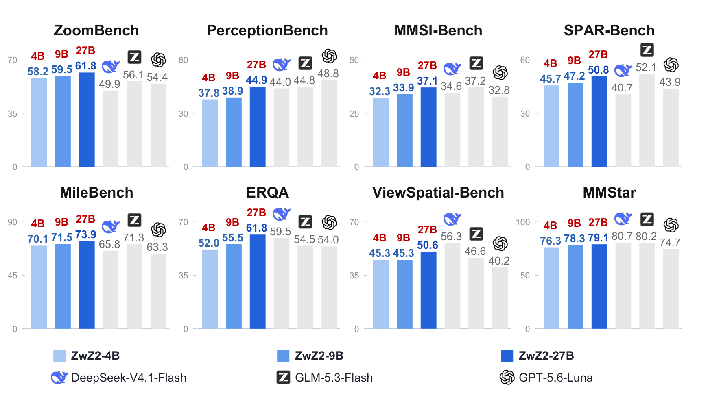
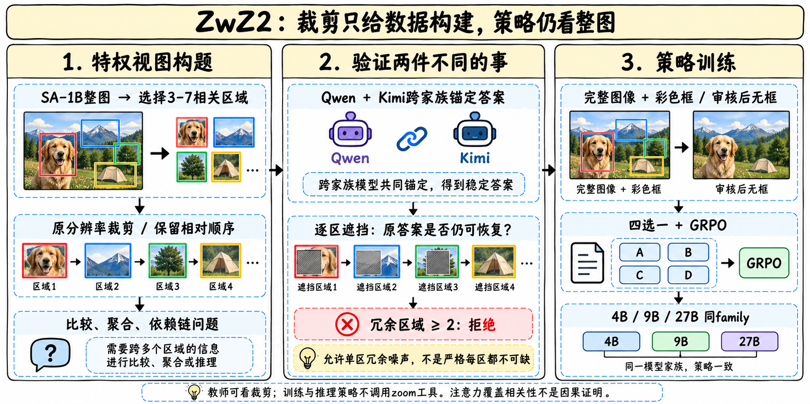
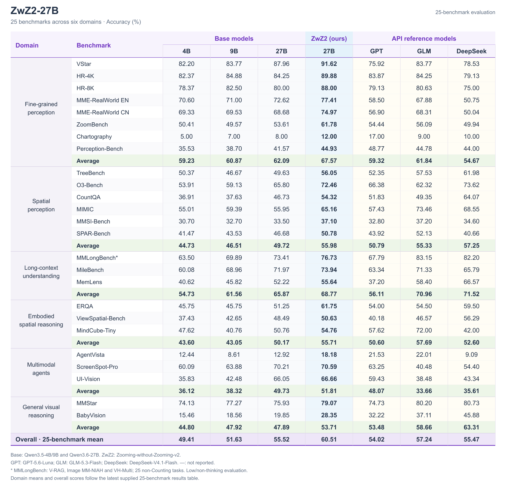
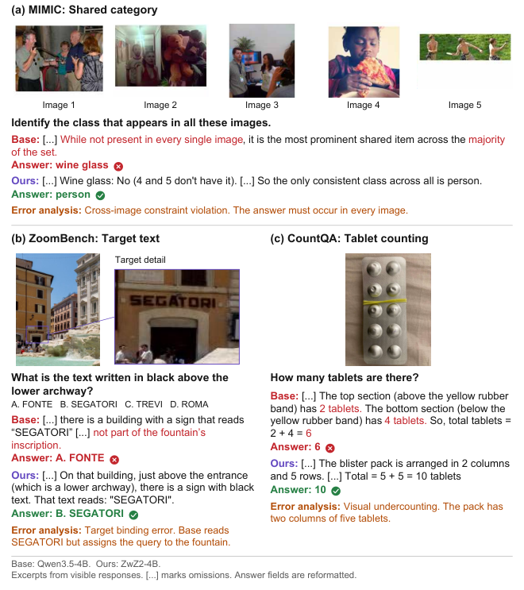

# ZwZ2：裁剪用于造题，策略仍然看整图

> [!tldr] 核心判断
> ZwZ2把视觉推理瓶颈从“看清单一区域”推进到“连接多个区域的证据”。数据构造器可以看原生分辨率裁剪，用跨模型答案锚定与逐区遮挡筛题；训练策略只看完整图像，经过20.4K四选一问题的GRPO后，在4B/9B/27B三个尺度上提升。它是蚂蚁的视觉推理专项family，不是三个Qwen新正代，也不是需要推理时调用放大工具的Agent。

> [!warning] 复现边界与真实冲突
> 本次已读论文HTML正文、训练/数据/评测附录、三尺寸HF卡、GGUF卡、数据卡与官方训练脚本文本，没有下载PDF或权重，没有执行脚本。**论文与仓库默认训练参数不一致**：论文2 epochs、32K响应，脚本默认10 epochs、1900响应；环境变量可覆盖，但缺少本次实际训练命令，不能声称默认脚本即可复现论文。注意力分析是相关证据，不是因果干预。

## 一手资料与首次公开日

- 🤗 [27B Model Card](https://huggingface.co/inclusionAI/ZwZ2-27B)、[9B](https://huggingface.co/inclusionAI/ZwZ2-9B)、[4B](https://huggingface.co/inclusionAI/ZwZ2-4B)：三份原卡分别保存在本目录`src/`。
- 📄 [Tech Report PDF链接](https://arxiv.org/pdf/2610.37037)；[本次实际阅读HTML](https://arxiv.org/html/2610.37037v1)与[[src/technical-report.html|离线报告阅读版]]。
- 🧩 [官方源码](https://github.com/inclusionAI/Zooming-without-Zooming-v2)、[数据集](https://huggingface.co/datasets/inclusionAI/ZwZ2-RL-VQA)、[[src/data-README|数据构造README]]。
- 📅 [Initial release不可变提交](https://github.com/inclusionAI/Zooming-without-Zooming-v2/commit/431521d5ade531d03aed837680710632c7325f83)：2026-10-26 11:27:52 UTC已公开命名4B/9B/27B family与训练方法。报告v1于10月27日提交，后续GGUF不是新的正代。

Atlas采用**2026-10-26**作为首次官方公开材料日期，而不拿10/30新GGUF出现日或HF lastModified当首发。4B/9B基于Qwen3.5，27B基于Qwen3.6-27B；三者共用数据与方法，放Ant / inclusionAI的Vision Reasoning支线。

## 为什么光有局部高分辨率还不够

单个对象能被清晰识别，并不代表模型会把不同区域的数量、关系和约束合并。一个题目可以由多区域比较、计数聚合、依赖链推理构成；若答案其实只需读其中一个区域，“多区域”仅是版面装饰，训练不到证据连接。

ZwZ2把两个问题分开检验：**完整证据能不能稳定给出答案；拿掉某区域后答案是否仍可恢复**。前者约束标签可靠性，后者约束证据需求。裁剪只给构造器和审查器，最终策略并不获得privileged crops。

## EvidenceConnect的实际构造流程

### 从图像到区域组

唯一图像来源为SA-1B。先筛长边至少1280、熵至少6.5、边缘密度至少0.04、亮度标准差至少60的图，再提出最多18个候选区域。区域面积约占整图0.04%—18%，IoU小于0.65；不足4个候选时跳过。每次取3—7区域，最多6组。

原生裁剪外扩8%边距，按原有相对位置排列，过大组合长边缩到4096。彩色框同时标在裁剪与整图上，用来维持区域身份。问题生成器Qwen3.5-397B-A17B工作在non-thinking模式，从22类任务、四种necessity模式中取样；104模板库每组取4个，再允许最多4个自由生成槽，最多8候选。

### 先锚定答案，再审计冗余

Qwen3.5-397B与Kimi-K2.6各采样4次，要求每个family至少3/4同答案，必要时由GLM5.2做文本等价判断。回答审查器不获得生成器预填答案与区域描述，避免直接复述标签。

随后逐区灰遮挡/红叉，最多3次回答；至少2/3仍恢复原答案，则该区域经验上冗余。**实际规则是冗余区域达到2个才拒绝题目**，允许单个区域因重叠/噪声被判断为冗余。因此不能把摘要“缺任一区域就不能回答”的理想叙述写成最终数据集严格保证。

### 回到完整图像与策略难度

最终策略接收完整图像，通常保留彩框。部分聚合题经四次整图审核（两个family各两次）均得到唯一、等价且有依据的答案后，可以移除框。四个选项保持同类格式并随机排序，避免只凭答案形式猜中。

难度评估器Qwen3.6-35B-A3B对整图做4次尝试：全对的容易题排除，任何不可解析结果也排除；0/4的高难题可保留，因为大教师已锚定标签。这里区分“弱策略答不出”和“问题没有可信答案”。

## 数据分布与训练配方

最终20.4K例共用于三个尺度，无额外SFT。3区域占65.74%、4区域24.34%、5区域7.93%，6/7区域共1.99%；难与很难超过44%。多数样本仍是三四区域，不应宣传成普遍七区域长链。

| 论文配方 | 原始说明 |
|---|---|
| 算法 | GRPO，四选一准确率reward |
| 训练 | 2 epochs；batch128；LR1e-6 |
| 采样 | 每题8 rollouts；temperature0.7 |
| 长度 | 最大响应32K；non-thinking发布模板 |
| 更新 | clip low0.2/high0.3；无KL项 |
| 尺度 | 4B、9B、27B，共用20.4K数据 |

> [!warning] 论文不是脚本默认配置
> 三个官方脚本默认`TRAIN_BATCH_SIZE=512`、`GEN_BATCH_SIZE=128`、`PPO_MINI_BATCH_SIZE=128`，`MAX_PROMPT_LENGTH=8000`、`MAX_RESPONSE_LENGTH=1900`、`MAX_MODEL_LEN=10000`、`TOTAL_EPOCHS=10`。论文的batch128到底对应哪一个实际执行单位，需要真实命令和日志确认；不能只看到脚本某处128就忽略512。32K响应与1900更不等价。脚本支持环境覆盖，但本次未取得实际run配置。

原脚本以`.sh.txt`保存用于阅读，没有执行或安装模型。发布的GGUF是同family量化分发，推理精度可能影响效果，不能以其上线日再添正代叶子。

## 25项评测：平均改善不等于每项领先所有对手

评测覆盖六类领域，Overall按25 benchmark等权平均，不是先按六类等权。三个尺度在各25项上都优于各自基座，但这与“每项超过最大模型”是两回事。

| 同尺度 | 基座均分 | ZwZ2均分 | 由展示数值计算的提升 |
|---|---:|---:|---:|
| 4B | 49.41 | 54.79 | +5.38；正文5.39存在舍入差异 |
| 9B | 51.63 | 56.59 | +4.96 |
| 27B | 55.52 | 60.51 | +4.99 |

4B ViewSpatial37.43→45.26，MileBench60.08→70.08，是明显的迁移提升。27B仍有清晰弱项：AgentVista18.18低于GPT-5.6-Luna21.53和GLM5.3Flash22.01；BabyVision28.35低于表中DeepSeek45.88；MMLongBench*76.73低于GLM83.15。比较中还存在平台输入分辨率限制、低/不思考配置，应固定协议再谈模型能力上限。

MMLongBench带星号，是V-RAG、ImageMM-NIAH、VH-Multi等视觉核心的25个非Counting任务，**不是完整原benchmark**。视频和长文档提升属于迁移结果，构造过程没有专门提供时序或跨帧训练，不能改称视频基模或世界模型。

## 消融与注意力：支持什么，不支持什么

7K受控子集消融均分：基座47.16，无privileged views51.38，无drop-one51.03，完整52.65。两组件在该平均上有效，但并非处处正贡献：ERQA完整47.50，去掉drop-one51.50。正文1.63与展示52.65−51.03=1.62也有舍入差异，保留展示精度。

与原ZwZ等数据基线的比较不是等样本量：原ZwZ约73K，EvidenceConnect20.4K，11项均分49.86与53.86；MileBench70.21对70.08却略有回退。数据效率是有价值线索，不能把样本量/recipe差异当作单组件因果证据。

注意力分析用405个TreeBench样本，8个full-attention层（4、8直到32），取生成前最后输入token的注意力，先head平均、再对图像token归一化。top-k区域集合大小等于证据token数，计算IoU；4B有7/8层、9B6/8层提高。它说明表示与证据位置更对齐，**不证明模型因这些位置而答对**。若要证因果，应固定问题做证据替换/遮挡与非证据对照，不只画热图。

## 对Agent Training与数据构造的启发

> [!insight] 将“答案正确”与“必须利用哪些证据”拆成两个verifier
> 工具Agent数据也可先让有特权信息的教师构造任务，再用受限观测的策略执行；审计某条工具结果被移除后能否仍答对。否则看似多步的轨迹可能存在捷径，策略只需猜最终答案。审计规则应公开容忍多少冗余，不能把启发式门禁写成数学保证。

可比较答案锚定、drop-one、难度过滤的单独与联合效果，保留被门禁拒绝的分布。训练时分别看成功率与实际证据调用，避免模型学会彩框或选项格式而非证据关系。代码与论文配置有冲突时先取得实际run命令，再做同预算复现，不能用默认脚本失败判断论文错误。

## 关联与产物

- [[Topics/13_base_model/Tencent_Hunyuan/Variants/2610_Youtu_Parsing_Omni/Youtu-Parsing-Omni|Youtu-Parsing-Omni]]：先保留可定位证据，再区分结构合法与内容正确。
- [[Topics/13_base_model/Tencent_Hunyuan/Variants/2610_WeVisCut/WeVisCut|WeVisCut]]：特权监督如何转成真实受限状态中的策略训练。
- [[zwz2_poster_zh.html|中文Poster]]；[[src/retrieval_manifest.json|原始来源清单]]。
