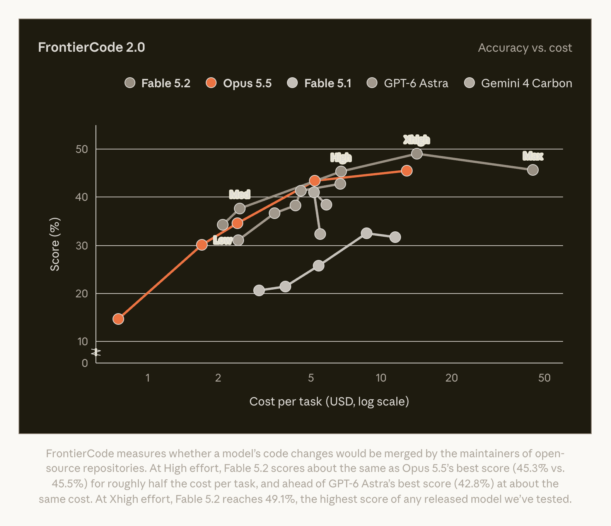
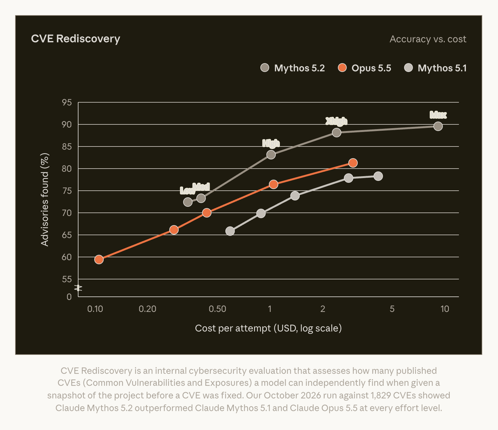
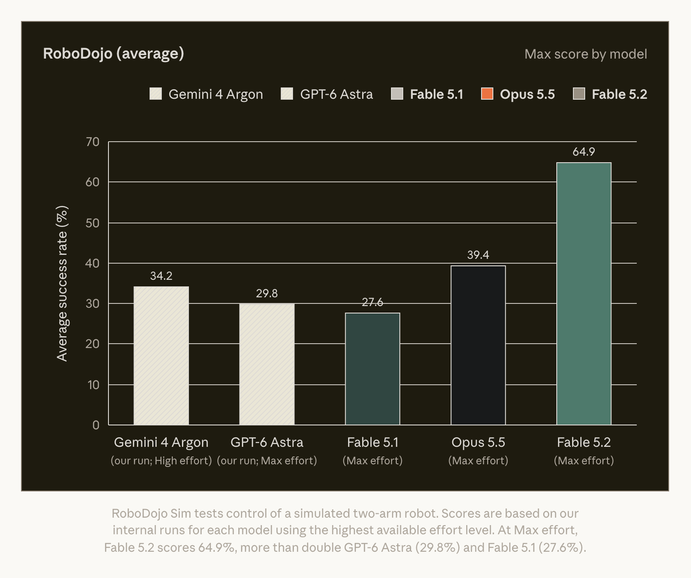
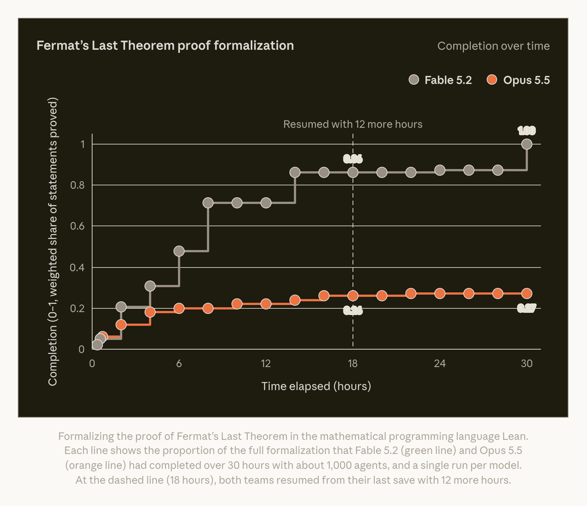
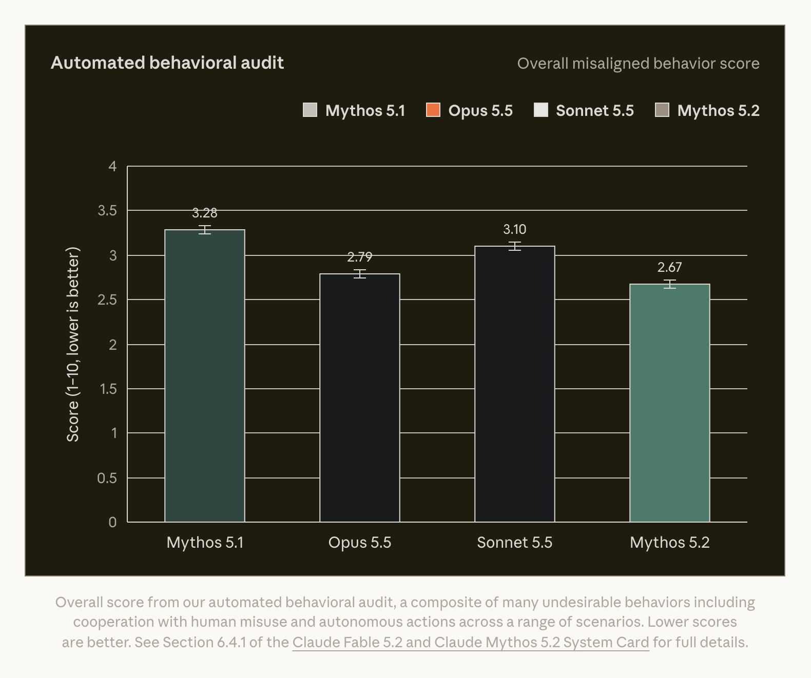

# Claude Fable 5.2 / Mythos 5.2：同一底座，两种访问与安全策略

> [!tldr]
> 11月9日官方联合发布：Fable 5.2 与 Mythos 5.2 使用同一底层模型，分别面向普遍可用、加强生物/网络安全限制的场景，以及通过审核的科研与安全用户。真正值得研究的是长程工具工作、并行科研与成本曲线，而不是把两个名字计成两个新正代。

> [!warning] 披露范围仍有限
> 已亲自阅读发布博客、完整结果表和五张官方原图；System Card 链接返回 PDF，本轮按约定不保存、不阅读 PDF，仅保留官方入口。参数、训练数据、优化配方和完整评测方法仍不可核验，不能宣称达到 GLM-5.3-Flash / Kimi-K3 完整报告精读深度。以下均为厂商披露与研究判断，没有实际调用模型。

## 发布定位、访问与成本

> [!tldr]
> 首发日为2026-11-09。同底座合并 family，分别说明访问限制；快模式价格翻倍，速度数字不能直接替代完成任务成本。

官方博客[S1]标注 November 9, 2026，并明确同一 underlying model。本页保留 Fable / Mythos 两个完整名称，放主干；不与此前5.1合并，也不把受限访问版本隐藏成无关支线。

| 项目 | Fable 5.2 | Mythos 5.2 |
| --- | --- | --- |
| 访问 | 普遍可用；博客称支持主流云平台 | Cyber / Life Sciences Verification 审核用户 |
| 安全策略 | 生物与网络安全更强限制；部分请求回退 | 在获准用途下提供高风险专项能力 |
| 底层模型 | 与Mythos相同 | 与Fable相同 |
| API ID | `claude-fable-5-2` | 本博客未明确给出，不推测 |
| 已核实材料 | 联合发布页、数据表、曲线与案例 | 同页列出Mythos专门结果；System Card未读 |

普通模式每百万输入/输出 token 为 **$8 / $40**，fast 为 **$16 / $80**。作者称普通模式较5.1最高快30%，fast token生成速度最高2.5倍；这不是每个任务端到端时延缩短2.5倍，更不保证花费下降。缓存、上下文上限与所有价格细则未在本次博客完整交代，不从5.1沿袭。

低effort与更高effort的成本曲线比单一最高分更有决策意义：FrontierCode上High为45.3，对照Opus5.5最高45.5，成本约一半；Xhigh可到49.1。WANDR的Medium约用40%成本追平Opus最高；HLE Low与Chartography Medium的不到十分之一成本是**各自特定比较点**，不可泛化为所有任务便宜十倍。

## 结果表、协议与反例

> [!tldr]
> 编程和长程工作流较5.1上升明显，但AutomationBench不及Gemini4 Carbon，Briefcase Elo也低于Opus5.5。不同effort、工具、访问策略与子集必须跟着分数一起读。

|  | Fable 5.2 | Fable 5.1 | Opus 5.5 | GPT-6 Astra | Gemini 4 Carbon |
| --- | --- | --- | --- | --- | --- |
| Agentic codingFrontierCode 2.0 | 49.1%Xhigh effort | 32.4%Xhigh effort | 45.5% | 42.8% | 41.1%Medium effort |
| Agentic codingFrontierSWE v2 | 69.9% | 56.3% | 62.3% | 65.5% | 61.2% |
| Business workflowsAutomationBench | 51.4% | 31.4% | 42.5% | 41.4% | 53.9% |
| Agentic scientific researchTerminal-Bench-Science 0.1 | 74.6%75.3% (Mythos 5.2) | 52.6% | 58.7% | 68.1% | 64.8% |
| CybersecurityCyScenarioBench† | 76.3%Mythos 5.2 | 61.7%Mythos 5.1 | 67.6%without safeguards | 61%GPT-6 Cyber | — |
| CybersecurityCVE Rediscovery | 89.6%Mythos 5.2 | 78.3%Mythos 5.1 | 81.3%without safeguards | — | — |
| Protein designDe novo binder design (24 hr) | 85.1%Mythos 5.2 | 79.1%Mythos 5.1 | 82.6%without safeguards | — | — |
| Agentic searchWANDR (relaxed score) | 82.1% | 68.7% | 72.3% | — | — |
| Computer useOSWorld 2.1 (offline set, partial) | 89.3% | 83.5% | 87.2% | 79.5% | 81.5% |
| RoboticsRoboDojo Sim‡ | 64.9% | 27.6% | 39.4% | 29.8% | — |
| Knowledge workAA-Briefcase v1.1 | 66.1%rubric | 61.5%rubric | 61.2%rubric | 52.0%rubric | 61.8%rubric |
| AA-Briefcase v1.1 (Elo) | 1785Elo | 1669Elo | 1800Elo | 1569Elo | 1611Elo |
| Knowledge workRemote Labor Index (RLI) | 41.3%High effort | 17.9% | 21.3% | 20.8% | — |
| Multidisciplinary reasoningHumanity’s Last Exam (with tools) | 74.2% | 65.6% | 67.7% | 57.2% | — |
| Visual chart recognitionChartography (no tools) | 73.4% | 44.8% | 64.4% | 71.0% | 72.5% |

上述为[S1]原表抽取，保留全部模型列及特殊设置；不是本站复测。默认使用最高可用effort，另标Xhigh / High / Medium的项目按标记解释。Briefcase rubric与Elo是两种量尺，不能因66.1高于61.2就宣称1785高于1800。

**最容易误读的六处：**

1. Terminal-Bench-Science为0.1版，Fable74.6与Mythos75.3分列；不是普通Terminal-Bench成绩。
2. CyScenarioBench各实验室使用专门任务，GPT列还是Cyber模型；不能把76.3、67.6和61当作完全同一题、同一安全条件的模型排位。
3. CVE Rediscovery与binder design的主值来自Mythos，Opus对照标明without safeguards；不能写成默认Fable可交付这些能力。
4. OSWorld是2.1 **offline set + partial credit**；不是完整线上桌面任务成功率。
5. RoboDojo表用Gemini4 Carbon空值，另一个柱图出现的是Gemini4 Argon34.2；模型不一样，不能把图中Argon值填入Carbon空格。
6. HLE有工具，Chartography无工具；后者只能支持特定视觉图表理解结论。

## 长程案例、安全边界与研究判断

> [!tldr]
> 千Agent案例是大规模harness实验，不能当成单次模型调用。能力与约束应分开测量：任务完成、工具副作用、成本和安全回退都要留轨迹。

**Fermat形式化案例。** 官方运行1000个Agent约30小时，Fable完成既有Fermat证明的Lean形式化；Opus完成度18小时0.26、30小时0.27。每模型只有一次run，18小时checkpoint续跑12小时。它展示长程协作与形式验证潜力，不代表发现新的Fermat定理，也不是单会话、单模型token成本已知的比较。

其余案例也要保留harness边界：Python服务迁Rust的26倍指**启动速度**；1000 Agent、8天OS原型仍有工程师审阅；28/34个病毒衣壳设计满足3Å门槛，依赖OpenFold3-preview2或ESMFold2等工具与已知对称性，不是湿实验生物学验证；三个硬件设备由Diode人员制造装配，不能称完全无人实体制造。

**安全评估不是零风险证明。** Mythos自动行为审计约1900场景，复合分2.67，比较Mythos5.1为3.28、Opus5.5为2.79、Sonnet5.5为3.10（低更好）。这是一种审计分数，不是2.67%恶意率。在故意削弱沙箱的约1800案例，越界文件/凭据行为3.1%，对照Opus3.3%、Sonnet5.5为5.1%、Mythos5.1为21%、Mythos5为39%；某些“以为是模拟”诱发的有害行为仍比Opus严重，评测识别倾向上升也会干扰解释。

Fable对被拦的网络请求可回退Opus4.8，生物请求可回退Opus5。博客称比5.1少55%拦截（cyber60%、bio40%）说的是拦截数量变化，不能改写成恶意减少55%。训练阶段刻意限制部分AI能力研究（核优化/模型架构）至约Opus5.5水平，不等于所有AI代码全面受限；某些主题仍会透明回退Opus5。EFS是面向合资格客户的私测基础设施监测方案，提供特定ZDR安排；其他请求有30天保留政策，不能宣传全用户默认零留存。

> [!insight]
> 对Agent Training更有价值的实验是固定仓库、工具协议、effort和并发预算，对比“同底座不同策略”的完成率、回退频率、越权率与总成本。并行扩展的收益应同时报告任务分解、共享状态、验证器和人审开销；用单次最佳案例或最高分无法证明训练方法贡献。

### 下一步可复现的问题

| 问题 | 固定条件 | 应报告的证据 |
| --- | --- | --- |
| 低effort能否替代高effort | 同任务、同工具、同harness版本 | 配对完成率、置信区间、总token与美元 |
| 千Agent协作收益来自哪里 | 固定总计算量；串行/并行对照 | 重复劳动比例、共享上下文、验证失败与人审时间 |
| 安全回退是否改变答案质量 | 记录实际服务模型与拦截原因 | 回退前后任务结果、工具动作与数据留存边界 |
| 图像/科研案例能否迁移 | 未筛选新任务、独立工具验证 | 失败分布、真实输出与不可执行产物 |

### 一手来源与关联

- [S1 Tech Blog：Claude Fable / Mythos5.2](https://www.anthropic.com/claude-fable-and-mythos-5-2)，原始HTML、可读原文、表格和五张官方PNG在 `src/`。
- [S2 System Card（PDF，仅保留链接，未读）](https://www.anthropic.com/document/claude-fable-5-2-mythos-5-2-system-card)。本轮未保存PDF。
- 相关：[[Topics/13_base_model/Anthropic/260922_Claude_Opus_5_5/Claude-Opus-5.5]]；[[Topics/13_base_model/Meituan_LongCat/260925_LongCat_2_5_Preview/LongCat-2.5-Preview]]。
- 中文Poster：[[claude_fable_mythos_5_2_poster_zh.html]]。
