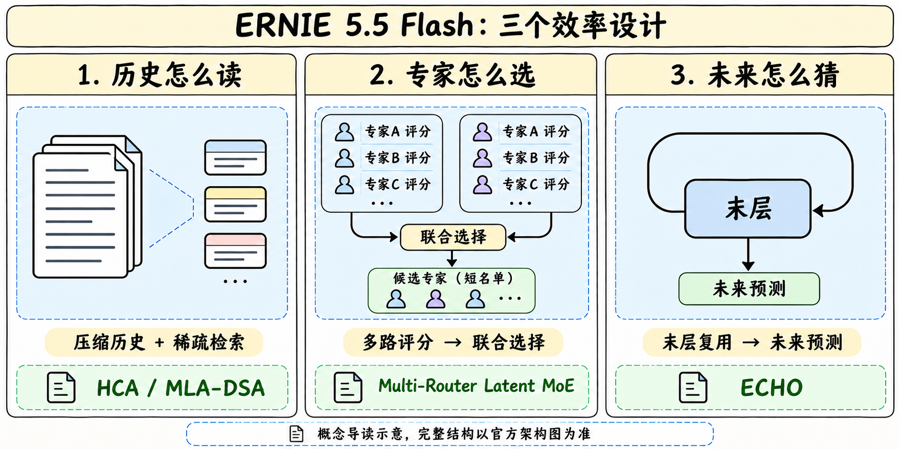
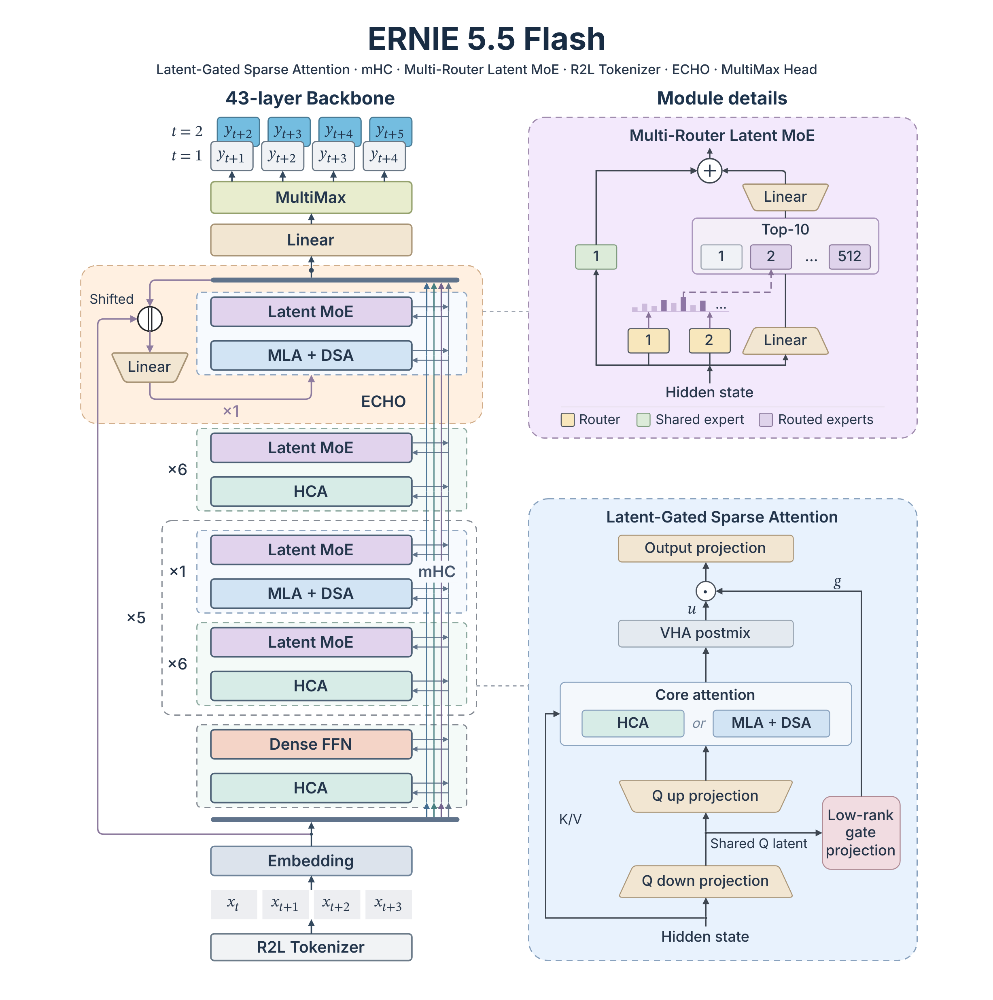
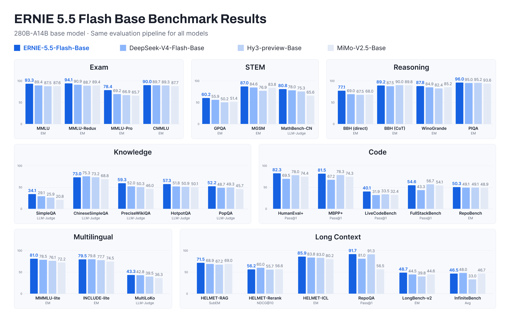
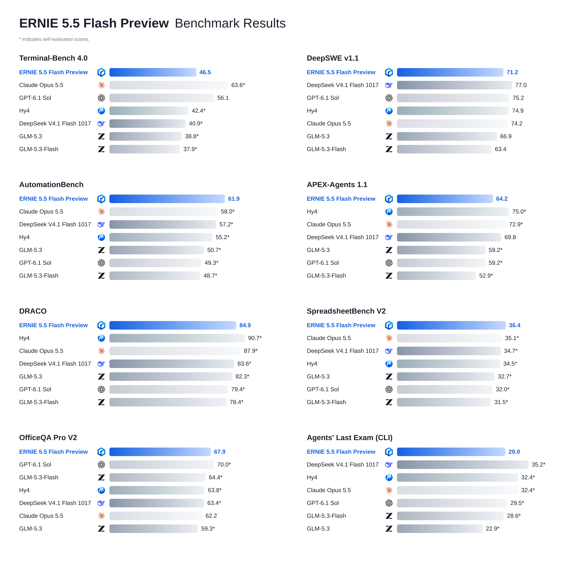
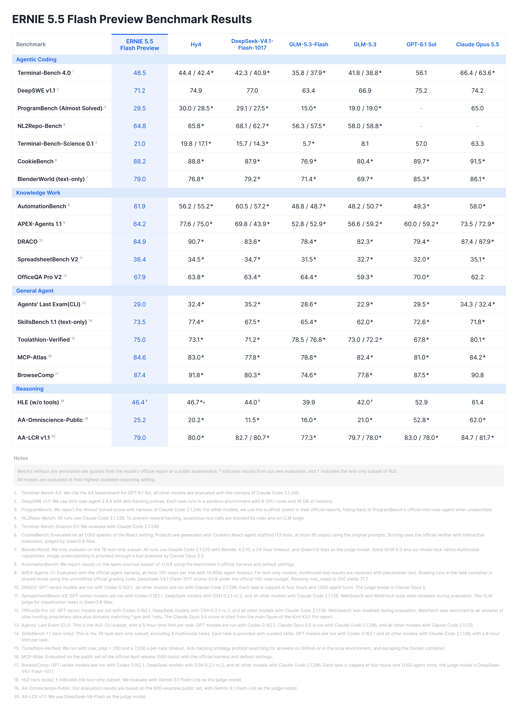

# ERNIE 5.5 Flash · Base / Preview

## Base：预训练与架构

> [!tldr]
> 保留11/5 Base的全部架构与原始资料。下列参数/组件实验不自动变为Preview后训练消融。

### 发布与规格

> [!tldr]
> 11 月 5 日发布的是 **预训练终点的 280B / A14B 文本 Base 模型**。它把历史读取、专家选择、未来预测与训练系统一起优化，为后续领域适配、SFT 和 RL 提供公共起点。FP8 与 BF16 属于一个家族。

| 项目 | 官方披露 | 研读口径 |
|---|---|---|
| 训练阶段 | 从头预训练 33.5T token，尚未中训练或后训练 | 接续生成和 few-shot 成绩不能直接等同聊天或 Agent 成功率 |
| 参数 | 总量 280B，每 token 激活 14B | 含输出头，总量另含输入 embedding；均不含额外 ECHO 0.36B |
| 主干 | 43 层，首层 Dense FFN，后 42 层 MoE | Hidden 4096，64 attention heads |
| 注意力 | 主干 37 层 HCA，6 层 MLA-DSA | HCA head dim 512，MLA head dim 256 |
| 专家 | 512 routed，top-10，另 1 shared | latent dim 2048，expert intermediate 2048 |
| 长度 | 预训练逐渐扩展到 128K；微调和推理支持 1M | 发布配置 1,048,576，示例服务仍设 131,072 |
| 精度与许可 | FP8 / BF16，专用 ERNIE 5.5 Flash Base Model License v1.0 | 许可证原文另存；开放权重的使用条件须按原文判断 |

官方首发页、两份 HF 原卡、配置、许可证与两张原图已经归档。模型的完整独立 Tech Report 尚未找到；三个组件论文是机制来源，全文 HTML 已保存，但其中的实验范围需要与本次 280B 运行分开阅读。

### 注意力与残差流

> [!tldr]
> HCA 让多数层以较小缓存看历史概要，少数 MLA 层保留 token 级候选，再由 DSA 挑选访问位置。缓存压缩比例与完整系统加速比是不同指标。

**HCA** 将每 128 个历史 token 合成一个缓存条目，同时保留最近一段未压缩窗口。其访问范围仍覆盖整个序列，但远端细节会压缩。多数廉价层使用较宽的 512 维头，让容量花在压缩后的信息上。少数 MLA 层使用较窄的 256 维头保留 token 级候选。正文报告在相近 KV 预算下，HCA + MLA 优于 HCA + CSA；没有给出足以重建本次 280B 全部消融的数表。

MLA 层进一步使用 **DSA**，轻量 indexer 给历史位置评分，核心 attention 计算选定 top-k。配置为 index head dim 128、64 index heads、top-k 2048。随上下文增长近似固定的是这一步的核心注意力预算，索引器、prefill、通信和其余层仍需计算。

**Low-Rank Gated Attention** 从低秩 query latent 产生门控。该 latent 的宽度是 hidden 的四分之一，门投影参数相应减少 75%；这个比例只属于门控投影。**VHA** 在 attention 后做带 identity skip 的低秩跨头混合，推理可吸收到投影或融合 kernel。它改善多头间表达的方式与专家路由不同。

**mHC** 将残差路径扩为 4 条并约束混合，增强层间传递。它是单网络内部的信息流设计。组件论文提供一般机制，本模型的稳定性归因还需要固定数据与优化器的单独消融。

> [!warning] 配置与正文的对应关系
> 原卡写 43 层主干、37 HCA + 6 MLA-DSA。发布的 `config.json` 中 `num_hidden_layers=43`，但 `compress_ratios` 有 44 项，其中 37 个 128 和 7 个 -2。额外项与 ECHO 复用路径如何对应，需要运行时实现继续核对。这里保留两个原始口径，不据这个列表直接改写主干层数。

### 专家选择与未来预测

> [!tldr]
> Multi-Router 改进的是谁来处理 token，Latent MoE 缩小的是专家计算和传输宽度。ECHO 则把预测更远位置的学习信号接回主干末层。

单 router 分数与专家实际效用可能不一致，而未被选中的专家拿不到该 token 的直接任务梯度。多个独立初始化的 sigmoid router 对 **同一专家池** 评分，汇总后仍只选择 top-10。能被某一路强烈支持或被多路共同支持的专家都有机会入选。博客报告中深层的分数—效用对齐改善，同时保留相同的活跃专家数。

专家处理前将 hidden 4096 投影到 latent 2048，dispatch / combine 也在这个空间进行，再经共享上投影返回。减少通信与专家 FLOPs 的比较基线是 full-width 专家；不能据此推导模型整体吞吐翻倍。RMSNorm、SiTU-GLU 与可学习的逐专家 routing scalar 共同用于数值稳定。负载平衡采用 bias-corrected、auxiliary-loss-free 路径。

这里引用的 arXiv 2610.40577 最新 v2 题名已是 **Multi-View Latent MoE**。论文进一步讨论用不同 router 的相对偏好调制专家输入，而本模型博客明确描述的是其 Multi-Router 子模块。论文新增的完整 Multi-View 路径不能仅凭同一个引用号就认定全部用于此 checkpoint。

**ECHO** 复用主干自己的末层预测未来 token。本次预训练采用 single-step ECHO，并把同一层作为推测解码的 draft。论文更深循环、跨深度推理和自适应采样的结果属于组件实验，尚不能作为本次 280B 的实测速度。主卡总参另排除了 0.36B ECHO 参数，部署核算应把它计入。

**MultiMax** 给词表 logits 使用可学习的分段温度，兼顾合理候选与不合理长尾，在 chunked、Triton fused cross-entropy 内实现。R2L tokenizer 将数字从右向左按最多三位分组，有助位值对齐，精确算术能力仍需独立评测。

## Base：数据、系统与评测

> [!tldr]
> 旧Base成绩与训练系统说明完整保留，与下方11/11 Preview聊天/Agent成绩分开。

### 数据与训练系统

> [!tldr]
> 本次披露的价值在于把后续训练需要的基础能力前置到预训练语料，同时让优化器通信和内存分片适配大规模 MoE。尚缺完整比例、去污染清单和全程成本。

| 数据组成 | 官方具体做法 | 可转化的核查问题 |
|---|---|---|
| 多语 Web | 高保真抽取、多维模型质量过滤 | 各语种比例、质量模型版本与过滤阈值 |
| 仓库与 Web 代码 | 去非代码、去重、多粒度质量评级 | 仓库级划分、许可与时间切分 |
| 软件演化与执行 | commit、issue、PR、code review、需求到 PR、多 commit 轨迹、生成测试、CI 验证修复 | CI 通过是否验证需求，测试是否泄漏目标答案 |
| 长上下文 | 自然长文、相似干扰文拼接、MRCR 式检索、带引用 QA、多跳 QA | 自然长文与合成长序列的占比，干扰是否足够难 |

训练使用 **Muon 与 FP8 mixed precision**。Muon 对整块参数矩阵的更新做正交化，通信与逐元素优化器不同。博客把 Dense 同步也改到跨节点同 rank 的路径，并将 Dense 与 MoE 通信合为一次 collective，以更大消息减少长链路延迟和抖动。另将 optimizer state 更均匀分散到节点，避免前几个节点出现 OOM 和慢 checkpoint。

**FlashMask-4** 使用 CuTe-DSL，覆盖 SM90 / SM100 的大 head dimension。支持 qk 至 576、v 至 512；正文报告在 SM100 特定 kernel 比较中，forward 相对 FlashAttention-4 MaskMod 最高快 175%，backward 最高快 74%。这两个最大值属于给定算子和配置，无法替代 280B 训练端到端吞吐或训练成本。

> [!warning] 资料深度
> 这次已取得比产品公告更详细的架构、数据与系统说明，但仍缺 280B 完整训练超参数、数据混合比例、逐项消融、去污染与独立复现。**原始资料尚不足以达到 GLM-5.3-Flash / Kimi-K3 那种完整报告级的逐项审计深度**。组件论文的完整实验不填作本次模型的缺失结果。

### 评测与反例

> [!tldr]
> 四个 Base checkpoint 使用同一 harness、prompt、shots 和自由问答 judge。优势集中在知识、代码和多项长上下文任务，仍有推理、重排和中文知识的反例。

| 指标／设置 | ERNIE 5.5 Flash Base | DeepSeek V4 Flash Base | Hy3 Preview Base | MiMo V2.5 Base |
|---|---:|---:|---:|---:|
| MMLU-Pro，5-shot EM | 78.4 | 69.2 | 66.9 | 65.7 |
| HumanEval+，1-shot Pass@1 | 82.3 | 69.5 | 78.0 | 74.4 |
| LiveCodeBench，1-shot Pass@1 | 40.1 | 31.9 | 33.5 | 32.4 |
| RepoQA，0-shot Pass@1 | 91.7 | 81.0 | 91.3 | 56.5 |
| BBH CoT，3-shot | 89.2 | 87.5 | 90.0 | 89.8 |
| ChineseSimpleQA，10-shot judge | 73.0 | 75.3 | 73.2 | 68.8 |
| HELMET-Rerank，0-shot NDCG@10 | 56.2 | 60.0 | 55.7 | 56.6 |
| InfiniteBench，0-shot Avg | 46.5 | 48.0 | 33.0 | 46.7 |

这是有代表性的优势和短板摘录。原卡的完整评测表保留在一手阅读包。judge 指标、EM 和 Pass@1 采用不同分母，不能直接合并成“平均准确率”。这里缺少置信区间和逐题原始输出，对 0.3 或 0.8 等小差异应保留不确定性。

### 部署与后训练研究

> [!tldr]
> 先用同一 Base、同一数据切分与同一运行时建立基线，再比较 SFT 或 RL 的增益。部署示例和支持上限分别记录。

官方 SGLang 示例使用 `dev-ernie-55-flash` 镜像与 `--tp 4 --attn-dp-size 4`，默认 context 131072。vLLM 示例固定 0.32.0 并安装百度插件，使用 FP8 KV cache、expert parallel、data parallel 4。二者称可把窗口设到 1,048,576；这不是所有硬件条件下的性能保证。模型为 Base，官方示例调用 `/v1/completions`。本轮只下载原文和轻量配置，未下载权重或执行模型代码。

对 Agent Training 可以固定这个 Base，将“静态代码 SFT”“执行反馈 SFT”“带终态 verifier 的 RL”放在同数据来源与预算下比较。使用未见仓库、跨文件修复和长程需求变更，分别测初次完成、恢复成功、重复动作与实际计算成本。预训练含 PR 与 CI 轨迹意味着需要时间切分和仓库级去重，才能减少验证数据与预训练覆盖的混淆。

- [HF Model Card · FP8](https://huggingface.co/baidu/ERNIE-5.5-Flash-Base)
- [HF Model Card · BF16](https://huggingface.co/baidu/ERNIE-5.5-Flash-Base-BF16)
- [Tech Blog](https://ernie.baidu.com/release/ernie-5-5-flash-base/)
- [组件论文 · VHA](https://arxiv.org/abs/2610.17959)、[Multi-View Latent MoE](https://arxiv.org/abs/2610.40577)、[ECHO](https://arxiv.org/abs/2610.24766)
- [[ernie_5_5_flash_poster_zh.html|中文 Poster]]

## Preview：后训练发布、案例与完整评测

> [!tldr]
> 11/11发布的是基于11/5 Base的首个后训练Preview；保持同一5.5 Flash家族和原入口。280B/A14B、1M，API已开放，权重Apache2.0是soon承诺，不能写成当前已经开源或覆盖Base原许可证。

> [!warning] 资料充分度与模态
> Preview是仍在后训练中的中间checkpoint。本文已读官方发布全文、两张完整评测原图和20条协议脚注；未取得Preview独立完整Tech Report、训练loss/reward、原始run和权重。不把Base组件报告当作Preview训练报告。正文明确模型text-only，视觉理解可由外部工具承担，生成图像/视频案例也含外部模型与资产，不代表本体原生生成这些模态。

训练材料披露：游戏引擎专业数据/专用评测，知识工作约30万workspace、1000万参考文件、40余格式，个人10–100文件到千文件企业知识库；内容创作15万余环境、1000余skills、约5300分钟成片。这些是训练环境/材料规模，不是独立测试样本数或任务通过率。

UE5.8武侠案例为11小时C++工程，整合不同代资产，模型看不到屏幕，playtest反馈转代码可测条件；不是无人类反馈的端到端视觉Agent。Blender机场/飞机用两个Agent、地图数据、下载及预先生成资产，最终GPU渲染/FFmpeg；CAD楼宇用了视觉MCP。约100个小游戏和24个展示是精选案例，不能当成功率。视频案例使用Seedance2.5、图生工具、外部配乐等；研究报告/财富工作簿是模型产物，本轮未下载PPT/XLSX/PDF或验证业务结论。

| 指标 |Preview结果|必要限定 / 反例|
|---|---:|---|
|TerminalBench4|46.5|Claude Code2.1.246；Sol56.1是AA榜引用|
|DeepSWEv1.1|71.2|mini-swe2.4.6、8CPU/16GB；DeepSeek77.0更高|
|ProgramBench AlmostSolved|29.5|不是完整Solved；Opus65.0更高|
|NL2Repo|64.8|ClaudeCode2.1.226；规则+LLM反作弊|
|TBScience0.1|21.0|Sol57.0/Opus63.3更高|
|CookieBench|88.2|1000 React查询、13工具/80步；judge Qwen3.8Max|
|BlenderWorld text-only|79.0|78任务，24h，Blender4.2.10；视觉由Opus工具提供|
|AutomationBench|61.9|开源v1.0.6子集，非所有版本同分母|
|APEXAgents1.1|64.2|100步/10800s；文本模型多模态工具结果换占位文字|
|DRACO|84.9|4h/1000turn；Hy4 90.7更高|
|SpreadsheetBenchV2|36.4|搜索/抓取禁用，视觉judge Qwen3.8Max|
|OfficeQAProV2|67.9|websearch禁、fetch仅源站/*.gov/*.edu白名单|
|ALE CLI|29.0|CLI子集、5h；DeepSeek35.2更高|
|SkillsBench1.1 text-only|73.5|78任务，排9多模态；6h，提供curated skills|
|ToolathlonVerified|75.0|200步/7200s；禁本机/GitHub搜答案、禁逃逸容器|
|MCPAtlas|84.6|4月公开500任务，原harness|
|BrowseComp|87.4|4h/1000turn；Hy4 91.8更高|
|HLE无工具|46.4†|†只文本子集；Gemini3.1FlashLite judge|
|AAOmniscience|25.2|600公开例，Gemini3.1FlashLite judge|
|AALCRv1.1|79.0|DeepSeekV4Flash judge；并非全对照领先|

图表中未标注值来自模型报告或榜单，星号为百度自测，†为HLE纯文本；斜杠并列官方引用与自测，不能挑高值重组统一榜单。各模型最高可用reasoning设置，仍非等成本。APEX的DeepSeek官方100步43.9，放宽500步71.7，而表中引用69.8也不是这个自测71.7，原表和原脚注都保留，不能互相覆盖。基础图/后训练图分别保存，不跨harness计算提升百分比。

20条脚注均在完整原图；关键运行时包括：DRACO/BrowseComp的GPT用Codex0.162.1、其余ClaudeCode2.1.296；Spreadsheet/OfficeQA的DeepSeek用DSH0.2.1-rc.2、其余ClaudeCode2.1.138；ALE其余模型2.1.170。judge、步数和权限差异都是分数的一部分。解码很快的描述未给本版完整延迟/并发表，不填推测速度。

> [!insight]
> Preview把代码、可执行环境、参考材料和终态产物联系起来。值得对齐的是可回放workspace、真实文件、环境权限、图像工具可见性和验证反馈；比较时冻结同一harness、预算和judge，再分离SFT/RL与外部工具带来的收益。精选产物只能提出待测假设，不能替代未见任务上的成功率。

- [官方Preview发布页](https://ernie.baidu.com/release/ernie-5-5-flash-preview/)
- [[ernie_5_5_flash_poster_zh.html|更新后的家族Poster]]
