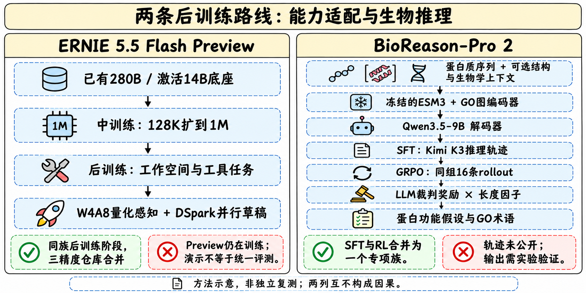
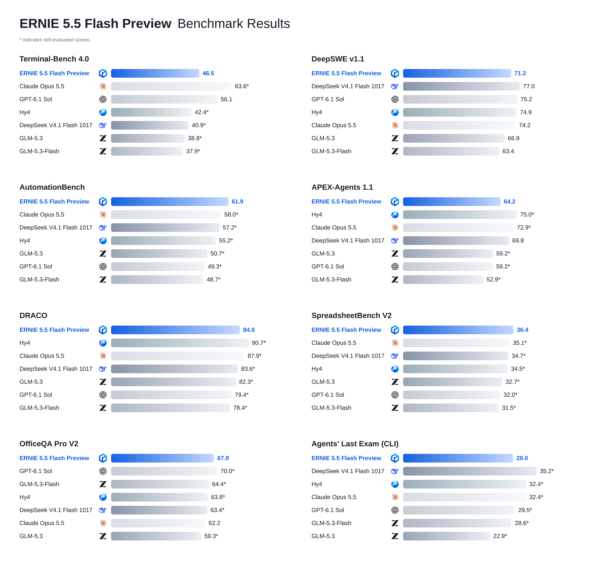
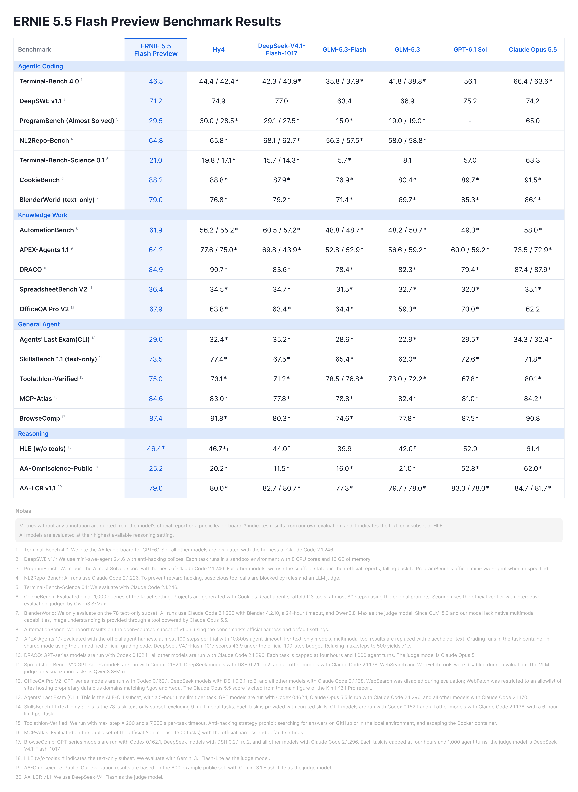

# ERNIE 5.5 Flash Preview开放权重 — API预览后的发布阶段

> [!tldr]
> 我的判断：11/24兑现的是同族Preview的权重开放与推理工程，不是新的5.6正代。11/5 Base、11/11 Preview API、11/24开源必须保留为三种事件。W4A8 QAT与DSpark让长任务有工程可用性，但演示11小时游戏不能当统一Agent benchmark。

> [!warning] 日期、许可与条件
> 原博客清楚写11/11，当前HF publish三仓库11/24 03:08–03:09UTC→北京11:08–11:09；不把新仓库日期覆盖旧API首发。已读卡片、完整20指标表、原博客和完整官方图。权重Apache2.0只覆盖Preview；Base仍为自己的Model License v1.0。Preview是后训练中间checkpoint，官方说训练尚未结束。

## 从Base到可部署Preview

> [!tldr]
> 架构与tokenizer继承Base，能力与长窗来自后续训练；发布规格1M与示例启动128K是两回事。

| 项目 | 官方卡 |
|---|---|
|参数 / 层|280B，总激活14B；43层=1dense+42MoE|
|专家|512 routed top10 +1shared|
|注意力|37HCA（每128历史token压缩一条cache）+6MLA-DSA|
|隐层 / 词表|4096 /201216|
|上下文|1048576；中训练由128K扩到1M|
|默认精度|blockwiseFP8；routed experts MXFP4 W4A8；FP8 KV；FP4 DSA indexer|
|发布SKU|默认FP4专家、FP8、BF16；都带DSpark草稿头|

W4A8 QAT在后训练内模拟与推理一致的粒度、scale和舍入，避免另行校准数值不匹配。非专家仍blockwiseFP8，不能称“全模型4bit”。DSpark并行提出一块token再由主模型验证；ECHO是自回归逐步MTP，两者对不同熵输出有取舍。当前Preview只带DSpark，后续支持两者的承诺不能写成已交付。7步ECHO平均接受长度&gt;5.5和在线蒸馏DSpark生产接受长度再提高&gt;10%是不同实验。

6个DSA层选择Top2048历史位置；head routing减少indexer头计算，阈值预筛精确剔除低候选，卡称1M上下文TopK环节加速40%，不能外推全模型吞吐40%。低并发建议最多7token草稿，高并发2–3，需以真实接受率、batch和任务熵验证。

## Agent数据与案例的意义

> [!tldr]
> 30万工作空间与1000万文件描述训练覆盖；精选作品描述模型加外部工具/资产的系统输出，不能算独立模型的原生图像/视频生成能力。

官方称知识工作训练含30万workspace、1000万参考文件、40余文件类型；视频创作15万环境与1000余skills。文本模型写脚本调用Blender/CAD/FFmpeg、检索并使用外部资产。11小时UE5.8武侠游戏、近100小游戏、两agent机场/飞机场景是案例；个别视频使用Seedance2.5、静态背景来自图像工具，必须保留工具与预置资产贡献。对Agent训练可研究“看不到画面时把playtest反馈变成代码可测不变量”，但无总体任务样本分布，不推断成功率。

## 20项评测与跨harness限制

> [!tldr]
> ERNIE是自测；比较模型混用官方报告/AA与厂商自测，星号和双值都有意义。不能只摘最高一格当统一排名。

| 维度 | ERNIE Preview分数（全部20项） |
|---|---|
|Agentic Coding|TerminalBench4 46.5；DeepSWE1.1 71.2；ProgramBench AlmostSolved29.5；NL2Repo64.8；TBScience0.1 21.0；Cookie88.2；BlenderWorld text79.0|
|知识工作|Automation61.9；APEXAgents1.1 64.2；DRACO84.9；SpreadsheetBenchV2 36.4；OfficeQAProV2 67.9|
|通用Agent|AgentsLastExam CLI29.0；SkillsBench1.1 text73.5；ToolathlonVerified75.0；MCPAtlas84.6；BrowseComp87.4|
|推理|HLE无工具text-only46.4；AAOmnisciencePublic25.2；AALCR1.1 79.0|

原完整比较表随模型卡保留：如TB4的Hy4为44.4报告/42.4厂商自测，Opus5.5为66.4/63.6；不能任意挑较低对手值。最高可用reasoning设定；有官方harness则用其，否则GPT放Codex、部分DeepSeek放DSH、其他放ClaudeCode。故跨列同时改变模型与harness。Automation61.9高于Opus自测58.0，但TB4和TBScience明显落后；此差异应保留。

## 运行契约与研究判断

> [!tldr]
> 示例依赖可变，需要冻结版本；本次只归档，没有运行官方脚本或申请GPU。

SGLang示例tp4/attn-dp4、context131072、128maxrunning、DSPARK、ernie55解析器；vLLM0.32.0配baidu插件、DP4专家并行、FP8KV、FP4indexer、7草稿token。它们默认启动128K，不是“只能128K”。卡片一处说可enable_thinking:false，接口段却说always thinks，保留这处契约不一致，实际应验证具体runtime与chat template。reasoning_content和content分开，不把思考文本混入答案评分。

> [!insight]
> 迁移到Agent训练时，应同时冻结模型权重、量化策略、草稿头、harness和工具环境，分开统计训练能力收益与解码系统收益。可对相同任务比较BF16/FP8/MXFP4与不同草稿长度，记录终态正确率、接受长度、总walltime、token和峰值显存；在这些条件未对齐前，不能用样例推理性能宣称普遍加速。

## 官方来源与关联资料

- [ernie-README.md](https://huggingface.co/baidu/ERNIE-5.5-Flash-Preview/resolve/main/README.md)
- [ernie-blog.html](https://ernie.baidu.com/release/ernie-5-5-flash-preview/)

> 📊 中文Poster：[[Topics/13_base_model/Baidu_ERNIE/261105_ERNIE_5_5_Flash/ernie55_preview_weights_poster_zh.html|中文Poster]]

## 官方原图与机制对照

