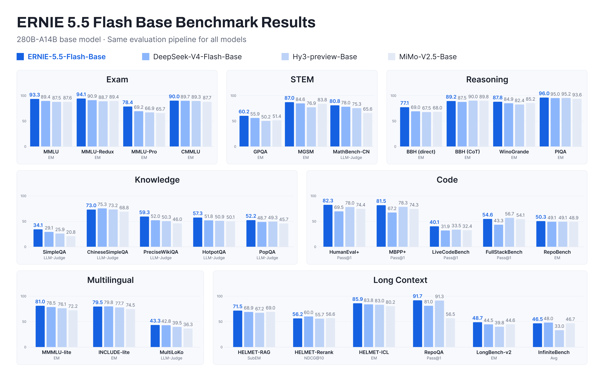
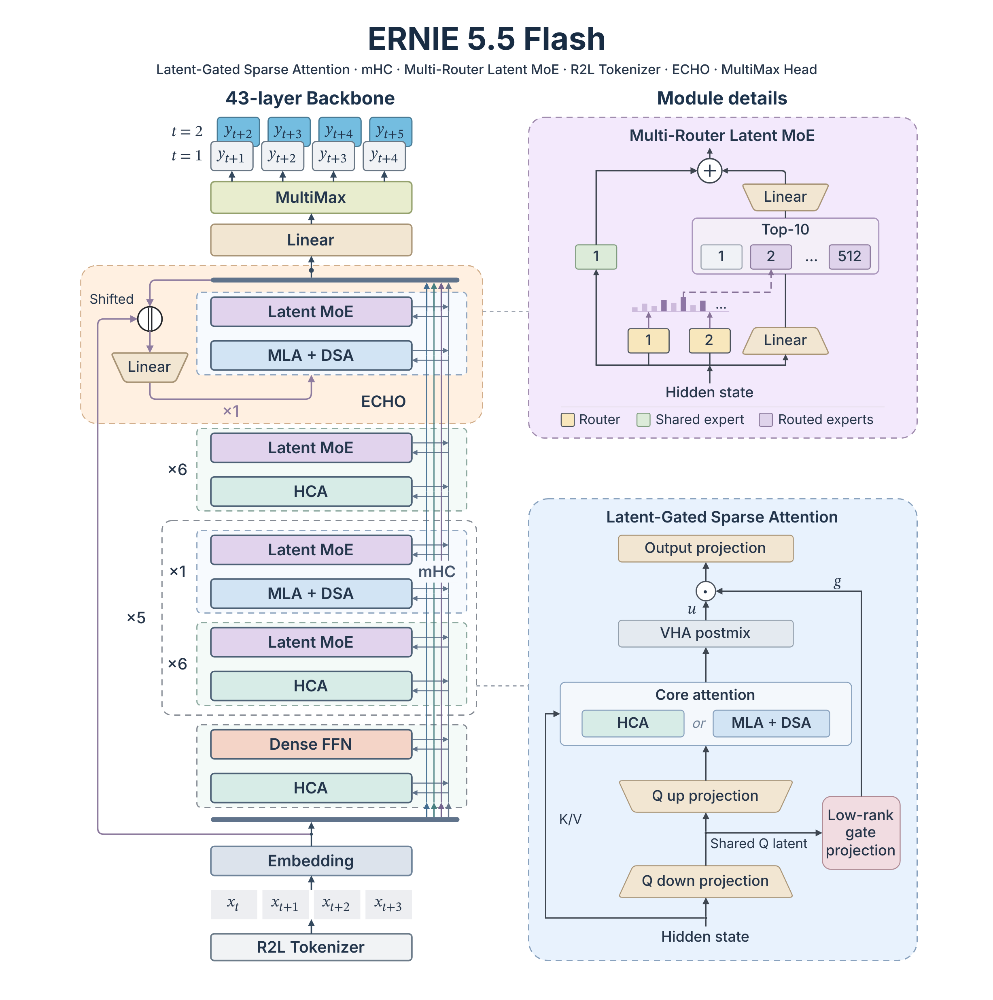

<div align="center">

</div>

<div align="center" style="line-height: 1;">
  <a href="https://ernie.baidu.com/release/ernie-5-5-flash-base/" target="_blank" style="margin: 2px;">
    
  </a>
  <a href="https://x.com/Baidu_ERNIE" target="_blank" style="margin: 2px;">
    
  </a>
  <a href="#license" style="margin: 2px;">
    
  </a>
</div>

<hr>

# ERNIE-5.5-Flash-Base

## Introduction

**ERNIE 5.5 Flash** is an efficient sparse Mixture-of-Experts (MoE) language model with **280B total parameters and 14B activated per token**, pre-trained from scratch on **33.5T tokens** with a training context of up to **128K**; fine-tuning and inference support a **1M-token** context. Different domains, reasoning tasks and agentic applications call for different data, training objectives and behavioral policies; by releasing the weights at the end of pre-training, we let developers build on the model's general capabilities and choose for themselves where to take it next. Because further training and agentic use keep adding to compute and memory cost, we made efficiency a key design goal from the start, revisiting each component, from attention and residual connections to the MoE layers and the output head, and treating activated compute, KV cache and long-context cost as part of one overall design. The same long-term view shaped the data and the training system: pre-training data emphasizes capabilities that are hard to build in afterwards, such as repository-scale code and long-context understanding, and the training system was co-designed with the architecture so that its efficiency choices also train efficiently at scale.

**ERNIE-5.5-Flash-Base** is the checkpoint at the end of pre-training, before any mid- or post-training, and can serve as a common starting point for domain adaptation, instruction tuning and reinforcement-learning research. Under a unified evaluation pipeline it delivers strong results across knowledge, reasoning, math, code, multilingual and long-context benchmarks; full results are in the table below, reported alongside DeepSeek-V4-Flash-Base (284B-A13B), Hy3-preview-Base (295B-A21B) and MiMo-V2.5-Base (310B-A15B), all evaluated with the same pipeline, prompts and few-shot settings.

For more details on ERNIE 5.5 Flash Base, please refer to our [technical blog](https://ernie.baidu.com/release/ernie-5-5-flash-base/).

<div align="center">
  
</div>

## Model Downloads

| Model | # Total Params | # Activated Params | Context Length | Precision | Download |
| :--- | :---: | :---: | :---: | :---: | :---: |
| ERNIE-5.5-Flash-Base | 280B | 14B | 128K (max training) / 1M (fine-tuning & inference) | FP8 (safetensors) | [🤗 Hugging Face](https://huggingface.co/baidu/ERNIE-5.5-Flash-Base) / [🤖 ModelScope](https://www.modelscope.cn/models/baidu/ERNIE-5.5-Flash-Base) |
| ERNIE-5.5-Flash-Base-BF16 | 280B | 14B | 128K (max training) / 1M (fine-tuning & inference) | BF16 (safetensors) | [🤗 Hugging Face](https://huggingface.co/baidu/ERNIE-5.5-Flash-Base-BF16) / [🤖 ModelScope](https://www.modelscope.cn/models/baidu/ERNIE-5.5-Flash-Base-BF16) |

## ERNIE 5.5 Flash Highlights

<div align="center">
  
</div>

**Architecture**

1. **280B-A14B hybrid-attention MoE.** 43 layers (1 dense FFN + 42 Multi-Router Latent MoE) with 37 Heavily Compressed Attention (HCA) layers and 6 Multi-head Latent Attention layers with sparse attention (MLA + DSA); 512 routed experts (top-10) plus 1 shared expert per MoE layer; pre-trained from scratch on 33.5T tokens with the Muon optimizer and a training context of up to 128K; fine-tuning and inference support 1M context.

2. **Hybrid MLA + HCA attention with layer-specific head dimensions.** One in seven layers keeps full-context access through MLA; the rest use Heavily Compressed Attention (HCA), which caches a single entry per 128 tokens. Head dimensions are matched to each layer's attention cost: the cheap HCA layers, which attend over a 128×-compressed sequence, use wide 512-dim heads, while the more compute-intensive token-level MLA layers use narrower 256-dim heads. At a comparable KV-cache budget, pairing HCA with MLA outperforms pairing it with Compressed Sparse Attention (CSA). The MLA layers adopt DSA, matching dense attention in pre-training loss while their per-query core attention cost no longer grows with context length.

3. **Low-Rank Gated Attention and [Virtual Head Attention (VHA)](https://arxiv.org/abs/2610.17959).** The attention output gate is computed from the low-rank query latent instead of the hidden state, cutting gate-projection parameters by 75% while improving performance. VHA adds a lightweight low-rank post-mix across heads with an identity skip, fused into the attention operator at inference. Both are applied in every attention layer, together with QK-norm.

4. **[Multi-Router](https://arxiv.org/abs/2610.40577) Latent MoE: multiple routers over half-width latent experts.** A single router's scores correlate only weakly with expert utility, especially in the middle-to-deep layers. Multi-Router replaces it with several independently initialized sigmoid routers with distinct preferences, so expert selection is no longer dictated by any single router's errors and becomes more accurate, while the number of activated experts, expert FLOPs and communication volume stay unchanged. Each MoE layer has 512 routed experts (top-10) plus 1 shared expert, operating in a 2048-d latent space so that expert dispatch/combine happens at half the hidden width. Auxiliary-loss-free load balancing keeps expert load even; following the Stable LatentMoE design, an RMSNorm before the up-projection and SiTU-GLU expert activations keep expert outputs well-scaled and stabilize optimization; on top of this RMSNorm, each routed expert's routing weight is multiplied by a learnable scalar of its own.

5. **[ECHO](https://arxiv.org/abs/2610.24766): the backbone's own final layer replaces the MTP module.** Instead of a separate MTP module, ECHO reuses the backbone's final layer to predict future tokens, so the multi-horizon loss directly shapes the next-token parameters; the same layer doubles as a built-in draft model for speculative decoding.

6. **Manifold-constrained Hyper-Connections (mHC).** The model adopts mHC with expansion rate 4 in place of the standard residual stream, strengthening signal propagation across the 43 layers while preserving expressivity.

7. **MultiMax Output Head.** A MultiMax head with a learnable piece-wise temperature sharpens the vocabulary distribution at negligible training cost.

8. **Tokenizer.** A ≈200K-entry BPE tokenizer tokenizes numbers right-to-left (R2L) in groups of up to three digits.

**Pre-training Data**

- **Web:** large-scale multilingual crawling, high-fidelity text extraction and model-driven, multi-dimensional quality filtering, for broad knowledge coverage and a high density of useful learning signal.
- **Code:** repository and web code with non-code filtering, recall-oriented deduplication and multi-granularity quality grading, complemented by software-evolution and execution-grounded data (commits, issues, pull requests, code reviews, requirement→PR and multi-commit trajectories, generated tests, CI-verified fixes) for repository-level reasoning and agentic software engineering.
- **Long context:** curated natural long documents, long sequences built from natural texts with semantically similar retrieved distractors, and synthesized MRCR-style retrieval, citation-grounded QA and multi-hop QA data.

**Training Infrastructure**

- **Communication-efficient distributed Muon:** dense and MoE parameter synchronization share one fused cross-node same-rank collective instead of a cluster-wide ring, cutting inter-node latency and jitter at the scale of thousands of GPUs without changing optimizer semantics.
- **Memory-balanced optimizer sharding:** optimizer states are spread nearly evenly across nodes while maintaining large message sizes for efficient communication, removing OOM hot spots and slow checkpointing.
- **[FlashMask-4](https://github.com/PaddlePaddle/FlashMask):** a CuTe-DSL attention kernel for both SM90 and SM100 supporting head dimensions up to 576 (qk) / 512 (v); on SM100 it is up to 175% faster forward and 74% faster backward than FlashAttention-4 MaskMod.

## Model Overview

ERNIE-5.5-Flash-Base is a text-only MoE base model. Key configuration:

| Key | Value |
| --- | --- |
| Modality | Text |
| Training Stage | Pre-training |
| Total Params | 280B |
| Activated Params per Token | 14B |
| Layers | 43 (1 dense + 42 MoE) |
| Hidden Size | 4096 |
| Attention | 37 × HCA (head dim 512) + 6 × MLA-DSA (head dim 256), 64 heads |
| Experts | 512 routed (top-10) + 1 shared, latent dim 2048, expert dim 2048 |
| Vocabulary | 201,216 |
| Context Length | 131,072 (max training) / 1,048,576 (fine-tuning & inference; the released config enables 1M context) |
| Pre-training Tokens | 33.5T |
| Precision | FP8 mixed (FP8 and BF16 weights released) |

Total parameters include the input embedding and the output head; activated parameters count the output head but not the embedding lookup. Both exclude the additional ECHO parameters (0.36B).

## Evaluation

| Benchmark (Metric) | # Shots | ERNIE-5.5-Flash-Base | DeepSeek-V4-Flash-Base | Hy3-preview-Base | MiMo-V2.5-Base |
| :--- | :---: | :---: | :---: | :---: | :---: |
| # Total Params | - | 280B | 284B | 295B | 310B |
| # Activated Params | - | 14B | 13B | 21B | 15B |
| **Exam** | | | | | |
| MMLU (EM) | 5-shot | **93.3** | 89.4 | 87.5 | 87.6 |
| MMLU-Redux (EM) | 5-shot | **94.1** | 90.9 | 88.7 | 89.4 |
| MMLU-Pro (EM) | 5-shot | **78.4** | 69.2 | 66.9 | 65.7 |
| CMMLU (EM) | 5-shot | **90.0** | 89.7 | 89.3 | 87.7 |
| **Knowledge** | | | | | |
| SimpleQA (LLM-Judge) | 10-shot | **34.1** | 29.1 | 25.9 | 20.8 |
| ChineseSimpleQA (LLM-Judge) | 10-shot | 73.0 | **75.3** | 73.2 | 68.8 |
| PreciseWikiQA (LLM-Judge) | 10-shot | **59.3** | 52.0 | 50.3 | 46.0 |
| HotpotQA (LLM-Judge) | 10-shot | **57.3** | 51.8 | 50.9 | 50.1 |
| PopQA (LLM-Judge) | 10-shot | **52.2** | 48.7 | 49.3 | 45.7 |
| **STEM** | | | | | |
| GPQA (EM) | 5-shot | **60.2** | 55.9 | 50.2 | 51.4 |
| MGSM (EM) | 8-shot CoT | **87.0** | 84.6 | 76.9 | 83.8 |
| MathBench-CN (LLM-Judge) | 5-shot | **80.8** | 78.0 | 75.3 | 65.6 |
| **Reasoning** | | | | | |
| BBH (EM, direct) | 3-shot | **77.1** | 69.0 | 67.5 | 68.0 |
| BBH (EM, CoT) | 3-shot CoT | 89.2 | 87.5 | **90.0** | 89.8 |
| WinoGrande (EM) | 5-shot | **87.8** | 84.9 | 82.4 | 85.2 |
| PIQA (EM) | 5-shot | **96.0** | 95.0 | 95.2 | 93.6 |
| **Multilingual** | | | | | |
| MMMLU-lite (EM) | 5-shot | **81.0** | 78.5 | 76.1 | 72.2 |
| INCLUDE-lite (EM) | 5-shot | 79.5 | **79.8** | 77.7 | 74.5 |
| MultiLoKo (LLM-Judge) | 5-shot | **43.3** | 42.8 | 39.5 | 36.3 |
| **Code** | | | | | |
| HumanEval+ (Pass@1) | 1-shot | **82.3** | 69.5 | 78.0 | 74.4 |
| MBPP+ (Pass@1) | 0-shot | **81.5** | 67.2 | 78.3 | 74.3 |
| LiveCodeBench (Pass@1) | 1-shot | **40.1** | 31.9 | 33.5 | 32.4 |
| FullStackBench (Pass@1) | 1-shot | 54.6 | 43.3 | **56.7** | 54.1 |
| RepoBench (EM) | 0-shot | **50.3** | 49.1 | 49.1 | 48.9 |
| **Long Context** | | | | | |
| HELMET-RAG (SubEM) | 2-shot | **71.5** | 68.9 | 67.2 | 69.0 |
| HELMET-Rerank (NDCG@10) | 0-shot | 56.2 | **60.0** | 55.7 | 56.6 |
| HELMET-ICL (EM) | many-shot | **85.9** | 83.8 | 83.0 | 80.2 |
| RepoQA (Pass@1) | 0-shot | **91.7** | 81.0 | 91.3 | 56.5 |
| LongBench-v2 (EM) | 0-shot | **48.7** | 44.5 | 39.8 | 44.6 |
| InfiniteBench (Avg) | 0-shot | 46.5 | **48.0** | 33.0 | 46.7 |


## Deployment

ERNIE-5.5-Flash-Base supports production serving with SGLang and vLLM.

### SGLang

Use the official prebuilt Docker image to launch the container:

```bash
docker run -d -it --name ernie55 \
  --gpus all \
  --network host \
  --ipc host \
  -v ~/.cache/huggingface:/root/.cache/huggingface \
  lmsysorg/sglang:dev-ernie-55-flash
```

Launch the server:

```bash
sglang serve \
  --model-path baidu/ERNIE-5.5-Flash-Base \
  --tp 4 \
  --attn-dp-size 4 \
  --context-length 131072 \
  --max-running-requests 1024 \
  --host 0.0.0.0 \
  --port 30000
```

### vLLM

Install vLLM and the ERNIE 5.5 plugin:

```bash
uv venv --python 3.12 ernie5-venv
source ernie5-venv/bin/activate

uv pip install vllm==0.32.0
uv pip install git+https://github.com/baidu/vLLM-ERNIE.git
```

Launch the server:

```bash
vllm serve baidu/ERNIE-5.5-Flash-Base \
  --kv-cache-dtype fp8 \
  --enable-expert-parallel \
  --data-parallel-size 4 \
  --max-model-len 131072 \
  --port 30000 \
  --moe-backend humming
```

Both servers accept a context length of up to 1,048,576 tokens for long-context inference.

### Send Requests

Use `curl` to send a request and verify that the service is running. As a base model, ERNIE-5.5-Flash-Base is served through the completions endpoint:

```bash
curl http://localhost:30000/v1/completions \
  -H "Content-Type: application/json" \
  -d '{
    "model": "baidu/ERNIE-5.5-Flash-Base",
    "prompt": "Large language models are",
    "max_tokens": 256,
    "temperature": 0
  }'
```

## License

ERNIE-5.5-Flash-Base is provided under the ERNIE 5.5 Flash Base Model License Agreement v1.0. See [LICENSE](https://huggingface.co/baidu/ERNIE-5.5-Flash-Base/blob/main/LICENSE) for details. Copyright © 2026 Baidu. All Rights Reserved.

## Citation

If you find ERNIE 5.5 useful in your research or projects, please consider citing this blog post:

```bibtex
@misc{ernie5.5flash,
  title = {ERNIE 5.5 Flash Base},
  author = {{Baidu ERNIE Team}},
  year = {2026},
  howpublished = {ERNIE Blog},
  url = {https://ernie.baidu.com/release/ernie-5-5-flash-base/}
}
```

## Contact

If you have any questions, please contact us at [Baidu_ERNIE@baidu.com](mailto:Baidu_ERNIE@baidu.com).