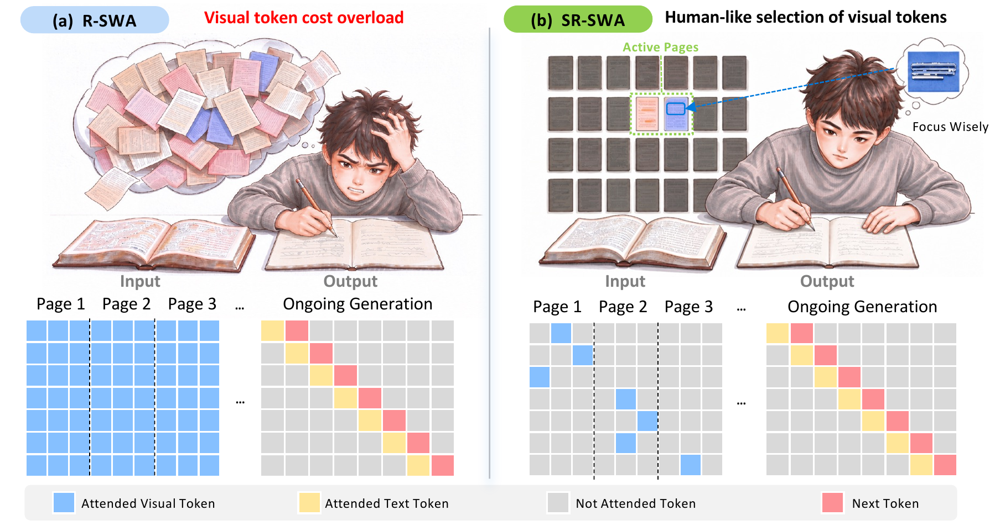
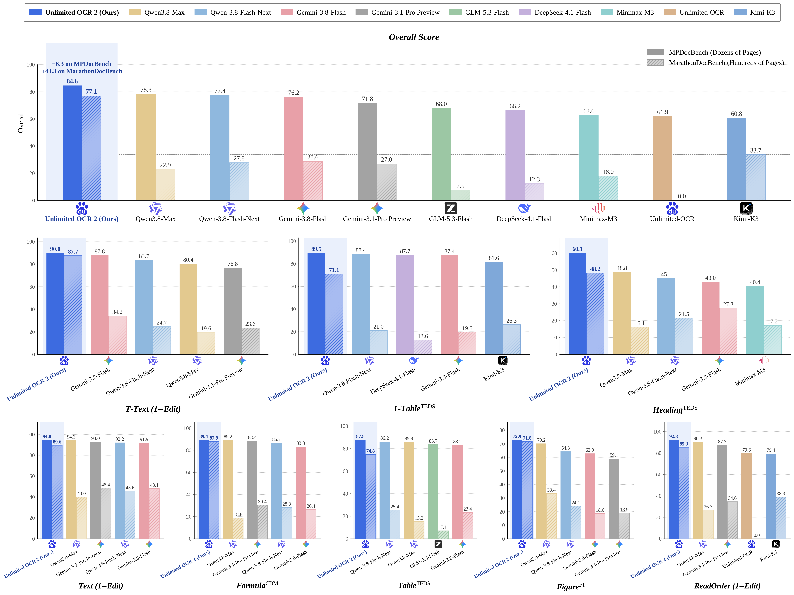
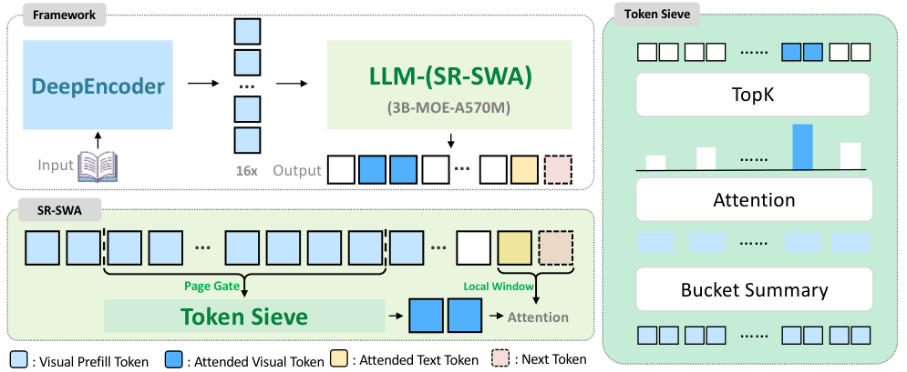

# Unlimited-OCR-2：长文档中的选择性视觉访问

> [!tldr]
> 核心不是把单页 OCR 连续调用几百次，而是让同一次生成在多页图像中选择要看的内容，并保持跨页解析顺序。SR-SWA 限制每步访问的参考内容，配合滑动窗口控制运行成本。官方百页级测试优势明显，但“Unlimited”不等于无限上下文、恒定总成本或任何页数都无遗漏。

> [!warning] 报告HTML已精读，复现与消融缺口仍保留
> 11月2日原卡新增arXiv2610.39308入口；已阅读v2完整HTML的方法、训练、评测与限制，保存HTML和官方图，不下载PDF。现已能核对3B/0.5B规模、训练数据、训练设置和性能条件，撤销旧笔记“没有可读报告”的限制。但原文缺独立组件消融、完整公平API协议与独立复测，本笔记仍无法达到完整机制归因/复现验收标准，不把补报告当作新模型发布。

## 模型与接口

> [!tldr]
> 跨页文档解析专项，10/27首发；同一请求保留页顺序，但单页裁剪与多页输入不是相同视觉预算。

### 为什么跨页解析比逐页 OCR 更难

长合同里的表格可能跨过分页，标题层级可能依赖前页，脚注与正文也可能分离。逐页识别即使字准，也可能在拼接时丢掉结构。反过来，让每个输出 token 都看全部页面，会把视觉访问成本放大。官方图左侧 R-SWA 的视觉参考仍很密；右侧 SR-SWA 只激活有关页面和视觉区域，同时保留局部生成历史。[S1]

这是一种选择性访问机制。卡中以固定工作参考规模（例如 512 tokens）解释解码时的内存与延迟控制；并不是说整份文档只有 512 tokens，也不意味着编码全部页面、最终生成全部文本的总时间不随文档长度增加。配置中的 `max_position_embeddings=131072`、`sliding_window_size=128`、视觉稀疏块参数属于不同层面的实现量，不能互相替换。

### 一页事实表

| 维度 | 官方可核对事实 | 阅读边界 |
|---|---|---|
| 发布 | News 明确 `[2026/10/27]` | 不沿用 OCR1 的 6 月日期 |
| 定位 | 文档解析专项；单页与多页接口 | 不作为 ERNIE 聊天正代 |
| 视觉输入 | 配置 1024 图像；全局视图及单页动态切片 | 多页不直接等于单页多裁剪模式 |
| 语言骨干 | 报告3B总参数 / 0.5B激活；配置12层hidden1280、10heads | 参数来自报告，不靠配置猜算 |
| MoE 配置 | 64 routed experts、每 token 选 6、2 shared | 不把专家数说成模型数 |
| 稀疏访问 | top-k blocks、page2d 位置、图像路由等公开配置 | 配置不是完整训练 recipe |
| 原始材料 | HF README、config、推理代码、两张官方图 | PDF 报告仅保留官方链接 |

### 两种输入协议不能混成一个基准

`infer_multi` 把有序页面组成一次请求，每页对应一个全局视图。默认提示按页重复 `<PAGE><image>`，再请求 multi-page parsing；输出也按原顺序产生 `<PAGE>` 分段。验收时应检查输入页数、输出页数、对应关系、最后一页是否完整，并额外看跨页表格和段落连接。

单页 `infer` 默认可以动态切片，`gundam` 等模式影响视觉细节和算量。用单页裁剪更精细的结果对比多页全局视图，必须把输入策略写清。多页优势应来自跨页信息使用与稳定生成，而不是给其中一个方法更多分辨率。

## 结果与限制

> [!tldr]
> MPDoc与Marathon分别看，图中一位小数与报告精确值分开；OCR1百页未报告，不能当实测零分。

### 官方结果：百页与几十页必须分列

下表从官方原图逐项抄录 Overall，两组文档规模不同，不能合成一个“总准确率”。图中名称保留发布时写法；本表不是自行重跑排行榜。[S1]

| 模型 | MPDocBench（几十页） | MarathonDocBench（几百页） |
|---|---:|---:|
| Unlimited OCR 2 | 84.6 | 77.1 |
| Qwen3.8-Max | 78.3 | 22.9 |
| Qwen-3.8-Flash-Next | 77.4 | 27.8 |
| Gemini-3.8-Flash | 76.2 | 28.6 |
| Gemini-3.1-Pro Preview | 71.8 | 27.0 |
| GLM-5.3-Flash | 68.0 | 7.5 |
| DeepSeek-4.1-Flash | 66.2 | 12.3 |
| Minimax-M3 | 62.6 | 18.0 |
| Unlimited-OCR | 61.9 | 未报告（40页输入限制） |
| Kimi-K3 | 60.8 | 33.7 |

84.6 相对几十页组最强对照 78.3 高 **6.3 分**；77.1 相对几百页组最高对照 Kimi 33.7 高 **43.4 分**，但原图标注是 **+43.3**，可能受未显示的小数影响。保留这一差异，不能把四舍五入后的手算数冒充原始统计。**报告表2明确OCR1因40页输入限制而未报告Marathon成绩**；旧HF图0.0应读为无法完成/未报告的展示，不是可比较的实测零分。

| 本模型分项 | MPDocBench | MarathonDocBench | 主要检查什么 |
|---|---:|---:|---|
| T-Text (1−Edit) | 90.0 | 87.7 | 任务文本 |
| T-Table TEDS | 89.5 | 71.1 | 任务表格结构 |
| Heading TEDS | 60.1 | 48.2 | 标题结构 |
| Text (1−Edit) | 94.8 | 89.6 | 全文文字 |
| Formula CDM | 89.4 | 87.9 | 公式 |
| Table TEDS | 87.8 | 74.8 | 全文表格 |
| Figure F1 | 72.9 | 71.8 | 插图 |
| ReadOrder (1−Edit) | 92.3 | 85.3 | 阅读顺序 |

标题在长文档上仍只有 48.2，表格 74.8；即使 Overall 明显领先，也不能宣称所有结构都接近解决。图中部分分项只画若干对照，不将未显示的对照单元格补成零。报告已给出测试构建，但API精确版本、失败重试与token cap公平性细节仍不充分，不能宣称完整审核通过。

## 部署与Agent验收

> [!tldr]
> 页窗、guard与预算影响页覆盖；先验解析和证据定位，再判断Agent最终任务。

### 部署参数本身会改变质量

官方 Transformers 示例环境为 A800 80GB、Python 3.10、torch 2.13、Transformers 4.52.1，含自定义模型代码。本轮只阅读，未安装、运行或下载权重。SGLang 文档要求专用 `0.5.20.dev10+g8d62f5fb9c` wheel，不应把示例当成任意上游版本即装即用的承诺。

| 参数/策略 | 官方示例 | 影响与验收 |
|---|---|---|
| 页面滑窗 | 示例 10 页，沿用前窗口 KV 尾部 | 小窗口省显存，但跨页连续块合并可能下降 |
| 每页生成保护 | 20000 tokens guard | 命中保护时检查是否截断，不把终止当完成 |
| 总输出预算 | 可按 `tokens_per_page=8000 × 页数` 配置 | 总预算必须随文档需求设置 |
| SAM 缓存 bias | MB64，相较默认 512 | 官方说明可避免约 462 MiB 的相关额外分配，不是全模型显存 |
| 预填充峰值 | `max_prefill=2048` 对比 4096 | 更小可降低这部分峰值，需配套 CUDA graph bucket |
| 静态内存比例 | 0.7 为稳妥示例，另有 0.75 | 高并发仍需单测，不保证 32+ 并发总能稳定 |
| 重复约束 | ngram 35；多页/单页窗口不同 | 重复减少和真正内容保留应同时检查 |

### 对 Agent Training 的判断

> [!insight]
> 长文档解析适合做可追溯的 Agent 观察层，但解析器错误会污染后续工具选择与最终结论。应把“视觉选择是否找对页”“结构是否保留”“Agent 是否引用正确页”分别监督，不能只用最终回答对错反推解析器质量。

可执行的对照是固定任务、提示和输出预算，比较逐页独立解析、整份多页解析、不同页窗。按页数、跨页表格、标题深度分桶，同时记录漏页率、尾页截断率、证据定位、耗时和峰值显存。给 Agent 制造关键页不可读或被截断的条件，检查它会报告缺口还是编造正文。

## 报告机制与训练

> [!tldr]
> 报告HTML已补读：限页、选块、跨chunk复用分别解决不同成本；作者承认缺全局文档信息。

### 11月2日报告补读：两级路由与分块复用

arXiv v1提交10/29，v2修订10/30；HF于11/2加入链接。**论文日期、卡片补链日期、10/27模型首发分开记录**，不另造11/2模型发布事件。

Page Gate按当前query关联页面筛选候选块；块边界可能跨相邻页。位置分解成0/1交替的页坐标与页内单调坐标，不是无限增长的绝对页号。Token Sieve先汇总每块key，再用query打分、α-entmax和TopK选远端块；所选路由概率的中心化log先验进入attention logits，解析目标梯度据此到达路由模块，**不需要辅助KL蒸馏loss**。局部窗口与选中远端块共同参与最终attention。这比笼统“只看有关页”更具体，但没有组件消融，仍不能量化Page Gate与Token Sieve各自贡献。

仅限制每query参考规模还不够：如果一次prefill全部页面，视觉KV驻留仍随页数增长。报告算法1将页面分成相邻重叠1页的chunk，保留边界图像KV与文本tail，编码下一chunk并释放非活动缓存；只有第一个chunk携带指令。这一流式处理仍按文档顺序输出，不等于全书所有细节永久全局可访问。

### 报告训练、数据与效率条件

| 项目 | 报告v2明确披露 | 边界 |
|---|---|---|
| 基座 | Unlimited OCR，源于DeepSeek OCR的DeepEncoder+MoE，3B/0.5B激活 | 不是从随机初始化完整预训练 |
| 数据 | 2M多页、10M单页文档；含合成，VLM特征均衡筛选 | 非独立页数/独立去重样本数保证 |
| 伪标注 | MinerU2.5-Pro与PaddleOCR-VL-v1.6按领域生成；MinerU-Popo及规则修跨页结构 | 需进一步审计教师偏差与去污染 |
| 后训练 | 1epoch、25×8 H800、global batch1600、最大64K | 未给完整硬件时长/成本 |
| 优化 | 冻结DeepEncoder和aligner，只优化LLM；AdamW、cosine，初始LR2.5e-4，MS-Swift | 不补写RL阶段；RL不在所读训练描述中 |
| MarathonDocBench | 100文档，103–300页，205k布局元素 | 解析器初始化、人修结构，VLM迭代校对文本，争议人工裁定 |
| KV峰值 | B=1：47.00→1.77GB，约26.6倍缩减 | 是KV cache，不是全系统显存1.77GB |
| 吞吐 | B=16：360→1315TPS，约3.65倍 | 不与B=1显存测量混作同一run |
| 单步延迟 | Gundam、B=3、每页固定生成1024tokens；百页相对Full/R-SWA约7.0/5.6倍 | 非所有端到端任务7倍，完整转写输出量仍增长 |

报告表1/2精确Overall是84.59/77.06，Kimi长文33.74，差43.32分，解释旧图+43.3标签；不再拿显示一位小数的43.4断言原图算错。表中Text/ReadOrder为越低越好的Edit Distance，旧图1−Edit越高越好，两种表示不能同列混排。

单页OmniDocBench v1.6为94.02，高于OCR1的93.92，但低于TeleOCR96.91和OvisOCR2 96.47；长文档优势不等于单页全面SOTA。作者明确限制：当前稀疏机制不保存全局文档信息，影响标题层级理解，计划用线性注意力等补全。因此“length-invariant”应限定所测300页范围和分布，不能宣称任意长度的全局理解已解决。
## 来源与修订记录

> [!tldr]
> 论文v1/v2、卡片补链日和模型首发各自保留；渠道和wheel变更不追加新模型事件。

### 一手资料与导航

- [S1] [🤗 HF Model Card](https://huggingface.co/baidu/Unlimited-OCR-2)；本地原件 [[src/hf_model_card|模型卡]]。
- [S2] [📄 Tech Report（PDF，仅链接）](https://arxiv.org/pdf/2610.39308) · [已读完整HTML v2](https://arxiv.org/html/2610.39308v2)。旧 arXiv 2606.23050 属于 OCR1，不能替代此报告。
- [S3] [官方仓库](https://github.com/baidu/Unlimited-OCR)；本地 [[src/config.json|配置]]、[[src/modeling_unlimitedocr.py|公开实现]]，未执行。
- [[Topics/13_base_model/Base Model MOC|基模主题索引]]；[[unlimited_ocr_2_poster_zh.html|中文 Poster]]。

> 📊 相关可视化: [[unlimited_ocr_2_poster_zh.html|Unlimited-OCR-2 中文 Poster]]

### 10月27日晚资料补充

原卡新增 [MarathonDocBench 数据集入口](https://huggingface.co/datasets/baidu/MarathonDocBench)，以及 ModelScope、百度云与演示链接。它补充了本笔记已有长文档评测的资源地图，**不改变Unlimited-OCR-2首发日，不另造模型叶子**；本轮未下载数据集或由新链接推断权重更新。

### 2026-10-28：ms-swift 训练支持入口

HF Release新增ms-swift社区支持Unlimited OCR 2训练的说明，链接指向 [modelscope/ms-swift](https://github.com/modelscope/ms-swift)。这是社区训练栈接入，不是新权重或新的首发日；未安装/执行训练，也没有从这条公告推断可复现超参、训练成本或成绩。

### 10月29日晚部署文档修订

官方SGLang示例wheel从`0.5.20.dev10+g8d62f5fb9c`改为`0.5.20.dev13+g75b9b06b02`。这是部署依赖修订，原卡没有据此公布新权重或新评测；模型首发仍10/27。本轮只保存新旧原卡，不安装wheel、不执行模型代码。

