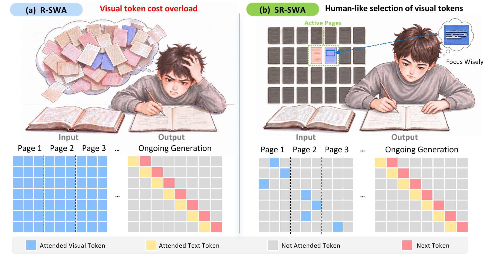
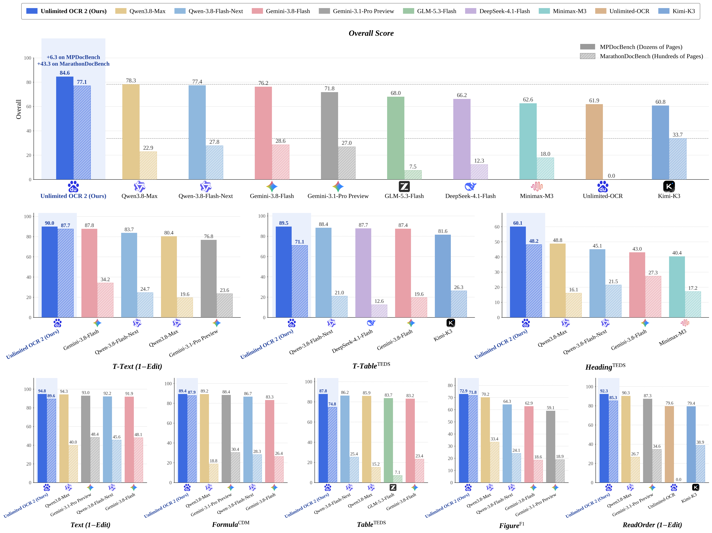

# Unlimited-OCR-2：长文档中的选择性视觉访问

> [!tldr]
> 核心不是把单页 OCR 连续调用几百次，而是让同一次生成在多页图像中选择要看的内容，并保持跨页解析顺序。SR-SWA 限制每步访问的参考内容，配合滑动窗口控制运行成本。官方百页级测试优势明显，但“Unlimited”不等于无限上下文、恒定总成本或任何页数都无遗漏。

> [!warning] 原始材料不足，未达到完整技术报告精读深度
> 已读 HF 原卡、config、公开推理实现和官方架构/评测原图。模型卡链接了独立 Unlimited-OCR-2 PDF 报告；遵照不下载 PDF 的要求，本轮只保留报告链接，尚未取得可阅读的报告源码，因此不能补出完整训练配方、消融、数据划分和显著性分析。以下明确区分官方成绩、配置事实与研读判断，未做本地复测。

## 为什么跨页解析比逐页 OCR 更难

长合同里的表格可能跨过分页，标题层级可能依赖前页，脚注与正文也可能分离。逐页识别即使字准，也可能在拼接时丢掉结构。反过来，让每个输出 token 都看全部页面，会把视觉访问成本放大。官方图左侧 R-SWA 的视觉参考仍很密；右侧 SR-SWA 只激活有关页面和视觉区域，同时保留局部生成历史。[S1]

这是一种选择性访问机制。卡中以固定工作参考规模（例如 512 tokens）解释解码时的内存与延迟控制；并不是说整份文档只有 512 tokens，也不意味着编码全部页面、最终生成全部文本的总时间不随文档长度增加。配置中的 `max_position_embeddings=131072`、`sliding_window_size=128`、视觉稀疏块参数属于不同层面的实现量，不能互相替换。

## 一页事实表

| 维度 | 官方可核对事实 | 阅读边界 |
|---|---|---|
| 发布 | News 明确 `[2026/10/27]` | 不沿用 OCR1 的 6 月日期 |
| 定位 | 文档解析专项；单页与多页接口 | 不作为 ERNIE 聊天正代 |
| 视觉输入 | 配置 1024 图像；全局视图及单页动态切片 | 多页不直接等于单页多裁剪模式 |
| 语言配置 | 12 层、hidden 1280、10 heads | 不自行猜测完整参数规模 |
| MoE 配置 | 64 routed experts、每 token 选 6、2 shared | 不把专家数说成模型数 |
| 稀疏访问 | top-k blocks、page2d 位置、图像路由等公开配置 | 配置不是完整训练 recipe |
| 原始材料 | HF README、config、推理代码、两张官方图 | PDF 报告仅保留官方链接 |

## 两种输入协议不能混成一个基准

`infer_multi` 把有序页面组成一次请求，每页对应一个全局视图。默认提示按页重复 `<PAGE><image>`，再请求 multi-page parsing；输出也按原顺序产生 `<PAGE>` 分段。验收时应检查输入页数、输出页数、对应关系、最后一页是否完整，并额外看跨页表格和段落连接。

单页 `infer` 默认可以动态切片，`gundam` 等模式影响视觉细节和算量。用单页裁剪更精细的结果对比多页全局视图，必须把输入策略写清。多页优势应来自跨页信息使用与稳定生成，而不是给其中一个方法更多分辨率。

## 官方结果：百页与几十页必须分列

下表从官方原图逐项抄录 Overall，两组文档规模不同，不能合成一个“总准确率”。图中名称保留发布时写法；本表不是自行重跑排行榜。[S1]

| 模型 | MPDocBench（几十页） | MarathonDocBench（几百页） |
|---|---:|---:|
| Unlimited OCR 2 | 84.6 | 77.1 |
| Qwen3.8-Max | 78.3 | 22.9 |
| Qwen-3.8-Flash-Next | 77.4 | 27.8 |
| Gemini-3.8-Flash | 76.2 | 28.6 |
| Gemini-3.1-Pro Preview | 71.8 | 27.0 |
| GLM-5.3-Flash | 68.0 | 7.5 |
| DeepSeek-4.1-Flash | 66.2 | 12.3 |
| Minimax-M3 | 62.6 | 18.0 |
| Unlimited-OCR | 61.9 | 0.0 |
| Kimi-K3 | 60.8 | 33.7 |

84.6 相对几十页组最强对照 78.3 高 **6.3 分**；77.1 相对几百页组最高对照 Kimi 33.7 高 **43.4 分**，但原图标注是 **+43.3**，可能受未显示的小数影响。保留这一差异，不能把四舍五入后的手算数冒充原始统计。OCR1 的 0.0 是图中该测试结果，不代表它所有 OCR 能力为零。

| 本模型分项 | MPDocBench | MarathonDocBench | 主要检查什么 |
|---|---:|---:|---|
| T-Text (1−Edit) | 90.0 | 87.7 | 任务文本 |
| T-Table TEDS | 89.5 | 71.1 | 任务表格结构 |
| Heading TEDS | 60.1 | 48.2 | 标题结构 |
| Text (1−Edit) | 94.8 | 89.6 | 全文文字 |
| Formula CDM | 89.4 | 87.9 | 公式 |
| Table TEDS | 87.8 | 74.8 | 全文表格 |
| Figure F1 | 72.9 | 71.8 | 插图 |
| ReadOrder (1−Edit) | 92.3 | 85.3 | 阅读顺序 |

标题在长文档上仍只有 48.2，表格 74.8；即使 Overall 明显领先，也不能宣称所有结构都接近解决。图中部分分项只画若干对照，不将未显示的对照单元格补成零。测试集构建、API 版本、失败重试与 token cap 的公平性还需报告源码才能审核。

## 部署参数本身会改变质量

官方 Transformers 示例环境为 A800 80GB、Python 3.10、torch 2.13、Transformers 4.52.1，含自定义模型代码。本轮只阅读，未安装、运行或下载权重。SGLang 文档要求专用 `0.5.20.dev10+g8d62f5fb9c` wheel，不应把示例当成任意上游版本即装即用的承诺。

| 参数/策略 | 官方示例 | 影响与验收 |
|---|---|---|
| 页面滑窗 | 示例 10 页，沿用前窗口 KV 尾部 | 小窗口省显存，但跨页连续块合并可能下降 |
| 每页生成保护 | 20000 tokens guard | 命中保护时检查是否截断，不把终止当完成 |
| 总输出预算 | 可按 `tokens_per_page=8000 × 页数` 配置 | 总预算必须随文档需求设置 |
| SAM 缓存 bias | MB64，相较默认 512 | 官方说明可避免约 462 MiB 的相关额外分配，不是全模型显存 |
| 预填充峰值 | `max_prefill=2048` 对比 4096 | 更小可降低这部分峰值，需配套 CUDA graph bucket |
| 静态内存比例 | 0.7 为稳妥示例，另有 0.75 | 高并发仍需单测，不保证 32+ 并发总能稳定 |
| 重复约束 | ngram 35；多页/单页窗口不同 | 重复减少和真正内容保留应同时检查 |

## 对 Agent Training 的判断

> [!insight]
> 长文档解析适合做可追溯的 Agent 观察层，但解析器错误会污染后续工具选择与最终结论。应把“视觉选择是否找对页”“结构是否保留”“Agent 是否引用正确页”分别监督，不能只用最终回答对错反推解析器质量。

可执行的对照是固定任务、提示和输出预算，比较逐页独立解析、整份多页解析、不同页窗。按页数、跨页表格、标题深度分桶，同时记录漏页率、尾页截断率、证据定位、耗时和峰值显存。给 Agent 制造关键页不可读或被截断的条件，检查它会报告缺口还是编造正文。

## 一手资料与导航

- [S1] [🤗 HF Model Card](https://huggingface.co/baidu/Unlimited-OCR-2)；本地原件 [[src/hf_model_card|模型卡]]。
- [S2] [📄 Tech Report（PDF，仅链接）](https://huggingface.co/baidu/Unlimited-OCR-2/blob/main/Unlimited-OCR-2.pdf)。旧 arXiv 2606.23050 属于 OCR1，不能替代此报告。
- [S3] [官方仓库](https://github.com/baidu/Unlimited-OCR)；本地 [[src/config.json|配置]]、[[src/modeling_unlimitedocr.py|公开实现]]，未执行。
- [[Topics/13_base_model/Base Model MOC|基模主题索引]]；[[unlimited_ocr_2_poster_zh.html|中文 Poster]]。

> 📊 相关可视化: [[unlimited_ocr_2_poster_zh.html|Unlimited-OCR-2 中文 Poster]]
