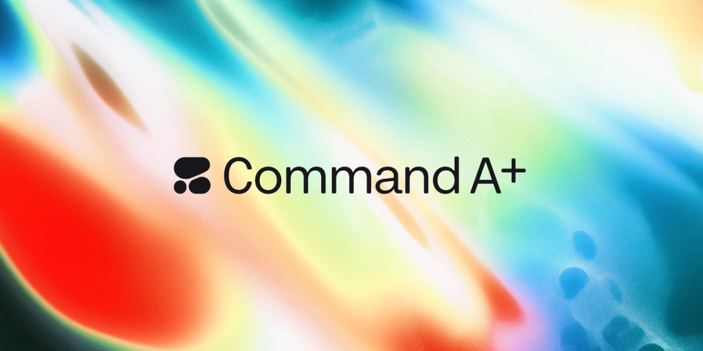
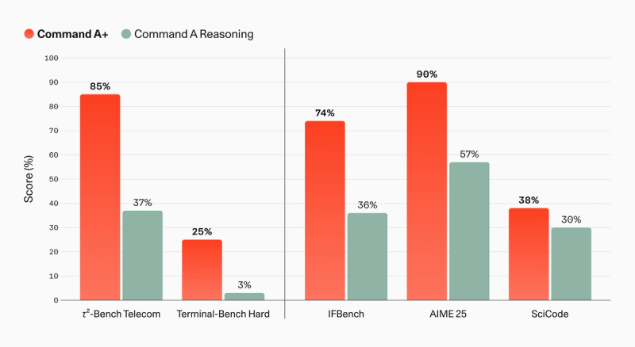
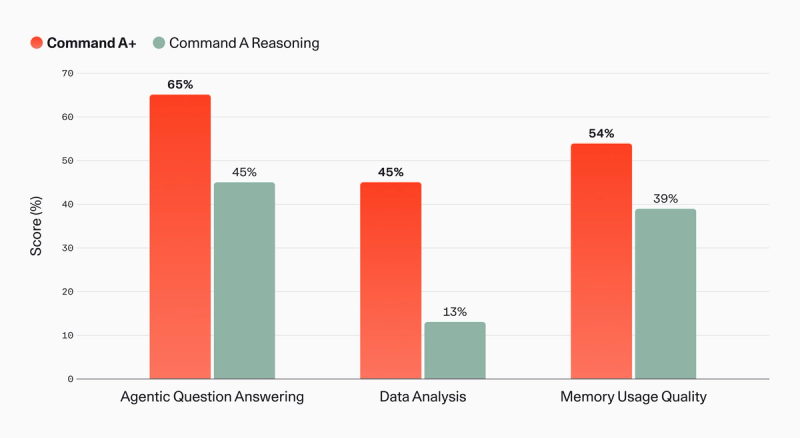
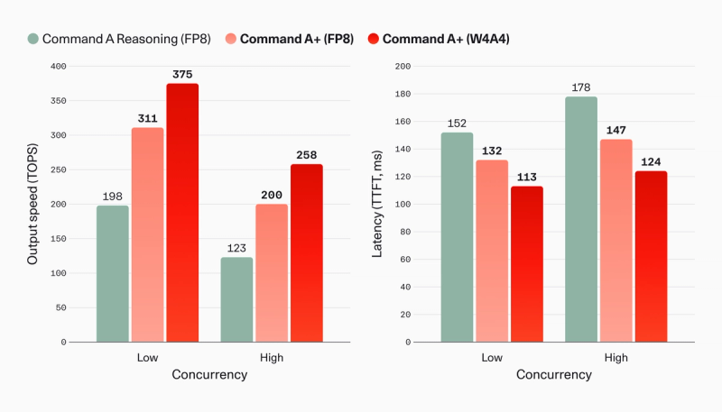

# Command A+

> [!tldr] 为什么这代值得单独记录
> Command A+ 把此前分开的推理、视觉、翻译和工具能力收进一个218B总参数 / 25B激活的MoE。其价值不是单纯更大，而是保留企业Agent能力的同时，通过专家低比特量化与量化感知蒸馏降低部署门槛。BF16、FP8、W4A4是同一family的部署格式，不另立三代。

> [!warning] 材料覆盖与深度边界
> 已读官方发布博客、HF W4A4模型卡、官方模型页和发布记录，并保存七张官方图。现有资料能讲清路由、混合注意力与QAD，但没有完整模型训练Tech Report、数据配方、Agent reward或关键消融。因此达不到GLM-5.3-Flash / Kimi-K3中可展开完整训练实证链的深度；不能据企业功能宣称补写RL实现。训练内容Public Summary是合规披露文档，不冒充完整技术报告，PDF不下载。

## 首发是五月，不是今天

官方Tech Blog与Release Notes均写 **2026-05-20**，模型ID为 `command-a-plus-05-2026`。本次是历史补漏，不计入10月的近30天新模型；官方文档或模型卡之后的修改日期也不改变首发日。

图1：官方发布主视觉。A+将此前几条Command A能力线汇聚到同一模型，仍属于Command A产品族演进，不把每个量化或运行框架拆成独立正代。

| 项目 | 官方披露 |
|---|---|
| 架构 | Decoder-only sparse MoE Transformer |
| 总参数 / 激活 | 218B / 25B |
| 输入 / 输出 | 文本与图像输入；文本、推理、工具调用输出 |
| 上下文 | 128K输入，64K最大生成；不写成统一192K上下文 |
| 语言 | 48种 |
| 许可 | Apache 2.0；具体上游和依赖仍各自核验 |
| 最低部署示例 | W4A4：1×B200或2×H100，非所有负载的显存保证 |

## 路由与注意力：25B激活不等于25B常驻显存

模型卡披露128个专家，每token选择8个，并另有一个所有token共用的shared expert。采用token-choice router、dropless训练，以加性bias做负载均衡，用top-k logits上的归一化sigmoid替代softmax路由激活。

局部滑窗注意力使用RoPE，全局注意力不带位置编码，两类层按 **3:1** 交错。这个安排延续Command A的注意力设计，不能简单把它称为全局RoPE MoE，也不能把8-of-128活跃专家理解为其余权重无需驻留或传输。

量化的主要对象是占据大部分参数的MoE专家；注意力Q/K/V/O投影、KV cache及attention计算仍保持高精度。于是低比特能显著缩减专家存储与GEMM开销，但长上下文的KV占用、并发和工具轨迹增长仍需单独计量。

## QAD：不是把全部张量直接压成4bit

W4A4采用NVFP4，含两级缩放；模型在post-training中进行Quantization-Aware Distillation：前向加入fake quantization，反向用straight-through estimator，让量化学生匹配全精度教师的输出分布。

为什么需要蒸馏？长推理链会积累逐token量化误差，普通后量化可能在复杂任务上明显退化。官方认为三种格式的基准质量差异很小，但没有提供这篇笔记所需的完整逐任务差异和置信区间；因此“近无损”应当视为官方测试条件下的观察，不是所有工具环境中的数学保证。

| 格式 | Blackwell示例 | Hopper示例 |
|---|---|---|
| BF16 | 4×B200 | 8×H100 |
| FP8 | 2×B200 | 4×H100 |
| W4A4 | 1×B200 | 2×H100 |

这些是官方最小GPU配置示例，不含对任意最大上下文、多用户并发和具体系统内存的承诺。模型卡注明W4A4需 `vLLM >=0.25.0` 与 `cohere_melody >=0.9.0`，并使用适配的tool-call / reasoning parser；这是读取时的兼容性要求，不保证未来任意版本都相同。

## Agent与多模态结果：基准名与内部judge要保留

| 指标 | 对照 | A+ | 不能省略的条件 |
|---|---:|---:|---|
| τ²-Bench Telecom | Command A Reasoning 37% | 85% | 既定user simulation设置 |
| Terminal-Bench Hard | Command A Reasoning 3% | 25% | Terminus-2 harness；不是其他Terminal版本 |
| MMMU | Command A Vision 65.3% | 75.1% | 视觉比较对象与前两行不同 |
| MMMU Pro | 未在正文给同列基线 | 63% | 不能拿MMMU成绩相减 |
| MathVista | Command A Vision 73.5% | 80.6% | 官方多模态评测 |
| CharXiv reasoning | Command A Vision 46.9% | 52.7% | 文档图表理解 |

官方正文用“改善20%和32%”描述North内部结果；核对下图可见Agentic QA为65%对45%、电子表格分析为45%对13%，对应的是20和32个百分点，而非相对提升20%和32%。Memory Usage Quality为54%对39%。三项采用LLM-as-a-judge，并非证明模型参数能永久记忆所有客户历史。

图3：内部评测与产品Harness绑定；Memory衡量利用North记忆系统中先前会话的信息，不应误写成脱离外部系统的模型固有记忆容量。

## 速度提升应分清比较条件，不能随手连乘

官方在同量化和并发条件下报告，A+相对Command A Reasoning最多提升63%输出token吞吐、首token时间最多下降17%；W4A4另有最多47%速度提升及13%延迟下降。另述speculative decoding带来1.5–1.6倍加速。这几组“最多”来自不同条件，不能相乘宣称稳定近4倍加速。

速度图脚注指定单个HGX B200节点、8GPU、vLLM TP=8、LiveCodeBench，prompt约3K、max output8K。它与“单B200可运行”的最低配置不是同一实验。新tokenizer在阿拉伯语/韩语/日语的token效率分别改善20%/16%/18%，也意味着token吞吐对比要兼顾相同文本任务，而不是只比较不同tokenizer的tokens/s。

> [!insight] 对训练与部署的研究判断
> 最值得验证的是“量化是否改变Agent轨迹”，而不仅是离线问答均分。固定工具schema、解析器、环境和终止verifier，对三种格式同时测成功率、解析失败、长链错误累积、重试与每成功任务的GPU秒。另将QAD学生与未经QAD量化版本比较，才能把收益归因给蒸馏，而不是硬件和Harness差异。

## 工具调用与citation：可解析不等于已验证正确

工具用JSON Schema描述，assistant输出plan/tool_calls后，真实执行结果以匹配tool_call_id的tool消息回填。模型卡的示例包含thinking字段；不要把它当作可直接信任的执行证据。`enable_citations=True` 可生成与工具结果索引对应的grounding span，但引用存在不代表引用确实支持结论，仍需核验来源和最终状态。

本地可运行、开权重和“主权AI”能改善数据控制方式，不自动解决提示注入、访问权限和越权工具调用。对企业Agent，模型许可、数据许可、用户授权与系统权限必须分别检查。

## 一手来源与关联阅读

- [🤗 HF Model Card（W4A4）](https://huggingface.co/CohereLabs/command-a-plus-05-2026-w4a4) — 架构、量化、部署与citation说明；三种格式归为同族。
- [📝 Tech Blog](https://cohere.com/blog/command-a-plus) — 首发、七张官方图、评测与效率脚注。
- [官方模型页](https://docs.cohere.com/docs/command-a-plus) 与 [Release Notes](https://docs.cohere.com/v2/changelog) — 型号规格及5月20日日期交叉核验。
- 本地src/保留原始模型卡、博客、模型页、发布记录和src/assets/图片；未抓PDF。
- 对照阅读：[[Topics/13_base_model/IBM_Granite/260825_Granite_4_2/Granite-4.2]]，比较企业模型如何报告Agent训练与可复现边界，而非直接跨不同基准排名。

> 📊 相关可视化: [[Topics/13_base_model/Cohere/260520_Command_A_Plus/command_a_plus_poster_zh.html|Command A+ 中文 Poster]]
