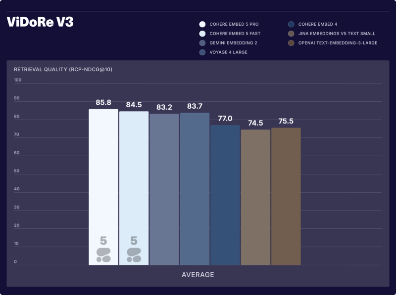
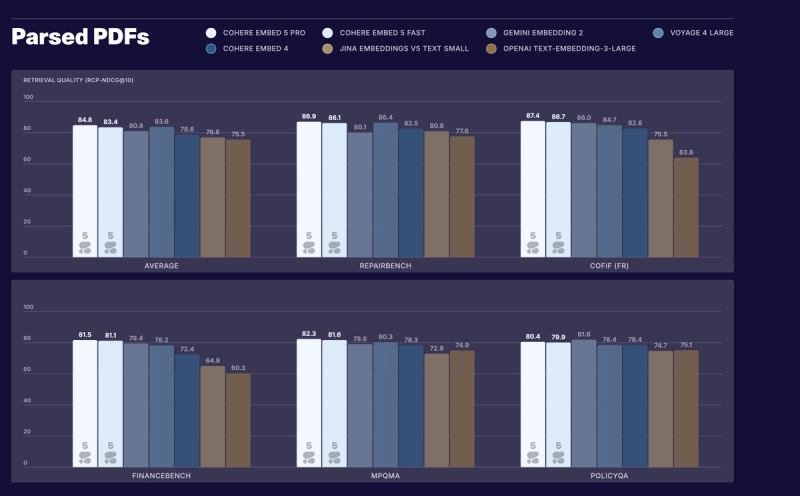
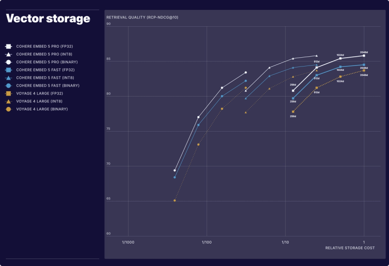

# Cohere Embed 5

> [!tldr]
> Embed 5 的实用变化是 Pro/Fast 共用向量空间：昂贵的离线文档索引与便宜的在线查询可以分别选择模型，而不用重建索引。它是 2026-09-30 发布的检索 family，归入 Cohere 支线，不当作两个通用语言模型正代。

## 它解决的不是“多会聊天”，而是检索链路的成本分工

企业 RAG 经常在索引与查询上使用同一个模型。索引成本通常一次性支付，在线查询的延迟却会在每次搜索、每个 Agent 步骤中累积。共享表示空间让 Pro 负责复杂文档的质量，Fast 负责高频 query 的效率。

这并非无条件可互换：文档与查询必须使用相同输出维度；截断、量化、归一化和数据库相似度也要一致。官方说兼容 Matryoshka 截断与 int8，但没有承诺任何任意压缩方式都兼容。

| 项目 | Pro | Fast |
|---|---|---|
| 定位 | 质量优先、离线索引、复杂企业语料 | 低延迟、高频搜索与 Agent 检索 |
| 上下文 | 128K tokens | 128K tokens |
| 输入 | 文本、图像、融合文本+图像 | 文本、图像、融合文本+图像 |
| 语言 | 100+ | 100+ |
| 向量维度 | 2048 / 1536 / 1024 / 768 / 512 / 256 | 同左 |
| 输出格式 | float / int8 / binary | 同左 |
| 发布时文本价格 | $0.12/M tokens | $0.08/M tokens |
| 发布时图像价格 | $0.40/M tokens | $0.40/M tokens |
| 部署 | API / Model Vault / Foundry / SageMaker；支持私有部署 | 同左 |

“支持 self-hosting”不能自动翻译成“HF 已公开下载并自由商用”。本轮没有发现可核验的对应 HF card 或独立训练报告，不编造链接、参数量和授权条件。

> [!warning] 技术深度边界
> 目前已完整阅读 Tech Blog，保存了结果图与部署说明；但原始资料没有公开完整训练目标、跨模型空间对齐配方、数据组成或准确模型规模。**因此本文达不到 GLM-5.3-Flash 式架构与训练报告精读的深度；原因是原始公开资料不足。** 本文重点放在真实披露的检索评测口径、兼容条件和可检验部署判断。

## Pro 文档 + Fast 查询：到底损失多少？

官方在 40 个 development datasets 上测了文档侧与查询侧的所有配对。将 Pro 文档 + Pro 查询归一化为 100：

| 查询模型 \ 文档索引模型 | Fast 索引 | Pro 索引 |
|---|---:|---:|
| Fast query | 96.6 | 98.4 |
| Pro query | 97.3 | 100 |

因此“Pro 建库，Fast 查询”平均为 98.4，下降约 1.6%；另一方向为 97.3，下降约 2.7%。这是归一化后的开发集均值，**不是任何实际数据库都只下降 1.6% 的保证**。均值还可能隐藏少数领域或语言的回归，接入前要看业务失败案例。

## 指标陷阱：RCP-nDCG@10 不是第一阶段召回率

官方新方法按每个 query 的 relevance criteria 评价检索结果，试图减少固定标签遗漏相关文档的问题。但脚注明确：这要求一个两阶段检索设置，用 embedding similarity 对固定候选集重新排序。因此它主要反映这个候选集内的 **reranking quality**，不能直接推断全库 ANN 第一阶段 Recall@k。

| 官方结果 | Pro | Fast | 阅读口径 |
|---|---:|---:|---|
| ViDoRe V3 平均 | 85.8 | 84.5 | 8 个视觉丰富领域；这里评测使用作者整理的 parsed text |
| FinanceBench | 80.1 | 80.0 | 正文金融套件结果；不要与 parsed-PDF 子表混淆 |
| FinQA | 90.0 | 88.8 | 金融文档检索指标，不是直接回答金融题的准确率 |
| ViDoRe Finance | 85.0 | 83.9 | 同一特定金融领域 |
| Parsed PDF 全套均值 | 84.8 | 83.4 | Gemini 1.5 Flash 解析；全套包含图中未展示的数据集 |
| 融合图文 5 数据集均值 | 82.3 | 81.2 | 页面图像 + metadata 的一个向量 |
| 金融 page-image 5 数据集均值 | 77.0 | 73.2 | 图像输入；不能与 parsed text 表直接拼排名 |

同一 FinanceBench 名称在不同输入表示或套件下可出现不同分数。把 parsed text、page image、fused image+metadata 混起来，会把预处理收益错误归到模型。官方全球语言均值也不意味着每种语言都领先：例如中文 Pro 为 82，与 Voyage 4 Large 持平；日语 87，低于该表 Gemini Embedding 2 的 90。

## 吞吐、价格与向量存储是三笔不同的账

官方给出 Fast 约 377.3 documents/s、Pro 159.7 documents/s，平均约 2.4×。测量覆盖约 200 与 1K tokens 文档，主要是索引效率；它不是 128K 长文档吞吐，也不是每次在线查询延迟改善 2.4×。

仅计算原始向量 payload：

| 表示方式 | 每向量字节 | 相对 2048D FP32 |
|---|---:|---:|
| 2048D FP32 | 8192 | 1× |
| 1024D int8 | 1024 | 8× 更小 |
| 256D binary | 32 | 256× 更小 |

1 亿个向量对应约 819.2 GB、102.4 GB、3.2 GB（十进制）。这些数值 **不含** ANN 图索引、metadata、冗余副本或数据库开销。binary 最省内存但有精度损失，适合第一阶段粗检索再用更高精度重排；不能写成同等质量的免费压缩。

## 对 Agent Training / RAG 的启发

> [!insight]
> 检索是 Agent 的观测入口。正确的问题不是“embedding 榜单高了几分”，而是更相关的证据是否减少无效搜索、重复工具调用与幻觉。在相同语料、chunk、候选预算和生成模型下，比较最终任务成功率与总成本。

可以先做一个 2×2 配对实验：Pro/Fast 分别作为 index/query 模型，按语言、表格密度、OCR 噪声和长文档分层，报告第一阶段 Recall、候选集重排 nDCG、最终带引用回答正确率和 p95 query latency。再以 2048 FP32、1024 int8、256 binary 做质量/内存曲线。

上述是阅读后的实验建议，没有在本机执行推理或复现厂商成绩。RCP 判定器的误标与偏置也应抽样人工复查，而不是把新打分方法视为绝对真值。

## 一手资料与导航

- [S1] [Tech Blog：Introducing Embed 5](https://cohere.com/blog/embed-5)，2026-09-30；评测限制见其脚注 1–3。
- [[src/retrieval_manifest.json|原始正文与官方图片抓取记录]]。
- [[Topics/13_base_model/Base Model MOC|基模主题索引]]
- [[embed_5_poster_zh.html|中文 Poster]]

> 📊 相关可视化: [[embed_5_poster_zh.html|Embed 5 中文 Poster]]
