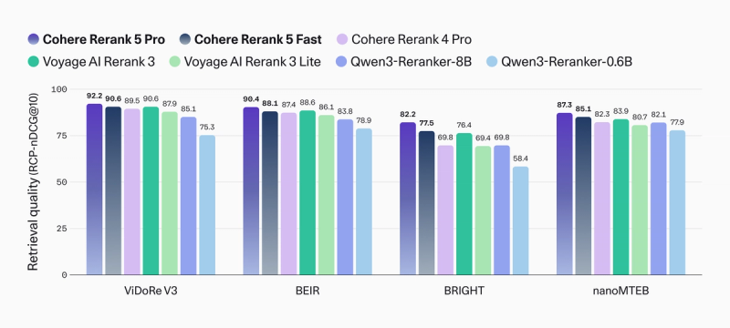
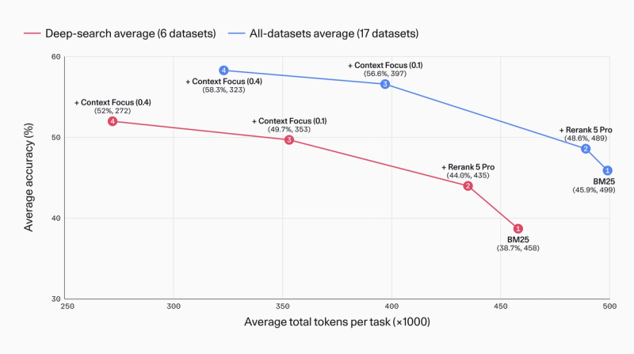
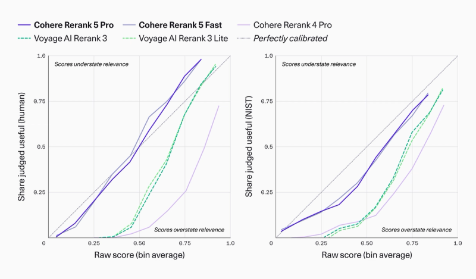

# Rerank 5 · Pro / Fast：候选重排、证据压缩与可校准相关性

> [!tldr] 我的判断
> 10/21发布，Pro/Fast合并；Context Focus同次返回文本spans，按RCP-nDCG、校准与固定Agent协议分别解读，不与普通nDCG混比。

> [!warning] 原始资料覆盖不足，尚未达到完整技术报告精读深度
> 官方博客有完整原图和协议，但未公开参数、训练数据/recipe、独立本版报告与完整消融，因此未达到完整技术报告精读深度。不虚构HF权重卡。结果是厂商报告、非本地复测，校准不能外推为事实真值或任意领域保证。

## 发布与模型边界

官方Tech Blog明确2026-10-21发布。Pro/Fast属于同代family，合并一个检索支线；Context Focus随此代提供，不另拆模型。当前证据是官方博客/模型网页，未找到公开权重Model Card，不制造一个HF链接充数。

## 三个变化分别解决什么

先对候选文档排序，再从相关文档里选spans，最后用经验校准的相关性分数决定是否送给生成器。它不是回答模型，也不替召回阶段找回完全遗漏的文档。“无需re-index”指可接现有检索栈，不保证沿用旧阈值与切块策略仍最优。

## 排名、速度和指标

| Benchmark | Pro | Fast | 指标 |
|---|---:|---:|---|
| ViDoRe V3 | 92.2 | 90.6 | RCP-nDCG@10 |
| BEIR | 90.4 | 88.1 | RCP-nDCG@10 |
| BRIGHT | 82.2 | 77.5 | RCP-nDCG@10 |
| nanoMTEB | 87.3 | 85.1 | RCP-nDCG@10 |

RCP-nDCG为厂商针对不完整qrel设计的协议；四组各含8/13/12/13个dataset。不能直接拿这些90分和其他卡的普通nDCG67分断言绝对领先。厂商称46个复合集39第一、43至少第二，只对该测试范围成立，缺显著性与全部应用分布证据。

Fast约187个1000-token文档/秒、约Pro2.9倍：单A100，经Cohere API，每request96文档、并发8、每长度1000请求。不是整条检索Agent加速2.9倍，也不是任意长文档固定吞吐。Parsed PDF测试用Gemini1.5Flash先解析，47集Pro89.9/Fast88.5，不能把parser变化归到reranker。

## Context Focus不是无损证据压缩

同次请求可返回document相关分和带start/end/score的原文片段，阈值控制保留；应保留源文档offset和citation，不把截段结果当新原文。30个单轮QA集实验固定候选50→top5，Qwen3.5-9B答题、35B judge；去一半上下文损失约2个百分点，不能推广为无损或人类验证。

17个Agent集每集50题，GLM5.3Flash以search为唯一工具，BM25候选top100由Rerank5Pro重排、每次5结果；Focus阈值0.1和0.4分别测。图中BM25约45.9%/499K tokens，Pro48.6%/489K，Focus0.4约58.3%/323K。tokens包含每轮完整上下文、输入/输出/reasoning和cached tokens；不是计费账单、也不含全部检索基础设施开销。

6个deep-search子集约38.7%/458K→52%/272K，不能把子集收益说成每项任务都同幅度提升。把删文本阈值、最大spans和答案judge版本锁定，才可归因。

## 校准为什么有用，又为什么不能当真实概率通行证

| 模型 | Human ECE | NIST ECE |
|---|---:|---:|
| Pro | 0.058 | 0.057 |
| Fast | 0.058 | 0.058 |
| Rerank4Pro | 0.384 | 0.309 |
| Voyage3 | 0.234 | 0.307 |
| Voyage3Lite | 0.226 | 0.325 |

Human2262文档，以五级平均达到Useful为正；NIST20646，以0–3级里的≥2为正。ECE是分箱平均分与正例率的加权差，低ECE不保证每条文档正确，分箱/样本分布也影响结果。相关性校准更不是事实正确性、安全性或RL任务成功率。官方默认概率阈值可作起点，不能未经目标领域验证就跨域硬用。

> [!insight] 同时控制观察选择与策略训练
> 对Agent Training，检索器和压缩器改变了策略可见状态。应保存原候选、文档分、spans、阈值和最终答案验证，分别评估ranker、压缩和policy。专门加入“被删掉的是反例/否定/单位”样本，看token下降是否以事实错误换来；拒答阈值需用目标分布上的覆盖–风险曲线验证。

## 来源与未读范围

[📰 Tech Blog](https://cohere.com/blog/rerank-5)、[官方模型页](https://cohere.com/rerank)。完整HTML与正文、三张官方原图保存在src；未执行API例程，不申请key、不运行推理。博客提到的Parse为8/27历史产品，不冒称本轮新发布；历史未归档项另记缺口。

> 📊 相关可视化：[[rerank_5_poster_zh.html|中文Poster]]
