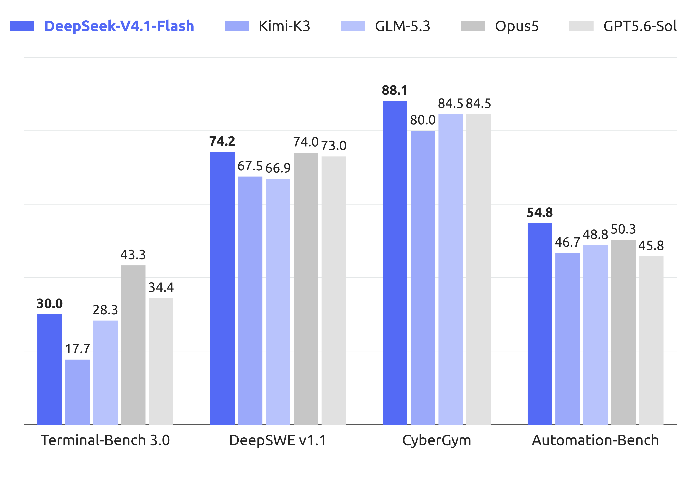

# DeepSeek-V4.1-Flash — KV Cache Compression for Million-Token Agents

> [!info] 资料充分度：9 月 family 充分；1017 更新资料有限
> 9 月 family 的架构精读沿用此前归档。**10 月 17 日增补**已逐项读取新 HF Model Card、官方带日期发布记录、encoding / inference README 与配置；更新部分单独注明证据边界，不把共享报告误写成 1017 新报告。

> [!tldr]
> **V4.1-Flash 不是 V4-Flash 的小修版，而是一次围绕“超长输入 agent 的真实服务成本”重构的 552B 多模态 MoE。** Causal Encoder–Decoder、CSA2、FP4 KV 与 bounded replay 把全局 KV 压到 890 bytes/token，约为 V4-Flash 的 1/4；模型以 45T multimodal tokens 从头训练，支持 1M context、最高 256K+ 输出建议和 1–100 连续 reasoning effort。我的判断：它把 DeepSeek 的竞争焦点从单纯 active parameters 推向了 **prefill、KV 常驻成本与长轨迹可持续性**。

> 上图为 **9 月 10 日 family 首发图**，不是 1017 的新评测。1017 的完整对照见下表；两版数字不要混用。

## 2026-10-17 更新：V4.1-Flash-1017

> [!tldr] 同一个 family，新的 checkpoint
> 官方原卡明确称 1017 为 **minor update**。这次最值得关注的是 agent 成功率与执行经济性的共同改善，而不是一个新架构名字：Terminal-Bench 4.0 从 31.2 到 42.3，ProgramBench 从 20.3 到 29.1；官方同时报告运行时间和输出长度减少，但没有公布降幅。Atlas 保留 9 月 10 日的 family 首发日与原链接，在近 30 天表格另记 10 月 17 日更新，不拆新正代。

### 发布、权重与资料范围

| 项目 | 已核实事实 | 不应作出的推断 |
|---|---|---|
| 日期 | 官方 Change Log 明确写 2026-10-17 并发布 1017 升级 | 不用 HF createdAt / lastModified 代替日期 |
| 归属 | HF 卡写明是 V4.1-Flash 的小版本 | 不是 V4.2，也不是新的专项支线 |
| 线上 | 网页、App、API 已切换；API 名仍为 `deepseek-flash`，调用方式和价格不变 | 同一个别名并不保证实验 checkpoint 恒定 |
| 权重与许可 | 官方独立 HF 仓库、MIT；公开配置仍为 `deepseek_v41` | 不能由相同配置证明训练过程、权重或行为不变 |
| 报告 | 新卡直接链接原 V4.1-Flash 报告 | 没有核实到一份独立的“1017 Tech Report” |
| 开源代码 | 提供 prompt encoding、最小推理参考；生产协议工具另指向 deepseek-recipe | 参考推理实现不等于生产服务或完整 RL 训练代码 |

### 全部 11 项官方对照：先比同表的前后版本

以下数值逐项来自 **1017 HF 原卡**，均为官方报告、不是本地复现。Δ 是两列直接相减的分数差，不是相对百分比。表中的横向竞品分数同样是 DeepSeek 报告，不能当作各家统一条件下的独立测评。

| Benchmark | V4.1-Flash | 1017 | Δ | 必须保留的口径 |
|---|---:|---:|---:|---|
| HLE w/o tools | 36.8 | 42.6 | +5.8 | 完整集合；纯文本子集另为 39.1 → 44.0（+4.9） |
| Terminal-Bench 4.0 | 31.2 | 42.3 | +11.1 | Claude Code harness |
| DeepSWE v1.1 | 74.2 | 77.0 | +2.8 | Mini-SWE-V2 harness |
| ProgramBench | 20.3 | 29.1 | +8.8 | 不与不同版本基准拼接 |
| NL2Repo-Bench | 65.4 | 68.2 | +2.8 | 此处旧值取本次原卡同表，不覆盖旧报告的 64.0 |
| Automation-Bench v1.0.6 | 54.8 | 60.5 | +5.7 | 显式保留 v1.0.6 |
| Agents’ Last Exam | 31.8 | 35.4 | +3.6 | 无新增协议细节披露 |
| Apex Bench v1.1 | 64.6 | 72.1 | +7.5 | 显式保留 v1.1 |
| Chartography w/tools | 78.9 | 83.0 | +4.1 | 有工具，不能写成无工具视觉能力 |
| BabyVision w/tools | 89.6 | 92.5 | +2.9 | 有工具 |
| ZeroBench-main w/tools | 49.0 | 51.0 | +2.0 | 官方发布记录注明 Pass@5，不是 Pass@1 |

**我的判断：**最大的绝对跃升出现在更难的终端与程序任务，但不能据此断言某种新 RL 算法起作用。原卡没有 1017 训练配方、消融、置信区间或重复次数。即使同一张表有跨厂商排名，也应先做自己 harness 中的前后版本受控对照。

### 更快、更短、更省：目前能说到哪一步

官方称在多个 harness 上改善性能—成本 Pareto 前沿，并特别适配 DeepSeek Harness、腾讯 CodeBuddy 与 WorkBuddy；建议 DeepSeek Harness 升级到 **0.2.1-rc.1 或更新版本**。这是官方部署建议，不是本文已验证所有工具兼容的承诺。

“API 单价不变”与“每个成功任务更省”不是一回事。更短输出可能减少输出费用，更快任务可能减少工具等待与重复轮次，但失败重试、缓存、输入、工具费用也会改变结果。建议报告：

$$
\begin{gathered}
C_{\mathrm{success}}=\frac{\sum_i C_i}{\sum_i\mathbf{1}[\mathrm{verified\ success}_i]}\\
T_{\mathrm{success}}=\frac{\sum_i T_i}{\sum_i\mathbf{1}[\mathrm{verified\ success}_i]}
\end{gathered}
$$

这是本文建议的验收统计量，不是官方训练目标；失败样本成本也进分子，不能只统计成功样本的平均 token。总成功数为零时不计算比值。

### 部署细节：协议本身就是实验条件

- 新卡仍建议 `temperature=1.0`、`top_p=1.0`、1M context、`max_tokens ≥ 256K`。预算是建议，不代表每次都必须消耗 256K 输出。
- 没有 Jinja chat template；应使用 `encoding/encoding.py` 或官方维护的 deepseek-recipe。不要把 V4 的旧 template 硬套给 V4.1。
- 已读的 encoding README 明确：DSML 的 ` calls` / ` invoke` / ` parameter` 标签名前有空格；numeric effort 范围 1–100，别名 `low/high/max` 分别映射 **50/75/100**，默认 75，不是默认最大预算。
- effort 前缀仅在 thinking 模式、会话起始注入；中途 system message 有单独 `<｜System｜>` token。带 tools 声明时默认保留历次 thinking，否则早于最新用户请求的 thinking 默认去除。历史处理差异会影响长轨迹对照。
- README 说明解析器只面向格式良好的输出，生产环境需额外错误处理；最小 inference 的 generation 是普通自回归采样，虽含 DSpark forward path，也不能据此声称默认已运行推测解码。
- deepseek-recipe 负责协议转换、prompt 编码及输出解析，**不负责模型推理、工具执行和 HTTP transport**。把这些职责区分清楚，才不会把 harness 失败误判成模型失败。

### 可以立即落地的对照实验

1. 固定 9 月与 1017 的实际权重 revision、同一任务快照、harness commit、工具和 parser；仅记 `deepseek-flash` 别名不足以复现。
2. 分别复测终端、仓库修复和带图任务；ZeroBench 保持 Pass@5 并报告总采样预算，不与单次结果混排。
3. 记录终态成功、工具重复率、输出 token、总花费及 P50/P95 时间；排查更短推理是否带来隐性漏步骤。
4. 固定 effort 50/75/100 的三点比较，再画任务成功率—总成本曲线；不能拿旧版低 effort 与新版 max 对比。
5. 同日搜索 API 开放属于服务更新，不另建模型。若测试中接入它，应明确把“模型更新”与“搜索工具更新”拆成两个变量。

> [!warning] 1017 更新资料不足，未达到完整报告级精读深度
> **因为原始资料较少，本次 1017 升级无法达到 GLM-5.3-Flash / Kimi-K3 那种完整训练报告级的分析深度。** 已有明确日期、完整指标对照和部署参考，但没有独立 1017 训练报告、训练数据与奖励配方、消融、成本降幅、显著性或安全评测。下文架构与训练内容属于 9 月 family 报告，不能用来填补 1017 的新增机制空白。两张原官方图也均标为首发图；不伪造更新图或新训练结论。

### 1017 一手资料与离线原件

- [🤗 HF Model Card · 1017](https://huggingface.co/deepseek-ai/DeepSeek-V4.1-Flash-1017)
- [🌐 Tech Blog · 10 月 17 日发布记录](https://api-docs.deepseek.com/updates/#date-2026-10-17)
- [📄 Tech Report · V4.1 共享报告](https://huggingface.co/deepseek-ai/DeepSeek-V4.1-Flash/blob/main/DeepSeek_V41_Tech_Report.pdf)（本轮仅保留链接，未下载 PDF）
- [[src/updates/2026-10-17/HF-Model-Card|1017 原始模型卡]] · [[src/updates/2026-10-17/Encoding|编码协议 README]] · [[src/updates/2026-10-17/Inference|最小推理 README]]

## 老板速览

| 问题 | 结论 |
|---|---|
| 为什么是新主干叶子？ | 官方独立发布权重、模型卡与 Tech Report，并更换为 `deepseek_v41` 架构。 |
| 最大工程变化？ | 以 CED + CSA2 + FP4 KV 把 1M context 的 KV 存储和重复索引成本压下来。 |
| 能力形状？ | Terminal-Bench 2.1、DeepSWE、CyberGym、工具增强 HLE 很强；Terminal-Bench 3/4 仍明显落后 Opus 5。 |
| 适合什么？ | 输入很长、工具轨迹很长、需要反复读取仓库或文档的 agent workload。 |
| 不能误读什么？ | “Flash”是效率定位，不代表所有 benchmark 都比 V4-Pro 更强；跨厂商数字仍受 harness 影响。 |

## 谱系与规格

| 字段 | 官方披露 |
|---|---|
| 发布时间 | 2026-09-10 |
| 架构 | Multimodal MoE + Causal Encoder–Decoder |
| Backbone | 552B parameters |
| 激活参数 | Prefill 8B/token；decode 16B/token |
| Transformer | 40 layers：20-layer causal encoder + 20-layer decoder |
| Experts | 1 shared + 384 routed；每 token 激活 6 routed experts |
| Conditional memory | Engram 196B parameters，按 token lookup 稀疏访问 |
| 训练数据 | 45T multimodal tokens，从头训练 |
| 上下文 | 最高 1M tokens；官方建议 `max_tokens ≥ 256K` |
| 推理控制 | `reasoning_effort` 1–100 连续可调 |
| 输入 / 输出 | 图像 + 文本输入；文本自回归输出 |
| 许可 | MIT |

V4.1-Flash 的名字容易让人只看“Flash”，但官方首次把视觉编码器从预训练开始与文本共同训练，也给出了新的 prompt encoding、权重、推理实现和可复现实验说明。它应当作为 V4 之后的新架构节点，而不是 0731 checkpoint 的日期更新。

## 架构：四层压缩链

### 1. Causal Encoder–Decoder（CED）

前 20 层作为 causal encoder，后 20 层作为 decoder。decoder 的 global KV 不再由每一层 decoder hidden states 分别产生，而是从 encoder 最终 hidden states 投影得到。直接后果是：

- prefill 只激活约 8B 参数/token；
- decode 约 16B 参数/token；
- 输入占比极高的 coding / research agent，不再为每层重复保留同规模 global KV。

### 2. CSA2：跨层共享稀疏索引

Compressed Sparse Attention 2 把 attention layer 固定分成 **Full / Reindex / Reuse** 三种模式。主 KV、indexer K 和 Top-K indices 可以跨层共享；decoder 里的 hierarchical sparse indexer 又把后续检索限制在首个 Full layer 产生的候选池中，使深层索引成本不再随完整上下文线性膨胀。

### 3. FP4 main KV + SWA bounded replay

主 KV 用 E2M1 FP4，每 16 channels 配一个 E4M3 scale。对 sliding-window attention，模型不把全部 SWA KV 落 SSD，而只 replay 最近 `n_win` tokens 重建缺失状态。两者叠加后：

| 代际 | Global KV / token | 相对 V4.1 |
|---|---:|---:|
| DeepSeek-V1 | 389,120 bytes | 约 437× |
| DeepSeek-V4-Flash | 3,584 bytes | 约 4× |
| **DeepSeek-V4.1-Flash** | **890 bytes** | 1× |

### 4. mHC、Engram 与 DSpark

- **Single-Pass mHC**：重做 residual-stream mixing，并提供 Mega-mHC kernel。
- **Engram**：196B conditional-memory parameters，不参与每 token dense compute，而以 token lookup 稀疏访问。
- **DSpark**：半自回归 draft generation + confidence-scheduled verification，用于 speculative decoding。

这四层设计的共同目标不是“让一个 token 更聪明”，而是让百万 token 轨迹在真实硬件上更能被服务。

## 训练：模型算法稳定，环境数据扩张

预训练在 45T multimodal tokens 上从头进行；34T tokens 时开始把 context 延伸到 1M，并以 64K sequence 训练 sparse attention。视觉侧使用从头训练的 DeepSeek-ViT、2D-RoPE、3×3 pixel-unshuffle 和两层 MLP projector。

后训练仍是 **SFT → RL → on-policy distillation**，官方强调没有算法层面的新花样，主要改变来自数据 pipeline：大规模自动合成 agent tasks / environments，并渐进扩大数据、任务和 rollout。这个表述对 agent training 很有价值：V4.1 的 agent 增益更像环境与轨迹规模化，而不是新 RL loss。

## 评测：长轨迹执行强，但不是全面第一

以下均为官方 model card 在 `reasoning_effort=100` 下报告的 instruct 结果。

| Benchmark | V4.1-Flash | V4-Flash | V4-Pro | 观察 |
|---|---:|---:|---:|---|
| Terminal-Bench 2.1 | **90.6** | 82.7 | 87.9 | 长终端任务显著跃迁 |
| Terminal-Bench 3.0 | **30.0** | 7.6 | 11.8 | 大增，但低于 Opus 5 的 43.3 |
| Terminal-Bench 4.0 | **31.2** | 7.0 | 12.4 | 大增，但低于 Opus 5 的 51.8 |
| DeepSWE v1.1 | **74.2** | 54.4 | 62.7 | 官方表中略高于 Opus 5 的 74.0 |
| NL2Repo-Bench | **64.0** | 54.2 | 61.5 | 仓库级理解继续上升 |
| CyberGym | **88.1** | 76.7 | 83.3 | 官方表中最高 |
| HLE with tools | **63.9** | 51.5 | 60.0 | 工具增强研究任务突出 |
| AutomationBench | **54.8** | 37.7 | 43.2 | 业务自动化显著上移 |
| Agent's Last Exam | **31.8** | 25.2 | 25.7 | 长轨迹 agent 改善 |

### Harness 不是脚注

DeepSWE 和 Terminal-Bench 2.1 还比较了 Claude Code、Codex、OpenCode、Pi、mini-SWE 与 DeepSeek Harness。V4.1 在不同 scaffold 下分数明显变化，例如 DeepSWE 从 65.5–74.2，说明结果属于 **model × scaffold × budget**，不能只把最高值写成裸模型能力。

## 对部署与评测的建议

1. 先测“每个严格成功任务的 KV + token + 工具成本”，而不是只测 tokens/s。
2. 把 64K、256K、1M 三档上下文分开，观察 bounded replay 和 cache 压缩是否真的降低 P95 latency。
3. coding agent 同时用 mini-SWE、Claude Code 与自己的 harness，避免被单一 scaffold 排名绑架。
4. 连续 effort 不应只测 1 和 100；建议以 10/30/60/100 画 success–cost Pareto 曲线。
5. 多模态任务要单列视觉输入 token、OCR / grounding 错误和工具调用后的最终状态。

## 资料边界

> [!info]
> 资料足够达到 Tech Report 级笔记：官方公开了权重、完整模型卡、独立 Tech Report、两张核心图、编码实现、推理代码与部分评测复现说明。仍未完整披露 45T 数据配比、所有 RL 环境、训练算力与关键消融，因此本文不对这些空白作推测。

## 一手资料

- [🤗 HF Model Card](https://huggingface.co/deepseek-ai/DeepSeek-V4.1-Flash)
- [📄 Tech Report](https://huggingface.co/deepseek-ai/DeepSeek-V4.1-Flash/blob/main/DeepSeek_V41_Tech_Report.pdf)
- [[src/HF_Model_Card|HF Model Card 本地 Markdown]]
- [Tech Report 本地 PDF](src/DeepSeek_V41_Tech_Report.pdf)
- [[src/Source Index|本地来源索引]]

## 导航

- [[Topics/13_base_model/Base Model MOC|Base Model MOC]]
- [中文 Poster](deepseek_v4_1_flash_poster_zh.html)

## 2026-10-31资料补充：NVIDIA的1017 NVFP4分发

> [!info] 不是新正代，也不改变1017发布日期
> NVIDIA原卡写该量化包10月30日发布，属于原1017 checkpoint的部署转换。它不是NVIDIA训练出的DeepSeek新代，Atlas不添叶子或“新模型”事件。原始新卡已保存，并与9月family及10月17日升级分开。

[🤗 NVIDIA Model Card](https://huggingface.co/nvidia/DeepSeek-V4.1-Flash-1017-NVFP4) · [[src/huggingface_model_cards/NVIDIA-DeepSeek-V4.1-Flash-1017-NVFP4|离线原卡]]。

普通routed专家由源MXFP4转换为NVFP4 W4A4，group16，384专家×40层的w1/w2/w3；Engram由源FP8改为MXFP4。attention/shared experts/vision/MTP等排除组件保留源精度，不能写成全模型统一4bit。16,986,931,200个专家weight blocks的反量化值无损（含signed-zero规范化），但Engram转换有损、activation scale还经过校准，**不代表整体输出逐token等同**。46,080投影scale中24项用了fallback。

ModelOpt v0.48.0rc0、revision `1bae0e1088993b9b82de08f59de5be5a34e42170`；两个校准数据集各512样本，总1024，序列512、batch4。checkpoint约400GiB，源约475GiB，减少75GiB约15.8%；这是文件体积，不等于峰值显存或总部署费用。

| 同表指标（%） | 源MXFP4 | NVFP4 + MXFP4 Engram | 展示值差 |
|---|---:|---:|---:|
| GPQA Diamond | 92.77 | 92.93 | +0.16 |
| AA-LCR | 80.41 | 80.19 | −0.22 |
| SciCode | 57.58 | 57.32 | −0.26 |
| IFBench | 76.33 | 76.47 | +0.14 |
| MMMU-Pro | 78.38 | 78.73 | +0.35 |
| Terminal-Bench 2.1 | 81.81 | 81.11 | −0.70 |

这些是NVIDIA原卡结果，**不能与前文DeepSeek的Terminal-Bench4.0直接相减**。普通请求temperature1/top-p1/max effort/262144输出预算；GPQA16重复，AA-LCR每run16重复共两run，IFBench5、SciCode8；终端任务另用每任务8轨迹、两run均值。没有独立方差/显著性，微小上下波动不证明量化优于源。

部署原卡验证4张GB300、vLLM0.31.0加[MXFP4 Engram支持PR61530](https://github.com/vllm-project/vllm/pull/61530)，stock镜像不能直接加载该Engram；SGLang未验证，MTP没有实测。原命令启用CPU offload、FP8 KV，工具调用需额外parser开关。本文只阅读卡片，没有执行部署命令、下载权重或测试吞吐，因此不补造加速倍数。
