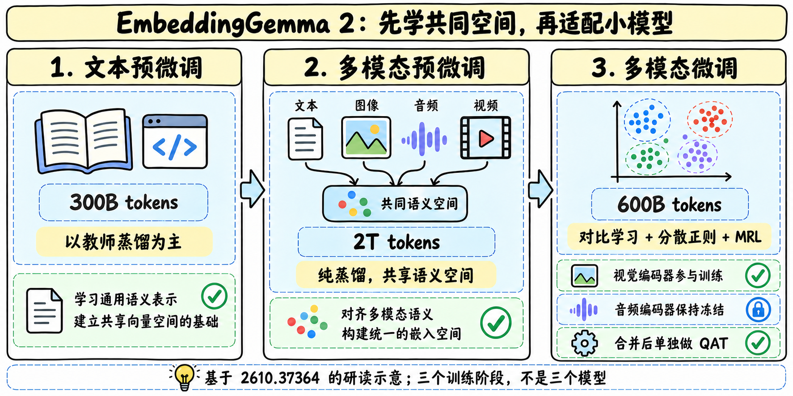
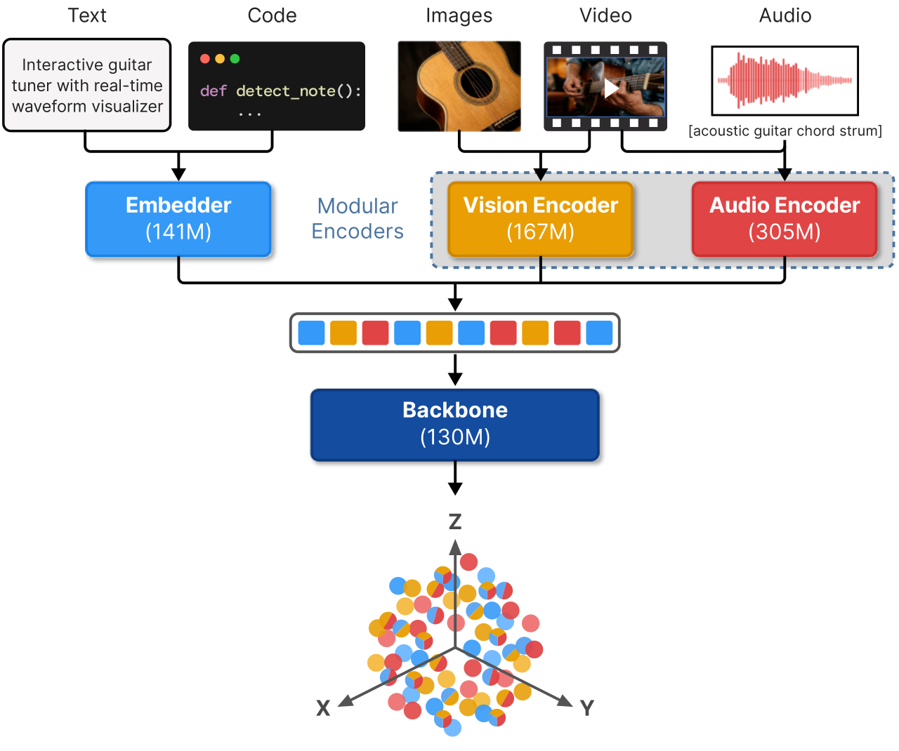

# EmbeddingGemma 2：统一空间之后，还要为小模型重新整形

> [!tldr] 我的判断
> 这是一套可按模态加载的多模态检索表示模型。新报告最有价值的发现是：**先蒸馏教师空间，再用对比学习和正则形成适合学生的空间**，比一味延长蒸馏更有效。原卡更新了 MIEB / MAEB 数值；模型仍按 10/6 首发，不把 10/27 报告上线当新代。

## 本次来源变化

10/28 回读 HF 主卡发现正式报告 [2610.37364](https://arxiv.org/abs/2610.37364)，报告 HTML v1 标 10/27。已保存原始 HTML 并阅读架构、输入、损失、训练、消融与评测部分。旧卡保存在 src/history/，保留数值修订证据。

| HF 原卡修订 | 旧值 | 本轮卡 / 报告 |
|---|---:|---:|
| MIEB-lite，Mean(Type)，768d | 64.64 | **65.67** |
| MAEB，Mean(Task)，768d | 49.39 | **49.87** |
| 截断维度表 | 对应旧列 | 512/256/128d 相关列一并更新 |

这是官方表格修订，不是本地重新测得提升，也没有证据说模型权重为此升级。

## 模块化架构：总参和实际激活模块不同

报告给出更精确的 744M 总参：271M 双向 Transformer 主体（含 embedder）、167M vision encoder、305M audio encoder。分项与组合值存在舍入；纯文本 271M、图文 439M、文音 577M，与原卡约 740M/270M/440M/570M 是精度口径不同。

图像和音频先变成 soft tokens，经投影与文本 token 交错进入同一个双向 backbone。最终 mean pooling、线性投影、L2 归一化，形成 768d 单向量。它不生成答案；只加载文本模块也不意味着跨模态表示空间需要换成另一模型。

PLE 不再额外维护一张巨大 token lookup table，而是从共享输入表示做每层投影与门控。这样非文本模态也能得到每层输入，同时减少参数与内存；这是架构消融支持的选择，不能简单概括成“把所有 embedding 层删掉”。

## 三阶段 curriculum：teacher 是起点，不是最终空间

| 阶段 | token 量 | 目标与作用 |
|---|---:|---|
| 文本预微调 | 300B | 以 embedding matching 蒸馏为主，少量对比项；先稳住文本能力 |
| 多模态预微调 | 2T | 只用蒸馏；从 Gemini Embedding 2 学跨模态共同空间 |
| 多模态微调 | 600B | 换成对比学习、spread-out 与 MRL；适配学生架构和低维空间 |

总量约 2.9T。Vision encoder 在多模态两阶段继续训练；audio encoder 与 Gemma 4 对应模块 bit-identical，保持冻结。最后平均同一次微调轨迹中的早晚 checkpoint；QAT 是合并后单独的 tail-patch，以冻结浮点模型为教师，不是直接在上述末阶段随手量化。

## 损失如何对应检索问题

对比项包含 batch negatives、hard negatives 与 same-tower negatives；后者避免 query 和 document 聚成互不兼容的两团。重复项 mask 避免把同一目标当负例；列表排序数据另用 Plackett–Luce 风格 listwise 目标。小的 squared-hinge 项校准绝对相似度。

Spread-out 正则约束随机向量对的二阶矩，让空间更充分利用，服务于量化与 ANN 检索。MRL 将目标同时施加到嵌套子维度。蒸馏则直接对齐教师向量而不仅是 query-document 分数，并涵盖 hard negative 向量。

## 消融：这些数来自中间 recipe，不能与最终模型直接相减

| 实验 | MMEB-v2 Overall | 含义 |
|---|---:|---|
| PLE projection-only / 带 lookup | 55.46 / 55.07 | 简化不只是省内存，也改善该组质量 |
| 多模态预微调 / 继续等量蒸馏 / 最后微调 | 52.27 / 52.28 / 55.46 | 继续蒸馏平台化，换目标更有效 |
| Vision 可训练 / 冻结 | 52.27 / 48.18 | 只接强视觉编码器仍不够 |

Vision token budget 提升尤其改善细粒度文档检索；但视频在 280→560 tokens 的该组消融反而退化。更长输入会稀释注意力和 mean pooling，不能把“可配 1120”理解为全任务单调增益。

## 最终评测：指标和比较对象要写清

| 指标 | 当前报告 / 原卡 |
|---|---:|
| MTEB multilingual v2，Mean(Task) | 61.36 |
| MTEB code，Mean(Task) | 78.68 |
| MIEB-lite，Mean(Type) | 65.67 |
| MMEB-v2，Mean(Task) | 59.01 |
| MSEB retrieval，Mean(Task) | 69.54 |
| MAEB，Mean(Task) | 49.87 |

MIEB 的 Mean(Task) 是 60.17，不能拿 65.67 与别人的 Mean(Task) 比。不同 benchmark 的均值口径不同，不能平均成“总能力分”。报告的英语 MTEB 68.46 低于上一代 69.67；多模态扩展并非每项都上涨。

| 向量维度 | MTEB multi | MMEB总体 | MIEB Mean(Type) | MAEB Mean(Task) |
|---|---:|---:|---:|---:|
| 768 | 61.36 | 59.01 | 65.67 | 49.87 |
| 512 | 61.17 | 58.38 | 65.34 | 49.76 |
| 256 | 60.41 | 56.24 | 64.16 | 49.13 |
| 128 | 57.89 | 45.65 | 59.97 | 47.28 |

低维需要截断后重新 L2 归一化，query/document 同维。文本 256d 较稳，多模态 128d 代价明显。报告的量化与浮点评测部分使用不同 harness，不能把差值全部归因量化；Pixel 11 Pro 的峰值内存是特定量化/设备结果，不是通用显存承诺。

## 使用与验收

8192 token 是共享总预算，图像、视频、音频共同占用。检索使用匹配的 query prefix 与 document title 模板；分类/聚类不照搬非对称检索前缀。使用 BF16/FP32，原卡警示 FP16 可能 NaN 或静默退化。固定模态模块、维度、precision、token budget、视频采样与任务前缀。

> [!warning] 尚未达到完整训练复现验收
> 报告已补齐许多方法与消融，不再写“没有报告”。但完整训练语料、配比/超参与本地复测仍不足；**原始可复现资料尚不能支持完整 checkpoint 重训验收**。报告中的作者结果与本笔记研究判断分别陈述。

## 对 Agent Training 的启发

> [!insight]
> Agent 记忆检索可先蒸馏覆盖面，再用本任务的检索/失败轨迹对形成学生空间。终点是独立任务的证据召回，而不是永远更贴近教师向量。评测 Recall@K、困难负例混淆和下游工具成功率，同时报告内存/延迟与低维损失。

- [S1] [HF Model Card](https://huggingface.co/google/embeddinggemma-2)
- [S2] [官方 Model Card](https://ai.google.dev/gemma/docs/embeddinggemma/model_card_2)
- [S3] [Tech Report](https://arxiv.org/abs/2610.37364)
- [[Topics/13_base_model/Base Model MOC|基模主题索引]]
- [[embeddinggemma-2_poster_zh.html|中文Poster]]

> 📊 相关可视化: [[embeddinggemma-2_poster_zh.html|EmbeddingGemma 2 中文Poster]]
