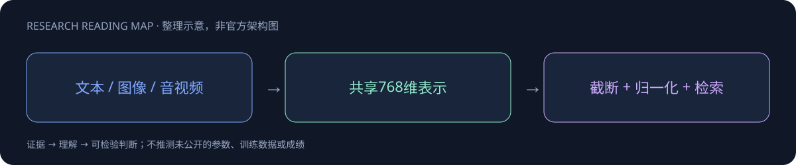

# EmbeddingGemma 2

> [!tldr]
> 740M 全模态 embedding；可裁剪为270M纯文本，支持Matryoshka向量截断。 它把文本、视觉和音频映射到同一检索空间，而不是生成答案。关闭模态encoder改变内存但保留文本能力路径；截断向量后重新L2归一化是排序正确性要求，不能只追求存储节省。

## 一页速览

| 维度 | 当前证据 |
|---|---|
| 发布时间 | 2026-10-06 |
| 类型 | 专项支线 / family · Embedding |
| 关键事实 1 | 完整740M；text-only270M |
| 关键事实 2 | 8192-token共享上下文 |
| 关键事实 3 | 768 / 512 / 256 / 128维 |
| 检查日期 | 2026-10-13；官方原始资料在同级src/ |

## 统一向量空间，不是新聊天模型

740M总参由270M文本、170M视觉和300M音频模块构成；仅加载文本270M，图文440M，文音570M。四模态映射到共享768维向量，适合检索与记忆，不能拿embedding benchmark解释生成或工具执行能力。

24层、1024滑窗、local/global5:1，512隐藏维经projection变768维，mean pooling。8192token为共享预算，混合图片/视频/音频会一起占用，而不是每种模态独享8K。

## MRL 的压缩有真实代价

| 维度 | MTEB multilingual | MMEB总体 | 音频MSEB检索 |
|---|---:|---:|---:|
| 768 | 61.36 | 59.01 | 69.54 |
| 512 | 61.17 | 58.38 | 69.18 |
| 256 | 60.41 | 56.24 | 66.76 |
| 128 | 57.89 | 45.65 | 56.71 |

128维存储约缩至六分之一，但多模态质量下降明显，不能将“最低维可用”写成“所有模态无损6倍压缩”。截断后必须再L2归一化，query/document要同维。

## 易被忽略的复现条件

使用BF16或FP32，不能用FP16：激活范围可导致NaN或静默退化。非对称检索使用query prefix与document title格式；分类/聚类为对称任务，不能机械复用检索前缀。模态模块按需加载与precision、维度一起记录，才知道小模型真正省了哪些资源。

10月6日按官方model card发布时间记录；HF9月14日仓库创建不能直接当正式首发。当前已读模型卡的架构/评测/部署，未补完整训练源码，长媒体召回仍应在用户任务上验证。

## 对 Agent Training 的启发

> [!insight]
> query/document使用匹配任务前缀与向量维度；BF16/FP32，避免FP16产生NaN。以Recall@K和下游证据命中测跨模态检索，128维须独立验收。

以上是基于已读官方资料的研究判断，不是官方保证，也没有在本机运行模型推理或复现论文成绩。下一步优先补独立验证器、固定任务/版本和完整失败轨迹，避免只保存最好样例。

## 一手资料与导航

- [S1] [HF Model Card](https://huggingface.co/google/embeddinggemma-2)
- [S2] [Model Card](https://ai.google.dev/gemma/docs/embeddinggemma/model_card_2)

原始下载文件与SHA-256见 [[src/retrieval_manifest.json|抓取记录]]。报告保留链接，不抓PDF；动态网页响应若只有壳文件，不将其标成完整离线正文。

- [[Topics/13_base_model/Base Model MOC|基模主题索引]]
- [[embeddinggemma-2_poster_zh.html|中文Poster]]

> 📊 相关可视化: [[embeddinggemma-2_poster_zh.html|EmbeddingGemma 2 中文Poster]]
