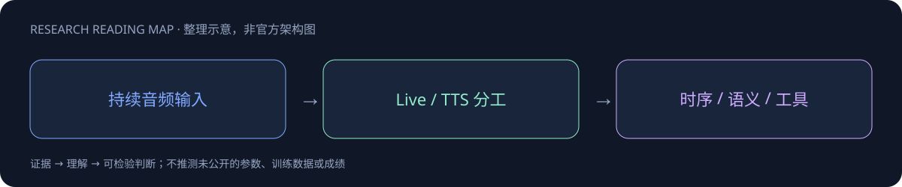

# Gemini 3.8 Audio

> [!tldr]
> Live、Extended Thinking、Flash TTS 与 Flash-Lite TTS family，基于 Gemini 3 Pro。 模型卡首次发布日与目录更新时间不同，本页采用9月15日证据。Live与TTS输入预算不同，不能用一个上下文数字概括四个成员；可选avatar还会改变输出预算。

## 一页速览

| 维度 | 当前证据 |
|---|---|
| 发布时间 | 2026-09-15 |
| 类型 | 专项支线 / family · Audio / Live |
| 关键事实 1 | Live：128K 输入；64K 输出 |
| 关键事实 2 | TTS：8K 输入；64K 音频输出 |
| 关键事实 3 | 模型卡首次发布9/15；目录更新9/24 |
| 检查日期 | 2026-10-13；官方原始资料在同级src/ |

## 首次发布与目录更新不是一个日期

模型卡首次published为9月15日；模型目录9月24日的更新不是新模型首发。因此30日表按9月15日记录，不把lastModified当发布日。

模型依赖Gemini3Pro路线，服务分别面向Live与TTS。Live连续交互的输入输出预算、音频合成的预算不一样，不应把它们揉成一个无条件上下文规格。

| 路线 | 上下文规格 |
|---|---|
| Live | 输入128K；输出64K |
| avatar相关输出 | 24K |
| TTS | 输入8K；音频输出64K |

## 实时交互与离线问答不能同测

Voice Agent需要一边听一边处理打断、轮次结束与工具反馈。离线音频问题分数无法证明会话延迟、对抢话的恢复和工具调用成功率。应分别测声学理解、语言推理、交互时序与任务状态，保留每次语音片段和工具执行的对应关系。

> [!warning] 资料与阅读限制
> 当前笔记基于官方model card，训练数据比例、参数与具体post-training未公开，公开技术细节不足以达到GLM式方法精读深度；仅模型卡中的可核对预算写入规格，不推断未公布架构。

## 对 Agent Training 的启发

> [!insight]
> 测实时对话打断、噪声与工具结果接续；TTS单列韵律、发音与控制一致性。Extended Thinking还需比较端到端响应而非仅音频首包延迟。

以上是基于已读官方资料的研究判断，不是官方保证，也没有在本机运行模型推理或复现论文成绩。下一步优先补独立验证器、固定任务/版本和完整失败轨迹，避免只保存最好样例。

## 一手资料与导航

- [S1] [Official Model Card](https://deepmind.google/models/model-cards/gemini-3-8-audio/)

原始下载文件与SHA-256见 [[src/retrieval_manifest.json|抓取记录]]。报告保留链接，不抓PDF；动态网页响应若只有壳文件，不将其标成完整离线正文。

- [[Topics/13_base_model/Base Model MOC|基模主题索引]]
- [[gemini-3_8-audio_poster_zh.html|中文Poster]]

> 📊 相关可视化: [[gemini-3_8-audio_poster_zh.html|Gemini 3.8 Audio 中文Poster]]
