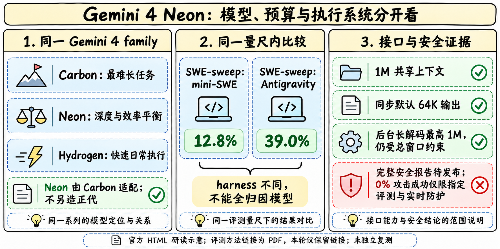

> [!tldr]
> Neon 是 Gemini 4 family 内由 Carbon 适配的平衡型模型。真正值得测的是固定工具、思考档位与任务成本之后的执行质量；不同harness、共享上下文与实时安全系统不能混成“模型单体全面领先”。

> [!warning] 首发与材料深度
> 官方博客 datePublished=2026-11-18T21:00:00Z，即北京时间11/19 05:00，作为本成员阶段事件；family首发仍10/1。已读官方博客、模型卡、接口页；评测方法URL实际为PDF，本轮只保留链接。完整安全报告称未来几天发布，当前缺失；未独立调用API或复测，不能补造架构、参数、训练配方与置信区间。

## 定位、接口与价格

> [!tldr]
> Carbon、Neon、Hydrogen共用一族；Neon并非另一个正代。1M是输入输出共享总窗口，后台最高1M输出不等于输入1M后还能额外输出1M。

Neon面向复杂代码、分析与企业工作，位于Carbon的最难长任务和Hydrogen的快速执行之间。输入支持文本、图片、音频与视频，输出为文本；工具产物不改变原生输出模态。API/App/AI Studio及企业渠道开始推广，Antigravity付费Pro/Ultra有对应入口；本轮没有核验用户账号的实际可用性。

| 接口字段 | 当前契约 |
|---|---|
| 上下文 |1M，输入与输出共享|
| 同步生成 |默认最高64K输出|
| 后台长解码 |最高1M输出，仍受共享窗口限制|
| 标准每百万tokens价格 |输入$3，缓存读$0.15，输出$15|
| 思考预算 |四档，默认high；xhigh更深，不是所有任务必然更好|

这些是接口页的标称上限与标准价，不能据此推导任务的真实端到端成本。官方称相对Carbon high成本低32%、相对部分竞品低50–80%，都是指定评测条件下的声明，不能作为任意业务节约率。

## 全部公开评测与比较条件

> [!tldr]
> 模型卡含多种量尺和harness。SWE-sweep的12.8与39.0不能只归因模型；Chartography也不是Neon最高，保留反例。

下面完整转录官方HTML评测表，空白/破折号保持未报告。数字属于各提供方自报或标明的第三方结果，尚无本轮原始run、重复种子与置信区间。

### 官方表 1

| Category | Benchmark | Notes | Gemini 4 Neon | Claude Opus 5.5 | GPT-6.2 Sol |
| --- | --- | --- | --- | --- | --- |
| Capability Indices | AA Index v5.0.1 |  | 61 | 59 | 57 |
| Vals Index v2.2 |  | 70.9% | 70.1% | 66.1% |  |
| Agentic coding | CursorBench 4.1 | Score | 65.4% | 58.1% | — |
| Terminal-bench 4.1 | Cheating adjusted accuracy | 65.2% | 65.8% | 61.5% |  |
| FrontierCode 2.0 | Main score | 46.2% | 47.3% | 43.8% |  |
| SWE-sweep | Provider harness | 39.0% | 10.1% | 8.3% |  |
| Mini-SWE harness | 12.8% | 3.6% | 11.6% |  |  |
| Knowledge work | AutomationBench |  | 56.3% | 42.5% | 41.3% |
| Agents' Last Exam v1.1 |  | 75.8% | 71.6% | 73.0% |  |
| Science and math | RiemannBench |  | 84.0% | 80.0% | 80.0% |
| Terminal-Bench-Science 0.1 |  | 70.5% | 63.3% | 68.0% |  |
| Reasoning | HLE-Diamond |  | 71.3% | 67.9% | 64.0% |
| Multimodal understanding | MKA | Climb WSR | 56.5% | 53.0% | 52.7% |
| Chartography |  | 73.5% | 66.3% | 75.1% |  |
| LVBench |  | 89.0% | 83.7% | 87.6% |  |
| Long context | GraphWalks | 256k to 1M, BFS (F1) | 95.2% | 66.8% | 80.1% |
| Cybersecurity | CWE-Bench v2 |  | 70.7% | 67.1% | 66.0% |
| SEC-bench Pro |  | 90.5% | — | 88.3% |  |
| WebExploitBench v1.2 |  | 51.3% | 37.1% | — |  |

### 官方表 2

| Evaluation | Description | Gemini 4 Neon vs. Gemini 4 Hydrogen (percentage point increase/decrease) |
| --- | --- | --- |
| Text to Text Safety (higher is better) | Automated content safety evaluation measuring adherence to safety policies across text prompts | 0.00pp |
| Multilingual Safety (higher is better) | Automated safety policy evaluation across multiple languages | -0.40pp |
| Image to Text Safety (higher is better) | Automated content safety evaluation measuring adherence to safety policies with both images and text as inputs | +1.90pp |
| Tone (higher is better) | Automated evaluation measuring objective, neutral, and non-preachy tone of model refusals | +1.25pp |
| Unjustified-refusals (lower is better) | Automated evaluation measuring over-refusals on benign or borderline prompts that can be safely fulfilled | -3.00pp |

### 官方表 3

| Risk Domain and Threshold | T/CCL Determination |
| --- | --- |
| CBRN - Uplift TCL (Chemical, Radiological & Nuclear): Provides low to medium resourced actors uplift in reference scenarios, resulting in material risk of CBRN attacks that could result in significant but not severe harm. | TCL not reached (carried forward from Argon). We continue to deploy mitigations. |
| CBRN - Uplift CCL (Biological): Provides low to medium resourced actors uplift in reference scenarios resulting in additional expected harm at a severe scale. | CCL cannot be ruled out (carried forward from Argon). We continue to deploy mitigations. |
| Cybersecurity - Uplift CCL: Provides sufficient uplift with high impact cyber attacks for additional expected harm at severe scale. | CCL cannot be ruled out (carried forward from Argon). We continue to deploy mitigations. |
| Harmful Manipulation - Uplift CCL: Possesses manipulative capabilities sufficient to enable it to systematically and substantially change beliefs and behavior in identified high stakes contexts over the course of interactions with the model, reasonably resulting in additional expected harm at severe scale. | CCL not reached (carried forward from Argon). We continue to deploy mitigations. |
| Loss of Control - Stealth and Situational Awareness TCL: The instrumental reasoning abilities of the model enable enough situational awareness (ability to discover and use relevant details of its deployment setting) and stealth (ability to circumvent basic oversight mechanisms) such that, absent additional mitigations, we cannot rule out the model significantly undermining human control. | TCL cannot be ruled out (carried forward from Argon). Baseline AI control and model security mitigations apply. |
| Loss of Control - ML R&D acceleration CCL: Has been used to accelerate AI development, resulting in AI progress substantially accelerating from historical rates. | CCL not reached (carried forward from Argon). Baseline AI control and model security mitigations apply. |
| Loss of Control - ML R&D automation CCL: Can fully automate the work of any team of researchers at Google focused on improving AI capabilities, with approximately comparable all-inclusive costs. | CCL not reached (carried forward from Argon). Baseline AI control and model security mitigations apply. |

SWE-sweep提供方harness中Neon39.0、Opus5.5 10.1、GPT6.2Sol8.3；mini-SWE条件下分别12.8、3.6、11.6。前后差异同时包含执行框架，不能报告“模型提升26.2pp”。TerminalBench4.1采用cheating-adjusted量尺；CursorBench4.1未报告GPT，不补零。AgentArena1336、4200+sessions及steerability排名是该平台条件下的表现，不能外推所有业务。

## 安全结果与未公开材料

> [!tldr]
> 攻击成功率与拒绝率依赖评测集、思考预算和实时防护。0%不等于无漏洞。

官方报告TB4 cheating=0、shortcuts=2.45%、misaligned actions=.09%、honesty=99.2%，应连同各自定义保留；TB4 refusal1.98%、TBScience refusal0也不等于所有请求都无过拒绝。underservice与overreach的改善范围来自特定档位比较，不能脱离分母或写成唯一绝对安全分。

GraySwan ASR=0只在最高思考档与实时safeguards指定组合下成立。完整Safety Report尚待发布；训练、架构及数据细节部分指向Carbon报告PDF，本轮未抓取或读取。未将Carbon的参数/训练步骤自动填到Neon。

## 对Agent训练的判断与验证设计

> [!tldr]
> 建议把模型、预算和执行器分开冻结。只换checkpoint的对照与整套系统升级的对照回答不同问题。

固定任务集、工具schema、浏览器/代码权限、上下文、思考档位、失败处理及重试次数，记录成功率、未完成原因、token与墙钟成本；至少保留Neon/Carbon/Hydrogen同harness对照。对长上下文任务分别测证据查找、跨文件状态维护与真实执行，不能用GraphWalks一项替代全部。

安全验收保留误拒绝、越权尝试、工具错误后的恢复和实时monitor开关条件；在独立隔离的良性测试中判断效果，不把厂商攻击集零分当作生产承诺。缺失方法PDF的细节仍列缺口，不据截图臆造采样参数。

## 官方来源与阅读范围

> [!tldr]
> 当前结论基于官方HTML，报告PDF仅提供访问入口。

- [官方发布博客](https://blog.google/innovation-and-ai/models-and-research/gemini-models/introducing-gemini-4-neon/)
- [官方模型卡HTML](https://deepmind.google/models/model-cards/gemini-4-neon/)
- [接口模型页](https://aistudio.google.com/docs/models)
- [评测方法PDF入口，仅链接、未读](https://deepmind.com/models/evals-methodology/gemini-4-neon)

## 关联与交付

> [!tldr]
> 一手材料、研读判断和展示分别保存；图为机制示意，原表保留原量尺。

[[Gemini-4-Argon]] · [[Gemini-4-Hydrogen]]

> 📊 相关可视化: [[gemini_4_neon_poster_zh.html]]
