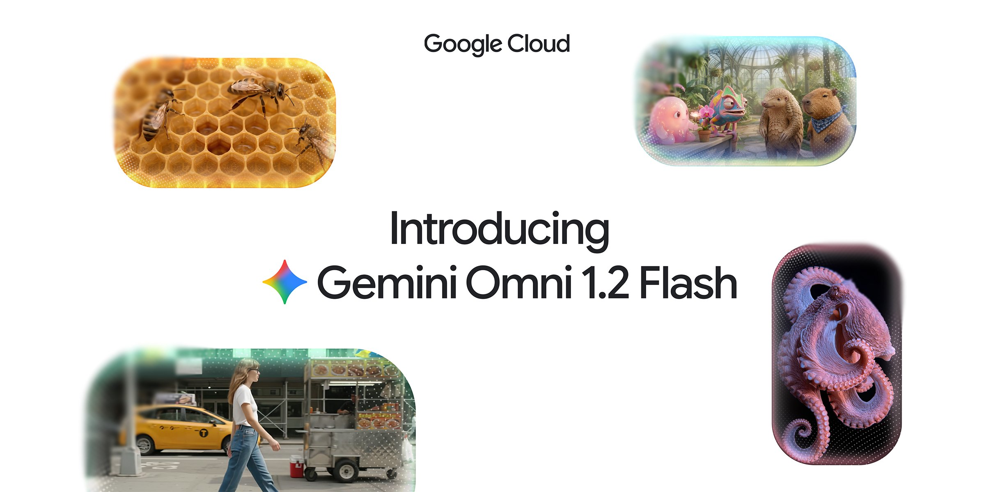
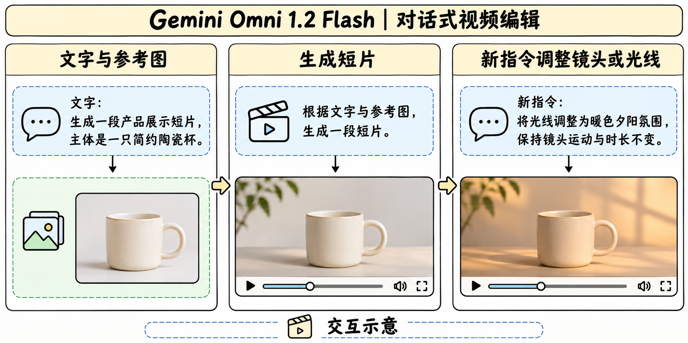

# Gemini Omni Flash 家族

## 家族版本与发布

> [!tldr]
> Omni Flash 首发于 5 月 19 日 Google I/O。1.2 Flash 在 11 月 5 日美国公告日期正式上线，Google Cloud 公告时间戳换算为北京时间 11 月 6 日。Atlas 沿用同一专项家族入口。

| 版本 | 官方证据 | 变化 |
|---|---|---|
| Omni Flash | 5 月 19 日 I/O 首发 | 从文字、图像、音频及视频输入生成带音频视频 |
| Omni 1.1 Flash | 8 月 27 日更新的家族模型卡 | 加强编辑控制与生产输出 |
| Omni 1.2 Flash | 新模型卡及独立 GA 型号 | 提升参考一致性、说话人表现与片段时长 |

## 生成、编辑与延展

> [!tldr]
> 1.2 Flash 把多类参考和编辑要求放入同一短视频工作流。已有片段可以作为下一次修改的条件。

API 文档给出的常规生成区间为 3–15 秒，首末帧条件为 3–10 秒。延展可添加 3–10 秒，接到输入视频末尾最多 30 秒的片段上。输出规格包含 360p、720p、1080p 和 4K，具体路径和功能以渠道为准。Cloud 博客把 360p/720p 用作草稿并描述后续高清化，音频参考需要 allowlist。

对话编辑可以只改光照或镜头运动并要求保留主体。这个交互可用分步验收拆开，先看首轮主体一致，再看二轮指定属性变化和非目标属性保留。跨回合重复采样有助于区分单次成功与稳定表现。

## 架构披露与安全

> [!tldr]
> 1.2 模型卡回引 Omni Flash 家族卡说明架构、训练数据和系统。家族卡披露 Transformer、原生多模态输入以及 TPU、JAX 与 Pathways。

版本级训练配方、权重、规模和可复现消融尚未公开。官方列出参考跟随、语音自然度和主体一致性改进，缺少可横向对比的 1.2 分项成绩。编辑过程中可单独检查时序一致性、复杂运动、文字渲染与音画同步。输出带 SynthID，官方还限制更改人物语音的部分功能。

## 服务指标与资料边界

> [!warning] 资料深度
> 现有材料支持版本与产品规格对比，缺少完整 1.2 训练报告与逐项实验数据，无法达到完整报告级精读。

Google Cloud 公告给出 720p 视频每秒 0.07 美元，较 1.1 Flash 低约 30%。比较生产成本时还应计入失败重试、编辑轮数和高清输出路径。将完成时长与分辨率分别固定后，再测每条合格视频的实际费用。

- [Google I/O 家族首发](https://blog.google/innovation-and-ai/sundar-pichai-io-2026/)
- [1.2 模型卡](https://deepmind.google/models/model-cards/gemini-omni-1-2-flash/)
- [家族模型卡](https://deepmind.google/models/model-cards/gemini-omni-flash/)
- [Google Cloud GA 公告](https://cloud.google.com/blog/products/ai-machine-learning/gemini-omni-1-2-flash-generally-available)
- [[gemini_omni_flash_poster_zh.html|中文 Poster]]
