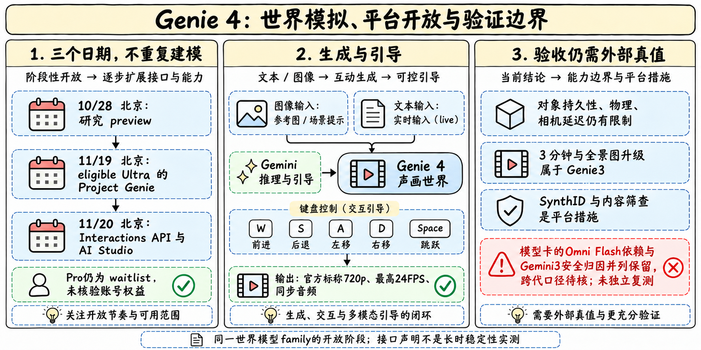
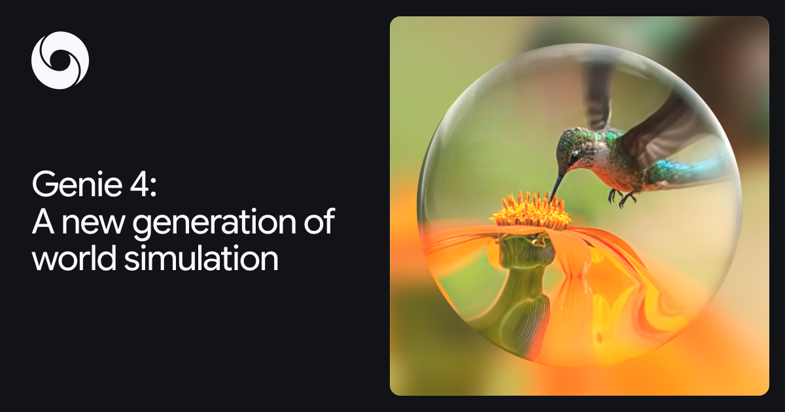

> [!tldr]
> 11/19的变化是Project Genie开始开放及新模型卡，不是世界模型family首次发布。10/28研究preview时间保留；模型、平台限制与完整技术公开深度分别记录。

## 开放日期与接口边界

> [!tldr]
> 官方博客11/18 18:00Z为北京11/19 02:00。开放计划不保证每个地区、账号和API路径已经可用。

新公告说明Genie4向eligible Google AI Ultra订阅者滚动进入Project Genie；Pro是waitlist，不能写已开放。原10/28笔记中的trusted-testers状态是当时记录，当前以本公告为准。未登录核验本账号和地区权益，不把项目网页能打开等同通用API已提供权重或无条件可调用。

模型卡首次公开日11/18只是卡的日期，不替代模型10/28首次公告。Genie属于独立世界模拟支线，不合入Gemini语言正代。

## 模型卡、安全与材料缺口

> [!tldr]
> 新卡补充模型用途和风险描述，仍缺可复现训练与长rollout原始实验；声画演示不能代替因果验证。

Genie4把连续声画生成与Gemini观察/规划/文字干预联动；平台可能提供交互限制、内容过滤、水印与访问控制，这些系统条件应随模型一起测试。卡的风险分类与厂商红队不是本轮独立复测，不推断所有场景安全。

本轮保存新官方HTML并逐段阅读公告与卡；未见公开权重、完整训练token/数据配方、loss/架构详解、原始可复现消融。原笔记有关verifier、对象持久性、状态和视觉表象分离的判断仍成立。卡明确输出720p、up to24FPS同步音频，属于官方接口声明，未独立测量；最长稳定rollout与参数仍未给出。新增博客中“每generation最多3分钟”、全景图与world chaining属于Genie3升级，不得挪到Genie4。卡称适配自Gemini Omni Flash，使用Gemini reasoning，但frontier safety一节又写Gemini3 series并以3.1Pro/3.7Flash评估推断；这一来源内部跨代归因保留为待核，不擅自修正或推导安全能力。

## 11月20日API开放文档补充

> [!tldr]
> 另一份官方公告datePublished=11/19 17:00Z，即北京11/20 01:00，说明通过Interactions API与AI Studio提供Genie4。属于同族API渠道更新，不新增模型正代。

[官方API公告](https://blog.google/innovation-and-ai/technology/developers-tools/genie-4-in-gemini-api/)给文本/参考图输入、720p24FPS同步原生音频、键盘与实时提示干预，输出带SynthID。未读取完整接口定价细节、未调用API，账号/地区、费用和实际延迟仍未验证；不能把公告“state consistent”当独立长期状态实验证明。

## 训练环境的验收与来源

> [!tldr]
> 先验收状态可验证和动作后果，再决定是否用生成世界当训练环境；可访问不等于可复现。

建议记录平台版本、账号限制、输入/动作接口、每步延迟、时长、失败/重置和视觉状态；对对象遮挡回返、长期目标、不可逆动作与奖励一致性设计外部真值检查。未独立跑测，原技术材料不足警示保留。

- [新开放公告](https://blog.google/innovation-and-ai/models-and-research/google-deepmind/genie-4-now-available-project-genie/)
- [新官方模型卡](https://deepmind.google/models/model-cards/genie-4/)
- [[Genie-4|原研究笔记]]

## 关联与交付

> [!tldr]
> 一手材料、研读判断和展示分别保存；图为机制示意，原表保留原量尺。

[[Genie-4]]

> 📊 相关可视化: [[genie4_availability_poster_zh.html]]
