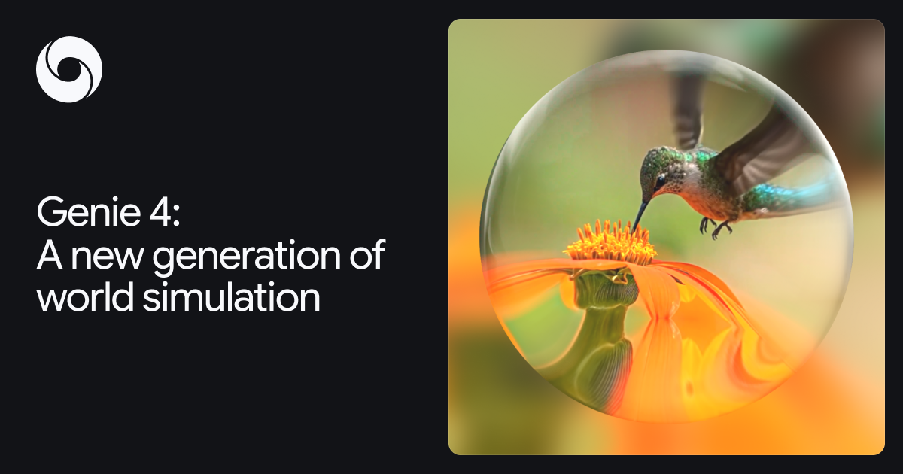
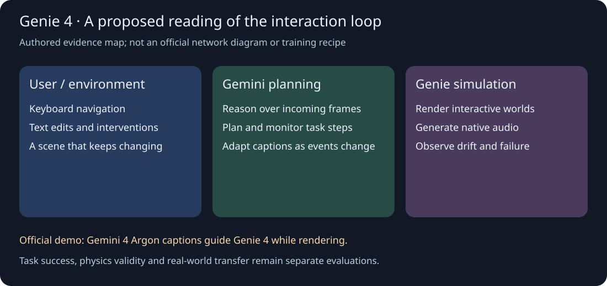

# Genie 4：Gemini 规划与原生声画世界模拟的协同

> [!tldr] 我的判断
> 这次值得关注的变化，是把持续声画生成与 Gemini 的观察、规划和文字干预连成在线循环。它为可交互训练环境提供了更强的候选生成器；环境能否可靠充当 verifier，仍需要独立的状态与因果检验。

> [!warning] 原始资料较少，达不到完整技术报告精读深度
> 已读官方发布博客与模型页，保存原始 HTML、正文和官方封面。尚未核实本版公开 HF Model Card、权重、训练技术报告、网络结构、数据配方、损失、消融或定量评测。因此本笔记与 Poster **达不到 GLM-5.3-Flash 参考笔记的训练与实验依据深度**；不会把视频演示、官网形容词或整理示意图当成实测结果。

## 首发时间与访问状态

官方博客肉眼日期为 October 27, 2026；原页 `article:published_time` 与 JSON-LD `datePublished` 一致为 `2026-10-27T16:13:00+00:00`，换算北京时间是 **2026-10-28 00:13**。Atlas 的北京时间发布表据此记 10/28，而不是抓取时间或较晚的 `dateModified`。本地目录也采用 261028。

目前是向 **trusted testers 推出的 research preview**。Google AI Ultra 的 Project Genie、Gemini API 与 AI Studio 早期伙伴属于后续开放路径，不能写成已经向所有消费者或 API 用户普遍开放；waitlist 是申请渠道，不是可立即调用的模型接口。没有依据把它并入 Gemini 通用语言模型正代，故收录 Google 的世界模型支线。

## 为什么单有好看的视频还不够

预先生成完整片段不需要应对中途改变目标；持续交互则要在相机移动、用户改天气、加入角色、角色说话时保持状态延续。画面自然、音画同步、对象永久性、任务过程正确是不同维度，不能用其中一项代表全部。

Genie 4 的发布叙事把 Gemini 家族引入这一问题：Gemini Omni 为外观与行为提供 grounding，其他 Gemini 模型参与复杂推理以帮助连贯性。官网没有给出各模块参数共享、联合训练、tokenizer、attention 或调度实现；“协同”只能描述公开的功能分工，不能推断具体网络架构。

## 公开能力与证据层级

| 维度 | 官方展示/描述 | 当前能下的结论 | 仍缺的检验 |
|---|---|---|---|
| 实时改场景 | 文字修改天气、相机、人物/对象，键盘控制浏览 | 用户可在过程里干预 | 编辑成功率、延迟分布、冲突指令处理 |
| 运动与物理感 | 碰撞、气流、自然人物动作演示 | 定性视觉真实感提高的厂商主张 | 守恒、接触、遮挡后状态、长时轨迹误差 |
| 原生音频 | 环境声、音乐与互动对白 | 声音由模型生成，非一律后配 | 声源定位、跨帧身份一致、话语与动作同步 |
| 规划协作 | Gemini 读入帧、调整计划，用 captions 引导模拟 | 有观察—计划—生成的系统闭环演示 | 无提示作弊的任务成功率与受控消融 |

不要给这些列补造 FPS、分辨率、并发、推理成本或“提升百分比”；本版公开材料没有统一数值表。原网页的大量视频与提示词是选择样例，本文保存正文与封面、链接回官方视频，没有把 fallback 占位图当成实验图。

## Gemini–Genie 闭环应怎样理解

官方博客描述：Gemini 在用户输入之间也观察当前帧，跟踪进展、验证步骤，必要时调整叙事；Genie 持续生成可感知的场景。一个机器人演示中，Gemini 4 Argon 把任务拆成步骤，实时以文字 captions 交错引导 Genie 4，模拟 Apollo 玩跳棋。

这里的“验证”是该系统内的检查动作，不意味着经过独立地面真值认证。若生成器和检查器共享同一错误世界假设，画面可以与计划一致，物理或任务终态仍然不成立。博客提出向 hybrid world models 演进：结构化推理与像素级模拟互补；这是研究方向，不能改写成已完整实现的可复现训练算法。

## 演示如何转化为可验收实验

| 测试 | 固定什么 | 测什么 | 能区分的问题 |
|---|---|---|---|
| 遮挡后返回 | 初始物体数、位置和相机轨迹 | 返回原视角的身份、数量和位置误差 | 外观逼真与对象永久性 |
| 同一中途干预 | 同一初始场景与随机种子（若可控制） | 接受编辑、保留未编辑状态、失败恢复 | 指令遵从与破坏性重生成 |
| 多步骤任务 | 外部可判定的符号状态/步骤 | 真正完成率、错误步骤、撤销后恢复 | captions 顺利与真实任务成功 |
| 声画协同 | 可追踪说话者/音源、事件时间 | 错配率与同步误差 | 自然音质与因果一致 |
| 更长交互 | 时间预算、转向次数与编辑复杂度 | 漂移随时间的曲线 | 短样例效果与持久环境可靠性 |

上述表是本文提出的评估设计，**不是官方已公布的 benchmark 或本地结果**。需要可读状态、外部裁判与失败回放；不能只用另一个视频模型打“像不像”分数。

## 官方明确的限制

模型页明确短会话仍可能出现细节漂移与对象永久性退化；多次复杂编辑、长时间运行和场景浏览会放大问题。多个独立角色之间的复杂交互尚不可靠；真实地点不能完美还原；文字清晰度有限；连续交互为数分钟量级而非长会话；实时音频准确性仍需改进。

这些限制直接影响训练环境：长期任务的 reward 可能被环境漂移污染，探索到的捷径可能是生成器漏洞，而非真实策略能力。不能从机器人的演示直接推出 sim-to-real 收益，也不能把“几分钟”当成统一保证的最大时长 SLA。

## 对 Agent Training 的启发

> [!insight] 先把环境正确性与策略正确性拆开
> 建议将世界状态、用户干预、规划文本、生成帧和外部验收记录分开存储。环境回放审查先判断对象与因果是否成立，再评策略是否完成任务。若条件允许，做相同任务的 Gemini 规划开/关对照，检查收益来自任务拆解、场景重写还是更真实的状态转移；不要让训练生成器同时垄断唯一 verifier。

持续声音可能让语音代理学到更自然的打断与交互，但转写正确、工具动作正确、世界状态正确仍是三种验收。没有公开权重/接口时，可先设计评测协议，不能声称已经跑出该系统的闭环 RL 或迁移收益。

## 来源与相邻阅读

- [📝 Tech Blog：Genie 4 发布](https://deepmind.google/blog/genie-4-a-new-generation-of-world-simulation/)；本地 `src/official_blog.html` 与 `.txt` 保留原始时间证据。
- [🌐 官方模型页](https://deepmind.google/models/genie/)：能力、访问状态、限制与责任说明。
- 官方声明生成声画附 SynthID；内部安全评估没有在本次材料中提供完整协议与数值，不能据此宣布无风险。
- 相邻本地阅读：[[Topics/13_base_model/Google_DeepMind/261001_Gemini_4_Argon/Gemini-4-Argon|Gemini 4 Argon]]。关联其规划能力与本次演示，不能将其训练方法推断为 Genie 4 的训练方案。

> 📊 相关可视化：[[genie4_poster_zh.html|Genie 4 中文Poster]]
