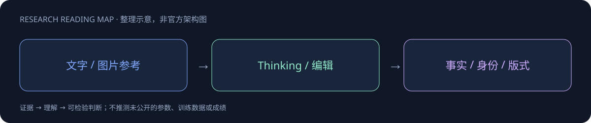

# Nano Banana 2.1

> [!tldr]
> 基于 Gemini 3.6 Flash 的图像生成/编辑模型，含 thinking 与 no-thinking 评测。 依赖基座是 Gemini 3.6 Flash，而不是仅凭2.1名称猜测为独立新架构。Thinking提升官方偏好评分和事实指标，但不同量纲的Elo与factuality不能直接求均值。

## 一页速览

| 维度 | 当前证据 |
|---|---|
| 发布时间 | 2026-10-06 |
| 类型 | 专项支线 / family · Image |
| 关键事实 1 | 1M 输入 context |
| 关键事实 2 | 图像4K token；文本64K输出 |
| 关键事实 3 | Preference：1050±14（thinking） |
| 检查日期 | 2026-10-13；官方原始资料在同级src/ |

## 生图能力来自专项路线，不是Gemini再升一个正代

模型卡10月6日发布，依赖Gemini3.6Flash，输入文字/图片支持1M，图像输出4Ktoken、文本64Ktoken。4Ktoken不是保证4K像素分辨率。卡中训练与硬件多处转引基座，不能据此虚构新的扩散结构或参数。

| 官方指标 | Thinking | No Thinking |
|---|---:|---:|
| T2I总体偏好 | 1050±14 | 1015±13 |
| 信息图设计 | 1048±17 | 1001±17 |
| 信息图事实性 | 0.521 | 0.328 |
| 通用编辑 | 1026±12 | 980±15 |
| 多人物一致性 | 1106±14 | 1068±14 |

偏好分来自并列人评Elo，事实性来自自动评判，两者不能比较大小。Thinking提高平均分不等于每次生成都事实正确。信息图若用于笔记，需要逐项检查文字、箭头与数值，不能以“可生成清楚海报”代替事实审稿。

## 官方主动列出的失败模式

小字体/长段落仍可能模糊；角色身份不总稳定；局部编辑可能留下涂鸦或错误保留姿势；左右与空间推理仍会混淆。可用多轮修图，但应检验非编辑区域、角色与多参考图对象映射，而不是只验一张最好看的样例。

> [!warning] 公开证据限制
> 已读模型卡，参数与专项训练recipe未公开，无法达到开源模型式架构精读标准。安全能力继承/转引需按模型卡原口径理解，不把基座评估等同每一种部署都独立重测。

## 对 Agent Training 的启发

> [!insight]
> 同一提示比较thinking/no-thinking并保留生成预算，检验信息图事实、小字、多轮编辑漂移；官方评测含内部集，不能替代自己的可重复任务。

以上是基于已读官方资料的研究判断，不是官方保证，也没有在本机运行模型推理或复现论文成绩。下一步优先补独立验证器、固定任务/版本和完整失败轨迹，避免只保存最好样例。

## 一手资料与导航

- [S1] [Official Model Card](https://deepmind.google/models/model-cards/nano-banana-2-1/)

原始下载文件与SHA-256见 [[src/retrieval_manifest.json|抓取记录]]。报告保留链接，不抓PDF；动态网页响应若只有壳文件，不将其标成完整离线正文。

- [[Topics/13_base_model/Base Model MOC|基模主题索引]]
- [[nano-banana-2_1_poster_zh.html|中文Poster]]

> 📊 相关可视化: [[nano-banana-2_1_poster_zh.html|Nano Banana 2.1 中文Poster]]
