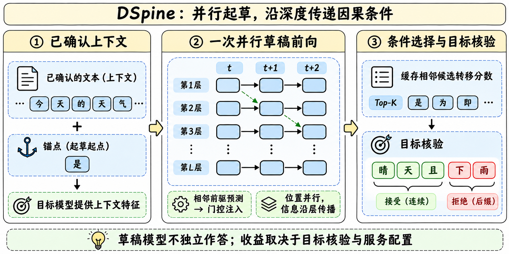
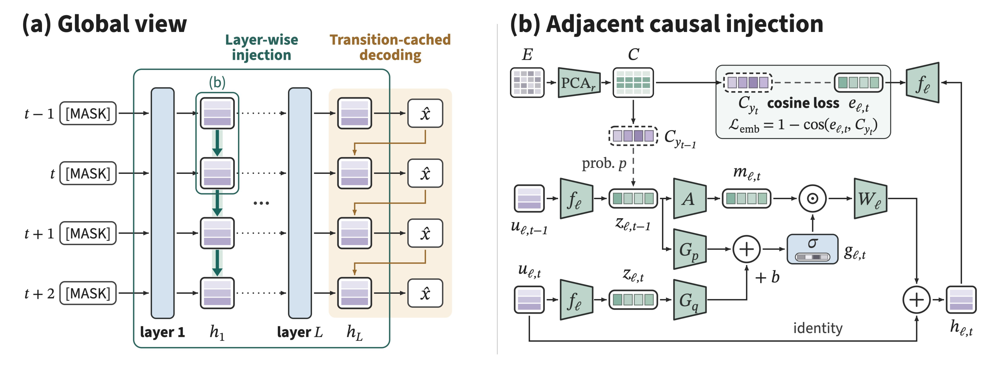
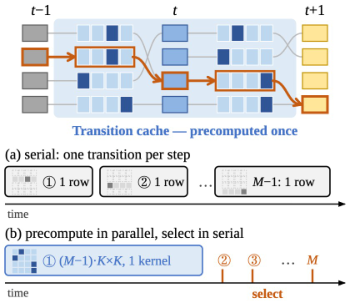

# DSpine · 用网络深度承载草稿 token 的依赖

> [!tldr] 我的判断
> DSpine 把“后一个 token 应该知道前一个在预测什么”这件事放进草稿 Transformer 的每一层。位置仍然并行更新，但前驱预测沿网络深度逐步传播；最后用候选转移缓存做条件选择，再交给目标模型核验。它是依附 Qwen 的推理加速草稿模型，不是新的 Qwen 正代，也不是能独立完成 Agent 任务的基础模型。8B 与 27B 目标适配合并在同一支线节点。

> [!warning] 来源、版本与复现边界
> 已读 arXiv v2 的正文和实现、核验、消融附录，两份 HF 原卡、官方 GitHub README、27B 配置与 SPS 调参说明；归档官方图和手绘机制图。论文的 ShareGPT 实验、8B 原卡的 Open-PerfectBlend 实验、27B 原卡的 Agent 回放实验是三套口径，下面分别记录。27B 原卡没有给出充分的硬件与训练细节，不能达到完整端到端复现标准；本次未下载权重、未运行吞吐或任务评测。没有把未读 PDF 当作已精读资料。

## 定位与发布时间

**一句话**　家族首发与这次 27B 适配分开记录，草稿的名字不能冒充目标模型参数量。

| 事件 | 可核实证据 | Atlas 处理 |
|---|---|---|
| 方法论文 | arXiv v1 提交 2026-09-28 19:44 UTC，即北京时间 9 月 29 日；v2 为 10 月 10 日 | 是论文时间，不等同于权重首发 |
| 8B 目标的草稿权重 | HF 权重上传提交为 10 月 16 日 22:55 北京时间；官方 GitHub 初始代码提交为 10 月 17 日 04:35；News 仅写 2026-10 | 家族归到 2026-10；精确首次公开日保留待核，不用仓库创建时间替代 |
| 27B 目标的草稿权重与代码支持 | HF 上传 2026-11-07 22:33 北京时间；GitHub 同日 23:57 发布支持，并链接已发布草稿权重 | 11 月 7 日同族更新，进入近 30 天表；不增加第二个家族叶子 |

`Qwen3-8B-DSpine-b16` 与 `Qwen3.8-27B-DSpine-b16` 中的 8B、27B 是**目标模型**标识。新卡明确为五层草稿模型、block size 16、8,192 token 草稿滑窗；不能据名称说草稿本身有 27B 参数。目标服务示例的 131,072 context 也不等于草稿能看完整 131K 窗口。

## 方法：为什么并行草稿容易断在前缀

**一句话**　便宜地同时预测很多位置，还需要让这些预测形成一致的前缀。

普通并行草稿在同一次前向中预测多个位置。每个位置单看都可能合理，组合起来却未必相容；目标模型按前缀接受，前面一个错误会使后续便宜生成的候选失去价值。DSpine 的干预实验发现：浅层的前几个位置已经有可读出的预测信息，而更早得到准确前驱信息，对后继更有帮助。

每一层先更新所有位置，再把当前位置预测的特征写入相邻后继。门控同时看前驱与接收者，控制残差写入的强度。消息使用这一层更新前的共同快照，因此层内并行；影响到下一层再继续向后传播。它没有把草稿计算改成逐 token 的自回归循环。

论文还把所有草稿层改为 block-causal attention。每个位置只看目标上下文和块内不晚于自己的位置，避免训练时注入正确 token 后，信息反向泄漏到更早位置。统一传递空间由目标 LM head 的输出嵌入构造：预测特征和已经确定的 token 都能进入同一条门控通路。

最后一层先得到每个位置的 top-K 候选，再用已选前驱 token 重算最后一次写入，修正后继选择。直接算会形成顺序依赖；transition cache 提前并行计算相邻候选对的分数。**候选分数计算并行，不代表选择过程不存在前驱依赖**。论文采用 K=16；目标模型仍负责最终无损核验。

## 训练与实现：论文能支持什么

**一句话**　只训练草稿，既让候选接近目标分布，也让浅层形成能传递的预测特征。

论文冻结目标模型、共享输入 embedding 与 LM head。草稿的普通输出和最后一次条件修正输出都接受蒸馏监督：token 交叉熵与概率 L1 距离混合，混合系数 0.1。逐层额外对齐正确 token 在紧凑输出嵌入空间的方向，使用 cosine 损失。作者的消融中，逐层全词表 CE 反而差于不加监督，说明“增加中间监督”不是无条件有效。

| 论文 Qwen3-8B 配置 | 记录 |
|---|---|
| 草稿结构 | 5 层、hidden size 4096；融合目标第 1/9/17/25/33 层特征 |
| 消息与候选 | transfer dimension 1024、message dimension 512、K=16；注入新增约 33M 参数，约草稿骨干的 3% |
| 数据 | ShareGPT；由目标重新生成回答，关闭 thinking |
| 预算 | 6 epochs、3,655 步；全局 batch 112，最大序列 3,072；每序列 512 anchors |
| 优化 | AdamW，无 weight decay；峰值学习率 6e-4、4% warm-up（146 步），cosine 降到零；梯度裁剪 1.0 |
| curriculum | 前三层按块替换正确前驱；前 1/6 训练概率 0.5，到 1/3 时线性降为零 |
| 层级监督 | 权重随 backbone CE 自适应，前 146 步逐步提高；位置衰减系数 7 |

这些是论文 8B 实验的设置，不能直接填到 27B 检查点的训练参数栏。官方代码包含融合投影、门控/残差 kernel 与 CUDA graph；SPS 文档要求针对 GPU、并发和任务调核验预算，不能用一个接受长度数字预测任意设备的速度。

## 结果一：论文与 8B 发布卡分别看

**一句话**　同一模型名下的数据、草稿和推理协议变了，数值也会变。

论文 v2 的七任务均值：Qwen3-8B 的 DFlash、DFlash2、DSpine 分别为 **3.77 / 4.39 / 4.82**（T=0），以及 **3.39 / 3.90 / 4.42**（T=1）。对 DFlash 的 27.8% 是接受长度的相对增幅；论文另报服务吞吐平均高 23.3%，两者不是同一个指标。对更强的 DFlash2，8B 服务吞吐平均高 11.1%。

| 8B 论文消融，T=0 | 完整 DSpine | 去最后条件修正 | 再去层内注入 |
|---|---:|---:|---:|
| MATH-500 | 5.49 | 5.11 | 4.93 |
| MBPP | 4.98 | 4.65 | 4.54 |
| MT-Bench | 4.11 | 3.82 | 3.67 |

论文服务实验在同提示、同顺序、BF16/FA3、TP=1、CUDA graph、T=0 下测整体任务 wall time，包含 prefill 与调度；每轮固定 15 个候选草稿，最多输出 2,048 token，并发 2–32。接受长度评测与服务吞吐评测又不是同一运行配置。

下面是**当前 8B 模型卡**的 Open-PerfectBlend 重训练结果，保留两种温度和完整七任务。它不覆盖上面的 ShareGPT 论文结果。

| 8B 原卡任务 | DFlash2 T=0 | DSpine T=0 | DFlash2 T=1 | DSpine T=1 |
|---|---:|---:|---:|---:|
| GSM8K | 10.06 | 10.55 | 9.07 | 9.83 |
| MATH-500 | 10.04 | 10.30 | 8.42 | 8.99 |
| HumanEval | 7.99 | 8.27 | 6.99 | 7.39 |
| MBPP | 7.33 | 7.66 | 6.43 | 6.97 |
| LiveCodeBench | 6.96 | 7.25 | 5.67 | 6.11 |
| MT-Bench | 5.40 | 5.63 | 4.90 | 5.09 |
| Arena-Hard | 5.06 | 5.13 | 4.25 | 4.49 |
| 平均 | 7.55 | 7.83 | 6.53 | 6.98 |

## 结果二：27B 原卡与 Agent 请求回放

**一句话**　观察的是相同目标模型的服务效率，不能把吞吐增幅写成任务成功率增幅。

27B 原卡运行 SGLang 0.5.22、BF16、FA3、并发 8。DSpine block=16，对照的官方 DFlash2 block=8；DSpine 还启用参考 DSpark 的动态核验与 ReplaySSM。这是当前系统组合的比较，不能把全部差额归因于相邻注入模块。

| 27B 通用任务接受长度，xhigh | DFlash2 T=0 | DSpine T=0 | DFlash2 T=1 | DSpine T=1 |
|---|---:|---:|---:|---:|
| GSM8K | 5.69 | 7.20 | 5.45 | 6.31 |
| MATH-500 | 5.49 | 6.49 | 5.27 | 5.66 |
| HumanEval | 4.87 | 5.71 | 4.34 | 4.71 |
| MBPP | 5.04 | 6.14 | 4.79 | 5.41 |
| MT-Bench | 4.11 | 4.48 | 3.89 | 4.03 |

Agent 数据每个子集 20 段对话，按顺序回放记录好的 tool-decision prefixes，打开 prefix cache；采样 temperature=1、top_p=0.95、top_k=20，最多生成 32,768 token。通用任务的上限则是 4,096。回放吞吐是输出 token 总数除并发回放 wall time，**没有证明真实工具执行、浏览等待、任务成功率或用户体验同比改善**。

| Agent 接受长度 | DFlash2 low | DSpine low | DFlash2 xhigh | DSpine xhigh |
|---|---:|---:|---:|---:|
| WorkBuddy Code | 4.19 | 5.08 | 4.06 | 4.92 |
| WorkBuddy Web | 3.95 | 4.91 | 3.95 | 5.01 |
| WorkBuddy Office | 4.24 | 5.63 | 4.20 | 5.49 |
| SWE-bench Pro | 4.19 | 4.99 | 4.00 | 4.77 |
| τ²-bench | 4.70 | 5.53 | 4.29 | 4.95 |

| 回放吞吐 tokens/s | AR low | DFlash2 low | DSpine low | AR xhigh | DFlash2 xhigh | DSpine xhigh |
|---|---:|---:|---:|---:|---:|---:|
| WorkBuddy Code | 253.35 | 590.27 | 686.23 | 193.00 | 550.40 | 613.55 |
| WorkBuddy Web | 247.40 | 639.74 | 773.19 | 252.26 | 734.04 | 840.14 |
| WorkBuddy Office | 210.03 | 664.77 | 805.53 | 215.05 | 662.34 | 763.83 |
| SWE-bench Pro | 241.86 | 657.71 | 713.41 | 248.17 | 711.60 | 791.30 |
| τ²-bench | 301.39 | 891.37 | 964.30 | 340.39 | 871.98 | 978.39 |

例如 Office low 的 805.53 / 210.03 约为 **3.84× AR**，对 DFlash2 则约为 **1.21×**。它不是“比 DFlash2 快 3.84 倍”，也不是 3.84 倍任务完成率。原卡没有完整硬件与误差条，跨设备外推和统计稳定性仍待验证。

## 部署边界与研究启发

**一句话**　固定目标、草稿、核验器和负载，再看接受长度是否真正转成服务收益。

官方 CUDA 示例使用 Python 3.11+ 与 SGLang 0.5.22；27B 为单 GPU、最多 8 请求、BF16、FA3、`DSPINE`、16 草稿槽、ReplaySSM、SSM float32 和 extra_buffer radix cache。目标 context 配成 131072，静态显存比例 0.80；这些是配置，不是已证明的硬件最低要求。使用代码前应审核自定义执行路径，本次没有安装或运行它。

同一仓库还有 MLX / SGLang-MLX 支持，不能把 CUDA 27B 吞吐表迁移成 Apple Silicon 的成绩。SPS tuning 根据预填充长度、并发和核验预算建表；默认 verify16 只是起点。

> [!insight] 对 Agent Training 的启发
> 更长的前缀接受可以降低同一个策略的推理成本，适合在固定 Agent policy 上单独评价基础设施收益。训练实验应把任务成功率、输出一致性、工具轨迹、每请求时延、吞吐和显存同时记录，并分开控制 prefix caching、采样、block size、动态核验与 ReplaySSM。不能拿加速机制的表替代 Agent 能力提升证据。

## 来源与待补事项

**一句话**　论文、代码和检查点版本都能追溯，首次公开日与完整性能复现仍留边界。

- [HF Model Card · 27B 目标草稿](https://huggingface.co/tencent/Qwen3.8-27B-DSpine-b16) · [HF Model Card · 8B 目标草稿](https://huggingface.co/tencent/Qwen3-8B-DSpine-b16)
- [Tech Report · arXiv v2 HTML](https://arxiv.org/html/2609.36173v2) · [Tech Report · PDF，仅链接](https://arxiv.org/pdf/2609.36173)
- [Project Page](https://dspine-project.github.io) · [官方 GitHub，27B 支持提交](https://github.com/Tencent/DSpine/commit/6450af726375cb3c6bac4de95d98ebc8df99fbd4)
- [27B HF 权重上传提交](https://huggingface.co/tencent/Qwen3.8-27B-DSpine-b16/commit/30de2dad4de18ddf9c66d6a5a3a39b59ea6444fb) · [8B HF 历史](https://huggingface.co/tencent/Qwen3-8B-DSpine-b16/commits/main)
- [本地原始材料清单](src/retrieval_manifest.json) · [27B 原卡](src/hf_model_card.md) · [8B 原卡](src/qwen3_8b_model_card.md)

待补：8B 精确首次公开日、27B 草稿训练配方与完整测试硬件、重复实验与真实闭环 Agent 任务结果。另见 [[Topics/13_base_model/Alibaba_Qwen/2608_Qwen3_8/Qwen3.8-Family|Qwen3.8 家族]]；这里的腾讯草稿适配不改变 Qwen 正代归属。

> 📊 相关可视化 [[dspine_poster_zh.html|DSpine 中文 Poster]]
