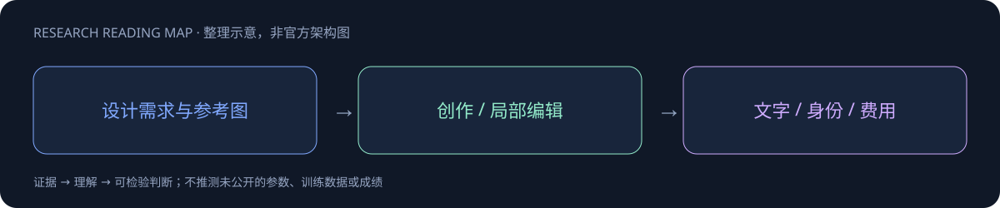

# Hy Image3.5 Preview

> [!tldr]
> 面向专业创作的高性价比图像模型，强化中英文小字、长文本和复杂版式。 专业创作模型的关键不是一张漂亮图片，而是文字内容、版式约束与修改稳定性。官方发布页本轮超时，只有首页发布索引与摘要可核实，完整架构和量化指标暂缺。

## 一页速览

| 维度 | 当前证据 |
|---|---|
| 发布时间 | 2026-09-22 |
| 类型 | 专项支线 / family · Image |
| 关键事实 1 | 最多5张参考图；多轮编辑 |
| 关键事实 2 | 最高2K输出 |
| 关键事实 3 | 中国API ¥0.15/张（发布时） |
| 检查日期 | 2026-10-13；官方原始资料在同级src/ |

## 专业视觉产物而非通用聊天正代

官方正文显示9月22日发布，优先于主页素材时间。支持文生图、图生图、最多5张参考、历史上下文多轮编辑与最高2K输出。预览版进入专项支线，不与Hy4的通用主干混为一条。

## 三类能力与三类验收

| 重点 | 官方展示 | 如何检查 |
|---|---|---|
| 文本与布局 | 中英文小字、知识卡片、信息图/UI | OCR逐字、层级、标注落点 |
| 真实感/风格 | 人物、光影、材质、摄影/印刷/游戏风 | 细节一致、物理合理、身份 |
| 编辑一致性 | 局部调整、多参考、材质/风格改变 | 非编辑区保持和对象关系 |

官方称上百名设计师GSB盲测，较上一代综合胜率提升30%以上，但没有完整样本、置信区间与分项数据。不能把它转写为任意任务绝对成功率增加30个百分点。

## Co-design 和系统效率

元宝、WorkRally、Miora、WorkBuddy、ima把真实使用反馈带入数据和迭代；这比只靠美图demo更贴近产物验收，但产品调用量增加不是模型精度指标。官方给出简化架构、高效蒸馏、文字图像分支解耦部署和注意力算子优化，未公开具体参数、蒸馏损失与消融。

发布腾讯云价：中国输入免费、2K及以下输出¥0.15/张；国际$0.024/张。多轮修图总费用取决于重试次数，不只是单图价格。

> [!warning] 技术资料限制
> 已读完整官方博客，但公开架构与训练recipe有限，因此本笔记无法达到GLM式训练/消融精读标准。动态正文完整离线原貌仍待补存；官方示例不是可复现横评。

## 对 Agent Training 的启发

> [!insight]
> 构造确定答案的双语海报与多栏信息图，以OCR逐字核验、元素位置、修改局部性和最终文件验收；未读到的训练与成本细节不补猜。

以上是基于已读官方资料的研究判断，不是官方保证，也没有在本机运行模型推理或复现论文成绩。下一步优先补独立验证器、固定任务/版本和完整失败轨迹，避免只保存最好样例。

## 一手资料与导航

- [S1] [Tech Blog](https://hunyuan.tencent.com/research/hy-image35-preview?langVersion=zh)

原始下载文件与SHA-256见 [[src/retrieval_manifest.json|抓取记录]]。报告保留链接，不抓PDF；动态网页响应若只有壳文件，不将其标成完整离线正文。

- [[Topics/13_base_model/Base Model MOC|基模主题索引]]
- [[hy-image3_5-preview_poster_zh.html|中文Poster]]

> 📊 相关可视化: [[hy-image3_5-preview_poster_zh.html|Hy Image3.5 Preview 中文Poster]]
