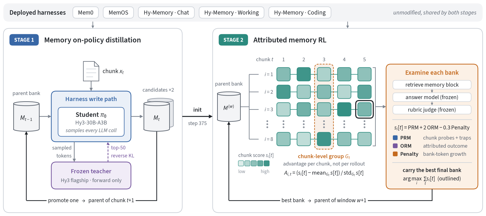
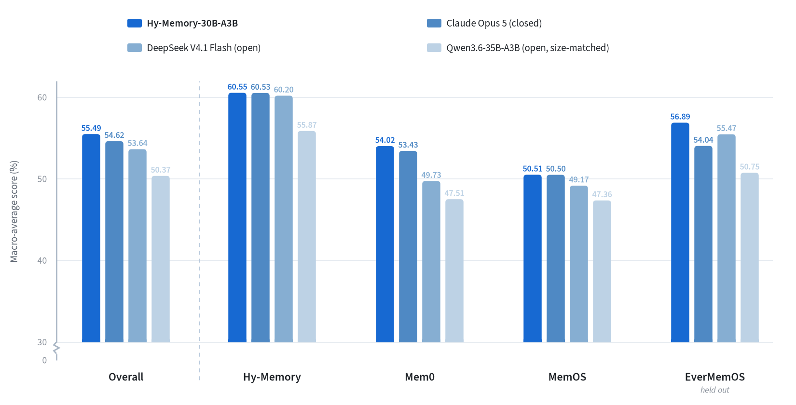
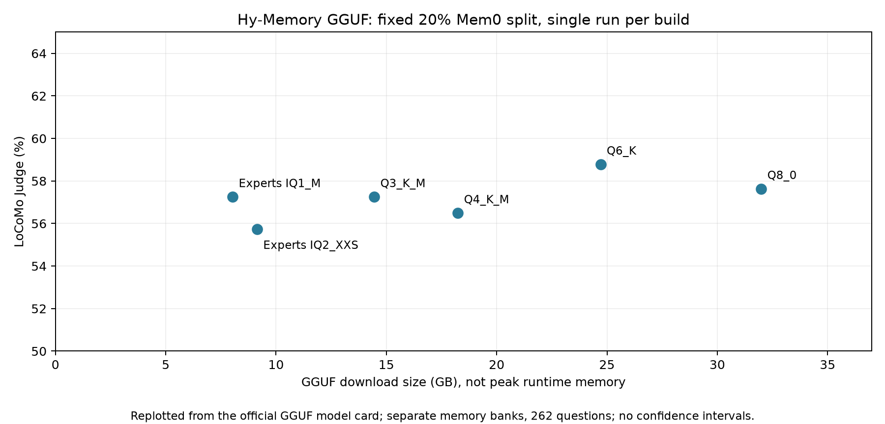

# Hy-Memory-30B-A3B：记住什么，是一个长期决策问题

> [!tldr] 我的判断
> 这不是新的混元通用正代，而是 **Hy3-30B-A3B 的记忆写入专项模型**。最值得研究的不是“3B 活跃超过 Opus5”的宣传口号，而是把抽取、更新、冲突消解当成外部状态上的策略学习：先在学生自己写出的记忆库上做 OPD，再用可归因到 chunk 的下游奖励做 RL。它给出可落地的 credit-assignment 方案，但**证据归因不等于反事实因果，宏平均第一也不等于每项领先**。

> [!info] 日期、来源与完成边界
> 官方发布页明确写“开源发布 · **2026.10.16**”，并链接模型、框架和报告。本笔记采用该正式开源日期，而不是 HF 创建时间。arXiv v1 是 10 月 15 日 16:46:47 UTC，即北京时间 10 月 16 日 00:46:47；它是报告时间，不单独充当权重首发证据。已读模型卡、完整技术报告 HTML（含方法、实验、附录）、官方主页和 GitHub README / CHANGELOG，两张官方图已本地化。**未抓 PDF、未下载权重、未运行训练或本地复测。**

> [!warning] 仍达不到的证据深度
> 这次不是“只有粗略博客”：完整报告已公开，训练目标和参数可以详细拆解。但原始资料**尚未提供关键组件受控消融、完整人工与泄漏审计、多训练 seed 和统计置信区间，附录还省略 checkpoint 标识**。因此这些方面仍达不到完整因果验收与严格复现深度；不能用模型卡的好成绩替代缺失证据，也不能编造消融收益。

## 三个同名层次，不能串错功劳

| 层次 | 实际是什么 | 本笔记如何处理 |
|---|---|---|
| Hy-Memory-30B-A3B | 约 30B 总参、约 3B 活跃的 writer checkpoint | Atlas 的专项支线节点 |
| Hy-Memory 2.0 | Chat / Working / Coding 外部记忆框架 | writer 的训练环境和可用载体，不另算模型正代 |
| MemHub | 组织多种应用历史与记忆的应用 / CLI 源码 | 不把应用支持数当模型能力，也不代用户安装或读取私人历史 |

官方主页把三层统称开源，但 GitHub CHANGELOG 明确说 **MemHub 还没有公共软件 release**，npm / GitHub Release 工件待发布。源码可见、SDK 上架、桌面应用正式发版是不同状态。`hy-memory==2.0.1` 的 10 月 16 日是 SDK 日期，不能据此把 SDK 本身算成新基模。

同样，框架页面的 MemoryArena 55.31、LoCoMo 72.6 等成绩来自另一套框架对照，Memory LLM 与 answer / judge 有具体配置；不能挪进本文 writer-only 的 55.49 宏平均表。这份报告只训练 writer，并固定下游组件。

## 为什么普通摘要和一个终局 QA 奖励都不够

外部记忆系统至少有 writer、retriever、reader 三环。writer 漏了名字、把否定写成肯定，或者只保留旧版本，后面的强 reader 不能凭空补回正确证据；但“全都存”又制造检索干扰、隐私暴露和存储成本。

把最后一个答案的成功奖励广播给所有写入也有问题：一个早期写入可能很重要，却直到后面才被问到；同一个最终错误可能来自漏存、检索或 reader。二元奖励还可能让同组 rollout 全同分，GRPO 没有任务梯度。文章于是改变监督接口：**不奖励摘要看起来有多好，而检验记忆库经过真实检索后还能支持什么答案**。

状态在外部 bank，而不是一个永不清空的模型上下文里：

$$
s_t=(M_t,x_t,h),\qquad a_t\sim\pi_\theta(\cdot\mid s_t),\qquad M_{t+1}=T_h(M_t,a_t).
$$

这里的 harness 保留原生写入控制流；一次 chunk 写入可以调用 LLM 多次。训练时必须隔离候选 bank，并让后续窗口从策略自己写出的 bank 开始，不能偷偷换成标注者生成的理想历史。

## 两阶段训练：先会操作，再比较写入的长期价值

*图 1｜官方完整训练图。每列是同一 chunk 的 rollout 组；最后选的是一整条 rollout 的最终 bank，不是逐列拼出一个从未真实执行过的“最佳 bank”。*

### OPD：教师看学生的轨迹，而不是另写一套标准答案

训练覆盖 Mem0、MemOS、Hy-Memory Chat / Working / Coding：**三个框架 family、五种场景配置**，不是五个独立框架。按时间处理交互，每个 chunk 通常约十轮且不跨 session；窗口最多五个 chunk，可以跨 session。

学生在原生 harness 内生成操作，后续提示中包含自己此前写出的 bank。冻结 Hy3 flagship teacher 只做前向，在学生 token stream 上给 top-50 分布，使用 reverse-KL 近似监督。这样同时减少 token 前缀与外部状态的训练—部署偏移。多次 LLM call 的 segment 显式保存，call 边界重置 position id，不能把独立调用硬拼成一次对话。

| OPD 参数 | 报告值 | 含义 |
|---|---|---|
| 学生 | Hy3-30B-A3B instruction checkpoint | 非从头预训练 |
| 教师 | 冻结 Hy3 flagship，top-50 log-prob | 教师不另外生成理想 bank |
| Rollout | 每 row 2 条 | 一个 row 推进一个 chunk |
| 学习率 / entropy | 常数 1e-6 / 0.005 | 不与 RL 配置混淆 |
| Prompt / response 限制 | 4096 / 126976 tokens | 分段调用累计限制，不是通用对话窗口承诺 |
| RL 初始化 | OPD step 375 | 不是任意 SFT 模型的直接 RL |

### RL：同父 bank 分叉，写完窗口再检查

每个窗口的八条 rollout 从同一 parent bank 的独立副本出发，各自执行全部 chunks。完成后才运行检索→冻结 answer model→冻结 judge 的三跳检查。answer model 只看问题与检索记忆，不见参考答案 / rubric；judge 看答案、reference 和 rubric，不看检索块。固定它们，避免将 reader 变强误归因于 writer。

这种分离能收紧实验解释，但不能消除 retriever 的所有误差：下游失败仍经过固定检索与 reader。因此应把报告结论理解为**在这些固定系统条件下，writer 写出的 bank 更有用**，不是每条写操作的因果效果已被测定。

## 奖励数据：从失败面构造，而非只抄 benchmark 问题

局部 PRM pass 看当前 chunk 原文与前两个 chunk 的已提取事实，用于指代与新颖性判断；前序事实不为当前块赚分。跨块 ORM pass 看当前窗口与更早事实，构造时间变化、共存、多跳与聚合问题。当前块是否写对，与跨块是否组合得起来，分别提供证据。

| 失败面 | 具体要检查什么 |
|---|---|
| Specificity | 名字、日期、版本、数字、路径是否保真 |
| Semantic precision | 否定、范围和事件含义是否被反转 |
| Plain recall | 明确而持久的事实是否漏存 |
| Secondary dimension | 主话题是否吞掉小而有用的细节 |
| Transition | 新状态与被替代的旧状态是否同时可追溯 |
| Should-not-store | 问候、泛泛鼓励、助手通用话术是否误入长期记忆 |
| Content, not meta | 存的是事实，还是“用户谈了一个项目”式空泛元摘要 |
| Casual detail | 随口提到、但后续有用的个人信息是否保留 |

Trap probe 的正确答案是库中没有那条不应存的内容。只做长度惩罚不够：把无用文字缩短仍然无用；trap 测语义选择性，growth penalty 测规模。反过来，也不能只奖励“少存”，否则真正有用但体积大的事实会被抹掉。

奖励工具本身经过 schema、causal locality、rubric independence、discriminability 四类检查；每题用 reference、paraphrase、partial、distractor、refusal 五种合成答案校验次序。报告仍把人审一致性、近重复 / sequence 泄漏审计留为后续，不把自动 QA 写成已完成人工验证。

| 数据规模 | 报告口径 |
|---|---:|
| RL 窗口 / chunks | 12,671 / 57,616 |
| 正 probe / traps | 164,576 / 8,599 |
| ORM 问题 | 约 60.8K |
| chunk 级 gold-fact 引用 | 222,395 |
| 每 chunk 保留上限 | 3 个正 probe + 1 个 trap |
| 消费次数 | 两个 epoch；同一序列窗口顺序不变 |

这些是不同单位，不能相加后称训练样本数或 token 数。受控标注比较中，full-history annotation 输入 token 为两块上下文的 33 倍，后者每 fact 专名更多 25%、数字更多 59%；它支持该数据构造的细节保真观察，不是所有任务通用的 33× 训练提速。

## 奖励和 GRPO：到底把功劳分给谁

每块的 PRM 是有效局部 probes 与 traps 的均分，无有效 probe 记 0。ORM 对与该块关联的问题，将恢复的 gold facts 对应 credit 平均；不能用多造题目直接增加某块权重。基础设施 answer / judge 失败移出分母，策略输出错误则保留低奖励，二者不可混淆。

报告一般式含折扣，**实际运行 gamma=0**，所以可以简写为：

$$
s_i[t]=\mathrm{PRM}_i[t]+2\mathrm{ORM}_i[t]-0.3\mathrm{Pen}_i[t].
$$

Bank 增长按 token 而非条目计量，先用每个 harness 的上下界归一化截断到 x∈[0,1]，再施加 `(exp(3x)-1)/(exp(3)-1)`。把同一条目拉长也要记账；缩库不直接额外赚奖励。关键优势归一化是：

$$
A_{i,t}=\frac{s_i[t]-\mu_t}{\sigma_t+\epsilon}.
$$

同一 chunk 位置跨八条 rollout 成组，每条 rollout 每块只投一票；该块即使有三次调用，也不是三次独立投票。有效组少于两条时 advantage 为零。但**一票公平只解决 baseline，仍没彻底解决多调用块拥有更多 loss mass**，原文也明确承认这一点。

最后以整条 rollout 的 chunk 分数之和选最终 bank，供下一窗口使用。不能每块选一个赢家后拼库，也没有跨优化步向过去动作反传梯度。继承的旧错误若各候选相同，通常会在相对基线里抵消；但“抵消”不等于历史错误已经修正。

## 工程实现：高 reward 也可能只是静默失败

RL 使用 16 节点×8 H20（128 GPU），64 windows×8 rollouts＝512 trajectories，常数学习率 5e-6，28672 prompt +4096 response，PPO-style clipped surrogate，无 KL penalty。rollout 时记录真实 token IDs、log-prob、segment 与 MoE route，训练回放路由；不能事后 retokenize 或用训练引擎重算的 log-prob 冒充采样概率。每十步保存模型、优化器、调度与选中的 banks。

最有复用价值的是原文的检查不变量：

- 记忆文件存在不代表跨窗口保存成功：重开 bank，查一个已知事实。
- teacher HTTP 成功不代表有 top-k：缺字段直接失败，并统计覆盖率，避免零梯度假训练。
- chunk→segment 映射缺失不能退化成广播奖励；多调用时更要显式检查。
- “读取所有”可能被默认分页截断：验证完整分页、条目与 token 计数。
- 平台故障应重试并从相应分母剔除；模型 malformed output 应低奖励，不能冒充环境错误逃罚。
- sandbox 请求验证 bank / trajectory identity，避免串库；这里隔离失败会污染整套归因。

## 结果：小差距保留精度，不夸成显著胜出

*图 2｜官方完整图。纵轴有断轴，不能按柱长估计提升倍数；它只选择了四个模型，下面补全七模型主表。全部是官方自报，本次没有本地复测。*

主矩阵用固定 **20% 子样本**；六项指标等权构成每框架均值，再四框架等权求宏平均。CMB 本身又由两个 repository QA 评测等权组成。不同任务分母、版本和预算不能随意混算。

| Writer | Mem0 | Hy-Memory | MemOS | EverMemOS（训练未见） | 宏平均 |
|---|---:|---:|---:|---:|---:|
| Hy-Memory-30B-A3B | 54.02 | 60.55 | 50.51 | 56.89 | 55.49 |
| Claude Opus 5 | 53.43 | 60.53 | 50.50 | 54.04 | 54.62 |
| DeepSeek V4.1 Flash | 49.73 | 60.20 | 49.17 | 55.47 | 53.64 |
| Hy3 | 45.99 | 58.06 | 50.19 | 52.30 | 51.63 |
| Qwen3.6-35B-A3B | 47.51 | 55.87 | 47.36 | 50.75 | 50.37 |
| Hy3-A3B Base | 40.20 | 50.39 | 49.05 | 50.98 | 47.66 |
| Qwen3-30B-A3B | 39.81 | 45.67 | 45.44 | 46.57 | 44.37 |

相对 Opus5 的宏平均 +0.87 分，Hy-Memory / MemOS 仅 +0.02 / +0.01，应视为这套确定性子采样评测下近似持平，而非已证明统计显著。EverMemOS +2.85（原报告文字写 +2.86；表格四舍五入相减为 2.85）更有阅读价值，但它也只是一个 held-out 框架。

反例不能藏掉：Mem0 的 LoCoMo 59.54 对 Opus5 69.47，CMB 67.13 对 70.74；EverMemOS 的 LME 76.00 对 DeepSeek 82.83，Shopping 19.05 对 Opus5 23.89。模型宏平均第一不代表每个切片最好，更不是通用聊天或代码能力超越 Opus5。

## 对 Agent Training 的启发与我会补的实验

> [!insight] 真正可迁移的是监督接口
> 固定 reader / judge / retriever，只训练改变外部状态的 writer；把最后答案拆成局部可恢复事实和跨块贡献，再按动作对应的 chunk 分组。这比把一个终局 reward 广播到整条轨迹更贴近长期任务。代价是奖励构造更复杂，也必须审计 judge、gold attribution 和跨窗口状态。

优先做四个对照：chunk-GRPO 对 window-GRPO；gold attribution 对广播 ORM；正 probe 对 probe+trap；带 growth penalty 对不带。在同一训练预算、相同 bank 起点和完整 held-out 序列上，同时测更新 / 删除 / 冲突 / 漏存、bank token、成功率与每成功任务成本。加入反事实删写测试，才能判断被归功的那条写入是否真的决定了答案。

还需冻结 gold 数据的来源与拆分、做人审和 judge 敏感性分析；测试跨用户 / workspace 隔离、记忆删除、过期与隐私，不能只看个性化成功。跨应用历史导入需要单独授权，本次没有访问用户的聊天历史或启动任何同步产品。

## 官方链接与本地材料

### 2026-10-18 巡检补充：官方 FP8 分发，不是新模型

官方 `Hy-Memory-30B-A3B-FP8` 原卡明确写它是原模型的 **FP8-quantized version**，用于高效 vLLM 部署，`base_model` 指回本 family。因此它与原 BF16 共用本笔记、Poster 和 10 月 16 日首发日期；10 月 18 日只是本次发现并归档的日期，不据仓库创建时间新增发布事件。

已读 FP8 原卡与配置：`quant_method=fp8`，activation 与 KV cache scheme 为 static；KV 使用 E4M3、per-tensor 静态量化，Q 是 E4M3、per-token-per-head 动态量化，embedding 和 lm_head 列为 ignored layers。原卡示例仍使用 vLLM v0.31.0 与 `reasoning_effort=no_think`。这些是分发配置，不是新训练算法或已验证的加速倍数。

> [!warning] FP8 独立测量缺失
> FP8 卡复用了原模型评测表，表中结果行仍标为 **Hy-Memory-30B-A3B**，没有单列 FP8 的质量、延迟、显存或量化误差对照。**因为原始资料较少，FP8 部署效果无法达到独立实测或完整量化报告级分析深度**；不能将 55.49 宏平均无条件转作 FP8 已验证成绩，也不能直接宣称质量无损。建议固定任务、bank、harness 与解码，配对比较 BF16/FP8 的写入保真、下游分数、KV/显存及每成功任务成本。

- [🤗 HF Model Card · FP8](https://huggingface.co/tencent/Hy-Memory-30B-A3B-FP8)；[[src/hf_fp8_model_card|本地原卡阅读版]]。
- 原始配置归档于 `src/hf_fp8_config.json`；不下载权重与 PDF，报告链接仍共享原 family。

- 🤗 [HF Model Card](https://huggingface.co/tencent/Hy-Memory-30B-A3B)：`src/hf_model_card.md`。
- 🌐 [Official Release · 2026-10-16](https://memory.hunyuan.tencent.com)：`src/official_website.html`；模型、框架、应用口径分开。
- 📄 [Tech Report · HTML](https://arxiv.org/html/2610.22196v1)：`src/report.html`；[PDF 链接](https://arxiv.org/pdf/2610.22196)仅保留、不下载。
- 💻 [Official Repository](https://github.com/Tencent-Hunyuan/Hy-Memory)：README 与 CHANGELOG 已归档，不把 SDK 版本日替代模型日期。
- 相关材料：[[Topics/13_base_model/Tencent_Hunyuan/260423_Hy3/Hy3-Family|Hy3 family]]；[[Topics/13_base_model/Tencent_Hunyuan/260828_Hy4_Preview/Hy4-Preview|Hy4 Preview]]。

> 📊 相关可视化：[[Topics/13_base_model/Tencent_Hunyuan/Variants/2610_Hy_Memory_30B_A3B/hy_memory_poster_zh.html|Hy-Memory 中文研究 Poster]]

## 2026-10-31资料复核：GGUF混合精度，不能与BF16/FP8表混算

> [!tldr]
> 官方GGUF卡已从三个文件扩展为六种方案，最小8.03GB文件仅把路由专家压至IQ1_M，其他主要矩阵保留Q8_0。它在固定Mem0 LoCoMo子样本上为150/262，与最强Q6_K的154/262差四题；这是具体配置下的单次自报，不能称整体1bit模型、专家裁剪或质量无损，也不是新模型正代。

| 官方分发文件 / 精度 | 下载体积GB | 正确题 / 262 | LoCoMo Judge |
|---|---:|---:|---:|
| Q6_K imatrix | 24.71 | 154 | 58.78% |
| Q8_0 | 31.99 | 151 | 57.63% |
| Q3_K_M imatrix | 14.45 | 150 | 57.25% |
| 路由专家IQ1_M，其余Q8_0，imatrix | 8.03 | 150 | 57.25% |
| Q4_K_M imatrix | 18.24 | 148 | 56.49% |
| 路由专家IQ2_XXS，其余Q8_0，imatrix | 9.14 | 146 | 55.73% |

8.03GB约为Q8_0文件的四分之一，和Q6_K分数差约1.53百分点；不同bank、单次测量无置信区间，不能把四题差距当作统计等效。更大位宽或更大文件也并非这一次就必然更高分。下载体积不包含KV缓存与运行时开销，不能标成峰值显存。

### 压缩的是哪些层

imatrix通过校准数据的激活统计控制量化误差；MoE混合精度把压缩预算集中给占参数量较大的路由专家。两个专家混合文件分别有141个路由专家tensor用IQ1_M或IQ2_XXS，338个其他矩阵tensor用Q8_0、287个小tensor保留F32。共享专家、注意力、输入embedding与输出层保留Q8_0；路由结构和专家数量没有改变。它不是整模型统一1/2bit，更不是剪掉专家。

IQ1_M与IQ2_XXS是不同IQ编码，相应tensor平均约1.75与2.0625bit/weight；I是字母，不是数字1，也不是Q1_0/Q2_0的别名。Q8_0是整数8bit量化，不是FP8；K-quants的K也不是MoE top-k。六个方案中五个使用imatrix，标准Q8_0为不带imatrix的基线。编码格式来自llama.cpp生态，原卡发布的是其上的校准与精度分配配方。

### 这个分数测了什么

评测固定Mem0 2.0.19、LoCoMo20%子集、2用户/262问题/59记忆chunk；每chunk10轮，retrieval top_k10，writer温度.7、no-think；embedding为qwen3-embedding-8b-for-online（4096维），answer/judge为gpt-5.6-sol，llama.cpp commit为5aeac37a35b44fde4bdffaec9159f2fcb253b622，F16 KV。每个精度方案在相同设置下**独立构建自己的bank**；官方称六个均完成全部写入与问答，没有遗留评测错误。

这不是上文跨框架55.49宏平均，也不是固定BF16记忆bank只更换answer模型的实验。应比较同任务/同预算下写入内容、bank状态和下游答案，而不是跨表挑最高数字。原卡命名中的Step250等历史文件名已规范化，选择文件时应按当前全名和SHA-256核验。

### 能加载不等于能写记忆

官方另报告了2026-10-21对特定社区仓库revision的四种超低比特文件检查：能加载，但8个中英文抽取/更新/删除/来源提示均未生成有效JSON；同条件Q6_K为8/8。条件为H20、上述llama.cpp revision、no-think、F16 KV、temperature0、max_tokens256、无强制JSON解码。这是基本输出检查，不是LoCoMo Judge分数，也没有把量化、转换与后端问题做因果隔离，不能推广成所有社区文件或所有低比特模型都失败。

> [!warning] 证据深度
> 本节原卡与全部表格已保存，但没有独立多seed复测、置信区间或同条件BF16/FP8配对结果，因此不能达到完整量化报告或独立实测级结论。这里明确保留资料不足；本次未下载权重或执行卡内命令。

> [!insight]
> 记忆writer的部署验收至少分两道门：先查结构化输出和写入语义不变量，再查完整bank→retrieval→answer闭环。只报告模型能加载、JSON格式合法或文件更小，无法证明记忆策略的实际质量。

来源：[🤗 HF Model Card · 官方GGUF](https://huggingface.co/tencent/Hy-Memory-30B-A3B-GGUF)；原始MD见[[src/hf_gguf_model_card|本地卡片]]。10/31是本次资料复核日，未据lastModified伪造新发布日；family仍为10/16。
