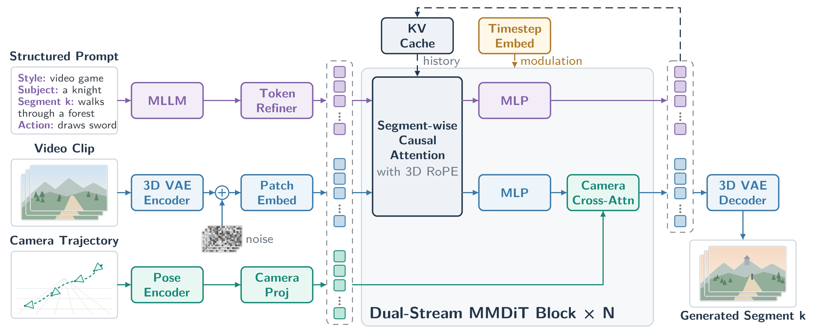
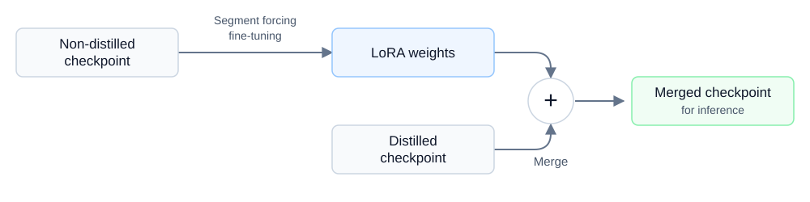

# Hy-Nomas：交互的是世界，缓存的仍是生成历史

> [!tldr] 我的判断
> Hy-Nomas 把多轮文字指令与相机轨迹接到分段自回归 DiT，每段内部做扩散，段间复用KV；它更像可持续改写的视频世界生成器，而非问答模型。研读重点是 **提示词服务、视频生成、解码、历史缓存与评测输入的边界**，不是把720p/24FPS误当实时交互性能。

> [!warning] 原始资料不足，明确未达完整技术报告精读标准
> 本轮读到官方HF模型卡、代码/配置、LoRA与标注说明、280案例benchmark卡和两张官方结构图；但官方仍标 **Technical Report (Coming Soon)**，没有可确认的独立报告正文、完整预训练数据/蒸馏配方、对照分数或时延曲线。**由于这些原始资料较少，当前无法达到完整技术报告级训练与效果审计深度。** 以下严格区分源码默认值、官方能力描述与待验证假设，不造SOTA或实时帧率。

> [!info] 首发日期待核
> 2026-10-23是本轮发现官方仓库的日期，不是已证实的模型首发日。HF createdAt/lastModified、GitHub创建时间均不作为首发；暂放10月归档线索与“日期待核实”，不伪造10月23日新发布。主干、蒸馏、INT8、两种LoRA、视频decoder与Nomas-PE都归一个专项family，不拆多个聊天正代。

## 一、推理链条：每个数字都要有所属组件

| 组件 | 作用 | 当前证据 |
|---|---|---|
| Nomas-PE | 将用户要求转成结构化生成提示 | Web demo必需的独立在线服务；离线可用预制提示 |
| Qwen文本编码器 | 将段级条件编码给DiT | 默认Qwen2.5-VL-7B-Instruct的语言组件，不等于PE |
| Segment-AR MMDiT | 每段从噪声生成视频潜变量 | 54双流block、0单流、hidden2048、16heads×128 |
| 历史KV | 让后续段读取以前生成上下文 | 默认保留全历史；单卡版选取有界GPU历史 |
| DCAE-V / PixelUMM | 潜空间表示与视频重建 | f32t4c32表示；默认用微调PixelUMM解码 |

文本hidden3584经两层refiner投影到2048。视频latent输入/输出32通道，patch1×1×1，3D RoPE分配[16,56,56]、theta256。两个stream在段级因果joint-attention交互，视频分支再用camera cross-attention读取相机条件，最后仅视频流预测flow velocity。

可用以下研读记号理解，不冒充官方新定理：

$$z_k \sim p_\theta(z_k\mid T_k,C_k,\mathrm{KV}_{<k}),\qquad V_k=D_{\mathrm{PixelUMM}}(z_k).$$

这里 \(k\) 是视频段；段内扩散步与播放帧数不同，后续段的可见上下文也取决于cache策略。

## 二、相机控制不是一句“往左看”就自动等价

原卡用 `extrinsics_attn`：归一化4×4外参按四视频帧分组，展平成64维，匹配latent时间压缩；`per_chunk_camera_attn=true`、`camera_chunk_size=1` 对齐逐latent帧。

离线相机轨迹包含 `c2ws[N,4,4]` 与 `intrinsics[N,3,3]`，要与时长、FPS对齐。默认平移gain1.0、旋转gain2.5，且有相对首帧/逐帧/位移归一化。**换gain、坐标系或归一化会改变任务，不应只看视频是否“动了”。**

动作时间戳由配置在段内归一化；`video_length=event` 从事件时间推导长度。原卡示例不是任意JSON都可兼容；`Style` 大写、subject/segments/description_change等字段有具体输入契约。

**10月24日官方原卡契约修正：** `segments` 与 `contained_actions` 的 `start_time` / `end_time` 都必须是 `MM:SS.mmm` 字符串，例如 `"00:05.000"`，不是旧示例中的数值秒。新例为0–5秒及5–10秒两段；把旧数值JSON直接传入不是有效复现。本次是输入格式/链接修正文档，不是新权重或新模型发布日期；报告仍为Coming Soon。

## 三、8步、1步、24FPS分别是什么

| 字段 | 默认值 | 不代表什么 |
|---|---|---|
| DiT `infer_steps_video` | 8 | 不是每秒8帧；需配蒸馏权重 |
| PixelUMM `num_steps` | 1 | 不是整个生成流程只用1步 |
| `video_size` | [720,1280] | 不是所有硬件都能实时720p |
| `video_fps` | 24 | **输出播放帧率，不是生成吞吐** |
| 标准 `sp_size` | 8 | 官方默认8GPU序列并行，不等于唯一可运行方式 |
| 解码窗口/重叠 | 10/5 latent帧 | 不是10秒窗口/5秒延迟 |

DCAE-V时空压缩为时间4×、空间各32×，32通道；PixelUMM是36层、hidden4096、32Q/8KV，RGB tubelet4×16×16。卡片说demo在段边界流式解码；段首等待、PE等待、去噪、CPU搬运与播放是不同计时段，本轮未实测。

## 四、单4090：减少活跃显存，不是无限免费历史

`single_gpu_low_mem_inference.yaml`继承标准配置，仅重写执行与内存策略：

- DiT权重与KV以INT8存储，但线性/注意力计算保留BF16；decoder用FP8，不能写成全链INT8算术。
- 文本编码器、DiT和decoder按阶段CPU offload。CPU内存要装模型和持续增长的历史archive；传输增加时延。
- GPU历史预算18个latent帧，`temporal_context`采样。**这不限制当前段长度，也不等于原始视频18帧。**
- DiT用FlexAttention，decoder用CUTLASS FP8，SP1；launch脚本按可见GPU数判断，官方例要求只暴露一张。
- 独立LoRA不能直接交给INT8 loader按浮点版方式加载；先核对兼容权重路径。
- Web demo仍需额外Nomas-PE资源；“视频生成单卡”不是“整个在线产品总共单卡”。

标准版`max_cache_segments=null`且不启滑窗，时间越长缓存越大；低显存版截取活跃历史会改变长程记忆条件。两者空间记忆分数若不同，先查历史策略再归因模型能力。

## 五、公开LoRA路径：先在非蒸馏版训，再合并到蒸馏版

官方仓库提供 captioning-harness：本地视频分段→语义标注→DCAE-V编码→Arrow/Parquet；涉及K3标注服务。它是可用的数据准备入口，**不是完整预训练语料已经公开**。

`sft.yaml`读到的实际字段：

| 项目 | 值 / 注意点 |
|---|---|
| 训练模式 | `segment_self_forcing`；README称segment forcing |
| 可训练权重 | 仅LoRA，rank256/alpha256/dropout0 |
| 优化器 | Muon；learning_rate1e-4、constant、2000步、grad_clip1 |
| 并行 | SP8；128GPU示例对应DP16，不是强制128GPU |
| 时间采样 | logit_normal、shift3.0；context_low_t0.1–0.3 |
| 其他 | prefix_flow_matching_loss=false；streaming_backward=true |
| 离线packing | 例max_seq_len360000、num_groups16；需匹配实际DP与训练文件行顺序 |

微调从 `DiT/base_ar` 非蒸馏权重开始，导出adapter，再合并到兼容的distilled权重推理。rank/shape与版本要匹配。**不能把公开的这份LoRA recipe说成基座预训练或8步蒸馏的全部recipe。** 本轮仅阅读源码，未启动标注、推理或训练。

## 六、280案例benchmark有输入，没有现成胜负表

| 子集 | 案例数 | 段/回合 | 平均请求时长 | 观察重点 |
|---|---:|---|---:|---|
| 多轮文字 | 60 | 2–6 | 37.88s | 指令执行、物理合理性 |
| 相机导航 | 100 | 4–20 | 27.05s | 相机动作与返回 |
| 文字/相机交替 | 60 | 2–7 | 30.59s | 条件切换；125文字段/68相机段 |
| 空间记忆 | 60 | 8 | 18.00s | 四组离开/返回，同有效相机位姿比较 |

合计280，附220条参考相机轨迹。官方卡明确：**不含视频、抽取的参考/回访帧或评测分数**。时长8–86s是请求输入范围，不是实测性能或成功生成时长。

轨迹路径相对所在JSON解析；时间范围左闭右开；Bench2/4的`w/a/s/d`与Bench3的`KeyW/KeyA/KeyS/KeyD`不是可忽略的字段差异。只读JSON也不会自动加载NPZ。官方脚本生成视频，**评分是另一步**；不能把成功写出MP4当全部benchmark通过。

## 七、对研究的启发：可用模拟器与可信动力学之间仍有距离

> [!insight] 让世界模型参与Agent训练前，先单独验证环境
> 固定Agent策略、任务种子、提示增强与动作接口，分别换全历史/有界历史、纯文本/相机控制、基础/机器人LoRA。报告动作可控性、回访一致性、失败恢复和策略最终成功；不以视频“像真的”推断动力学或奖励可直接用于现实决策。

建议最小对照：同位姿回访看静态目标是否被重绘；插入无关文本看动作是否漂移；关PE/使用固定预制prompt区分提示增强与生成模型收益；记录每段PE/去噪/解码/搬运p50、p95与显存。这里是待做实验，不是官方已报告结果。

## 来源与资料边界

- 🤗 [HF Model Card](https://huggingface.co/tencent/Hy-Nomas)，归档`src/hf_model_card.md`；[Benchmark Card](https://huggingface.co/datasets/tencent/Hy-Nomas-Bench)，归档`src/hf_benchmark_card.md`。
- 🧩 [官方代码](https://github.com/Tencent-Hunyuan/Hy-Nomas)：README中英、推理/低显存/SFT配置、demo与captioning说明已存`src/reference/`，未执行外部源码。
- 🌐 [官方项目与演示](https://hy-nomas.hy.tencent.com/)：本轮调用端抓取超时，保留缺口，不写已离线归档成功。
- 📄 Tech Report：官方仍标Coming Soon；**不把未来PDF占位按钮伪装成已发布报告链接**，本轮未抓PDF或权重。
- 许可证Apache2.0；Qwen等第三方组件各自条款仍适用。
- 关联：[[WeVisOne-VL]] 为另一种感知专项；[[Hy4-Preview]] 为聊天正代，本文不归入其新代际。

> 📊 中文海报：[[hy_nomas_poster_zh.html]] · [Thinking Overview](https://linjh1118.github.io/thinking/base-model-atlas/model.html?id=hunyuan-hy-nomas)
