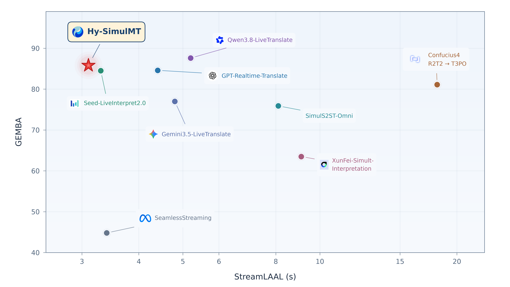
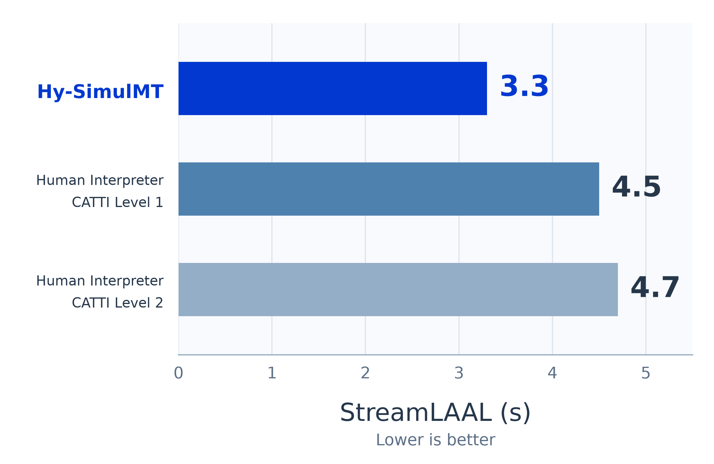

# Hy-SimulMT：译得准，也要跟得上

> [!tldr] 我的判断
> Hy-SimulMT 把同声传译的核心矛盾放在可测量的质量—延迟曲线上：连续音频输入、增量译文输出，语音朗读与声音克隆由独立 TTS 接续。它是混元的语音翻译专项 family；仅译文 / 源文与译文交替、FP8 / GGUF 共六个仓库合并收录，不算六个新正代。官方 News 明确 **2026-10-26** 发布，本轮未用仓库创建时间替代首发日。

> [!warning] 原始材料不足，尚未达到完整技术报告精读深度
> 已逐项阅读六份 HF 原卡、中文卡、GitHub README、SimulInfer / SimulTrain 说明、训练 YAML、TTS 文档与模型配置，保存官方原图。**未核实独立 Tech Report**，未获得原始预训练 / 同传对齐数据配比、策略学习目标、组件消融、完整 judge 协议与置信区间；因此达不到 GLM-5.3-Flash 那种完整训练报告级解释。这里提供可核验的模型、系统和评测解读；没有编造训练算法或本地复测成绩。

## 发布与资料地图

| 项目 | 已确认事实与边界 |
|---|---|
| 官方日期 | HF / GitHub News 明确 2026.10.26 发布（Release） |
| 能力范围 | 中英双向、连续语音输入、实时译文；系统可接 TTS 实现语音输出和实时声音克隆 |
| family | `Hy-SimulMT-30B-A3B` 与 `-Interleave`；各有原精度、FP8、GGUF，共六仓合并 |
| 开放性 | HF 可读取模型配置及权重目录；本轮对首个权重分片仅做 HEAD，HTTP 200，未下载权重 |
| 许可 | 原卡标注 Apache-2.0；使用时仍需核对所选仓库实际许可 |
| Tech Report | 本轮官方卡和已读仓库文档未找到独立报告链接，不拿别的混元报告代替 |
| 官网 | 原始响应已保存，但只有动态导航壳；不能称完整正文已离线抓取 |

官方来源：[🤗 HF Model Card](https://huggingface.co/tencent/Hy-SimulMT-30B-A3B) · [🤗 Interleave Card](https://huggingface.co/tencent/Hy-SimulMT-30B-A3B-Interleave) · [官方代码与发布说明](https://github.com/Tencent-Hunyuan/Hy-SimulMT) · [官方模型页](https://hy.tencent.com/model/open-source-model/detail?id=hy-simulmt)。

## 问题：同传不是一句话结束后再翻译

离线翻译可以看完整句子再决定语序；同传必须在未来语音未知时输出。多等一点可能减少歧义，却会让听者落后；过早输出则容易漏掉否定、条件或后置修饰。需要同时考察语义保真与时间过程，单独报一句话翻译分数不足以说明能否用于实时交流。

Hy-SimulMT 的价值在于把连续音频、增量输出、客户端节奏与语音服务串到一起。官方 RealSI 长音频图展示它在较低 StreamLAAL 下保持较高 GEMBA；这是特定协议上的质量—延迟折衷证据，不是“所有场景都最快且最准”的结论。

*官方原图。横轴 StreamLAAL 为对数刻度，越小越好；纵轴 GEMBA 越大越好。不能把视觉横向距离当等差秒数。Hy-SimulMT 约 3 秒滞后；Qwen3.8-LiveTranslate 的质量坐标更高，因此两者体现取舍，并非全面支配。*

## 模型与系统：哪里是模型，哪里是服务

### 从配置能读出的结构

`config.json` 指定 `HYV3SpeechForCausalLM` / `model_type=hy_v3`。语言骨干 48 层、hidden size 2048、32 attention heads、4 KV heads；MoE 配置有 128 个路由专家、每 token 选 8 个专家、1 个共享专家，前 1 层为 dense。**30B-A3B 是官方 family 命名**；这里没有通过粗略参数计数重新认证精确总参数 / 激活参数。

音频配置是 24 层 encoder、1024 维内部表示、128 mel bins，输出对齐 2048 维语言表示；采样率 16kHz、hop length 160、`fsk_size=2`。训练配置明确 `encoder_type=qwen3_asr`、`adapter_type=fsk`。配置能证实音频接口和模型组成，不能替代未披露的预训练过程。

语言配置虽有 `max_position_embeddings=262144`，**不能据此宣传已验证的 262K 音频会话长度**；训练示例 `cutoff_len=2048`、服务输入分块与音频窗口属于不同层级。

### 三段式运行路径

1. **音频接入**：SimulInfer 接收文件或 WebSocket PCM，可做 VAD / 抗噪处理；服务组织音频块，送模型后端。
2. **增量翻译**：选定 checkpoint 决定仅输出译文，或返回源文与译文。更换模型后要重启服务、刷新客户端；不是网页里任意切一个开关便改变同一权重的训练协议。
3. **可选语音**：译文送单独部署的 TTS。官方例子是 Qwen3-TTS-12Hz-0.6B-Base + vLLM-Omni；声音克隆读取输入音频，并以约 10 秒历史窗口保持片段衔接。**TTS 的显存、排队、首声时间应单独计算**，不能说全部由 Hy-SimulMT 单模型直接生成。

> [!note] 不把语言标签表当能力承诺
> HF frontmatter 列了许多语言标签；正文与请求参数只明确中英双向。本文按正文证据记录，不扩写成几十语种同传已验证。

## 六个仓库该怎么选

| 输出协议 | 原精度 | FP8 | GGUF | 选择依据 |
|---|---|---|---|---|
| 仅译文 | `Hy-SimulMT-30B-A3B` | `-FP8` | `-GGUF` | 面向只需要目标语言结果的场景 |
| 源文 + 译文 | `Hy-SimulMT-30B-A3B-Interleave` | `-Interleave-FP8` | `-Interleave-GGUF` | 需要源文展示、对齐和错误回放 |

六份原卡已存 `src/`，但量化格式存在不等于原生推理框架已全部支持。**10月27日卡片补充 [llama.cpp PR #31198](https://github.com/ggml-org/llama.cpp/pull/31198)：当前实现支持 `llama-mtmd-cli`，`llama-server` 支持计划后续提供，尚未合入官方仓库。** 因此 CLI 能推理不证明音频 server bridge 已可用；运行下文 server 示例前，应单独核对该版本包含所需服务支持。这里只记录部署资料修订，不据此认定权重更新或新增模型。vLLM 路径要求兼容的 `HYV3ForCausalLM` 支持以及 `simulst` 插件；配置架构名和框架注册名不同，不能机械按字符串断言不兼容。

## 评测：四个短音频数据集说明什么

下表完整保留官方九个系统、四个数据集；分数越高越好，**均为官方报告，非本地复测**。卡片没有在该表旁完整展开 judge 版本、prompt、方向汇总和方差，因此不能补写成已充分复现的统一质量基准。

| API / Model | FLEURS | CoVoST2 | ACL6060 | RealSI-Sentence |
|---|---:|---:|---:|---:|
| Qwen3.8-LiveTranslate | 88.4 | 82.1 | 80.5 | 84.4 |
| **Hy-SimulMT** | **90.3** | **75.5** | **81.2** | **84.7** |
| Gemini3.5-LiveTranslate | 92.4 | 74.4 | 82.6 | 82.2 |
| Confucius4 R2T2 → T3PO | 89.4 | 76.8 | 76.1 | 77.7 |
| Seed-LiveInterpret2.0 | 85.8 | 67.7 | 74.8 | 80.0 |
| SimulS2ST-Omni | 78.6 | 66.6 | 73.1 | 77.4 |
| GPT-Realtime-Translate | 77.7 | 50.8 | 76.4 | 76.7 |
| XunFei-Simult-Interpretation | 73.4 | 57.0 | 57.5 | 70.9 |
| SeamlessStreaming | 72.8 | 60.9 | 49.8 | 56.9 |

可直接得到的判断是：Hy 在 RealSI-Sentence 为表内最高 84.7，比 Qwen 的 84.4 高 **0.3 分**；但在 CoVoST2 低 **6.6 分**，FLEURS 与 ACL6060 也不是全表最高。原表把 Hy 整行加粗是高亮本模型，**不是宣称整行每一列第一**。小差距没有置信区间时，不应写成稳健优势。

长音频 RealSI 与四个短音频集合需要分开解释：上下文长度、输出时机与评估协议不同；不能把长音频图上的 GEMBA 坐标和短音频表格中的数字直接混成一个总排名。

## 与真人同传比较：保留样本与取最大值的口径

官方另取 **18 段** 2026 年 9 月以后上线的中英文音频，每段约 6 分钟，覆盖 10 类领域。邀请 6 位译员：CATTI 一级 3 人、二级 3 人；**每个认证级别取三人中最高分**作为比较对象，既不是所有译员均值，也不是随机人类总体。

*官方图标注 Hy 3.3s、CATTI 一级 4.5s、二级 4.7s。它与前面的 RealSI“约 3 秒”来自不同评估设置，不能合并成同一个延迟测量。原卡只作这批样本和参评者范围内的能力判断，没有证明全面替代专业同传。*

真人对照的完整质量分数、显著性、按领域 / 方向细分、语音自然度与声音相似度没有在已读材料中充分呈现。官方示例视频是挑选的离线回放，**播放时序不能当现场实时延迟测量**；本文没有下载视频或据演示补造成绩。

## 推理接口里最容易踩的三个坑

| 层级 | 官方约束 | 验收时应记录 |
|---|---|---|
| 音频节奏 | standard 每块 1600ms；short_chunk 仅后续块可 800ms，首块仍必须 1600ms | 实际时间戳、首块时长、VAD 与输入采样率 |
| 网络协议 | WebSocket 先声明 PCM 格式、采样率、声道，等 ready 再发二进制，结尾 EOF 并读到 done | 丢包 / 重连、结束尾句是否完整、背压与排队 |
| 语音输出 | TTS 可选、独立模型服务；开启克隆需配置输入参考与历史衔接 | 首字 / 首声 / 稳定译文延迟分别统计 |

SimulInfer Web/API 默认 8080、vLLM 模型服务默认 8800；llama.cpp bridge 示例是另一条 8094 Web/API → 8080 模型服务路径。区分部署方式后再解释端口，避免把不同示例拼成一套配置。

## 训练：公开的是继续 SFT 的入口

SimulTrain 以已下载的 merged checkpoint 为起点，用 LlamaFactory 集成继续训练。默认 YAML 冻结 encoder，训练语言模型与 adapter；`stage=sft`、full finetuning、ZeRO-3、BF16、gradient checkpointing、AdamW、学习率 1e-5、cosine、warmup 1000、每卡 batch 1、累积 2、1 epoch、长度 2048、无 packing。数据示例包含音频引用、源文和译文，示例音频占位不能当真实训练集。

**这些是公开适配示例，不是首发模型原始训练 recipe。** 不能由一份 SFT 配置推断预训练规模、具体“等待 / 输出”策略训练或线上模型无 RL。训练 README 仍有 “Model access is pending public release” 的旧句；本轮 HF 权重目录与分片 HEAD 已可访问，保留文档滞后这一差异，不据旧句反推模型未发布。

## 对 Agent Training 的启发

> [!insight] 把等待决策、语义损失和系统延迟拆开
> 同传是部分可观察的序列决策：未来语音未知，模型决定何时给出可用结果。若把它用于语音 Agent，应固定翻译器与 TTS 分别验收，再研究策略训练；只优化“尽快发声”可能奖励无意义抢答，只优化最终译文又可能让系统等到句末。

我的实验建议是记录输入音频时间线、源文 / 译文增量、修订、否定与数值实体、工具触发与最终状态。对真实任务先做“换翻译器 / 固定 Agent”“固定翻译器 / 换策略”的对照；在同一延迟预算下比较语义保真与任务完成，而不是把官方 GEMBA 直接当 Agent reward。Interleave 适合错误回放，但不能让真实部署拿不到的源文监督泄漏进评测。

还应覆盖噪声、口音、语速、多人切换、数字金额、句尾反转、静音与结束尾句；按方向和场景分别给均值与 p95、失败比例。StreamLAAL、首字、首声、稳定译文时间必须分列，不能用单个“3 秒”替代全部实时性。

## 相关研读与原件

- [[Topics/13_base_model/Tencent_Hunyuan/Variants/2610_Hy_Nomas/Hy-Nomas|Hy-Nomas]]：同为流式交互系统，但视频段间记忆与语音翻译滞后的定义不同。
- [[Topics/13_base_model/Tencent_Hunyuan/Variants/2610_Hy_SimulMT/src/Hy-SimulMT-30B-A3B|HF 原始模型卡]]：首发日、完整结果、家族链接。
- [[Topics/13_base_model/Tencent_Hunyuan/Variants/2610_Hy_SimulMT/src/github/SimulInfer/README|SimulInfer 原始说明]]：分块、协议与 TTS。
- [[Topics/13_base_model/Tencent_Hunyuan/Variants/2610_Hy_SimulMT/src/github/SimulTrain/README|SimulTrain 原始说明]]：继续 SFT 范围与配置。

> 📊 相关可视化：[[Topics/13_base_model/Tencent_Hunyuan/Variants/2610_Hy_SimulMT/hy_simulmt_poster_zh.html|Hy-SimulMT 中文 Poster]]
