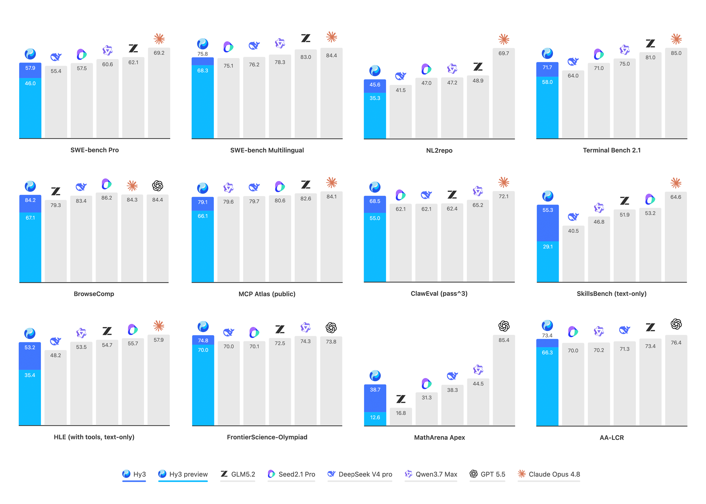
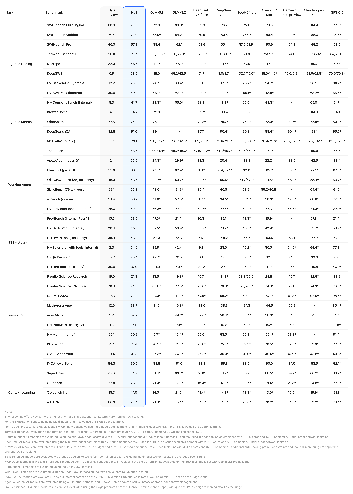

# Hy3 family：从 Preview 到正式版的产品反馈闭环

> [!tldr]
> **Hy3 最有价值的变化不是又一个更大的 MoE，而是固定 295B / 21B 量级，将真实产品反馈转成后训练的可靠性目标。** 4月23日的 Preview 与7月6日正式版合并为一个正代 family；FP8 是精度变体，不单独扩张代际。

> [!warning] 资料深度说明
> 本笔记亲自阅读并归档 Preview、正式版两份 HF 模型卡及腾讯正式发布博客。**这次取得的原始资料不足以达到 GLM-5.3-Flash / Kimi-K3 的完整训练技术报告级拆解标准**：尚未核实完整预训练配比、生产 RL 奖励、消融或数据去污染方法。下面明确区分官方事实和研究判断，不用部署教程补造训练过程。

## 时间线与 family 边界

| 阶段 | 实际日期 | 如何收录 |
|---|---|---|
| Hy3 Preview | 2026-04-23 | family 首次发布日；腾讯正式发布博客回溯确认 |
| Hy3 正式版 | 2026-07-06 | 同一 family 的重要后训练更新，笔记单列比较 |
| Hy3-FP8 | 不作为新代际 | 部署精度变体；不把仓库创建时间当模型首发 |

这个日期选择不会让7月的实质更新消失：它记录在阶段表里，但不人为制造两个没有架构差异证据的新正代。Preview 的模型许可与正式版的 Apache-2.0 也应分别核验，不能把正式版许可倒推给旧权重。

## 架构：容量、活跃计算和服务状态是三笔账

| 规格 | 正式版模型卡 |
|---|---|
| 主干总参 / 激活 | 295B / 21B |
| MTP | 额外 3.8B、1层，不包含在上述主干描述中 |
| 主干层数 / hidden | 80 / 4096 |
| 注意力 | GQA；64 Q heads、8 KV heads、head dim 128 |
| 专家 | 192，top-8 激活 |
| 上下文 / 词表 | 256K / 120832 |
| 卡中精度 | BF16；另有 FP8 仓库 |

21B active 表明单 token 不是每次遍历所有专家，但**不能据此把模型当成一张卡能装下的21B**。295B 权重、KV cache、路由通信、MTP 都会影响部署。GQA 以更少 KV heads 降低缓存负担，但这里没有官方消融证明它独立带来了多少端到端收益。

## 从 Preview 到正式版：真正公开的后训练信息

官方明确说，团队收集了50多个产品的反馈，提升后训练数据质量与多样性，并扩大 RL 训练规模。改进对象不是抽象“更聪明”，而是三类可记录的失败：

- 工具参数和输出格式不稳定、失败后恢复不当；
- 无证据仍回答、来源混淆、事实与常识错误；
- 多轮中的指代、省略和约束继承失败。

我的理解是：这是将用户错误分类转成数据/验收目标的闭环，而不是声称“接入产品”本身就会训练模型。生产后训练具体采用什么奖励模型、如何过滤反馈、是否线上策略更新，卡里没有充分公开。

卡末另提供 **verl + GRPO、Megatron-LM、vLLM rollout 的 RL 使用指南**。这证明官方支持这种开发路径，**不证明已发布 Hy3 checkpoint 就是按该示例的奖励和超参训练出来的**。

## 结果：内部可靠性改善比一句榜单排名更可解释

| 官方指标 | Preview / 基线 | Hy3 正式版 | 可支持的结论 |
|---|---:|---:|---|
| 内部幻觉率 | 12.5% | 5.4% | 该内部集下降7.1个百分点 |
| 内部常识错误率 | 25.4% | 12.7% | 该内部集下降12.7个百分点 |
| 内部多轮问题率 | 17.4% | 7.9% | 该内部集下降9.5个百分点 |
| 专家盲评平均分 /4 | GLM-5.1：2.51 | 2.67 | 270名专家的真实工作任务口径 |

不要把内部幻觉率5.4%写成任意开放世界问答的保证。数据、标注规则和置信区间没有完整披露，也不能把专家平均分与公开 benchmark 百分比混加。

模型卡还报告：在 CodeBuddy、Cline、KiloCode 等 scaffold 上，SWE-Bench Verified 准确率变化幅度在4%以内。原文并未在正文明确这4%是相对比例还是百分点，因此不擅自精确化。它值得启发跨 harness 测试，但还不是“任意框架同样稳定”的证明。

## 部署阅读：可配置推理强度不等于免费性能

卡中推荐 temperature=0.9、top_p=1.0；`reasoning_effort` 包含 no_think、low、high。vLLM 示例使用 TP8、hy_v3 工具和 reasoning parser，并启用 MTP；SGLang 示例使用 hunyuan parser 和 EAGLE/MTP相关参数。它们是**服务示例**，不是本地已复现结果。

比较 Preview / 正式版或 FP8 / BF16 时，必须同时固定 revision、parser、任务集、上下文与 effort；否则工具调用格式修复、scaffold提升和模型后训练收益会混在一起。不要直接执行远程代码或下载数百GB权重来“验证可用”。本次只保存原始卡、网页和官方图。

> [!insight] 对 Agent Training 的启发
> 最值得复用的是“错误类别 → 定向数据 → 轨迹级验证”的组织方式。可以分别记录工具格式失败、错误恢复成功、证据混淆、多轮约束丢失，再比较同一最终成功率下的工具次数与 token；不要只用一个二元终态奖励吞掉可靠性差异。以上是我的实验建议，不是官方训练配方。

## 一手来源与继续阅读

- [S1 · HF Model Card：Hy3](https://huggingface.co/tencent/Hy3)，原始MD：[[src/Hy3-model-card]]。
- [S2 · HF Model Card：Hy3 Preview](https://huggingface.co/tencent/Hy3-preview)，原始MD：[[src/Hy3-preview-model-card]]。
- [S3 · Tech Blog：2026-07-06正式发布，含4月23日回溯](https://www.tencent.com/zh-hk/tencent-hunyuan-officially-releases-hy3-advancing-agent-capabilities-and-deeper-product-integration/)，原始网页存于 `src/official-blog.html`。
- 当前未核实独立完整 Hy3 Tech Report，不编造 PDF 链接。
- 下一代对照：[[Topics/13_base_model/Tencent_Hunyuan/260828_Hy4_Preview/Hy4-Preview]]。

> 📊 中文 Poster：[[hy3-family_poster_zh.html]]
