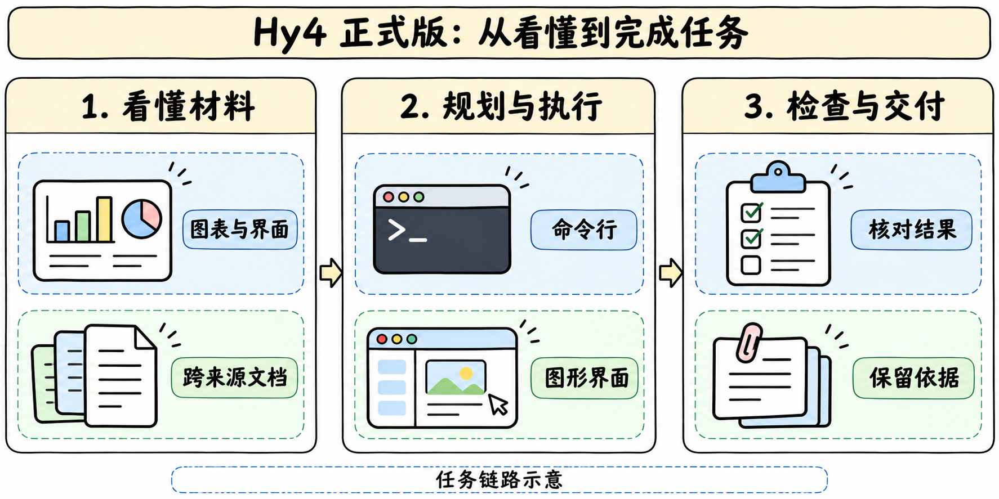
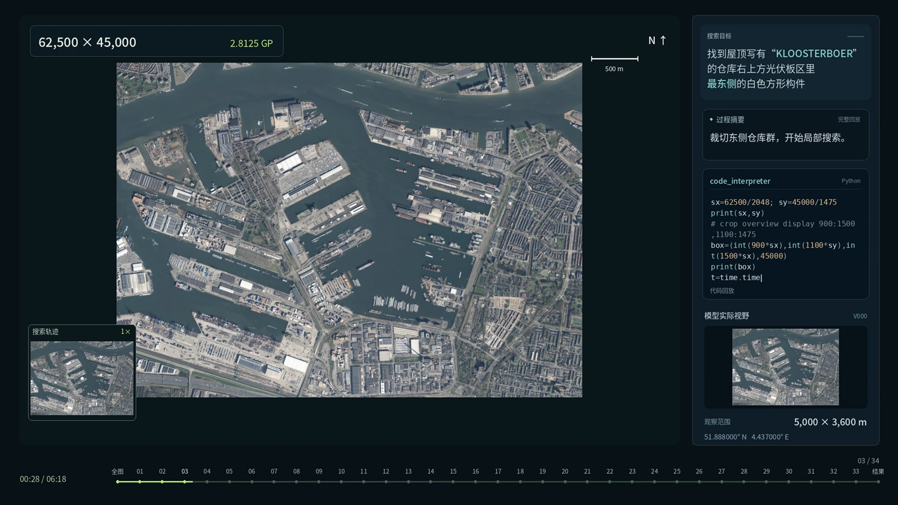
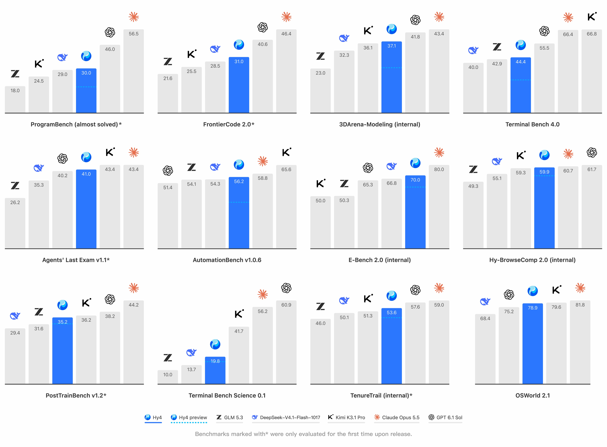

# Hy4 家族 · 正式版研读

## 两次发布

> [!tldr]
> 8 月 28 日的 Preview 公开了文本模型权重和架构。11 月 4 日的正式版首次引入视觉，官方宣布扩大预训练与后训练规模，并上线腾讯云、OpenRouter 和多款产品。正式版最值得读的是任务执行方式的变化，以及哪些增益依赖工具和产品环境。

| 维度 | Hy4 Preview · 8 月 28 日 | Hy4 正式版 · 11 月 4 日 |
|---|---|---|
| 已证实可用方式 | 官方 HF 模型卡与权重 | 腾讯云和 OpenRouter 托管；官方宣布计划公开权重及系统卡 |
| 输入与输出 | 文本到文本 | OpenRouter 正式端点列文本、图像输入和文本输出 |
| 模型架构 | 770B 主干、49B 激活、Gated DSA、IndexCache、iHC | 官方发布文只披露训练规模继续扩大，正式版参数与组件细节待公布 |
| 上下文 | 模型卡注明 1M | OpenRouter 当次端点注明 1,048,576 上下文与 65,536 最大输出 token，适用此服务端点 |
| 同族 Flash | 预览版的 FP8 是同权重精度变体 | 博客称 Hy4 Flash 计划近期发布，本次未核实已上线 |

> [!warning] 资料深度
> 正式版博客有完整场景案例和评测附表，**当前资料仍未达到 GLM-5.3-Flash / Kimi-K3 那种可拆解训练流程的深度**。正式权重、系统卡、训练配方、消融和完整复现协议待补。下文将官方报告、提供商元数据和研读推断分开。

Preview 的结构、部署与过度验证问题详见 [[Hy4-Preview]]。两个阶段共用一条 Atlas 家族记录。

## 视觉与电脑操作

> [!tldr]
> 视觉扩大了模型能接收的证据，命令行和图形界面扩大了 Agent 可执行的动作。要判断进步来自哪里，应分开测视觉理解、工具选择与最后交付。

这张手绘图整理的是应用链路。发布页没有披露正式版视觉编码器、视觉 token 化、动作接口和训练配比。

发布文的卫星图案例同时约束地标、方位和目标属性。只检测到光伏板还无法完成任务，模型需要把文字地标绑定到图中仓库，再用相对方向筛到正确构件。可以把评测拆成地标对齐、关系定位、最终区域三个可核验条件。单个演示能说明测试形态，稳健性仍需要负例和重复测量。

在桌面工作流里，官方称针对 Blender、CAD 及跨应用任务进行了专项训练。把同一任务分别限制为 CLI、GUI 和混合动作空间，才有机会分辨增益来自视觉感知还是工具可达性。前端与游戏也需要复查状态持久化、交互和导出产物。官方给出的 GameDev 19.1%、GameLogic 9.8% 是相对 Preview 的增幅，发布文未给出这两项的原始分值。

## 评测与证据口径

> [!tldr]
> 金融专家众测、内部题集和合作伙伴 Harness 回答的是不同问题。保留任务数、量表和对照组，避免把不同分数混成一个排名。

| 证据 | 官方发布页报告 | 阅读边界 |
|---|---|---|
| 金融专家众测 | 579 道真实任务，213 位专家，其中 153 位来自外部机构。Hy4 3.04/4，DeepSeek V4.1 Flash 1017 2.97/4，Kimi K3.1 Pro 与 GLM-5.3 均为 2.68/4 | 0.07 是同表均分差；缺逐题配对、评分方差及显著性 |
| 讯兔 IRAB | 合作方称在 101 道任务得 61.63，较 Preview 提高 12.03 分 | 产品 Harness 与题集固定后才可复现；正文与合作方反馈对增量使用的单位表述有差别 |
| 自建搜索测试 | 幻觉率 15.76% → 5.45%；猜测导致的错误率 23.1% → 5.6% | 分别下降 10.31 和 17.5 个百分点，指标分母和交集未披露 |
| TenureTrail | 7 个学科、123 项可执行研究任务，厂商报告在参评开放模型中排名第一 | 样本、资源限制和逐项通过率不足，不能外推到所有科研任务 |
| 王者荣耀产品流程 | 20 类配置任务中准确率 91.74% → 97.28%，加入 Agent 自校验后达 99.32%；另一个根因分析任务为 59.5% → 73.8% | 把配置、带修复的配置和根因定位分开；额外校验带来的 2.04 个百分点属于工作流 |

发布页还给出小鼠胚胎切片对齐案例：84 张无序二维切片、约 699 万细胞、部分镜像翻转，在离线条件下约 1.5 小时完成。这个案例适合追问对齐误差、翻转恢复率和对照工具配置；目前文章没有给出可独立复跑的完整协议。

## 从发布证据到研究设计

> [!tldr]
> 固定模型、任务、环境和资源预算，再分别评估终态、证据质量与动作成本。这样才能判断更深的工具轨迹是否值得。

一组可复验实验可以使用同一投研工作区与验收标准，把 Preview 和正式版分别接入同一个 Harness，先只用文本，再加入图表截图与 GUI。至少记录每轮工具调用、无效重复、最终产物验收、数字证据可追溯率和耗时。对配置修复场景可进一步拆开初次输出、一次校验和反复校验，区分提升来自一次纠错还是更多尝试。

官方称以 Hy4 和 Hyra 2.0 改进了内部小模型训练基础设施，并在部分评测得到更好的 Jev 模型。因果证据仍需要同训练预算、同验证集的隔离对照。博客同时提及 HyCell 和 HyPDE 两个专项及开源，当前尚未定位可核验的独立仓库、权重卡和实际首发日，已留待核查。

安全方面，博客给出 Hy-BioExperimentBench 30.4/100，并描述内部专家审计。该值用于理解厂商所述的特定测试；没有完整系统卡时，阈值、采样、对抗条件和迁移范围仍需追踪。

## 一手来源与阅读包

> [!tldr]
> 官方发布文锚定 11 月 4 日，原始卡锚定 8 月 Preview，OpenRouter 快照交叉核对正式服务规格。训练细节和开放权重后续独立核实。

- [Tech Blog · Hy4 正式发布](https://hunyuan.tencent.com/research/hy4?langVersion=zh)。本地保留可读正文、清理签名查询后的 DOM 快照和官方图。
- [官方服务 · 腾讯云 TokenHub](https://console.cloud.tencent.com/tokenhub/models/detail?modelId=hy4)、[提供商模型页 · OpenRouter](https://openrouter.ai/tencent/hy4)。公告所列腾讯云价格每百万 token 为缓存输入 0.3 元、普通输入 6 元、输出 18 元。
- [HF Model Card · 8 月 Preview](https://huggingface.co/tencent/Hy4-preview)。公开卡与参数仅归属 Preview。
- [Tech Blog · Hyra 2.0](https://hunyuan.tencent.com/research/hyra2)。用于理解科研工作流背景。
- 中文 Poster：[[hy4-20261104_poster_zh.html]]。
