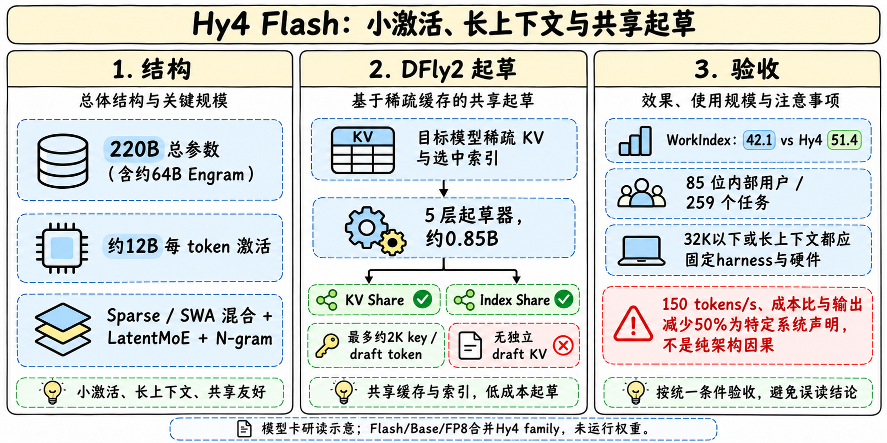
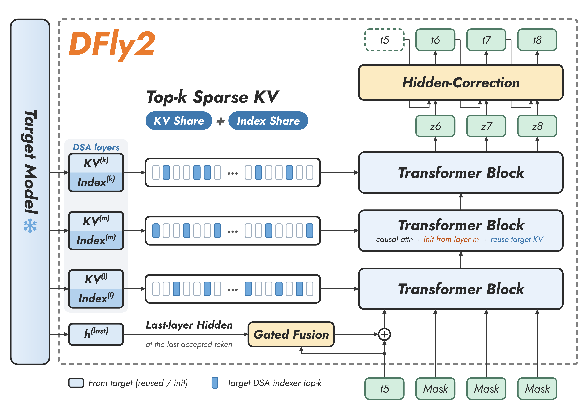
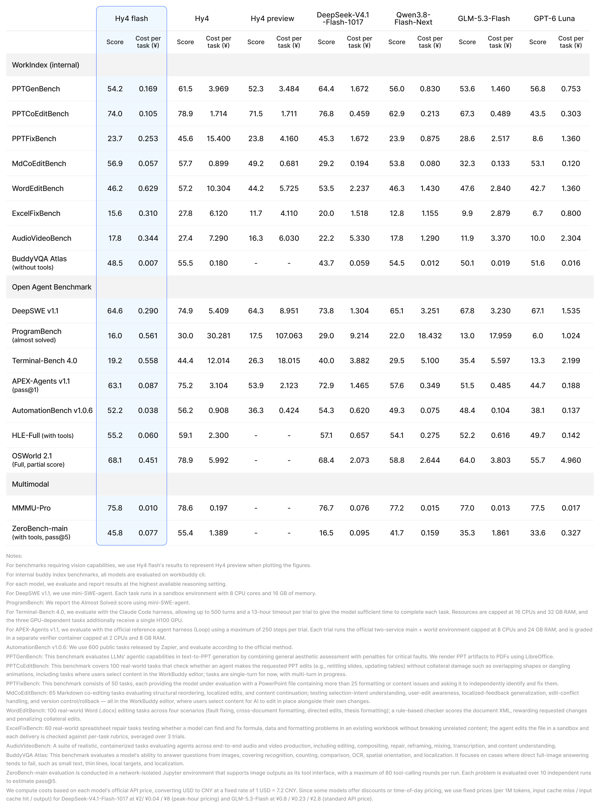
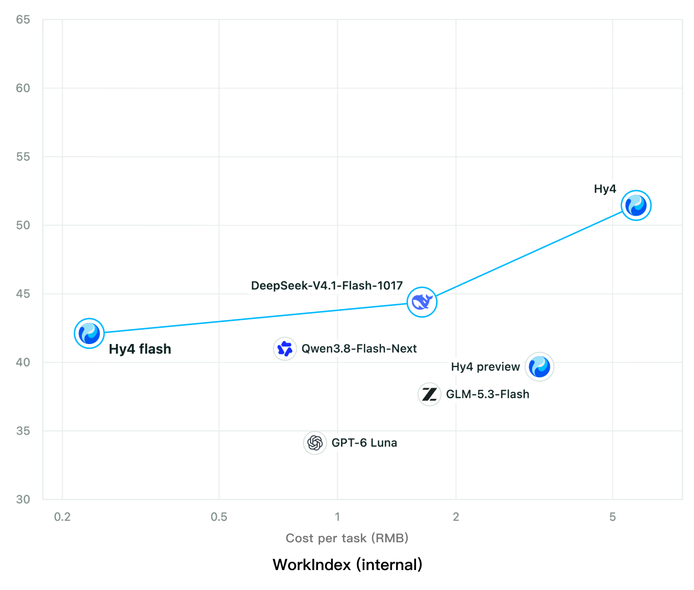
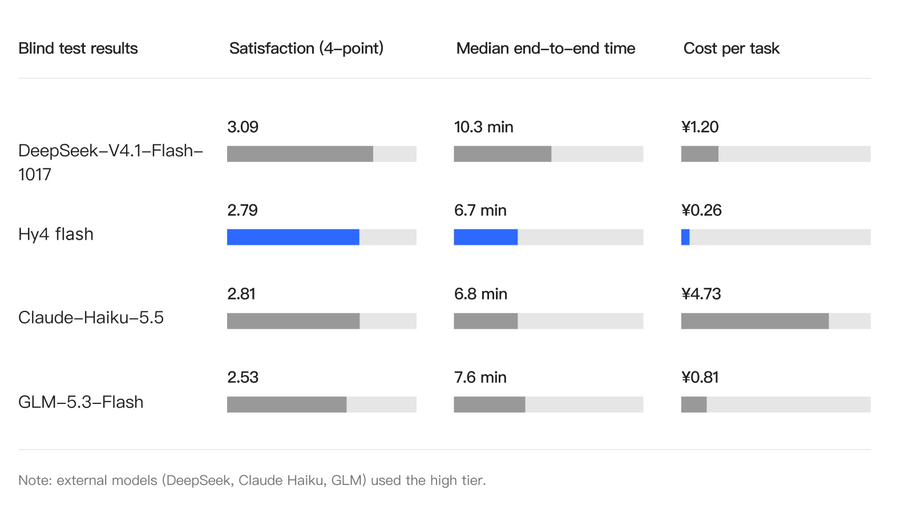

> [!tldr]
> Hy4 Flash通过稀疏/滑窗注意力、LatentMoE、N-gram记忆与共享KV起草降低执行成本。它属于Hy4 family；Base、Instruct、FP8是同族分发，不新增三个正代。

> [!warning] 日期与归因
> HF publish为11/18 03:59 UTC前后，北京11/18 11:59，记录开放权重阶段。沿用Hy4首发。已读卡、配置、DFly2/微调说明；未下载权重或复测，150 tokens/s、输出减半与成本比均是特定系统声明，不可归为单一架构因果。

## 架构、参数与激活量

> [!tldr]
> 220B总参数、约12B激活与155.5B骨干是不同统计口径。Engram、视觉和起草器要分别列明，不能相加重复计算。

模型文本/图片输入、文本输出，上下文1,048,576。骨干42层（1dense+41MoE）、hidden3072、词表120832，iHC使用4条残差流。注意力开头2层Sparse，随后10组3SWA→Sparse，总计12Sparse/30SWA；不是全网严格1:3。

| 组件 | 参数/结构口径 |
|---|---|
| 骨干，不含Engram/视觉/起草器 |155.5B|
| Engram |约63.5B；表内embedding tables约63.4B|
| 视觉 |约.43B|
| 起草器 |约.85B，5层|
| 文本每token激活 |约11.3B，视觉另约.43B；宣传口径约12B|
| 总体 |约220B，含约64B Engram，存在四舍五入|

Sparse/SWA分别32/64heads，Q低秩1024、KV低秩512，QK为192+64、V256，RoPE theta分别1e7/1e4；Sparse选最多2048keys，SWA512含当前token。LatentMoE有512路由专家top16+1共享，latent及intermediate均1536。Engram在1/11/21/31层用二元/三元N-gram，每阶8hashheads、每head约10.3M词表、每阶768维（8×96）。

视觉为调整后的SigLIP2 So400m Patch16 Res512：27层、hidden1152、MLP4304、16heads，16patch、128²位置与2×2合并。不能仅据相似架构推断图像训练分辨率分布或数据配方。

## DFly2与部署成本

> [!tldr]
> 起草器共享目标模型的稀疏缓存和选择索引；“接受更多token”和“端到端更快”仍是不同测量。

DFly2在匹配的Sparse层共享目标KV与选中的索引，每draft token最多约2Kkeys；无独立draft KV，也不参与prefill。PD分离时还需传输最后层hidden，额外系统通信不能忽略。起草器5层约.85B，是否获益依赖batch、并发、上下文、接受率和kernel。

官方称自蒸馏后RL将输出tokens减少50%、KV为Hy3的1/24和Hy4的1/6、megakernel+4bit+DFly2超过150tokens/s。这些是组合条件，缺少足够公开硬件/采样/重复实验账本，不应画成可移植加速曲线。依赖临时框架PR与官方8GPU示例未执行。

## 原始评测、内部指标与反例

> [!tldr]
> WorkIndex42.1高于Preview39.7，但低于Hy4的51.4。更便宜不等于质量全面提升；内部盲评也需保留样本量与量尺。

WorkIndex为8个内部集合；成本称为Preview的1/13、Hy4的1/20、DeepSeekFlash1017 Max峰时的1/8，任务与价格时间必须一并固定。85位内部用户、259任务、27类别的盲评给2.79/4，Haiku5.5为2.81/4；中位6.7min、RMB.26/任务，不含公开误差条或所有任务分布。

Base的完整表与原卡保存在src。ARC使用299子集、HellaSwag3000、INCLUDE5000 Lite44语言、Belebele4475五语言（de/ko/vi/es/ru），†为宏平均；不同子集不应与完整榜直接横比。midtrain含合成指令数据，可能影响few-shot格式遵循；低分未必只反映知识缺失。

| Property | Value |
| --- | --- |
| **Overview** | |
| Architecture | Mixture-of-Experts (MoE) |
| Total Parameters (excluding Engram, ViT, and DFly2) | 155.5B |
| Engram Parameters | 63.5B |
| ViT Parameters | 0.43B |
| DFly2 Parameters | 0.85B |
| Activated Parameters per Token | Text 11.3B + Vision 0.43B |
| Context Length | 1M (1,048,576 tokens) |
| **Language Backbone** | |
| Backbone Layers | 42 — 1 dense layer and 41 MoE layers |
| Hidden Size | 3,072 |
| Vocabulary Size | 120,832 |
| Residual Connections | iHC (identity Hyper-Connections) with 4 residual streams |
| **Attention — Hybrid Layout** | |
| Attention Architecture | Sparse attention + sliding-window attention (SWA) |
| Backbone Layer Pattern | 2 × Sparse → 10 × (3 × SWA → Sparse) |
| Attention Formulation | Multi-head Latent Attention (MLA) |
| Multimodal Position Encoding | Interleaved MRoPE |
| **Attention — Layers** | **Sparse / SWA** |
| Backbone Layers | 12 / 30 |
| Attention Heads | 32 / 64 |
| MLA q_lora_rank | 1,024 / 1,024 |
| MLA kv_lora_rank | 512 / 512 |
| QK Head Dimension (non-RoPE + RoPE) | 192 + 64 / 192 + 64 |
| Value Head Dimension | 256 / 256 |
| RoPE Base | 10,000,000 / 10,000 |
| Sparse Context Selection | Up to 2,048 tokens via group-level selection |
| SWA Context Window | 512-token causal window (511 preceding + current) |
| **Feed-Forward Networks** | |
| Dense FFN Intermediate Size | 13,824 |
| Routed Experts per MoE Layer | 512 |
| Shared Experts per MoE Layer | 1 |
| Activated Routed Experts per Token | 16 |
| MoE Latent Dimension | 1,536 |
| Expert Intermediate Size | 1,536 |
| **N-gram Embedding** | |
| N-gram Orders | Bigrams and trigrams |
| Backbone Layer Indices (starting from 0) | 1, 11, 21, 31 |
| Hash Heads per N-gram Order | 8 |
| Hash Vocabulary Size per Head | 10.3M |
| Embedding Dimension per N-gram Order | 768 (8 heads × 96 dimensions) |
| Embedding Table Parameters | 63.4B |
| **Vision Encoder** | |
| Vision Encoder Layers | 27 |
| Vision Encoder Hidden Size | 1,152 |
| Vision Encoder Intermediate Size | 4,304 |
| Vision Encoder Attention Heads | 16 |
| Vision Patch Size | 16 × 16 |
| Vision Position Embedding Size | 128 × 128 |
| Visual Feature Merging | 2 x 2 |

| Category | Benchmark | #Shots | Hy4 flash Base | Hy4 Base | Hy3 preview Base | DeepSeek-V4-flash-Base | DeepSeek-V4-Pro-Base |
| --- | --- | :---: | ---: | ---: | ---: | ---: | ---: |
| **Knowledge** | MMLU† | 5 | 88.7 | **91.6** | 87.5 | 89.7 | 91.1 |
|  | MMLU-Pro† | 5 | 71.1 | **73.9** | 65.8 | 68.6 | 73.4 |
|  | MMLU-Redux† | 5 | 87.6 | **90.6** | 87.0 | 88.8 | 90.2 |
|  | SuperGPQA† | 5 | 57.8 | **62.7** | 52.3 | 52.5 | 54.8 |
|  | C-Eval† | 5 | 92.0 | **95.0** | 90.1 | 91.9 | 93.4 |
|  | CMMLU† | 5 | 91.6 | **93.1** | 89.6 | 89.8 | 90.7 |
|  | SimpleQA | 5 | 37.5 | **57.2** | 26.4 | 31.3 | 52.1 |
|  | Chinese-SimpleQA† | 5 | 74.6 | **83.9** | 69.6 | 71.9 | 76.6 |
|  | AGIEval (English)† | 3 | 75.4 | **79.3** | 76.0 | 76.3 | 78.2 |
|  | AGIEval (Chinese)† | 3 | 90.6 | **91.2** | 87.8 | 88.5 | 89.8 |
| **Reasoning** | HellaSwag (3,000-item subset) | 10 | 85.2 | **87.1** | 85.7 | 85.1 | 86.8 |
|  | PIQA | 4 | 84.4 | **85.3** | 84.6 | 83.8 | 84.9 |
|  | ARC-Challenge | 0 | 95.0 | **97.3** | 96.0 | **97.3** | 97.0 |
|  | Social IQa | 0 | 80.1 | **82.7** | 80.5 | 72.5 | 73.1 |
|  | KOR-Bench | 3 | 54.7 | **57.6** | 54.6 | 53.4 | 55.4 |
|  | C³ | 0 | 77.3 | **82.4** | 75.9 | 74.1 | 78.3 |
| **Math** | U-MATH | 5 | 69.8 | **71.6** | 60.9 | 57.4 | 64.8 |
|  | OCW Courses | 5 | 64.0 | 66.7 | 62.6 | 63.3 | **68.2** |
| **Code** | MBPP-plus | 3 | 73.7 | 74.0 | 77.4 | 76.8 | **79.1** |
| **Multilingual** | Belebele (5-language subset)† | 5 | 93.8 | 95.0 | 94.2 | 94.4 | **95.2** |
|  | INCLUDE† | 5 | 82.8 | **88.1** | 84.3 | 84.0 | 84.3 |
| **Multimodal** | MMMU-Pro (Standard, 10 opts) | 4 | 52.0 | **59.6** | — | — | — |
|  | SimpleVQA | 4 | 48.5 | **54.5** | — | — | — |
|  | CVBench | 4 | 83.4 | **86.7** | — | — | — |
|  | RealWorldQA | 4 | 71.1 | **72.3** | — | — | — |
|  | TextVQA | 4 | 73.4 | **78.2** | — | — | — |
|  | CountBenchQA | 4 | 86.6 | **90.6** | — | — | — |

| Model Name | Description | Hugging Face | ModelScope | GitCode |
|:---|:---|:---:|:---:|:---:|
| Hy4 flash | Instruct model | [Model](https://huggingface.co/tencent/Hy4-flash) | [Model](https://modelscope.cn/models/Tencent-Hunyuan/Hy4-flash) | [Model](https://ai.gitcode.com/tencent_hunyuan/Hy4-flash) |
| Hy4 flash-FP8 | FP8 quantized instruct model | [Model](https://huggingface.co/tencent/Hy4-flash-FP8) | [Model](https://modelscope.cn/models/Tencent-Hunyuan/Hy4-flash-FP8) | [Model](https://ai.gitcode.com/tencent_hunyuan/Hy4-flash-FP8) |
| Hy4 flash-base | Pre-trained base model | [Model](https://huggingface.co/tencent/Hy4-flash-base) | [Model](https://modelscope.cn/models/Tencent-Hunyuan/Hy4-flash-base) | [Model](https://ai.gitcode.com/tencent_hunyuan/Hy4-flash-base) |

## 训练线索、使用边界与研究启发

> [!tldr]
> 当前材料足以拆解工程机制，仍不足以复建完整预训练与后训练。可转化实验应区分缓存、起草和短输出策略。

卡给自蒸馏、RL与微调样例，但没有完整预训练token/去重、实际训练账本、各设计独立消融与公开内部任务。Instruct默认high，可no_think，示例temp.9、top_p1；Base不应直接按聊天策略评估。许可为Tencent Hy专用条款，不可写Apache。

建议固定目标模型与质量门槛，分别关闭DFly2、替换缓存、固定输出预算，再对短/长任务、首token/稳态吞吐与总成本测量。检查Engram是否帮助工具模板/长尾标识符，需有泄漏与复用控制；不能从机制名称自动宣称长期记忆。

## 官方来源

> [!tldr]
> 原卡、中文卡、Base/FP8、配置、微调说明与七幅官方图离线保存；本轮未运行。

- [HF Instruct](https://huggingface.co/tencent/Hy4-flash)
- [HF Base](https://huggingface.co/tencent/Hy4-flash-base)
- [FP8分发](https://huggingface.co/tencent/Hy4-flash-FP8)
- [官方源码](https://github.com/Tencent-Hy/Hy4-Flash)

## 关联与交付

> [!tldr]
> 一手材料、研读判断和展示分别保存；图为机制示意，原表保留原量尺。

[[Hy4-Family]]

> 📊 相关可视化: [[hy4_flash_poster_zh.html]]
